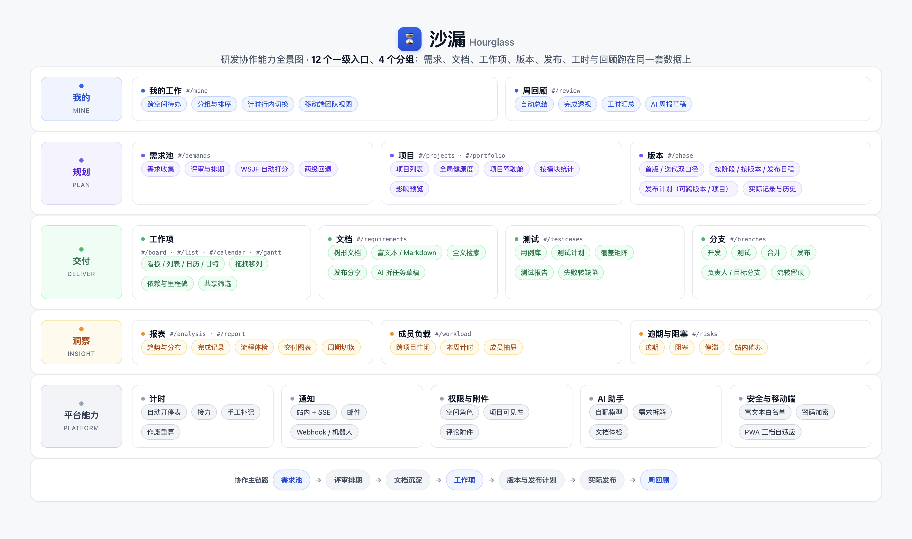
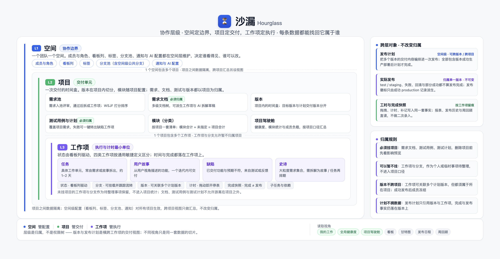
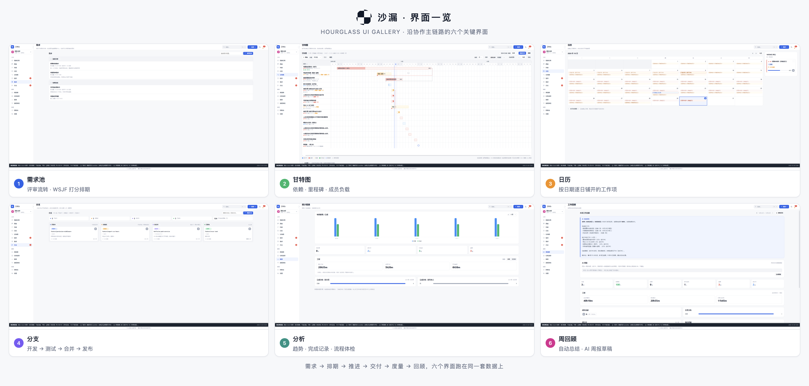
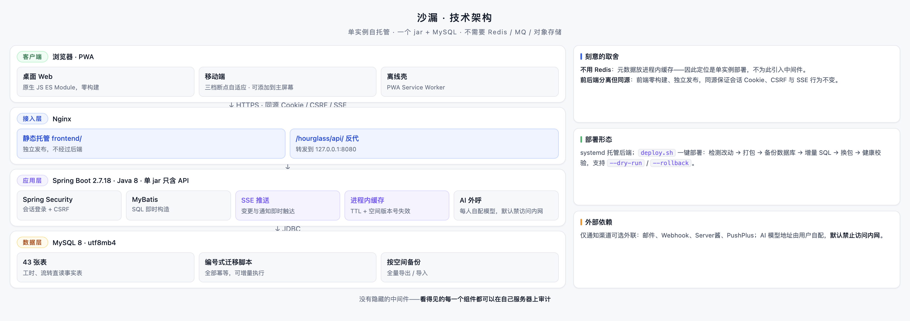
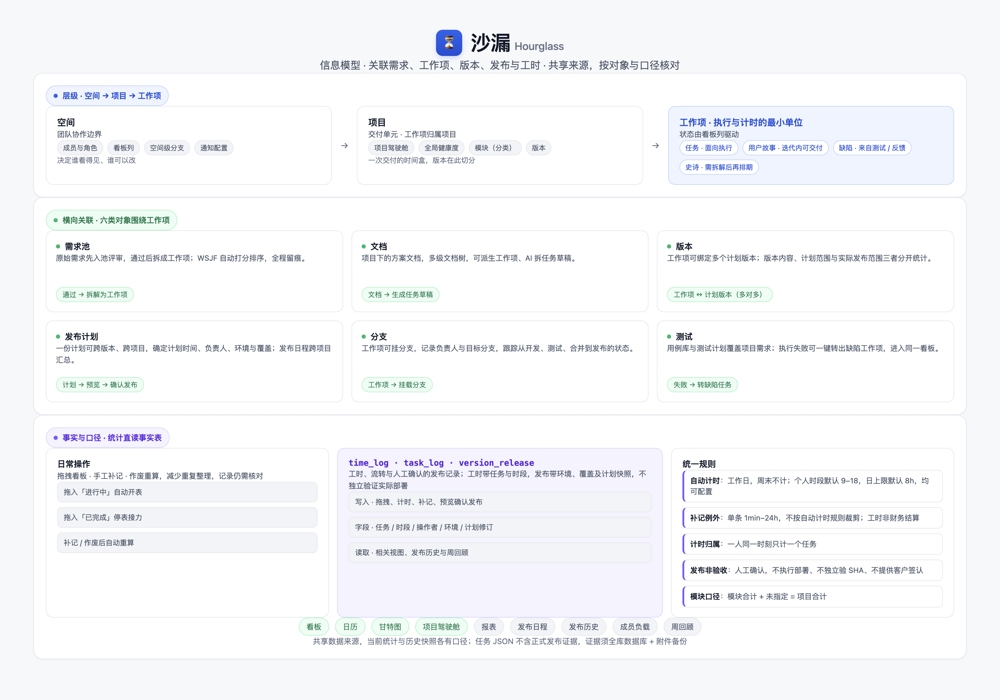

# 沙漏 Hourglass

**简体中文** | [English](README.en.md)

> 面向小型项目制研发团队的自托管研发交付工作台：让投入可解释，让交付可追溯。

**一句话介绍**：沙漏把研发协作的整条链路收进一个可以自己部署的系统里——

> 需求池提想法 → 评审排期 → 文档沉淀方案 → 拆成工作项 → 看板 / 日历 / 甘特推进 → 维护计划版本 → 完成后预览 / 确认发布 → 周回顾与月度清单


需求、工作项、有效工时与实际发布记录相互关联，进度、负载与周回顾据此生成，减少重复整理。自动计时仍需核对与必要的补记，实际发布需要有权限的人确认记录；系统不代替部署、财务结算或客户验收。



- 项目介绍：[`docs/项目介绍.md`](docs/项目介绍.md)
- 用户手册：[`docs/用户使用手册.md`](docs/用户使用手册.md)
- 接口契约：[`docs/接口契约.md`](docs/接口契约.md)

## 在线体验

公开文档不再给出演示环境地址与游客口令。想上手可以：按 [`deploy/README.md`](deploy/README.md) 自行部署（所需时间取决于环境），用全新基线初始化数据库后登录创建第一个项目。需要试用托管演示环境的，联系维护者开通。

---

## 这个项目是怎么来的

沙漏来自对小团队协作困境的直接观察。小团队常见的问题不是「事情没人做」，而是**「没人说得清全局」**：

1. **需求是断的** —— 想法在聊天记录、方案在文档、任务在看板、交付靠口头，彼此不关联。月底问一句「这个版本承诺了什么、各自做到哪一步」，没人能一句话答上来。
2. **管理者看不见全局** —— 哪个项目要延期、谁的活已经排满、谁还有余量、哪个风险正在发酵，信息散落在每个人脑子里，不问就不知道。
3. **时间说不清** —— 记录里只有「做完了」，事后答不出「这件事到底花了多久、这个月时间都去哪了」。
4. **回顾靠拼凑** —— 周报月报翻聊天记录、邮件和会议纪要，写的人痛苦，看的人也未必信。

主流工具也提供需求、工时和发布管理，选型不应只比功能数量。沙漏的侧重点是：**在单实例自托管的形态下，把需求、工作项、有效工时和发布记录连接起来**，让团队少拼凑一次信息、多保留一份可核对的记录。

## 产品定位

| 维度 | 说明 |
| --- | --- |
| 面向谁 | 需要按项目核对投入、说明版本交付，并愿意自行运维的小型研发团队；软件外包、IT 交付、企业内部项目团队都可按约束评估。50 人以下是参考规模，不是容量保证 |
| 形态 | 单实例、自托管：后端 jar + MySQL，前端由 Nginx 托管；不依赖 Redis / MQ / 对象存储 |
| 核心主张 | **投入可解释，交付可追溯**：需求有出处、时间有记录，计划、工作完成与实际发布分开核对 |
| 产品风格 | 清晰顺手是采用方式，口径统一与记录可追溯是价值；不为对标大产品堆功能 |
| 明确不做 | 多租户 SaaS、大规模横向扩展、多人实时协同编辑表格、完整工作流引擎（审批流 / 条件分支；仅提供列级流转约束）、插件市场 |

可以把这条数据链理解为研发团队的「交付账本」：它记录投入与发布，而不是财务账本。有效工时不等于可计费工时，发布快照不等于客户验收；计费率、审核锁账、客户签认与外部防篡改证明不在当前能力内。

所有功能都落在同一套三级归属上：**空间**管配置、**项目**管交付、**工作项**管执行；版本与发布计划跨层引用，但不改变归属。



## 主要功能



> 上方九图已于 2026-11-10 按当前实现重出：七张来自本地 headless Chrome 1440px 仿真，发布工作区与发布历史取自仓库 delivery 截图（docs/images/delivery-preview-desktop.png、delivery-history-desktop.png）；docs/frontend 配对 SHA256 一致并视觉查看，不声称真实物理手机。操作规则以正文为准。

### 我的

- **我的工作**：汇总所有分派给自己的待办，跨空间聚合、分批加载；手机端另有团队视图，完成率与工时可按本周 / 本月 / 近 30 天切换
- **周回顾**：自动总结一周的完成、待确认、进行中，可选 AI 生成周报草稿

### 规划

- **需求池**：排期可暂不指定目标版本；选定目标时须同项目且未发布；计划起止独立于期望日期；调期（含清空目标） / 取消 / 恢复带原因与 revision，不自动改已有任务
- **项目 / 全局健康度**：项目列表与全局健康度双视图；点项目名进入驾驶舱，维护负责人、项目目标与计划起止日期，查看进度、工时、工作项分布与成员负载；支持项目模板、归档与带影响预览的删除（存在发布证据时受保护）
- **版本**：工作项可关联多个计划版本；版本内容、跨版本发布计划与每次实际范围分开，一个计划可覆盖多个版本 / 项目。一个版本生产只成功部署一次，改动走新 hotfix 版本；同一制品可 redeploy / rollback，替换制品须新建版本；计划须其全部包含版本都完成成功生产部署 / 重部署才完成，test/staging、回滚与部分成功不算。不可变快照与当前工时分开，多关联 / 多事件不放大全局工时。

> A–E 已实施，本地正确性门禁通过：Java、真实 API / MySQL、full 模拟回读及真实 headless Chrome（backend 8120 / frontend 8121，1440/390px 仿真）；导航 72、权限 29、恢复 27（3 场景）、planTime 6、截图 16 断言独立通过。七对 delivery PNG 已重拍、SHA256 配对一致并视觉查看，部署安全隔离 212 项（含脚本语法 73）通过；不声称物理手机验收。1 个自建浏览器 fixture 空间保留作本地证据，最终复跑未建新空间。线上 payload 见 [更新日志](CHANGELOG.md) 中最近一次实际发布记录，A–E 交付时点的完整生产模拟与只读验收已完成（1747 GET / 3 login，7463 有效断言，0 失败 / 0 API 错误）；原 `hourglass` 46 表经单独授权、受限备份与恢复验证后重建为 52 表，认证 JDBC 与 `DB_NAME=hourglass`，历史数据保存在备份而非原表在线，`hourglass_20261110` 保留额外回退点。生产 Chrome 1440/390px、24 次入口导航、93 项有效断言通过，0 runtime/console/HTTP 错误，不以本地浏览器结果替代（独立统计见[更新日志](CHANGELOG.md)）。仅 Task 使用 `versionIds/versionNames` 数组，保存省略 / null 保留、`[]` 解绑；需求和测试计划仍是单目标 `versionId`。生产成功记录推导只读发布徽标（`publishSource=record`），无人工标记 / 撤标；test/staging 与失败不代表生产发布。rollback 追加事件、按目标撤销关联记录引用，保留 ever 历史及后续不同成功。成功事实冻结内容关联，不锁任务完成 / 回退 / 计时。发布管理仅空间 owner/admin 或项目负责人，任务 / 计划负责人不获整版本发布权。操作与 API 详见[用户手册](docs/用户使用手册.md#11-版本与发布)及[接口契约](docs/接口契约.md)。

### 交付

- **工作项**：看板、列表、日历、甘特四种视图共享同一套筛选；看板支持拖拽移列与行内新增；甘特图提供依赖关系（FS / SS / FF / SF）、里程碑、基线偏差、关键路径、成员负载，支持 CSV 导出、A3 打印与只读分享链接
- **文档**：树形管理的富文本 / Markdown 文档，支持全文检索、历史快照、发布分享，AI 可拆任务草稿
- **测试**：用例、测试计划、覆盖矩阵与测试报告四个视图；失败用例可一键转缺陷工作项，测试计划完成后锁定为快照，支持 CSV 导入导出
- **分支**：空间级分支跟踪，从开发、测试、合并到发布的全流程状态管理

### 洞察

- **报表**：趋势与分布、完成记录、流程体检（一次通过率、需求开工延迟、估时准确度）、交付图表（燃尽图、累积流图、速度图、交付周期分布）
- **成员负载 / 逾期与阻塞**：跨项目看忙闲，集中处理风险工作项；成员负载支持按人 / 按周穿透与「导出本月工时」

### 平台能力

- **计时**：拖入「进行中」自动开表，拖入「已完成」自动停表并接力下一个任务；支持手工补记与作废重算
- **权限**：空间角色（空间主 / 管理员 / 成员 / 查看者）+ 项目级可见性控制
- **通知**：站内通知 + SSE 即时推送 + 邮件 + 外部机器人（Webhook / Server酱 / PushPlus）
- **附件**：图片、PDF、Markdown、Word、ZIP、Excel；图片、PDF、Markdown 与 Word 点开即在弹框内预览（图片可放大、旋转、拖拽查看细节），`.xlsx` 可在工作项详情内直接编辑保存
- **AI 助手**：每人配置自己的模型与额度，用于需求拆解、文档体检、周报草稿，结果需人工确认后才落库
- **数据安全**：富文本白名单清洗、密钥加密保存、AI 地址默认禁止访问内网；按空间 JSON 搬运工作数据（任务版本数组、version.startDate、需求日期与 canceled），不转移正式发布证据；有证据时禁止破坏性覆盖，正式证据用完整数据库备份恢复
- **流转约束**：看板列可配置来源 × 目标矩阵（允许 / 需填原因 / 禁止），默认全放开；列级处理规则独立控制计时与逾期
- **检索与审计**：全局搜索跨需求、工作项、文档与用例；操作审计支持筛选与 CSV 导出，管理员可查看系统信息
- **移动端**：三档断点自适应，PWA 可添加到主屏幕

## 快速开始

前置：**JDK 8**、**Maven**、**MySQL 8**。

```bash
# 1. 全新部署：一步建库、建账号、建表
mysql -uroot -p --default-character-set=utf8mb4 < sql/baseline/01_schema_full.sql

#    基线里的账号密码是占位值，上线前务必修改：
#    ALTER USER 'hourglass'@'%' IDENTIFIED BY '你的强密码';

# 2. 必要配置（全部可用环境变量覆盖）
export DB_USER=hourglass
export DB_PASSWORD='你的数据库密码'
export AUTH_USER=admin
export AUTH_PASSWORD='你的登录密码'

# 3. 构建并启动后端（jar 只包含 API，不含前端）
mvn -f backend/pom.xml -DskipTests package
java -jar backend/target/hourglass-server.jar

# 4. 前端由 Nginx 托管：root 指向本仓库 frontend/，/hourglass/api/ 反代到 8080
#    参考 deploy/nginx-hourglass.conf（本地可把 root 改成 <仓库绝对路径>/frontend，
#    listen 改成 8081，再访问 http://127.0.0.1:8081/hourglass/）
```

生产部署执行 `bash deploy/deploy.sh`：自动检测改动 → 按需打包前端 / 后端 → 备份数据库 → 执行增量 SQL → 换包 → 健康校验，支持 `--dry-run` / `--rollback`。详见 [`deploy/README.md`](deploy/README.md)。

本轮 A–E **经用户单独明确授权重建原库**：原 `hourglass` 46 表先受限备份并恢复验证，再 DROP / CREATE 为 52 表；原历史在备份中，不再原表在线保留。完整基线 `sql/baseline/01_schema_full.sql` 包含 54 张表（重建时 52 表，其后 65 新增跨版本计划关联表、66 新增邀请项目预分配表），不回放 61/62、不迁移旧历史。完整基线会重建表，不是幂等无损脚本；正常部署脚本仍只支持新空库，不能把本次授权泛化为任意部署删库许可。重建后的完整回退须匹配 SQL 恢复并单独授权，软件-only 回退不足。`63_delivery_release.sql` 仅增列与建五张发布相关表：`version_release_plan`、`version_release_plan_task`、`version_release`、`version_release_item`、`version_log`，不回填、不清空、不构造历史证据；它不是本轮旧库迁移入口。`65_release_plan_versions.sql` 只新增 `version_release_plan_version` 关联表并回填现有计划，使一个计划可跨版本 / 跨项目，不改写任何实际发布证据。既有已发布结构的升级按发布说明评估所需编号脚本，61/62 的破坏性说明仍有效。详见 [`sql/README.md`](sql/README.md)。

## 技术栈

| 层 | 选型 |
| --- | --- |
| 后端 | Spring Boot 2.7.18 / Java 8 / MyBatis / Spring Security（会话登录 + CSRF） |
| 数据库 | MySQL 8（utf8mb4），54 张表（含已部署交付闭环、跨版本计划关联与邀请项目预分配），完整基线仅新空库；编号增量须评估破坏性 |
| 实时 | SSE 推送变更与通知 |
| 前端 | 原生 JavaScript ES Module，**无框架、无构建步骤**；PWA 离线壳 |
| 部署 | 前端由 Nginx 直接托管，后端只提供 `/api/**`；systemd + 一键部署脚本 |



几个刻意的架构选择：

- **不用 Redis**：元数据放进程内缓存，靠 TTL 与空间版本号失效——因此定位是单实例部署
- **前后端分离但同源**：前端零构建、独立发布，同源保证会话 Cookie、CSRF 与 SSE 行为不变
- **统计直读事实表**：工时、燃尽、负载直接读 `time_log` / `task_log`，补记或作废后自动重算，不维护第二套汇总数据

更深入的信息模型、统一口径规则、角色权限矩阵和配置项清单，见 [`docs/项目介绍.md`](docs/项目介绍.md) 与 [`docs/用户使用手册.md`](docs/用户使用手册.md)。



## 文档

| 文件 | 内容 |
| --- | --- |
| [`docs/产品说明.md`](docs/产品说明.md) | 产品说明：是什么、为谁、核心价值与部署形态 |
| [`docs/快速上手指南.md`](docs/快速上手指南.md) | 快速上手：已部署环境中约 30 分钟的主链路练习 |
| [`docs/项目介绍.md`](docs/项目介绍.md) | 背景与定位、信息模型、模块地图、核心机制与边界取舍 |
| [`docs/用户使用手册.md`](docs/用户使用手册.md) | 面向最终用户的操作手册与统一口径解释 |
| [`docs/管理员指南.md`](docs/管理员指南.md) | 管理员指南：部署架构、备份升级、通知与 AI、故障速查 |
| [`docs/常见问题.md`](docs/常见问题.md) | 常见问题：口径、统计、部署与选型对比 |
| [`docs/接口契约.md`](docs/接口契约.md) | 接口契约，含工时、日历、回顾等口径附录 |
| [`docs/archive/产品竞品对标与功能体验优化分析报告.md`](docs/archive/产品竞品对标与功能体验优化分析报告.md) | 归档：竞品对标、五维差距矩阵、UI/UX 审查与页面优化方案（配套[页面示意](docs/audit/页面优化示意图.html)） |
| [`deploy/README.md`](deploy/README.md) | 部署指南：服务器准备、systemd、Nginx、备份与回滚 |
| [`CHANGELOG.md`](CHANGELOG.md) | 更新日志：版本变更与在制改动清单 |

## 边界与取舍

| 不做 / 有限支持 | 原因 |
| --- | --- |
| 多租户 SaaS 与大规模横向扩展 | 适合 50 人以下团队自托管，单实例部署是刻意选择 |
| 多人实时协同编辑表格 | 在线表格定位是附件查看与快速修改，以覆盖保存为最终稿 |
| 预测型统计与 AI 评分 | 统计只做可回溯的口径，不引入无法解释的模型输出 |
| 当前集成与迁移缺口 | 暂无 Jira / 禅道任务迁移工具、SSO / 企业微信免登、公开 API Token 和 Git 流水线联动；这些是当前缺口，不是永久不做的原则 |

## 联合开发

本项目由 [chc2](https://gitee.com/chc2)（chenghongchang）发起的个人看板项目逐步升级为面向小团队的私有化研发协作工作台 **沙漏（Hourglass）**，目前由 chc2 持续维护、完善。

主要贡献者：

- [chc2](https://gitee.com/chc2)（chenghongchang）— 项目创建者，负责早期个人看板项目的设计与核心实现，并持续参与沙漏的联合开发与功能扩展
- kongxiangjin

## 许可

[PolyForm Noncommercial License 1.0.0](LICENSE)：**源码可用（source-available），禁止商用**。本项目不是 OSI 意义上的开源软件。

- **允许**：个人学习、研究、试验、兴趣项目等非商业目的的使用、修改与分发；慈善组织、教育机构、公共研究机构、公共安全/卫生/环境保护组织与政府机构的使用（无论资金来源）。
- **禁止**：任何商业目的的使用——在生产经营中使用本软件、以收费方式提供本软件或基于它的服务、将其用于对外交付的项目。
- **商业授权**：企业内网部署、对外交付、试点评估等商业场景，须先向版权持有人取得商业授权（联系方式待补充）。
- 版权、历史沿革与贡献者许可说明见 [NOTICE](NOTICE)；「沙漏」「Hourglass」名称与 logo 等商标不在许可授予范围内。
- `frontend/vendor/` 内嵌的第三方库（Univer、SheetJS、SunEditor、marked、DOMPurify、React、RxJS）与后端依赖各自沿用其原始开源许可证，清单见 [THIRD-PARTY-NOTICES.md](THIRD-PARTY-NOTICES.md)。
- 其中 **MySQL Connector/J 为 GPL-2.0 + Oracle FOSS Exception**，该例外很可能不适用于非开源许可的应用，**对外分发前须按清单说明处理**。
