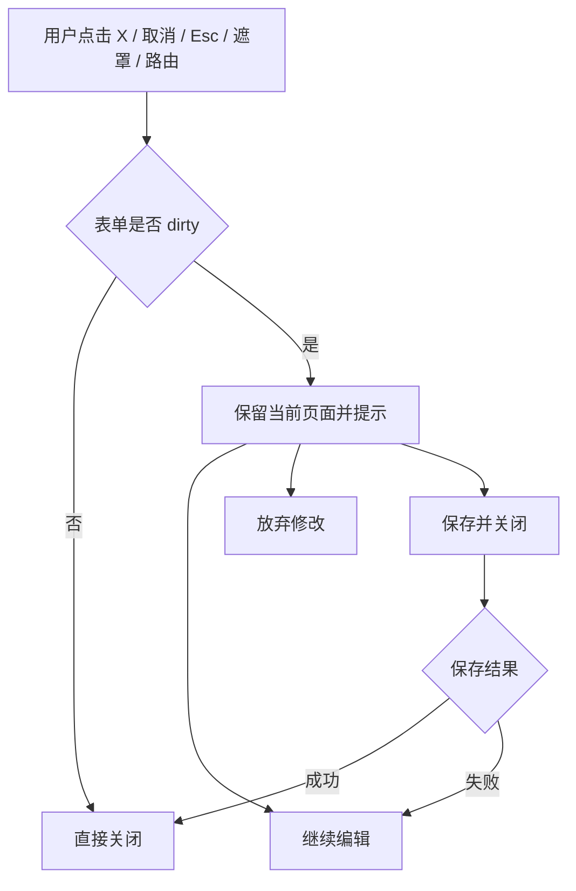
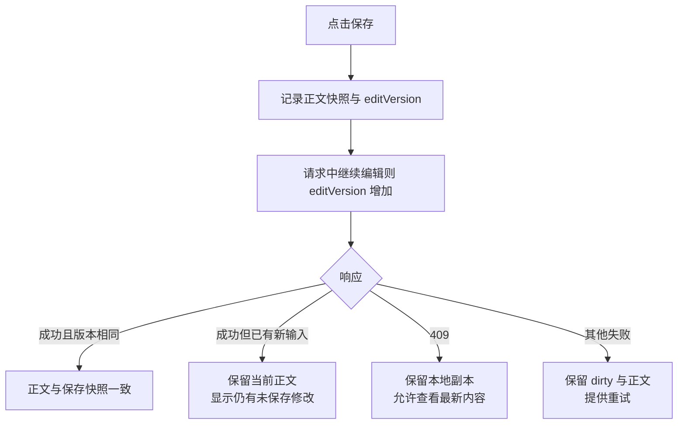
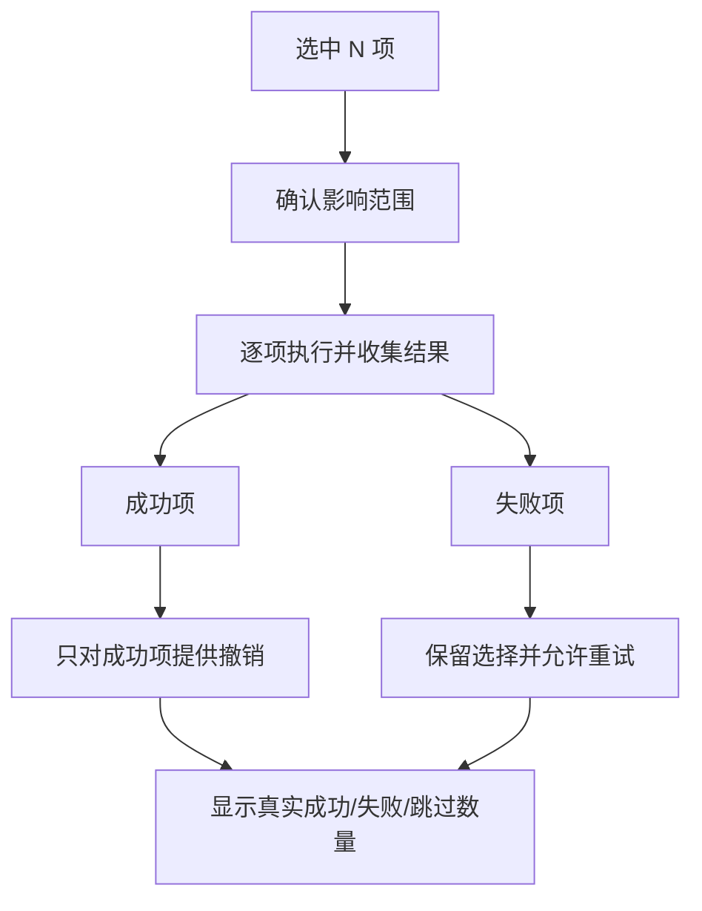

# 沙漏产品 UI/UX 体验审查与优化报告

- 审查日期：2026-11-07
- 审查视角：产品经理、UI/UX 设计师、交互设计师
- 审查目标：不以增加功能为目标，在保持轻量、专注和现有业务能力的前提下，提高可靠性、易用性、操作效率与视觉一致性。
- 运行环境：本机 Chrome Headless，桌面 1440×1000，移动端 390×844；真实 Hash SPA 页面与本地后端。
- 代码基线：本次审查时的 `hourglass` 工作区。审查期间运行代码有持续更新，实施前应对所列文件再次核对。
- 设计参考：[产品 UI/UX 优化设计参考](../audit/产品UIUX优化设计参考.html)
- 证据截图：仅存本地，不随公开仓库分发

## 证据标记

- **[实测]**：已在真实页面完成操作或查看，并有截图、DOM 或操作结果。
- **[代码]**：由当前前后端实现直接证明；故障注入或特定角色页面不一定已实测。
- **[待验证]**：当前没有足够证据，不能据此下确定结论。

优先级口径：P0 为数据丢失、数据误改或核心流程高风险；P1 为错误反馈、权限可信度、常见流程明显受损；P2 为效率、一致性和可读性；P3 为低频 polish。实施难度按现有原生 JavaScript 架构局部改造估算，不代表精确工期。

---

# 一、整体评价

沙漏已经具备较完整的产品骨架和统一的视觉基础，不需要推倒重做。登录、侧边导航、卡片、表格、状态标签、Toast、抽屉、弹窗、空态和移动底部导航均有较好的统一性；看板、列表、日历、甘特、项目总览、版本、成员负载和报表信息层级总体清楚。尤其是以下能力已经表现良好，应保留：

1. **全局搜索已经成为跨对象入口**：Cmd/Ctrl+K 可搜索项目、工作项、文档、需求和用例，支持方向键、Enter 和对象直达，实测可打开正确文档。
2. **任务创建具备上下文意识**：当前项目、唯一项目筛选、最近使用项目依次作为默认值，不再简单选择第一个项目。
3. **任务表单已有分组与折叠**：基本信息、缺陷信息、归属关系、时间进度、人员、评论等结构已经存在，不能按“完全无组织”处理。
4. **任务与文档已有部分未保存保护**：任务抽屉关闭和路由切换会确认；文档编辑页返回列表提供取消、不保存、保存并关闭。
5. **测试闭环真实可用**：已实测创建用例、执行失败、填写失败备注、转为缺陷、自动打开缺陷任务、用例行显示缺陷和覆盖矩阵统计。
6. **桌面与移动布局已有适配**：本次所测桌面主视图无 document 级横向溢出；390px 下七个主视图无 document 级横向溢出，列表转卡片、底部导航和任务抽屉固定底栏可用。
7. **设计令牌基础完整**：颜色、语义前景色、圆角、阴影、动效、布局尺寸、暗色主题和减少动画偏好均有统一变量。

当前主要差距不在“页面不好看”，而在三类体验可信度：

- **数据安全**：文档离开与保存竞态、用例关联加载失败可能误清空。
- **结果可信**：部分请求失败被显示为空态或全部成功。
- **上下文连续**：项目进入文档未带项目筛选，不同表单的关闭、保存和键盘行为不一致。

建议采取“先修数据与反馈，再统一表单和权限，最后做密度与视觉微调”的顺序，不引入复杂工作流设计器、字段级权限或大型自动化体系。

---

# 二、页面与功能巡检清单

| 区域 | 页面/能力 | 本次覆盖 | 结论 |
|---|---|---|---|
| 系统入口 | 登录 | [实测] 页面、必填校验、错误提示、提交中状态、登录成功 | 视觉清晰，账号由管理员创建，不开放注册 |
| 系统入口 | 邀请加入 `join.html` | [实测] 无 token 错误页；[待验证] 有效邀请、过期、已撤销、重复加入 | 无 token 反馈清楚 |
| 系统入口 | 帮助中心 | [实测] 完整使用手册与快捷键说明 | 内容组织完整 |
| 系统入口 | 公开分享 `share.html` | [实测] 无 token；[待验证] 有效甘特/文档分享、失效 token | 无 token 页需精简 |
| 个人工作 | 我的工作、个人待办 | [实测] 桌面与移动、逾期/以后分组、任务卡 | 高频入口明确；移动首屏筛选偏多 |
| 个人工作 | 周回顾 | [实测] 桌面 | 指标和图表层级清楚 |
| 项目 | 项目列表、卡片/表格、创建、编辑 | [实测] 页面与创建弹窗、未保存关闭；最新页面已有负责人、计划周期和目标 | 表单保护不足；不再沿用“无负责人/计划”的旧结论 |
| 项目 | 项目总览、单项目概览 | [实测] 全部项目与单项目页面 | 健康度、进度、负载和口径说明清楚 |
| 项目 | 项目到文档 | [实测+代码] “管理文档”按钮 | 项目上下文未传递 |
| 工作项 | 看板 | [实测] 桌面、移动、创建与状态修改；[待验证] 拖拽失败故障注入 | 保留现有结构 |
| 工作项 | 工作项列表 | [实测] 桌面、移动、任务创建与详情；[代码] 批量删除/撤销 | 移动卡片可用；批量结果口径需修 |
| 工作项 | 任务详情抽屉 | [实测] 创建、编辑、保存、深链、dirty 确认；[代码] 附属数据失败处理 | 主表单可靠，附属数据失败需显式化 |
| 工作项 | 日历 | [实测] 桌面 | 信息完整，文字对比度可提升 |
| 工作项 | 甘特图 | [实测] 桌面；[待验证] 拖拽、依赖、基线异常 | 专业密度合理，不建议删掉排期信息 |
| 工作项 | 分支 | [实测] 空态页面 | 空态视觉占比可优化 |
| 需求 | 需求池列表/看板、评审动作 | [实测] 列表与操作；[待验证] 全状态流转失败注入 | 行尾动作较密集 |
| 文档 | 文档列表、创建、编辑、Markdown、预览、大纲、关联、保存 | [实测] 创建、搜索直达、保存、重开、返回保护、侧栏离开 | 功能完整，保存与离开安全性优先修复 |
| 测试 | 用例列表、创建、编辑、执行、转缺陷、覆盖矩阵 | [实测] 完整成功链与未保存关闭；[代码] 防重复和候选失败 | 当前没有独立“测试计划”模块，不臆造 |
| 洞察 | 分析、报表中心 | [实测] 桌面 | 图表与指标口径整体清楚 |
| 度量 | 版本、成员负载、逾期与阻塞 | [实测] 桌面 | 业务信息密度合理 |
| 管理后台 | 设置：空间、成员与角色、项目可见范围、工作流、集成、数据、活动、账号 | [实测] 八个分区均打开；[代码] 角色与工作流权限 | owner 显示和权限说明需修 |
| 个人 | 个人设置、通知偏好、计时、密码 | [实测] 页面；[待验证] 邮件实际送达 | 分区明确 |
| 通用 | Cmd/Ctrl+K 搜索 | [实测] 跨对象结果、键盘与文档直达 | 当前优点，保留 |
| 通用 | 通知中心 | [实测] 空态打开；[待验证] 未读、跳转、推送失败 | 空态可用 |
| 通用 | 弹窗、抽屉、Tooltip、Popover、Toast | [实测] 多个实例；[代码] 通用焦点陷阱与关闭逻辑 | dirty 与提交规则不统一 |
| 异常 | 空数据、无结果、加载、失败、无权限、网络异常、冲突 | 部分实测，部分代码核查 | 不做“全部已实测”声明，详见待验证清单 |
| 响应式 | 390×844 | [实测] 我的工作、看板、列表、项目、文档、用例、设置、任务抽屉 | 无页面级横向溢出；移动文档编辑和弹窗仍待补测 |
| 组织能力 | 部门、组织架构 | 当前产品无此能力 | 不建议为对标企业微信而新增 |

---

# 三、问题总览与实施顺序

| 编号 | 问题 | 优先级 | 难度 | 主要证据 |
|---|---|---:|---:|---|
| UX-01 | 文档侧栏切换与刷新缺少完整未保存保护 | P0 | 中 | 实测 + 路由/文档代码 |
| UX-02 | 文档保存竞态与冲突恢复可能覆盖本地内容 | P0 | 中 | 代码 |
| UX-03 | 用例需求候选加载失败可能误清空原关联 | P0 | 中 | 代码 |
| UX-04 | 项目与测试弹窗未保存保护不一致 | P1 | 中 | 实测 + 代码 |
| UX-05 | 任务评论、检查项、时间线失败被伪装成空态 | P1 | 低 | 代码 |
| UX-06 | 批量删除和撤销可能虚报全部成功 | P1 | 中 | 代码 |
| UX-07 | 测试提交缺少防重复，加载更多失败可能卡住 | P1 | 低 | 代码 |
| UX-08 | 文档加载静默失败，导入失败可能遗留空文档 | P1 | 中 | 代码 |
| UX-09 | 项目“管理文档”丢失项目上下文 | P1 | 低 | 代码 |
| UX-10 | owner 被显示为管理员，权限说明与后端不一致 | P1 | 低 | 实测 + 前后端代码 |
| UX-11 | viewer 部分设置控件形成可编辑假象 | P1 | 中 | 代码，角色实测待补 |
| UX-12 | 任务保存成功后强制关闭，连续编辑效率可优化 | P2 | 低 | 实测 + 代码 |
| UX-13 | 普通弹窗键盘提交覆盖不一致 | P2 | 低 | 代码 |
| UX-14 | 移动顶栏与筛选区挤占首屏，全局搜索入口不明确 | P2 | 中 | 移动实测 |
| UX-15 | 需求池和文档编辑器动作密度偏高 | P2 | 低 | 桌面实测 |
| UX-16 | 日历文字对比度与密集单元格可读性不足 | P2 | 低 | 桌面实测 |
| UX-17 | 分支等空态没有有效利用页面空间 | P3 | 低 | 桌面实测 |
| UX-18 | 分享无 token 时保留完整空甘特框架 | P3 | 低 | 公开页实测 |

建议首批实施 UX-01、UX-02、UX-03、UX-05、UX-06、UX-07、UX-09、UX-10；这些改动范围相对集中，能优先提升数据安全和结果可信度。

---

# 四、详细问题与优化建议

## UX-01 文档侧栏切换与刷新缺少完整未保存保护

- **所属页面**：文档编辑器、全局侧边导航、浏览器刷新/关闭。
- **问题分类**：交互逻辑 / 数据安全 / 异常状态。
- **当前表现**：[实测] 修改 Markdown 正文后点击侧栏“我的工作”，URL 直接变为 `#/mine`，没有确认，未保存正文被放弃。文档“返回列表”有保护，但普通路由没有完整接入；全前端未找到应用级 `beforeunload`。
- **证据**：`frontend/js/core/router.js:95-114` 广播 `ds:before-route`；`frontend/js/views/requirements.js:209-217` 直接清除 dirty 并隐藏编辑器；文档仅见返回按钮保护，未接入同一路由守卫。
- **问题影响**：长文档编辑中一次误点即可造成不可恢复损失，且与任务抽屉的安全行为不一致。
- **竞品参考**：Linear 保留评论和编辑草稿；Jira 对未保存变更提供明确警告。应借鉴“保护内容与明确选择”，不是增加复杂版本体系。
- **优化建议**：文档监听 `ds:before-route`，与任务共用“继续编辑 / 放弃并离开 / 保存并离开”决策；dirty 时增加 `beforeunload`；保存中的路由请求应等待保存结果。可选增加本地恢复草稿，但第一期不必做自动云端保存。
- **优化后的效果**：返回列表、侧栏、浏览器后退、刷新和关闭页面均有一致保护，不再静默丢正文。
- **优先级 / 难度**：**P0 / 中**。

## UX-02 文档保存竞态与冲突恢复可能覆盖本地内容

- **所属页面**：文档编辑器、保存反馈、409 冲突提示。
- **问题分类**：数据安全 / 并发交互 / 保存状态。
- **当前表现**：[代码] 保存请求发送前读取正文；请求返回后无条件 `reqDocDirty=false` 并 `fillReqDocEditor(doc)`。如果用户在请求期间继续输入，新输入可能被旧响应覆盖。已有基于 `updatedAt` 的 409 处理，但“查看最新内容”会直接重开文档，本地未保存内容没有恢复入口。
- **证据**：`frontend/js/views/requirements.js:2267-2301`；冲突处理位于 `2306-2314`。
- **问题影响**：弱网或慢保存时可能丢失最后一段输入；多人冲突时用户被迫在“保留本地”和“查看最新”之间做高风险选择。
- **竞品参考**：Linear 的草稿恢复思路；现代编辑器通常区分“已保存版本”和“当前仍有修改”。
- **优化建议**：为每次编辑递增 `editVersion`，保存时记录正文快照和版本；响应只更新已保存快照，若期间继续编辑则保留当前正文并显示“已保存至 23:24，仍有未保存修改”。409 时提供“保留我的副本并查看最新”，至少先复制/下载本地正文；无需第一期引入复杂 diff 编辑器。
- **优化后的效果**：慢响应不会覆盖新输入，冲突可恢复，保存状态能准确表达当前内容是否已落库。
- **优先级 / 难度**：**P0 / 中**。

## UX-03 用例需求候选加载失败可能误清空原关联

- **所属页面**：测试用例编辑弹窗。
- **问题分类**：数据完整性 / 异常状态 / 表单。
- **当前表现**：[代码] 需求候选请求失败后返回空数组，随后下拉被重建为“不关联”；保存时直接提交 `demandId: $("cDemand").value || null`。用户若未注意，可能把原有关联清空。
- **证据**：`frontend/js/views/testcases.js:350-375`、`473-496`。
- **问题影响**：网络失败被转化为业务数据修改，且用户没有主动执行“取消关联”。
- **竞品参考**：Jira/Linear 对字段加载失败通常保留原值并允许重试，而不是把失败解释为空值。
- **优化建议**：区分“加载中、加载失败、真实无关联、用户主动取消关联”。失败时禁用需求下拉并显示内联重试；保留原始 `demandId`，未成功加载前禁止保存或提交原值；只有用户明确选择“不关联”才提交 `null`。
- **优化后的效果**：依赖数据失败不会改变业务关联，用户可重试后继续编辑。
- **优先级 / 难度**：**P0 / 中**。

## UX-04 项目与测试弹窗未保存保护不一致

- **所属页面**：项目创建/编辑、用例创建/编辑、执行、转缺陷弹窗。
- **问题分类**：弹窗交互 / 数据安全 / 组件一致性。
- **当前表现**：[实测] 项目输入后关闭，无确认，重新打开内容被清空；用例标题修改后点 X 关闭，无确认，修改丢失。[代码] 执行与转缺陷弹窗也直接关闭。任务抽屉已有 dirty 确认，形成明显行为差异。
- **证据**：`frontend/js/views/projects.js:412-448、471-473`；`frontend/js/views/testcases.js:652-667`；通用 `frontend/js/core/ui.js:99-138` 只有焦点陷阱与遮罩关闭，没有 dirty 守卫。
- **问题影响**：误点遮罩、X、取消或 Esc 会丢失输入；用户需要在不同模块形成不同心智模型。
- **竞品参考**：Jira 未保存提示、Linear 低中断草稿。短表单不必每一步都弹窗，但有实际修改时必须保护。
- **优化建议**：在通用 modal 增加可插拔 `requestClose`，由表单提供 dirty 判断；打开时记录快照，X、取消、Esc、遮罩和路由统一走同一入口。短表单使用“继续编辑 / 放弃修改”，文档保存场景保留三选一。
- **优化后的效果**：所有可编辑浮层关闭行为一致，误关闭不再丢数据。
- **优先级 / 难度**：**P1 / 中**。

## UX-05 任务评论、检查项、时间线失败被伪装成空态

- **所属页面**：任务详情抽屉。
- **问题分类**：异常反馈 / 数据可信度。
- **当前表现**：[代码] 三类请求失败后分别渲染 `[]`，界面与“没有评论、没有检查项、没有时间线”相同。
- **证据**：`frontend/js/core/task-drawer.js:435-440、717-723、1302-1308`。
- **问题影响**：用户可能误以为协作记录消失，继续添加内容或作出错误判断。
- **竞品参考**：Linear/飞书通常在内容区域内区分空状态和加载失败，并允许原地重试。
- **优化建议**：保留各分区标题和已有缓存；失败时显示“评论加载失败，重试”，不清空旧数据；空态只在成功返回空数组时展示。Toast 可作补充，不能代替区域内重试。
- **优化后的效果**：用户能区分无数据和加载失败，协作记录不会因网络问题被误解。
- **优先级 / 难度**：**P1 / 低**。

## UX-06 批量删除和撤销可能虚报全部成功

- **所属页面**：工作项列表、多选工具条、回收站撤销 Toast。
- **问题分类**：批量操作 / 异常反馈 / 数据恢复。
- **当前表现**：[代码] 单项删除失败被转成 `null`，最终仍按原始选中数提示“已移入回收站 N 项”；撤销采用相同逻辑并提示全部恢复。本地跳过项也可能未计入结果。
- **证据**：`frontend/js/views/list.js:676-697`。
- **问题影响**：实际仍存在的任务被报告为已删除，未恢复的任务被报告为已恢复；用户可能停止后续处理。
- **竞品参考**：Jira 批量编辑和 Asana 批量编辑强调变更结果；这里应借鉴结果明细与失败处理，不引入复杂批处理配置。
- **优化建议**：使用 `Promise.allSettled` 或等价结果收集；只对成功 ID 提供撤销；提示“成功 8 项，失败 2 项”，失败项保留选择并提供重试；0 成功时使用错误态而非成功态。
- **优化后的效果**：成功、失败、跳过数量与真实服务端结果一致，撤销范围准确。
- **优先级 / 难度**：**P1 / 中**。

## UX-07 测试提交缺少防重复，加载更多失败可能卡住

- **所属页面**：用例保存、执行、转缺陷、加载更多。
- **问题分类**：提交状态 / 防重复 / 异常恢复。
- **当前表现**：[代码] `saveCase()`、`doRun()`、`doDefect()` 未设置 busy/disabled；加载更多先将按钮禁用并改为“加载中…”，失败只 Toast，没有恢复按钮。
- **证据**：`frontend/js/views/testcases.js:112-130、473-496、525-562`。
- **问题影响**：快速双击可能产生重复执行或重复缺陷；加载失败后用户无法在同一位置重试。
- **竞品参考**：现代 SaaS 的提交按钮普遍有 pending 状态和幂等意识。
- **优化建议**：提交期间禁用主按钮并显示“保存中/记录中/创建中”，`finally` 恢复；转缺陷成功后以服务端返回任务为准；加载更多失败恢复原文本并保留重试。
- **优化后的效果**：重复提交减少，所有失败都有明确下一步。
- **优先级 / 难度**：**P1 / 低**。

## UX-08 文档加载静默失败，导入失败可能遗留空文档

- **所属页面**：文档列表、新建文档、文件导入。
- **问题分类**：异常状态 / 创建流程 / 可恢复性。
- **当前表现**：[代码] 文档列表请求失败被静默吞掉，页面可能表现为空；文件导入先创建空文档，再转换并写正文，后续失败统一提示“创建失败”，没有说明空文档是否已生成，也没有清理或恢复入口。
- **证据**：`frontend/js/views/requirements.js:187-196、1305-1343`。
- **问题影响**：用户无法区分没有文档和加载失败；重复重试导入可能留下多份空草稿。
- **竞品参考**：飞书文档强调连续的内容组织；对导入而言更重要的是明确阶段和可恢复结果，而非增加格式支持。
- **优化建议**：列表失败显示区域错误与重试；导入按钮显示“创建文档→转换文件→写入正文”的当前阶段；失败时提示“已创建草稿，可继续编辑/重试导入”，或清理本次新建且仍为空的文档。不要静默删除已有内容。
- **优化后的效果**：失败原因和当前结果透明，不产生无法解释的空文档。
- **优先级 / 难度**：**P1 / 中**。

## UX-09 项目“管理文档”丢失项目上下文

- **所属页面**：项目列表/展开区 → 文档。
- **问题分类**：跨页面导航 / 上下文连续性。
- **当前表现**：[代码] 按钮带有项目 ID，但点击后直接 `showView("requirements")`，没有读取 ID 或设置文档项目筛选。
- **证据**：`frontend/js/views/projects.js:239、271、533-534`。
- **问题影响**：用户从“结算中台”进入文档后仍需再次寻找项目，增加步骤并可能误操作其他项目文档。
- **竞品参考**：飞书项目内嵌文档以项目上下文组织内容；沙漏无需内嵌整套文档系统，但应保留来源项目。
- **优化建议**：复用文档模块现有项目筛选和打开方法，跳转到 `#/requirements` 同时设置项目 ID；文档页显示“项目 / 文档”的面包屑和可清除筛选。
- **优化后的效果**：项目到文档一步直达正确范围，返回项目时保留来源。
- **优先级 / 难度**：**P1 / 低**。

## UX-10 owner 被显示为管理员，权限说明与后端不一致

- **所属页面**：设置 → 成员与角色、角色权限说明、工作流。
- **问题分类**：权限表达 / 文案准确性 / 无效操作。
- **当前表现**：[实测] owner 行显示“管理员”下拉。原因是 owner 进入可管理分支，但角色选项只有 admin/member/viewer，没有 owner。[代码] 后端会拒绝修改空间主角色，因此不是实际越权，而是 UI 错显与无效操作。权限说明称看板列/分类仅 owner 可管理，但后端新增、修改、排序使用 writer 校验，admin/member 也可执行，只有删除是 owner-only。
- **证据**：`frontend/js/views/settings.js:115-121、149、320-329`；`backend/src/main/java/com/hourglass/service/WorkspaceService.java:418-443`；`CategoryController.java:40-74`、`ColumnController.java:49-82`。
- **问题影响**：管理员无法准确理解自己的身份和能力，权限说明失去可信度。
- **竞品参考**：企业微信和飞书强调角色名称与实际控制范围一致；无需引入其复杂组织体系。
- **优化建议**：owner 行固定显示“空间主”标签，不渲染角色下拉；权限矩阵按“新增/编辑/排序”和“删除”拆分，准确标明 writer 与 owner 规则；由同一权限函数驱动说明和控件。
- **优化后的效果**：界面身份、说明和真实后端行为一致，消除无效角色操作。
- **优先级 / 难度**：**P1 / 低**。

## UX-11 viewer 部分设置控件形成可编辑假象

- **所属页面**：设置 → 工作流及其他写操作控件。
- **问题分类**：权限反馈 / 只读状态 / 组件一致性。
- **当前表现**：[代码] viewer 的看板列和分类新增、改名、颜色、排序等控件仍可能可用，提交后才被后端 403 拒绝。不能笼统描述为“非 owner 都不可操作”，因为 admin/member 的新增、修改和排序是真实允许的。
- **证据**：`frontend/js/views/settings.js:217-275、611-619、699-708`；后端 writer 校验同上。[待验证] viewer 真实账号逐控件页面巡检。
- **问题影响**：用户完成填写后才收到拒绝，浪费时间并误以为系统故障。
- **竞品参考**：飞书/Jira 通常将无权限控件显示为只读或解释原因，而不是允许完整操作后失败。
- **优化建议**：viewer 显示只读列表和“查看者仅可查看”的说明，禁用或隐藏写控件；admin/member 保留新增、编辑、排序，仅对 owner-only 删除做限制。避免简单隐藏整套设置菜单。
- **优化后的效果**：可编辑性在操作前即可判断，同时不损害合法成员效率。
- **优先级 / 难度**：**P1 / 中**。

## UX-12 任务保存成功后强制关闭，连续编辑效率可优化

- **所属页面**：任务详情抽屉。
- **问题分类**：操作效率 / 保存反馈。
- **当前表现**：[实测+代码] 保存成功后无条件关闭抽屉；保存失败会保留抽屉，主表单 dirty 保护有效。
- **证据**：`frontend/js/core/task-drawer.js:1190-1200`。
- **问题影响**：保存后还需继续补充评论、检查项或时间的用户必须重新打开任务；但不能把当前行为描述为“保存失败也丢数据”。
- **竞品参考**：Linear 支持低中断连续编辑；Asana 详情也偏向保留工作上下文。
- **优化建议**：保留默认“保存并关闭”，增加次级“保存并继续”或拆分按钮；成功后更新保存时间和 dirty 状态，不强制改变默认习惯。移动端可只保留一个主按钮，通过更多菜单提供另一动作。
- **优化后的效果**：快速处理仍可一键关闭，连续编辑无需重复打开。
- **优先级 / 难度**：**P2 / 低**。

## UX-13 普通弹窗键盘提交覆盖不一致

- **所属页面**：项目、用例及其他非 `<form>` 弹窗。
- **问题分类**：键盘操作 / 组件一致性。
- **当前表现**：[代码] Cmd/Ctrl+Enter 只覆盖任务抽屉和带 `<form>` 的弹窗；项目、用例等非 form 弹窗不在范围内。项目名称输入没有 Enter 提交，现有项目 Enter 逻辑属于行内快速新建工作项。
- **证据**：`frontend/js/core/shortcuts.js:102-117`；`frontend/js/views/projects.js:471-475`。
- **问题影响**：键盘用户在不同创建流程中需要反复切换到鼠标，Linear 式效率无法贯穿。
- **竞品参考**：Linear 创建 Issue 的键盘连续性。
- **优化建议**：优先把可提交区域语义化为 `<form>`；统一 Cmd/Ctrl+Enter 保存，单行文本可 Enter 提交，textarea 保持换行；提交中忽略重复按键，IME 组合输入不触发。
- **优化后的效果**：创建和编辑流程可预测，快捷键帮助与实际行为一致。
- **优先级 / 难度**：**P2 / 低**。

## UX-14 移动顶栏与筛选区挤占首屏，全局搜索入口不明确

- **所属页面**：移动我的工作、工作项列表、顶栏。
- **问题分类**：响应式 / 信息密度 / 搜索导航。
- **当前表现**：[实测] 390px 下页面无 document 级横向溢出，卡片和底部导航可用；但顶部页面标题被明显截断，筛选 chips 横向占用，工作项列表的分组、排序、导出、保存视图在首屏形成较高控制区。顶部“搜索”仍是任务筛选心智，移动端没有键盘 Cmd/Ctrl+K，跨对象全局搜索入口不够明确。
- **证据**：`mobile-mine.png`、`mobile-list.png`；桌面全局搜索见 `frontend/js/core/search-palette.js:85-93`。
- **问题影响**：首屏可见任务数量减少，用户难以区分“当前视图筛选”和“全局找对象”。
- **竞品参考**：Asana 移动 App 强调核心任务浏览；Linear 的移动效率应转化为少步骤，而非把桌面所有控制都堆到首屏。
- **优化建议**：移动顶栏提供明确全局搜索图标；视图内关键词保留在筛选面板。首屏只保留常用筛选摘要和“筛选”按钮，其余分组、排序、导出、保存视图收进底部面板；标题缩短为视图名，完整路径放在页面内容区。不要删除保存视图等能力。
- **优化后的效果**：首屏优先展示任务，高级控制仍可一两步到达，全局与局部搜索分工明确。
- **优先级 / 难度**：**P2 / 中**。

## UX-15 需求池和文档编辑器动作密度偏高

- **所属页面**：需求池列表、文档编辑器顶栏。
- **问题分类**：视觉层级 / 操作密度 / 信息组织。
- **当前表现**：[实测] 需求池每行可同时出现通过、拒绝、编辑、删除等多个同权重动作；文档编辑器顶栏同时展示 AI 拆分、检查、历史、大纲、导入、导出、复制、发布、分享、删除和保存。
- **证据**：`current-demands.png`、`current-doc-editor.png`。
- **问题影响**：主状态动作与危险/低频动作竞争注意力，增加误点和扫描成本。
- **竞品参考**：飞书文档将目录、协作和更多动作分层；Linear 将主要动作保持清晰，低频属性进入菜单。
- **优化建议**：需求行保留当前状态最主要动作，其余进入行尾“更多”；删除保持危险色和确认。文档保留保存、发布/分享和编辑模式，历史、导入导出、复制、删除按使用频率分组到“更多”，大纲可作为侧栏开关。不要为视觉简洁移除业务动作。
- **优化后的效果**：高频动作更突出，低频能力仍可发现，误操作概率下降。
- **优先级 / 难度**：**P2 / 低**。

## UX-16 日历文字对比度与密集单元格可读性不足

- **所属页面**：日历。
- **问题分类**：视觉可读性 / 信息密度。
- **当前表现**：[实测] 日历单元格内任务文字和次要信息偏淡，密集日期中扫描成本较高。
- **证据**：`current-calendar.png`；全局已有 `--text-2`、`--text-3` 和语义前景色可复用。
- **问题影响**：浅色文字在小字号下不易识别，逾期、今天和普通任务的视觉差异不够迅速。
- **竞品参考**：现代 SaaS 日历通常将事件标题保持正文对比度，浅色只用于次要元信息。
- **优化建议**：任务标题使用 `--text-2` 或 `--text`，元信息才使用 `--text-3`；逾期增加文字/左边框而非只依赖颜色；密集单元格使用“+N 更多”并保持点击展开。不要通过整体放大日历造成更多滚动。
- **优化后的效果**：在不改变布局和交互模型的前提下提升浏览速度与可访问性。
- **优先级 / 难度**：**P2 / 低**。

## UX-17 分支等空态没有有效利用页面空间

- **所属页面**：分支及类似低内容页面。
- **问题分类**：空状态 / 页面布局。
- **当前表现**：[实测] 分支空态仅占据左上角小卡片，剩余页面大面积留白，引导性较弱。
- **证据**：`current-branches.png`。
- **问题影响**：页面看起来像未加载完成，用户不容易理解下一步。
- **竞品参考**：现代 SaaS 空态通常说明对象用途，并提供一个主行动，不堆砌营销插画。
- **优化建议**：在内容区居中或按栅格展开空态，说明分支用途和前置条件；有权限时提供主操作，无权限时只说明原因。复用现有空态组件，不新增插画体系。
- **优化后的效果**：空页面也能清楚表达状态和下一步。
- **优先级 / 难度**：**P3 / 低**。

## UX-18 分享无 token 时保留完整空甘特框架

- **所属页面**：公开分享 `share.html`。
- **问题分类**：公开异常页 / 信息反馈。
- **当前表现**：[实测] 无 token 时仍展示完整甘特工具栏、空白大画布和图例，仅一行提示“链接缺少 token 参数，无法查看”。
- **证据**：`share-no-token.png`。
- **问题影响**：错误原因不够聚焦，公开访问者可能误以为甘特仍在加载。
- **竞品参考**：现代 SaaS 的失效分享页通常只保留品牌、原因和可执行下一步。
- **优化建议**：缺少、失效或过期 token 时使用独立错误页，隐藏业务工具栏和画布；提供返回产品入口，不暴露内部数据。有效分享页的现有工具栏保持不变。
- **优化后的效果**：错误状态一目了然，减少无效等待和误解。
- **优先级 / 难度**：**P3 / 低**。

---

# 五、五条核心业务流程审查

## 流程 A：项目创建到交付跟踪

**当前流程**：项目列表 → 新建/编辑项目 → 填写名称、描述、状态、负责人、计划与目标 → 项目内快速新建工作项 → 看板/列表推进 → 项目总览与单项目概览。

**优点**：项目字段已逐步完整；行内快速新建、看板上下文和项目健康度形成闭环。

**断点**：项目弹窗关闭无 dirty 保护；“管理文档”丢失项目筛选；连续创建时键盘提交不统一。

**优化后流程**：

```text
创建项目
  → 输入信息（dirty 快照）
  → Enter / Cmd+Enter / 点击保存
  → 成功 Toast + 项目上下文保持
  → 新建工作项 / 管理文档
  → 文档自动带项目筛选
  → 看板推进
  → 项目概览验证进度、负载与风险
```

**验收重点**：误关闭不丢项目输入；从项目 A 进入文档只显示项目 A；返回项目后来源仍可识别；总览指标口径不变。

## 流程 B：任务创建、协作与状态流转

**当前流程**：全局新建/N/C/看板行内创建 → 任务抽屉 → 默认项目上下文 → 编辑分组字段 → 保存 → 状态修改 → 评论、检查项、时间线。

**优点**：快捷入口丰富，默认项目合理，主表单 dirty 保护有效，任务深链可打开。

**断点**：附属数据失败像空态；保存成功必须关闭；批量删除/撤销结果可能不真实。

**优化后流程**：

```text
快捷创建 → 预填项目/列 → 保存并关闭 或 保存并继续
                         → 状态流转
                         → 评论/检查项/时间线分区加载
                            ├─ 成功为空：显示真实空态
                            └─ 失败：保留旧数据 + 区域重试
                         → 批量删除：成功/失败分明，仅撤销成功项
```

**验收重点**：失败不会清空已有评论；双击和快捷键不会重复提交；批量数量与服务端一致；默认保存关闭行为仍高效。

## 流程 C：文档创建、编辑、关联与分享

**当前流程**：文档列表/项目入口/全局搜索 → 新建或导入 → Markdown/富文本编辑 → 保存 → 大纲、关联工作项/需求、评论 → 发布分享。

**优点**：编辑器能力完整，Markdown 保存和重开已验证，409 已有基础，跨对象搜索直达准确。

**断点**：侧栏和刷新可丢稿；保存竞态；列表失败静默；导入失败可能留空文档；项目上下文断裂。

**优化后流程**：

```text
项目 A / 搜索 / 文档列表
  → 新建或导入（阶段可见）
  → 编辑（本地 editVersion 递增）
  → 保存快照
       ├─ 成功且未继续输入：全部已保存
       ├─ 成功但继续输入：已保存快照，当前仍有修改
       └─ 409：保留我的副本，可查看最新
  → 返回/侧栏/刷新统一 dirty 守卫
  → 关联工作项或需求 → 发布分享
```

**验收重点**：慢网中持续输入不丢；所有离开路径行为一致；失败导入不产生无法解释的空草稿；有效分享另测。

## 流程 D：测试用例到缺陷闭环

**当前流程**：选择项目 → 新建用例 → 模块/前置条件/步骤/预期 → 执行并标记失败 → 失败备注 → 转缺陷并选严重度/环境 → 自动打开缺陷任务 → 用例行和覆盖矩阵更新。

**实测结果**：完整成功链已通过，当前产品真实形态是“用例 / 覆盖矩阵”，没有独立测试计划模块。

**断点**：弹窗无 dirty；需求候选失败可能清关联；提交无 busy；加载更多失败卡住。

**优化后流程**：

```text
编辑用例（依赖失败保留原值）
  → 防重复保存
  → 执行失败（记录中）
  → 转缺陷（创建中，禁止双击）
  → 缺陷任务打开
  → 用例与矩阵同步
```

**验收重点**：网络失败不会取消需求关联；重复点击只产生一个缺陷；未保存步骤不会静默丢失。测试计划、批量执行、导入导出是否新增应另行产品决策，不在本轮借优化扩功能。

## 流程 E：账号、邀请、权限与系统管理

**当前流程**：平台管理员创建账号 → owner/admin 生成邀请 → 已有账号确认加入 → 配置空间角色与项目可见范围 → 工作流/集成/数据/活动管理。

**优点**：设置八个分区完整，项目可见范围矩阵可读，活动记录能追踪本次任务与缺陷创建。

**断点**：owner UI 错显；权限说明和后端不一致；viewer 控件可编辑假象；有效邀请尚未实测。

**优化后流程**：

```text
管理员创建账号 → 邀请链接 → 接受/失效状态明确
  → 成员角色：owner 固定标签，其他角色按权限编辑
  → 项目范围：默认参与 / 只读 / 不可见
  → 工作流：viewer 只读，writer 可增改排，owner 可删除
  → 数据操作与活动记录可追踪
```

**验收重点**：有效、过期、撤销和重复邀请分别验证；owner/admin/member/viewer 四角色逐项回归；危险数据操作不做未经授权的实测。

---

# 六、竞品设计对标：借鉴边界

本次竞品结论来自官方功能资料，不是对竞品登录后页面进行实测。

| 产品 | 可直接借鉴 | 需按沙漏调整 | 不适合引入 |
|---|---|---|---|
| Linear | 命令面板、键盘创建、低中断状态修改、草稿意识 | 沙漏已有 Cmd/Ctrl+K，应补移动入口与表单一致性，不必再建第二套搜索 | 复杂命令语法、为快捷键而隐藏可见入口 |
| 飞书 | 项目—文档—任务关联、文档目录、上下文面包屑 | 保留独立轻量文档模块，只传递项目和关联上下文 | 完整 IM、组织通讯录和重型套件导航 |
| Jira | 批量结果明细、未保存提示、冲突说明 | 只呈现成功/失败与重试，不复制复杂配置 | 工作流设计器、字段级权限、繁重管理员体系 |
| Trello | 清晰拖拽落点、卡片菜单替代操作 | 保留看板简单模型，为移动和键盘提供菜单替代 | 大量 Power-Ups 和插件化首页 |
| Asana | 多选工具条、表单分步、移动核心任务优先 | 高级筛选收进移动底部面板，桌面效率不下降 | 复杂规则自动化和多步骤配置向导 |
| 企业微信 | 账号来源、邀请状态和身份说明清晰 | 保持管理员建号与邀请链接，不开放无控制注册 | 部门树、完整组织架构和审批体系；当前无部门模型 |

官方参考：

- Linear：[选择 Issue](https://linear.app/docs/select-issues)、[创建 Issue](https://linear.app/docs/creating-issues)、[显示选项](https://linear.app/docs/display-options)、[评论](https://linear.app/docs/comment-on-issues)
- 飞书：[项目内嵌文档](https://project.feishu.cn/b/helpcenter/1ykiuvvj/o0jctoem)、[文档任务](https://www.feishu.cn/hc/zh-CN/articles/598456080060)、[文档目录](https://www.feishu.cn/hc/zh-CN/articles/178968744708)
- Asana：[批量编辑](https://help.asana.com/s/article/how-to-bulk-select-and-edit-tasks)、[看板](https://help.asana.com/s/article/board-view)、[表单](https://help.asana.com/s/article/forms)、[移动 App](https://help.asana.com/s/article/getting-started-with-asana-s-mobile-app)
- Jira：[批量编辑](https://support.atlassian.com/jira-software-cloud/docs/edit-multiple-issues/)、[未保存变更提示](https://support.atlassian.com/jira-software-cloud/docs/troubleshoot-warnings-in-review-changes-modal/)
- Trello：[移动卡片或列表](https://support.atlassian.com/trello/docs/moving-cards-or-lists/)

---

# 七、优化前后页面结构

原则：不重排全局导航，不减少视图，不改变核心对象模型；只调整局部层级和动作分组。

## 7.1 项目到文档

**当前**：

```text
项目列表
  └─ 管理文档（带项目 ID，但未使用）
       └─ 文档全量列表
            └─ 用户再次寻找项目
```

**优化后**：

```text
项目列表 / 项目 A
  ├─ 新建工作项（项目 A 预填）
  └─ 管理文档
       └─ 文档列表（项目 A 已筛选，可清除）
            ├─ 面包屑：项目 A / 文档
            └─ 返回项目 A
```

## 7.2 文档编辑器

**当前**：对象属性、编辑模式、十余个顶栏动作、大纲和编辑区同时竞争注意力。

**优化后**：

```text
┌ 返回  项目 A / 文档标题        已保存/仍有修改     [发布/分享] [保存] ┐
├ 分类 / 上级 / 关联             编辑 分屏 预览       大纲  更多 ▾       ┤
├───────────────────────────────┬──────────────────┬──────────────┤
│ Markdown / 富文本编辑区        │ 预览              │ 大纲/关联     │
│                               │                  │ 可折叠        │
└───────────────────────────────┴──────────────────┴──────────────┘
更多：历史、导入、导出、复制、AI 工具、删除（按权限显示）
```

## 7.3 任务抽屉

**当前结构保留**，只调整保存和异常区：

```text
标题与常用属性
基本信息 / 缺陷信息 / 归属关系 / 时间进度 / 折叠区
人员
评论        加载失败 [重试]（不再伪装为空）
检查项      真实空态或区域错误
时间线      保留已有缓存
────────────────────────────────
[删除]                         [保存并继续] [保存并关闭]
```

## 7.4 移动工作项列表

**当前**：筛选 chips + 分组 + 排序 + 导出 + 保存视图连续占据首屏。

**优化后**：

```text
[视图名]  [全局搜索]                  [菜单]
[已选筛选摘要 3] [筛选]                [+]
任务卡片
任务卡片
任务卡片
────────────────────────────────
[任务] [看板] [项目] [消息] [我的]
筛选底部面板：关键词 / 状态 / 项目 / 分组 / 排序 / 导出 / 保存视图
```

高保真静态参考见 [产品 UI/UX 优化设计参考](../audit/产品UIUX优化设计参考.html)。

---

# 八、关键交互流程图

## 8.1 通用弹窗关闭



## 8.2 文档保存



## 8.3 批量操作



---

# 九、统一 UI 设计规范

现有 `frontend/css/tokens.css` 已较完整，本规范以收敛使用方式为主，不另建平行色板。

## 9.1 颜色与状态

- 页面背景 `--bg-app`，卡片/表格 `--surface`，次级区域 `--surface-sunken`，边框 `--border`。
- 正文 `--text`，次级正文 `--text-2`，辅助信息 `--text-3`；小字号任务标题不要降到 `--text-3`。
- 主行动只使用 `--primary`；成功、警告、危险、信息分别使用语义色及对应 `-fg/-soft/-border`。
- 状态不能仅依赖颜色：同时提供文字、图标或形状。优先级仍保持 P0–P3 数据档位。
- 正文对比度目标至少 4.5:1，大字和关键图形至少 3:1；暗色主题需单独复核，不直接反推浅色配色。

## 9.2 字体与数字

- 字体沿用 `--font-sans`，代码和工时等可使用 `--font-mono` 或 `font-variant-numeric: tabular-nums`。
- 建议层级：12px 辅助说明，13px 标签/工具栏，14px 正文/输入，16px 卡片标题，20px 页面标题，24–28px 核心指标。
- 正文行高 1.5–1.7，表格与紧凑工具栏可使用 1.3–1.5；不要通过过浅颜色制造“高级灰”。

## 9.3 间距、圆角和阴影

- 使用 4px 基础网格：4、8、12、16、20、24、32；页面内容默认 24px，移动端 12–16px。
- 控件圆角优先 `--r-sm`，卡片 `--r-lg`，浮层 `--r-xl`，标签 `--r-pill`。
- 普通卡片不使用重阴影；阴影用于抽屉、弹窗、Popover 等浮层，层级由 `--shadow-md/lg/xl` 表达。

## 9.4 按钮与图标

- 高度沿用 28px（sm）、34px（默认）、40px（lg）；移动主要触控目标建议至少 44px。
- 一个区域最多一个主按钮；危险操作不与主行动并列成同样权重。
- 提交中使用 `.loading` + disabled，恢复必须放在成功和失败两条路径。
- 图标按钮必须有 `aria-label` 和 Tooltip；仅图标不承载无法猜测的关键业务含义。

## 9.5 表单

- 标签在控件上方，必填、错误和帮助文案位置稳定；错误贴近字段，不只 Toast。
- 打开时建立快照，dirty 后所有关闭入口统一保护；保存中保留用户输入，不用旧响应覆盖。
- 单行 Enter 提交，多行 Enter 换行，Cmd/Ctrl+Enter 统一保存；IME 输入不触发快捷键。
- 依赖选项加载失败时保留原值并允许重试，不能将失败转换为空值。

## 9.6 表格、卡片与状态标签

- 桌面表格行高建议 44–48px，标题列优先，元信息对齐，数字使用等宽数字。
- 行尾只保留当前最主要动作，其余进入更多；选择后出现固定批量工具条并显示真实数量。
- 卡片标题、状态、负责人、日期形成固定扫描顺序；移动卡片不机械复制全部桌面字段。
- 标签高度和语义色沿用现有组件；状态标签不可只显示圆点。

## 9.7 弹窗、抽屉、Popover 与 Toast

- 小表单弹窗建议 480px，中等表单 560–640px；任务抽屉沿用 680/800px，不为了视觉统一缩窄复杂表单。
- 所有浮层支持焦点陷阱、Esc、焦点恢复；dirty 表单由统一 `requestClose` 决定能否关闭。
- Popover 用于少量上下文动作，不放长表单；Tooltip 只解释，不承载必须点击才能看到的关键错误。
- Toast 用于结果确认；需要用户处理的错误必须留在对应区域并提供重试。成功 Toast 不夸大服务端结果。

## 9.8 空态、加载、失败、无权限和冲突

- **空态**：仅在请求成功且数据为空时出现，说明对象用途与一个主行动。
- **加载**：保留布局，使用骨架或“加载中”，避免整页闪烁。
- **失败**：区域内说明失败并允许重试；已有数据不被清空。
- **无搜索结果**：显示关键词/筛选条件和“清空筛选”。
- **无权限**：操作前只读或解释，不等待后端 403；后端仍保留最终校验。
- **冲突**：保留本地副本，允许查看最新；不得静默覆盖。
- **删除确认**：说明对象、影响范围、可恢复性；撤销只覆盖真实成功项。

## 9.9 键盘、响应式与动效

- 保留 Cmd/Ctrl+K、N、C、g+字母和现有甘特快捷键；所有快捷键在输入法和可编辑区域中避免误触。
- 看板拖拽、甘特拖拽应有菜单或键盘替代；触控端不依赖 hover。
- 移动端优先浏览、创建、状态更新和详情，不要求完整复制桌面专业编辑能力。
- 延续 `prefers-reduced-motion`，过渡以 120/180/240ms 为主，不用动效延迟高频操作。

---

# 十、分阶段优化任务与验收

## 第一批：数据安全与真实反馈（优先确认）

| 任务 | 对应问题 | 预期效果 | 核心回归 |
|---|---|---|---|
| 文档全离开路径 dirty 守卫 | UX-01 | 不再静默丢稿 | 返回、侧栏、后退、刷新、关闭 |
| 文档保存版本与冲突副本 | UX-02 | 慢响应不覆盖新输入 | 弱网持续输入、409、保存失败 |
| 用例依赖加载失败保护 | UX-03 | 原需求关联不被误清 | 候选失败、重试、主动取消关联 |
| 任务附属分区错误态 | UX-05 | 空数据与失败可区分 | 评论/检查项/时间线失败 |
| 批量结果与撤销校正 | UX-06 | 数量真实、撤销准确 | 全成功、部分失败、全失败 |
| 测试 busy 与加载更多恢复 | UX-07 | 防重复、可重试 | 双击、慢网、失败恢复 |

## 第二批：表单、上下文与权限一致性

| 任务 | 对应问题 | 预期效果 |
|---|---|---|
| 通用 modal `requestClose` 与 dirty 快照 | UX-04 | 项目/测试/任务关闭行为一致 |
| 文档加载与导入恢复闭环 | UX-08 | 不静默失败、不遗留无解释空稿 |
| 项目文档上下文传递 | UX-09 | 一步进入正确项目文档 |
| owner 标签与权限矩阵校正 | UX-10 | UI、文案、后端口径一致 |
| viewer 只读控件与 writer 能力保留 | UX-11 | 操作前知道是否可编辑 |

## 第三批：效率与视觉微调

| 任务 | 对应问题 | 预期效果 |
|---|---|---|
| 保存并继续、统一键盘提交 | UX-12、UX-13 | 连续编辑和键盘流程更顺畅 |
| 移动筛选面板与全局搜索入口 | UX-14 | 首屏任务更多、搜索心智清晰 |
| 行尾和文档工具栏动作分层 | UX-15 | 主行动突出、低频动作可发现 |
| 日历对比度与空态/分享异常页 | UX-16–18 | 可读性和异常体验提升 |

## 回归测试最低集合

1. 项目：创建、编辑、误关闭、Enter、快捷键、归档/删除确认、管理文档上下文。
2. 任务：各入口默认项目、保存关闭/继续、状态修改、深链、评论/检查项/时间线失败。
3. 列表：批量全成功、部分失败、全失败、撤销部分成功、重复点击。
4. 文档：Markdown/富文本、保存中继续输入、409、侧栏/后退/刷新、导入各阶段失败。
5. 测试：用例编辑 dirty、需求候选失败、保存/执行/转缺陷双击、加载更多失败。
6. 权限：owner/admin/member/viewer × 项目默认参与/只读/不可见；平台管理员账号分区另测。
7. 视图：看板拖拽与失败回滚、列表筛选、日历、甘特改期与撤销、报表口径。
8. 响应式：1440、1024/平板、390；移动文档编辑器、普通弹窗、底部面板和横屏待补。
9. 可访问性：完整键盘路径、焦点恢复、对比度、减少动画、Tooltip 与 aria-label。

---

# 十一、待验证与环境事项

## 11.1 待验证，不作为已确认缺陷

- 有效邀请接受、过期、撤销、重复加入和未登录回跳。
- 有效甘特/文档分享、失效 token、只读权限和公开内容边界。
- 看板拖拽成功与失败回滚；甘特拖拽、依赖、基线和冲突。
- 批量删除/撤销的真实部分失败故障注入。
- 全局筛选清空、保存视图在多种条件下的恢复。
- viewer 角色真实页面；owner/admin/member 的完整权限矩阵操作回归。
- 移动文档编辑器、移动普通弹窗、平板宽度和横屏。
- 通知未读、点击跳转、邮件/Webhook 实际送达。
- 空态、无搜索结果、无权限和网络异常的系统性故障注入。

## 11.2 本地环境/数据编码事件

本次截图中空间名、部分看板列和任务状态出现 `ç ”å‘...`、`待处理` 等乱码，而其他项目名和中文内容正常；`/api/workspaces` 原始 JSON 已返回乱码。因此更像本地数据库、种子数据或导入编码问题，不应直接归因于 CSS 或前端字体。

建议单独核查数据库连接字符集、表/列 collation、种子导入链路和已有数据内容，先备份再修复；本报告不将其计为 UI 组件缺陷，也不在未确认根因前批量改写数据。

审查期间出现的后端重启导致会话失效、旧进程接口 404 和临时代理 Origin 问题属于巡检环境事件，不纳入产品问题。

---

# 十二、证据索引

代表性页面：

- 登录（截图 `01-login.png`）
- 我的工作（截图 `current-mine.png`） / 周回顾（截图 `current-review.png`）
- 项目列表（截图 `current-projects.png`） / 项目总览（截图 `current-portfolio.png`） / 单项目概览（截图 `current-project-detail.png`）
- 需求池（截图 `current-demands.png`） / 文档编辑器（截图 `current-doc-editor.png`）
- 测试用例（截图 `current-testcases.png`） / 覆盖矩阵（截图 `current-testcase-coverage.png`）
- 看板（截图 `current-board.png`） / 列表（截图 `current-list.png`） / 日历（截图 `current-calendar.png`） / 甘特图（截图 `current-gantt.png`）
- 分析（截图 `current-analysis.png`） / 报表（截图 `current-report.png`） / 版本（截图 `current-phase.png`）
- 成员负载（截图 `current-workload.png`） / 逾期与阻塞（截图 `current-risks.png`）
- 成员与角色（截图 `settings-members.png`） / 项目可见范围（截图 `settings-access.png`） / 工作流（截图 `settings-workflow.png`）
- 全局搜索（截图 `global-search-palette.png`）
- 任务未保存确认（截图 `task-unsaved-confirm.png`） / 文档未保存确认（截图 `doc-unsaved-confirm.png`）
- 用例创建（截图 `form-testcase-create.png`） / 执行（截图 `form-testcase-run.png`） / 转缺陷（截图 `form-testcase-defect.png`）
- 移动端：我的工作（截图 `mobile-mine.png`） / 列表（截图 `mobile-list.png`） / 项目（截图 `mobile-projects.png`） / 任务抽屉（截图 `mobile-task-drawer.png`）
- 公开页：无 token 邀请（截图 `join-no-token.png`） / 帮助（截图 `help.png`） / 无 token 分享（截图 `share-no-token.png`）

---

## 最终建议

本轮不建议进行大规模视觉重构或新增复杂模块。先确认并完成 P0/P1 的局部改造，再以真实回归结果决定是否进入移动效率和视觉密度优化。所有实施应遵守“现有功能不退化、默认路径不增加无意义步骤、失败可恢复、权限前后一致”四条验收原则。
