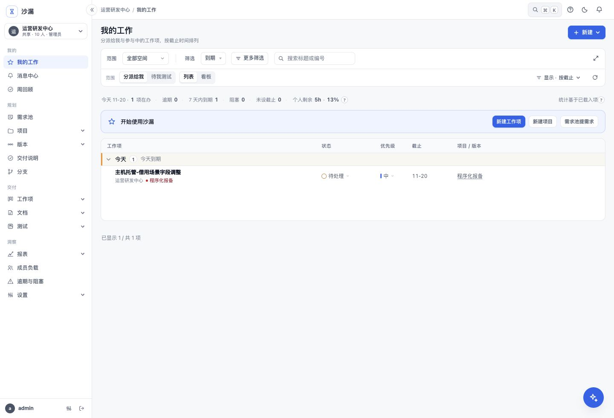
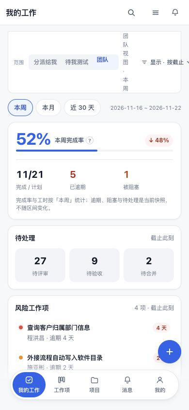
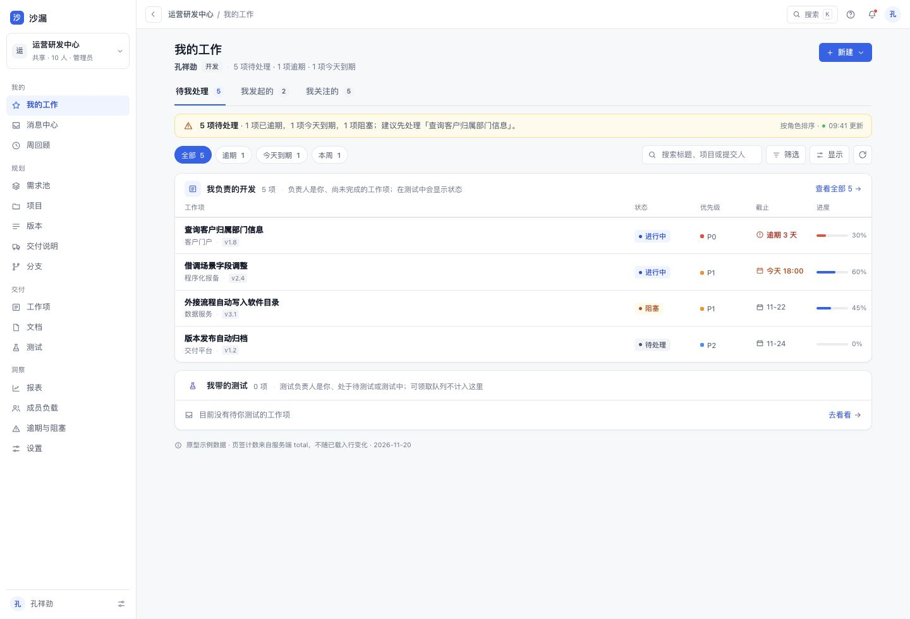
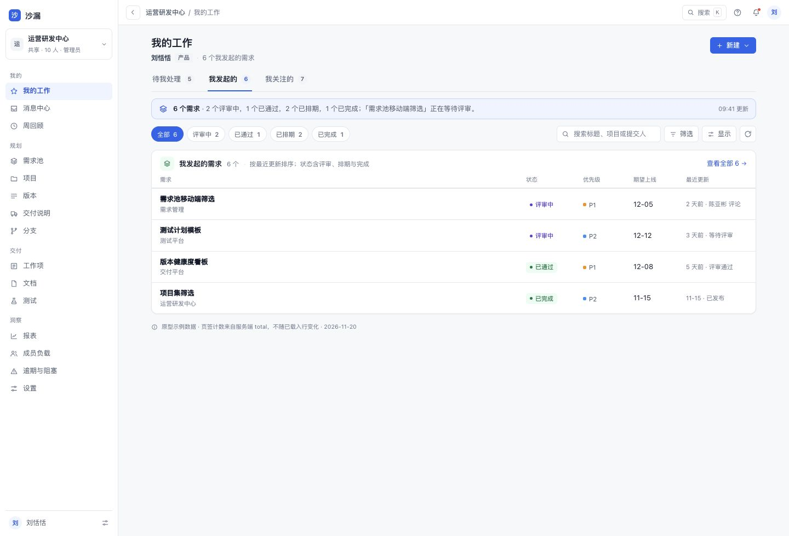
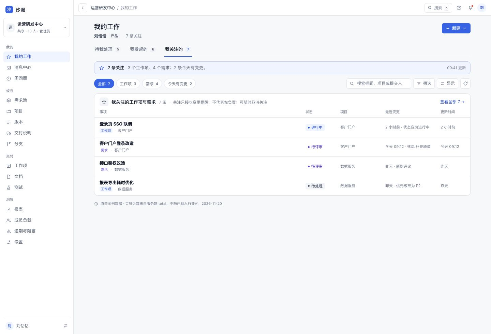
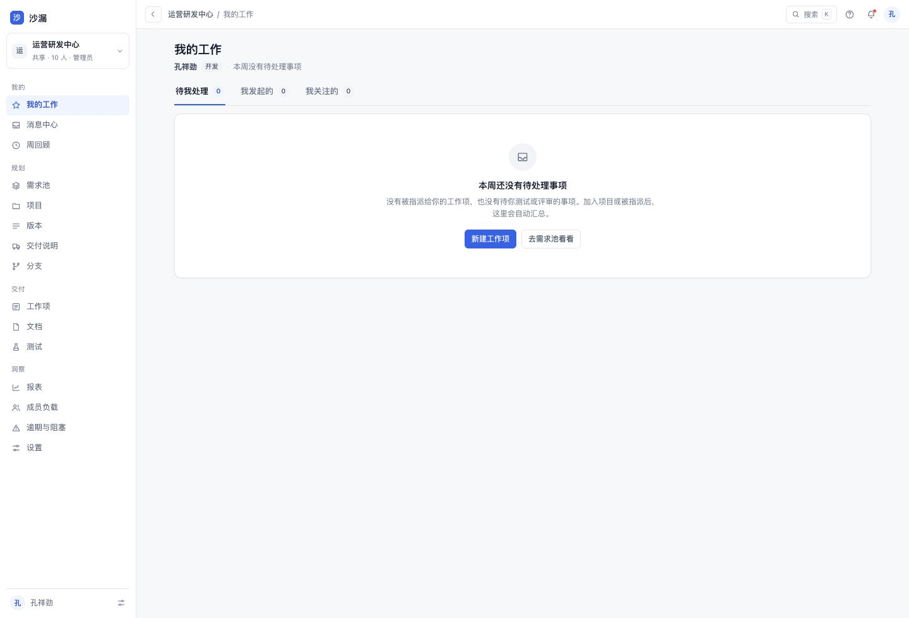
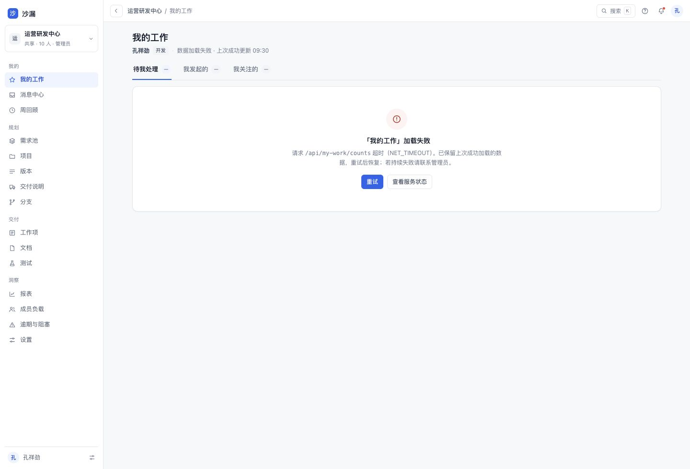

# 我的工作 · 多角色个人工作台设计

日期：2026-11-20
范围：「我的工作」页签、工具条、分区、空/错/加载态；桌面 1440 与移动 390；团队页签仅移动端
对象：工作项（负责 / 测试）、需求（发起 / 评审 / 关注）、关注关系；不包含文档、测试计划、分支的完整工作流
方法：`uiux-review` 六层透镜 + `uiux-design` 设计简报、信息架构与页面规格
性质：设计提案 + 高保真原型；P1 已于 2026-11-20 实施，实施差异与验证见第 13 节
原型：[prototype.html](./prototype.html)（角色 / 页签 / 场景可切换，示例数据已标注）

---

## 0. 评审口径与证据

- 现状截图：`current-1440-v1.jpg`、`current-390-v1.jpg`，来自本机预览空间 SXk01「运营研发中心」，账号 admin。
- 代码核查：`frontend/index.html`、`frontend/js/views/mine.js`、`frontend/js/core/mobile-rules.js`、`TaskMapper.xml`、`MyTasksController.java`、`DemandController.java`、`TaskWatchService.java`、`sql/36_task_watch.sql`、`sql/104_demand_watch.sql`。
- 原型截图：`proto-*.jpg`，均由同一份 HTML 在无头 Chrome 中截取；1440×980、390×844（团队另附 390×1500 全文）。
- 原型数据为合成示例，页脚与文末均已标注；不代表线上账号的真实数量。
- 严重度：P0 破损（本周可改）、P1 结构（一个迭代）、P2 打磨（随功能迭代）。

页面四问（现状）：

| 问题 | 现状回答 | 结论 |
|---|---|---|
| 我在哪 | 当前空间 / 我的工作，有面包屑 | 成立 |
| 现在是什么状态 | 分派给我或待我测试；统计基于已载入项 | 部分成立：看不到我发起、我关注 |
| 我能做什么 | 看列表/看板、改筛选、打开详情 | 不成立：产品、测试的评审/关注没有入口 |
| 做完会发生什么 | 行内状态可改，操作有提示 | 部分成立：关注只发通知，没有回看入口 |

---

## 1. 结论先行

**判断：现有页面是「我的任务清单」，不是「我的工作台」。需要一次信息架构调整，不需要重做壳层。**

现状把“个人关系”只建模成两种：负责人和测试负责人。开发之外的角色因此没有落点：产品发起的需求只能去需求池逐个找，负责人待评审的需求没有汇总，关注功能只产生通知、无法回看。移动端还叠了一个 P0：团队范围控件被挤进页签行，在 390 下逐字竖排。

最硬的四条证据：

1. 390 下「团队视图 · 本周」竖排换行，范围控件与页签挤在同一行（`current-390-v1.jpg`）。
2. 「待我测试」把“测试负责人是我”和“无人认领、我有权限领取”混在一个计数里（`TaskMapper.xml:278-300`；空态文案 `mine.js:1146-1149` 明说“没人认领的待测队列也汇总在这里”）。
3. 需求关注已有表与接口（`sql/104_demand_watch.sql`、`DemandController.java:211-228`），但没有“我关注的需求”列表；任务关注同理（`TaskWatchService.java:44-72`，只返回单条 watching 状态）。
4. 桌面同时出现两个「范围」：空间范围和关系范围；关系页签又与列表/看板同排（`index.html:608-616`）。

目标形态：**待我处理 / 我发起的 / 我关注的**（+ 移动端负责人可见的“团队”）。角色只决定分区顺序与默认落点，不改变权限；每一屏只保留一个主操作；计数来自服务端 total，不随已载入行变化。

---

## 2. 现状六层审计

### 2.1 发现清单

| ID | 严重度 | 透镜 | 位置 | 证据 | 用户成本 | 改法 | 验证 |
|---|---|---|---|---|---|---|---|
| F1 | P1 | 信息架构 | 我的工作页签 | 只有 `mine/test/team` 三种模式（`mine.js:722-745`） | 产品、负责人找不到“我发起/待我评审”；关注无法回看 | 改为 3 个关系页签 + 团队；关注只放关注项 | 4 个角色走查首屏 |
| F2 | P1 | 状态语义 | 待我测试 | SQL 同时命中“已认领给我”和“无人认领且可写”（`TaskMapper.xml:278-300`） | 计数虚高，分不清哪些是我的测试 | 「我带的测试」严格只含测试负责人；可领取单独一行次级入口 | 断言未认领项不进入个人计数 |
| F3 | P0 | 响应式 | 390 团队范围 | “团队视图 · 本周”逐字竖排（`current-390-v1.jpg`） | 范围不可读、难点击 | 范围条独占一行，页签只放页签名；390 截图复测 | 390 无竖排、无横向溢出 |
| F4 | P1 | 信息架构 | 桌面工具条 | 两个「范围」：空间范围与关系范围；页签与列表/看板同排（`current-1440-v1.jpg`、`index.html:608-616`） | 用户误以为页签是筛选，返回时丢失上下文 | 关系统一进页签；关系不叫“范围”；视图收进“显示” | 桌面 1440 走查 |
| F5 | P1 | 任务路径 | 全页 | 角色只是展示字段，页面顺序不随角色变化（`mobile-rules.js:11-18` 只区分 team/mine） | 测试、产品每天先看到与自己无关的列表 | 角色决定分区顺序；默认页签取第一个非空 | 开发/测试/产品/负责人各截一屏 |
| F6 | P1 | 信息架构 | 需求评审 / 分支验收 | 需求查询没有评审人维度（`DemandController.java:80`）；验收按项目写权限 | 评审队列只能进各项目找 | 待我处理增加「待我评审的需求」，按项目写权限、排除本人提交 | 有/无写权限两种账号对照 |
| F7 | P2 | 视觉 / 统计 | 统计行 | 今天/7 天/逾期/阻塞与引导卡重复；计数基于已载入项（`mine.js:47`） | 数字与页签不一致，0 值被红黄强调 | 一屏一句结论；页签计数用服务端 total；0 不强调 | 计数与接口 total 一致 |
| F8 | P2 | 任务路径 | 页头 + 工具条 | 页头「新建」与引导卡「新建工作项」重复；工具条 12 个控件（`current-1440-v1.jpg`） | 主操作不唯一，筛选压过创建 | 去掉引导卡；工具条四段；主操作只在页头 | 首屏只有一个实心主按钮 |
| F9 | P1 | 移动端 | 默认落点 | 负责人/管理员默认进团队（`mobile-rules.js:11`） | 管理者在手机看不到自己的工作 | 默认进「待我处理」；团队变为显式页签 | 390 首屏是个人事项 |
| F10 | P2 | 一致性 | 计数与空态 | 页签无计数；空态按任务类型写死（`mine.js:1146-1154`） | 切换页签后不知道有多少；空态解释不完整 | 页签徽标 + 分区空态写原因与下一步 | 逐页签走空态 |
| F11 | P2 | 可访问性 | 390 控件 | 范围与页签同排时控件低于 44px（目测 ±2px，待实测） | 误触 | 页签 46、chips 44、行 ≥56、底部导航 56 | 390 控件尺寸表 |

### 2.2 做得好的地方（保留）

- 状态色有文字兜底，阻塞/逾期/完成不靠颜色单独表达。
- 任务与需求都有可见的「关注」入口，通知覆盖评论、状态、回收站（`TaskWatchService.java:147`、`sql/104_demand_watch.sql` 注释）。
- `myTasksWhere` 已处理“仅显示名匹配”的历史数据与项目可见性（`TaskMapper.xml:302-307`），可直接复用。
- 空态有下一步动作；焦点环全局可见；数字列右对齐。
- 移动端团队页签的完成率、待评审/待验收/待合并、风险与成员负载结构成立，问题只在入口和布局。

### 2.3 现状截图





---

## 3. 角色 × 工作矩阵

角色来自 `job_title`（展示字段），权限仍由 `workspace_member.role` 与 `project_member.access` 决定。角色只改顺序与默认落点。

| 角色 | 默认页签 | 第一分区 | 第二分区 | 第三分区 | 我发起 | 我关注 | 团队 |
|---|---|---|---|---|---|---|---|
| 开发 | 待我处理 | 我负责的开发 | 我带的测试 | 待我评审（仅项目写权限） | 有 | 有 | 否 |
| 测试 | 待我处理 | 我带的测试 | 我负责的开发 | 待我评审（若有写权限） | 有 | 有 | 否 |
| 产品 | 待我处理 | 待我评审的需求 | 我带的测试（兼岗时） | 我负责的开发 | 有 | 有 | 否 |
| 负责人 / 管理员 | 待我处理 | 待我评审的需求 | 我带的测试 | 我负责的开发 | 有 | 有 | 移动端 |
| 只读成员 | 待我处理 | 我负责的开发 | 我带的测试（若有） | — | 有 | 有 | 否 |

工作对象与字段：

| 对象 | 个人关系 | 主状态 | 本页展示 |
|---|---|---|---|
| 工作项 | `owner_user_id`（含显示名兜底） | 待处理/进行中/测试中/阻塞 | 状态、优先级、截止、进度 |
| 工作项（测试） | `test_owner_user_id` + 测试列 | 待测试/测试中/阻塞 | 测试进度、提测人/时间、截止 |
| 需求 | `created_by`（账号 ID 或显示名） | 评审中/已通过/已排期/已完成/已关闭 | 状态、优先级、期望上线、最近更新 |
| 需求（评审） | 项目写权限，且非本人提交 | 待评审 | 提交人、等待天数、优先级 |
| 关注 | `task_watch` / `demand_watch` | 沿用对象状态 | 类型、最近变更、更新时间 |

“可领取的测试”不是个人关系，只在「我带的测试」分区底部出现一行文字入口，不进入页签计数。

---

## 4. 目标信息架构

```
我的工作
├─ 待我处理        （默认，第一个非空页签）
│  ├─ 我负责的开发       owner=我，未完成
│  ├─ 我带的测试         test_owner=我，处于待测试/测试中
│  │  └─ 另有 N 个未指派测试可领取（次级入口，不计入）
│  ├─ 待我评审的需求     项目写权限，状态=待评审，排除本人提交
│  └─ 待我验收/合并的分支  P2，仅负责人
├─ 我发起的         created_by=我，全部状态
├─ 我关注的         task_watch / demand_watch
└─ 团队            仅移动端负责人/管理员（沿用现有内容，修布局）
```

规则：

1. **一个个人关系只出现一次**。工作项若同时是我负责且我测试，优先显示在“开发”，测试分区用测试视角会重复计数的问题在接口层去重。
2. **评审是权限队列，不是指派**。没有项目写权限就隐藏整个分区；有权限但为本人提交的需求不出现在待评审。
3. **关注只读**。关注不代表负责，不提供“完成/改状态”，只提供打开详情与取消关注。
4. **默认页签**取第一个非空：待我处理 → 我发起的 → 我关注的。新用户不会落在空白页。
5. **“查看全部”在页内展开**，不跳去工作项/需求池；跨页跳转会丢失工作台上下文。数据多时分页追加，页签计数不变。
6. **一处统计**：页签徽标给全量；分区标题给筛选后数量；页头只给一句结论。

---

## 5. 页面规格

### 5.1 桌面 1440 骨架

| 顺序 | 区块 | 内容 | 状态 |
|---|---|---|---|
| 1 | 产品壳层 | 空间选择、面包屑、全局搜索、通知 | 保留 |
| 2 | 页头 | H1「我的工作」；姓名 + 角色 + 一句结论；右端唯一主操作「新建」 | 空/错时隐藏主操作 |
| 3 | 页签 | 待我处理 / 我发起的 / 我关注的，带服务端计数 | 计数加载中显示 — |
| 4 | 结论条 | 一条主结论 + 建议先做的事 + 更新时间；风险时用警示色 | 空态不显示 |
| 5 | 工具条 | 左侧范围 chips；右侧搜索、筛选、显示、刷新 | 每段 ≤3 个控件 |
| 6 | 分区 | 标题、数量、口径说明、查看全部；列头；预览 ≤4 行；空态/领取行 | 逐分区 |
| 7 | 页脚 | 数据更新时间、示例数据声明（原型） | — |

### 5.2 分区与字段

**我负责的开发**

| 列 | 内容 | 规则 |
|---|---|---|
| 工作项 | 标题 + 项目 · 版本 | 长标题省略，hover 显示全称 |
| 状态 | 待处理 / 进行中 / 测试中 / 阻塞 | 淡底深字 |
| 优先级 | P0–P3 色点 + 代码 | 颜色不单独承载 |
| 截止 | 今天/逾期 N 天/日期 | 逾期红、今天橙并加粗 |
| 进度 | 50px 进度条 + 百分比 | 逾期进度条用红色 |

**我带的测试**

| 列 | 内容 |
|---|---|
| 工作项 | 标题 + 项目 · 版本 |
| 测试进度 | 已测/总数，如 8/12 |
| 状态 | 待测试 / 测试中 / 阻塞 |
| 提测 | 时间 + 提测人 |
| 截止 | 今天/逾期/日期 |

分区底部：`另有 N 个未指派测试可领取 · 不计入你的待处理` + 「去领取」。N=0 不显示。

**待我评审的需求**

| 列 | 内容 |
|---|---|
| 需求 | 标题 + 项目 |
| 提交人 | 显示名 |
| 优先级 | P0–P3 |
| 期望上线 | 日期 |
| 提交 | 日期 + 等待天数 |

分区说明常驻一行：“你有项目写权限且尚未评审；不含你本人提交的需求。”等待 ≥3 天的提交列用警示色。

**我发起的需求**

状态 chips：全部 / 评审中 / 已通过 / 已排期 / 已完成。列：需求、状态、优先级、期望上线、最近更新。排序默认最近更新，不按期望日期，避免“旧需求排前面”。

**我关注的**

类型 chips：全部 / 工作项 / 需求 / 今天有变更。列：事项（带类型标签）、状态、项目、最近变更、更新时间。说明：“关注只接收变更提醒，不代表你负责；可随时取消关注。”

### 5.3 空态 / 错误 / 加载

| 状态 | 长什么样 | 能做什么 |
|---|---|---|
| 首次加载 | 结论条与两张分区骨架，页签计数显示 — | 等待，不阻塞页头 |
| 整页空 | 图标 + 原因 + 两个动作：“新建工作项”（唯一主操作）与“去需求池看看” | 创建或去来源页 |
| 分区空 | 分区保留，显示“目前没有待你测试的工作项” + 去看看 | 进入对应列表 |
| 筛选/搜索无结果 | “当前筛选下没有事项” + 清除筛选 | 一键还原；不伪装成整页空 |
| 错误 | “我的工作加载失败”、接口与错误码、上次成功时间、重试、查看服务状态 | 重试；页签计数 — |
| 部分失败 | 失败分区内嵌错误行，其他分区正常；页签计数对应项 — | 只重试失败分区（P2） |
| 只读 | 隐藏评审分区与领取入口；行可看不可改 | 打开详情只读 |

### 5.4 视觉与令牌

- 颜色取自 `frontend/css/tokens.css`：`--bg-app`、`--surface`、`--border`、`--text/-2/-3`、`--primary/--primary-soft/--primary-border`、六类语义色及其 `-fg`。
- 分区图标底色复用语义浅底：开发 `--primary-soft`、测试 `--plum-soft`、评审 `--warning-soft`、发起 `--success-soft`、关注 `--surface-sunken`。
- 字号：页标题 19、正文 12.5–13、元信息 10.5–11.5；数字 `tabular-nums`。
- 圆角与阴影只用令牌；卡片 11px、控件 6px、轻阴影。
- 状态徽标两种形态：淡底深字=只读状态；实心=筛选中/当前选中。没有第三种。
- 一屏一个实心主按钮：默认态在页头「新建」；空态在空卡「新建工作项」（页头主操作隐藏，避免两个实心按钮）。
- 功能色只用于状态与风险，不铺底；结论条在逾期/阻塞时用 `--warning-soft`，否则 `--primary-soft`。

### 5.5 交互

- 页签切换保留空间与显示偏好；范围 chips 与搜索重置（属于页签内范围）。
- 行点击或 Enter/Space 打开详情抽屉；行内不放多个操作按钮（P1）。评审、领取的动作在抽屉内完成（P2 可做行内快捷）。
- 「查看全部」原位展开，按钮变「收起」；不跳页。
- 搜索输入 150ms 防抖，焦点与光标位置保持；筛选菜单关闭后保留状态。
- 刷新显示骨架并保持筛选；完成后提示“已刷新”，不重置滚动。
- 计数与列表分离：页签徽标来自 `/api/my-work/counts`；列表加载不改徽标。

---

## 6. 移动端 390

- 顶部应用栏 56px：标题、搜索、更多、新建（44×44）。
- 页头只保留姓名 · 角色 · 一句结论，隐藏 H1 与页头「新建」。
- 页签横向滚动，46px 高；团队页签仅负责人/管理员可见。
- 结论条可换行，更新时间单独一行。
- 范围 chips 44px 高、横向滚动；搜索 + 筛选 + 显示 + 刷新共一行，各 44px。
- 分区变卡片：列头隐藏，行变三行——标题；项目/版本；状态 + 进度 + 提测 + 截止。
- 底部导航 56px，`我的工作` 高亮；内容留 76px 底部安全区。
- **团队页签**：范围 segmented 独占一行（宽度 100%），日期范围在其下居中；“待处理”3 格、风险、成员负载依次排列。这是对 F3 的直接修复。












---

## 7. 设计决策记录

| 决定 | 替代方案 | 代价 | 何时反悔 |
|---|---|---|---|
| 3 个关系页签 + 移动团队 | 单列表加一堆筛选 | 跨关系要切换 | 多数人只有 1–2 类事项时合并 |
| 待我处理按关系分区 | 所有事项混排按截止 | 纵向更长 | 单页事项长期 <5 条时合并分区 |
| 测试严格只算负责人 | 沿用“可领取 + 已认领”合计 | 首次进入可能为空 | 领取流程成为主要路径时改为双区并列 |
| 关注页签只放关注项 | “我的关注”聚合全部个人事项 | 与“待我处理”有入口重叠 | 用户明确要求单一聚合流 |
| 评审按项目写权限 | 指派评审人 | 无法精确到人 | 产品引入评审人字段后改为指派优先 |
| 角色只改顺序不改权限 | 角色直接控制可见性 | 角色字段不可信时排序失真 | `job_title` 成为受控枚举并参与权限 |
| 默认取第一个非空页签 | 固定默认“待我处理” | 空页会跳走 | 空页也有引导内容时固定 |
| 计数用服务端 total | 用已载入行数 | 多一次请求 | 计数接口不可用时降级为已载入并标注 |
| “查看全部”页内展开 | 跳到工作项列表 | 页面变长 | 单分区超过 200 条时改为独立子页 |
| 去掉统计网格与引导卡 | 保留 KPI | 少一个总览 | 需要周报式总览时另开“周回顾” |
| 移动团队范围独占一行 | 继续放在页签行 | 多占 48px | 页签行能容纳且不改语义时再收 |
| 空态隐藏页头主操作 | 保留两个入口 | 空态下无法从页头新建 | 组件规范要求页头恒定主操作时恢复 |

---

## 8. 后端与数据方案

### 8.1 接口

**计数（新增）**

```
GET /api/my-work/counts
→ { pending:{dev,test,review}, created, watched, claimable, updatedAt, matchedByNameOnly }
```

与列表使用同一套可见性条件；没有权限的分区直接返回 0 且不显示。

**工作项（扩展现有 `/api/my-tasks`）**

- `view=dev`：严格 `owner_user_id = 我`（保留显示名兜底），未完成。
- `view=test&strict=1`：严格 `test_owner_user_id = 我 AND board_column IN ('test','testing')`；不再包含待领取。
- `view=test&strict=0`：保留现有含领取队列的行为，供“去领取”使用。
- `view=watch`：`JOIN task_watch`，按关注时间/更新时间排序；只读。
- 返回项增加 `myRelation: owner | tester | watcher`，前端据此显示关系标签；同一条工作项只归一个主分区（owner 优先）。

**需求（新增 `/api/my-demands`）**

- `view=created`：`created_by = 账号ID OR created_by = 显示名`；保留 `matchedByNameOnly` 标记。
- `view=watch`：`JOIN demand_watch`。
- `view=review`：`status='review'`，且项目写权限或空间管理员，且 `created_by <> 我`。
- 统一过滤：空间、项目、优先级、关键词、分页；返回 `total`、`hasMore`、`statusCounts`。

**可选：跨对象搜索**（P2）`GET /api/my-work/search?q=`，先做本地筛选，不引入新表。

### 8.2 数据与索引

- 不改表结构。复用 `task_watch(user_id, workspace_id)` 与 `demand_watch(user_id, workspace_id)` 索引（`sql/36_task_watch.sql`、`sql/104_demand_watch.sql`）。
- 新增需求索引（建议，可随 P1 迁移）：

```sql
ALTER TABLE demand ADD INDEX idx_demand_ws_creator (workspace_id, created_by);
ALTER TABLE demand ADD INDEX idx_demand_ws_status (workspace_id, status);
```

- 权限判断复用 `myTasksWhere` 的项目可见性片段（`TaskMapper.xml:275-307`），避免两套口径。
- 评审队列排除本人提交，避免“自己审自己”；管理员也排除，需要他人评审时可指派。

### 8.3 性能与一致性

- 计数一次请求返回四项；列表按页签惰性加载，首屏只加载当前页签。
- 页签计数与列表 total 使用同一 SQL 条件；若列表加载后 total 变化，以计数接口为准并提示“有新变更，刷新查看”。
- 跨空间聚合：现有 `/api/my-tasks` 已是全局接口；需求接口同样按当前空间 + 可选“全部空间”处理，默认跟随壳层空间。

---

## 9. 分期

**P1（本次落地范围）**

- 3 个个人页签 + 移动团队页签。
- 开发 / 测试 / 评审 / 发起 / 关注五类分区。
- 服务端计数、一句结论、空/错/加载/筛选空态。
- 390 团队范围条修复；默认落点改个人事项；44px 控件。
- 不改表，只加索引；复用现有 watch 表。

**P2**

- 分支「待我验收/待合并」、文档「我负责的文档」、测试计划「我发起的计划」。
- 评审/领取的行内快捷动作；关注项取消关注。
- 跨对象搜索、保存的筛选、部分失败独立重试。
- 列表分页追加载（“查看全部”展开后）。

**P3**

- 桌面团队视图；角色偏好与置顶；每日摘要；跨空间聚合视图。
- 个人工作台小组件（可配置 3–6 个）。

---

## 10. 验收清单

**信息架构**

1. 开发、测试、产品、负责人四个角色首屏分区顺序符合第 3 节；每屏只有一个实心主按钮。
2. 页签为「待我处理 / 我发起的 / 我关注的」；负责人移动端多一个「团队」；桌面不出现团队。
3. 默认页签为第一个非空；三项全空时落到“待我处理”空态。
4. 关系不再叫“范围”；同一屏只有一个「范围」（空间）。

**任务路径**

5. 从任意角色进入，核心事项 ≤2 次点击打开详情；行支持 Enter/Space。
6. 「我带的测试」不含未认领项；未认领项只在分区底部一句入口出现。
7. 「待我评审」只对项目写权限显示，且不含本人提交。
8. 「我发起的」按最近更新排序；状态 chips 与计数一致。
9. 「我关注的」只含 watch 表对象；提供取消关注；不出现“完成”动作。

**状态与反馈**

10. 首次加载、整页空、分区空、筛选空、错误、部分失败、只读七种状态齐全，且文案与动作符合 5.3。
11. 错误态给出接口、错误码、上次成功时间与重试；不把失败显示为空或健康。
12. 刷新保留筛选、排序与滚动；搜索防抖且焦点不丢。
13. 所有计数来自服务端 total；加载更多不改变页签徽标。

**权限**

14. 无写权限用户看不到评审分区与领取入口；有权限但本人提交的需求不进入待评审。
15. 只读成员可打开详情但无编辑入口；导出/分享若出现按权限禁用并说明原因。
16. 跨空间时空间条件生效；显示名兜底匹配有标注。

**移动端**

17. 390 下团队范围条独占一行，无逐字竖排；`document.body.scrollWidth = 390`。
18. 页签、chips、工具按钮、行、底部导航触控目标 ≥44px。
19. 负责人默认进「待我处理」；团队需显式切换；底部安全区不遮挡最后一张卡。

**视觉**

20. 颜色、字号、圆角、阴影全部来自令牌；没有硬编码色值（原型除外）。
21. 状态徽标只有淡底深字与实心两种；颜色均配文字。
22. 数字右对齐且 `tabular-nums`；日期格式一致；0 值中性。

**数据**

23. 原型中所有示例数据有标注；验收时用真实账号核对计数与列表。
24. 四个角色的首屏截图与两类移动截图留档；差异逐项对照本文件。

---

## 11. 六层自审

| 透镜 | 自审结论 | 残留 |
|---|---|---|
| 1 信息架构 | 三种个人关系 + 团队有明确入口；评审与关注不再藏 | 文档 / 测试计划 / 分支仍在 P2；跨空间“全部空间”未在原型展示 |
| 2 任务路径 | 首屏一句结论；分区直达；领取与个人测试分离；查看全部原位展开 | 行内评审、领取是 P2；首次使用引导只有空态 |
| 3 交互反馈 | 加载、空、筛选空、错误、重试、刷新、搜索焦点、计数独立 | 部分失败只写了规格，原型未画；取消关注未做交互 |
| 4 视觉四原则 | 一屏一主操作；分区顺序即优先级；统计只出现一次；令牌统一 | 逾期时结论条为黄色，功能色占比接近上限，需要实际页面复核 |
| 5 一致性 | 页签/标签/状态徽标/日期/进度同形；计数口径唯一 | 团队完成率与个人进度是两套口径，已在团队卡注明“按计划口径” |
| 6 可访问性 / 响应式 | 390 无横向溢出；触控目标 ≥44；行可键盘打开；焦点环可见 | 原型未实现 Tab 键在页签间左右移动；颜色对比度以令牌为准，上线前需实测 |

原型实测：1440 与 390 的 `scrollWidth` 均等于视口宽；页签 3 个（移动负责人 4 个）；分区与行数随角色变化；无控制台异常。原型中的点击反馈为 toast，仅用于演示位置，不代表接口已接通。

---

## 12. 未覆盖与假设

- **实现状态**：P1 已按第 8、9 节落地（见第 13 节）；原型与实现的偏差以第 13 节为准，正文保留设计时口径。
- **评审人模型**：当前需求没有评审人字段，因此“待我评审”按项目写权限推导；若后续引入指派评审，应改为指派优先、权限兜底。
- **测试领取**：P1 只给入口，不重做领取流程；领取后进入「我带的测试」。
- **关注语义**：沿用现有通知范围（评论、状态、回收站），不新增“关注原因/分组”。
- **角色字段**：`job_title` 目前是展示字段，排序可降级为按数量；不得据此放开权限。
- **示例数据**：人物、项目、数量均为原型合成，已在页面页脚与截图中标注；验收须用真实数据复核。
- **桌面团队**：不在 P1；现有移动端团队内容只修布局，不重做统计口径。

---

## 13. 实施记录（2026-11-20）

### 13.1 落地文件

| 层 | 文件 | 内容 |
|---|---|---|
| 前端 | `frontend/js/views/mine.js` | 重写页面：页签、计数、结论条、工具条、五个分区、空/错/筛选空态、团队页、跨空间交接 |
| 前端 | `frontend/css/my-work.css` | 新增 378 行；颜色/字号/圆角全部用令牌，仅主色底上白字用 `#fff` |
| 前端 | `frontend/index.html` | `#view-mine` 骨架换成页签 + 结论条 + 工具条 + 正文 + 脚注；引入样式 |
| 前端 | `frontend/js/core/router.js`、`app.js`、`views/profile.js` | 页头副标题；空间就绪后按角色补进一次；切换空间文案改为“页签会保留” |
| 前端 | `frontend/sw.js` | SHELL 增补 `css/my-work.css`；`CACHE_NAME` 未改，未部署 |
| 后端 | `MyWorkController`、`MyWorkService`、`MyWorkMapper(.xml)`、`MyDemandQuery` | 新增 `GET /api/my-work/counts`、`GET /api/my-demands` |
| 后端 | `MyTasksController`、`MyTasksQuery`、`TaskQueryService`、`TaskMapper.xml` | `/api/my-tasks` 增加 `view=dev|test|pending|watch` 与 `strict`；测试口径严格只含测试负责人 |
| 后端 | `SseService` | 连接已 complete 时 `hello` 抛 `IllegalStateException` 的回收兜底 |
| 验证 | `tools/e2e/my-work-tabs.mjs`、本目录 `e2e-*.png` | 真实登录走查与截图 |

### 13.2 与规格 / 原型的偏差

| 项 | 规格 / 原型 | 实现 | 原因与影响 |
|---|---|---|---|
| 默认页签 | 取第一个非空 | 默认「待我处理」；首次进入且用户未手动切过时按计数落到第一个非空（待我处理 → 我发起的 → 我关注的）；之后记住上次页签（`ds.mineTab`），切换空间保留 | 每天回到工作台不被搬走；仍满足“新用户不落空白页” |
| 待我处理口径 | 开发 / 测试 / 评审三分区 | 工作项 `dev ∪ test` 取或并去重（同一工作项负责优先归开发）+ 待评审需求；可领取仍只在测试分区底部 | 按确认口径调整；避免同一工作项在两个分区重复出现 |
| 页签计数 | `pending:{dev,test,review}` | `pending:{tasks,dev,test,review}`；徽标 = `tasks + review`；工作项跨空间、需求限当前空间 | 多一个并集计数供徽标使用；口径写在页脚 |
| 评审权限 | 项目写权限，隐藏无权限分区 | 按**当前空间**项目写权限；`reviewAvailable=false` 时分区与徽标中的评审计数一并隐藏；排除本人提交，按提交时间升序 | 与后端现有权限模型一致；等得久的排在前面 |
| 测试进度 | “已测 / 总数” | 用子任务完成数 / 总数，列名仍是「测试进度」，并给提测时间与提测人 | 当前数据模型没有用例执行数；不新增字段 |
| 关注页签 | 任务 + 需求，取消关注列为 P2 | 任务（跨空间）与需求（当前空间）合并一张表，五列；行内「取消关注」并给 8 秒撤销 | 关注没有回看入口是本页要解决的核心问题，撤销提前到 P1 |
| 视图与统计 | 列表 / 看板、行内改状态、活动流 | 只保留列表；移除看板、行内改状态、统计网格、分组/二级/密度/显示字段/发布态筛选；页签徽标 + 分区标题是唯一两处数量（分组与排序已于 2026-11-27 恢复，见 13.5） | 工作台回答“先做什么”，不承担批量编辑；改状态进详情抽屉 |
| 分页与筛选 | 服务端分页 + 完整筛选 | 每类首载 100 条，底部「已载入 X / 共 Y · 继续加载」；搜索、chips、排序只作用于已载入行，页脚明示 | 不新增服务端搜索参数；避免“筛选后计数与页签矛盾”被误读 |
| 查看全部 | 页内展开 | 分区先显示 4 行，「查看全部 N」原位展开 / 收起 | 与规格一致；未做独立子页 |
| 团队 | 移动端负责人 / 管理员 | 仅移动端且 `owner/admin` 可见；范围默认「本周」；范围条独占一行，日期单独一行（修复 F3） | 桌面不出现团队；团队内容沿用原统计口径 |
| 跨空间打开 | 未细化 | 工作项在别的空间时，确认后切空间并交接打开（`ds.wsHandoff.v1`）；需求都在当前空间 | 不悄悄切换空间；返回后恢复页签 |
| 计数与可见行 | 计数以服务端为准 | 加载后行数大于服务端计数时徽标取较大值（`max`） | 外部写入关注、页面未刷新时，避免“列表有行但页签 0” |
| 状态覆盖 | 七态齐全 | 已做骨架、整页空、分区空、筛选空、错误（错误码 + 重试）、只读；**部分失败未做独立重试**，错误按页签粒度 | 计数失败不阻塞列表；分区级重试留 P2 |

### 13.3 验证

- 走查脚本 `tools/e2e/my-work-tabs.mjs`（独立 9227 端口临时 profile，真实登录 admin，预览 8081 + 后端 8080）全部通过，覆盖：
  - 桌面 1440：三页签、服务端计数、单一选中、结论条、工具条、页头副标题；待我处理三分区与顺序；真实写入任务与需求关注后出现两行、五列、类型标签、行内取消关注；取消 → 8 秒「撤销」→ 撤销恢复；我发起 chips 与行；搜索无结果落筛选空态。
  - 移动 390：四个页签、无横向溢出（`scrollWidth` 差 0）、页签 46px、chips 44px；团队范围条三档按钮 111×44 横排、日期独占一行；团队三分区（待处理 / 风险工作项 / 成员负载）。
  - 无控制台错误；测试写入的两条关注已用 DELETE 清理。
- 截图：`e2e-pending-1440-v1.png`、`e2e-created-1440-v1.png`、`e2e-watched-1440-v1.png`、`e2e-pending-390-v1.png`、`e2e-team-390-v1.png`。
- 后端全量测试（JDK 8）：1551 个用例，0 失败、0 错误（`backend/target/surefire-reports`）；`MyTasksControllerPaginationTest` 已改为 9 参分页签名。
- 走查中修掉两处显示问题：移动端搜索提示被截断，改为「搜索事项」；评审「提交」列原来的完整时间 + 等待天数会换行撑高行，改为日期 + 等待天数并禁止换行，完整时间进 `title`。
- **未实测**：非管理员成员的 390 视图（团队页签应隐藏、只剩三个页签）；按代码 `canTeam = isMobile && owner/admin` 判定，未用成员账号走查。
- **未实测**：评审分区在“无项目写权限”账号下的隐藏效果；只验证了管理员账号。

### 13.4 残留

- 未提交、未部署；Service Worker `CACHE_NAME` 未升版，部署时必须同时加版本号。
- 部分失败独立重试、保存筛选、跨对象搜索、分支验收 / 文档 / 测试计划分区、桌面团队均未做。
- 需求只覆盖当前空间；切空间重载，不做跨空间需求聚合。
- 评审仍按项目写权限推导，没有指派评审人字段。
- 「去领取」打开当前空间可领取测试表；领取动作仍在工作项详情内完成。

### 13.5 增补：分区内分组与默认排序（2026-11-27）

起因：三个页签各自一次载入最多 100 行，平铺后难以扫读；待我处理原默认按截止时间排序，与「先看最近有变化的」直觉不符。第 9 节与 13.2 中「P1 移除分组」的口径由本节取代。

| 项 | 原实现 | 2026-11-27 起 |
|---|---|---|
| 默认排序 | 待我处理按截止时间；其余按最近更新 | 三个页签统一按最近更新倒序 |
| 排序选项 | 待我处理：截止时间 / 优先级；我发起：优先级 / 期望截止 | 待我处理：最近更新 / 截止时间 / 优先级；我发起：最近更新 / 优先级 / 期望截止；我关注：最近更新 / 优先级 |
| 分组 | 无 | 「显示 → 分组」：按项目 / 类型 / 状态 / 优先级；待我处理保留四分区，在每个分区内部再分组，且不提供按类型（分区本身已按类型拆分） |
| 分组头 | — | 组名 + 条数，可点击折叠；组顺序：优先级 P0→P3、状态按流转顺序、其余按组内最新更新；组内行沿用当前排序 |
| 分区截断 | 无分组时先显示 4 行 | 分组开启时直接列出已载入的全部行；「查看全部」仍只在未分组时出现 |
| 记忆 | — | 分组选择按页签存本机（`ds.mineGroup.v1`）；折叠状态按「分区 + 维度 + 组」存本机（`ds.mineGfold.v1`）；排序只存会话 |
| 计数 | 页签徽标 + 分区标题 | 不变；分区标题追加「· N 组」，页签计数仍取服务端 |

验证：`mine.js` 通过 ESM 语法检查；离线预览稿实测显示菜单分组四项（待我处理无「按类型」）、分组头渲染与折叠、分区计数带「· N 组」、控制台无错误。未接真实后端逐项点击；我发起的 / 我关注的分组未用真实数据验证；移动端 390 未复测。
