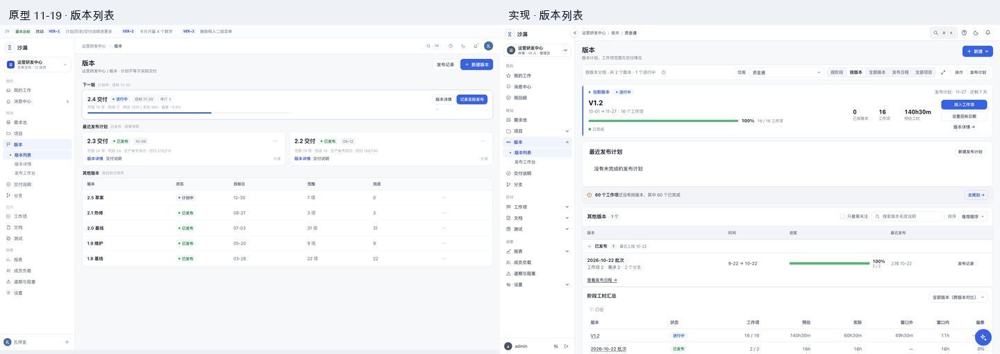
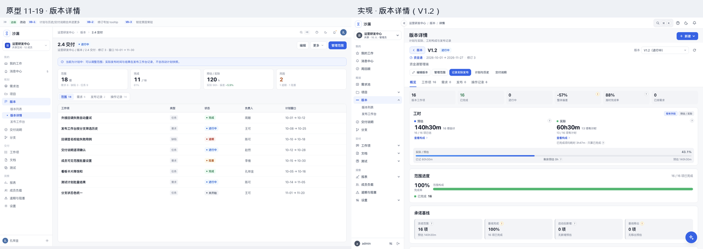
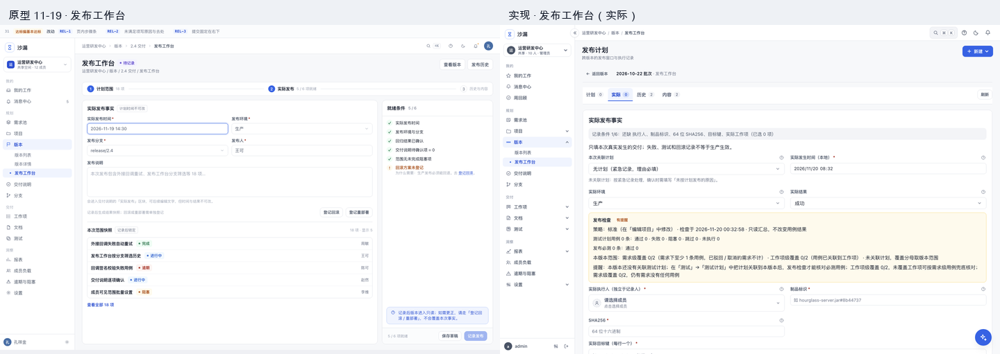

# 版本域页面与原型一致性审计

日期：2026-11-20  
范围：版本列表（按阶段 / 按版本 / 全部版本 / 发布日程 / 全部项目）、版本详情、发布工作台及其页签  
代码基线：干净 worktree，HEAD `0f02571`  
结论：**不一致，属于多轮原型混合落地**。P0 0 条；P1 6 条，归并为 3 个问题；P2 17 条，归并为 10 类；另有 1 项提案未落地、4 处原型自身冲突。本轮未修改产品代码。

## 一句话结论

版本域的骨架已经按 11-16 / 11-19 落地：版本列表是「下一版 + 发布计划 + 其他版本」，详情是「状态驱动主操作 + 锁定」，发布工作台是「计划 / 实际 / 历史 / 内容」四面。  
但顶部仍是旧的五口径工具栏，最近发布计划查的是未完成计划，详情头部仍是 6 格 KPI + 双页头，发布工作台仍是四页签长表单。这些与 11-19 最新原型不一致，也不是同一套结构。

## 审计基线

| 原型 | 作用 | 与本轮的关系 |
| --- | --- | --- |
| `docs/preview/version-page-redesign-v2-2026-11-16.html` | 版本页 3 页签、列表 + 详情子页 | 实现采纳了详情 5 页签和列表骨架 |
| `docs/preview/version-list-before-after-2026-11-17.html` | 只对齐列表：需关注、状态命名、阻塞段 | 已落地；顶栏三页签等明确列为范围外 |
| `内部资料/uiux-review-20261118/原型-2026-11-19/全站改版原型.html` | 七原则逐页改版，`p-versions` / `p-version-detail` / `p-release` | **最新视觉与结构基线**，多项未落地 |
| `内部资料/prototypes/version-ia-2026-11-19/index.html` | 版本页信息架构建议方案，4 项收敛 | **最新 IA 基线**，4 项均未落地 |
| `内部资料/prototypes/release-ia-2026-11-19/index.html` | 发布提为一级入口、下一次发布、双视图 | 提案，未落地；涉及菜单改造 |
| `docs/audit/release-prep-2026-11-20/prototype.html` | 关注计划、通知成员、回执 | 提案，未落地 |

原型本身存在冲突，先说明，避免把「实现没跟全站稿」误判成 bug：

1. 版本列表：11-19 全站稿是「版本 / 状态 / 目标日 / 范围 / 完成」，无搜索、无分组；11-19 IA 稿是「版本 / 时间 / 进度 / 最近发布」+ 分组 + 搜索 / 排序。实现跟的是 IA 稿。
2. 最近发布计划：11-19 全站稿有该卡，定义为「已发布 · 结果快照」；11-19 IA 稿没有该卡。实现有卡，但口径与全站稿不同。
3. 版本详情：11-16 是 5 页签（概览 / 工作项 / 需求 / 发布记录 / 动态）；11-19 全站稿是 4 页签（范围 / 需求 / 发布记录 / 操作记录）+ 4 格 KPI。实现跟的是 11-16。
4. 发布工作台：11-19 IA 稿明确「工作台继续用计划 / 实际 / 历史 / 内容四个面」；11-19 全站稿改成 3 步条 + 右侧就绪条件 + 底部固定提交。实现跟的是 IA 稿。

因此，要判断「是否一致」，必须先指定以哪一份为准。下文按「IA 看 11-19 IA 稿，视觉结构看 11-19 全站稿」对照，冲突处单独标注。

## 对照结果

### 1. 版本列表

原型：`全站改版原型.html#p-versions`（2700–2756 行），IA 建议：`version-ia-2026-11-19/index.html`（412–441、494–502 行）。  
实现：`frontend/index.html:1096-1117`，`frontend/js/views/phase.js:1355-1415`、`2224-2290`、`1572-1590`。

已对齐：

- 页面标题「版本」和副标题「版本计划、工作项范围与交付情况」。
- 「当前版本 / 下一版」焦点卡、未排版本提示、其他版本队列、阶段工时汇总。
- 列表行的需关注筛选、搜索、排序、工作项 / 需求 / 分支副标题、阻塞段、状态命名、行尾 kebab。
- 已发布版本的内容只读与「最近上线」提示。

残留差异：

| # | 级别 | 差异 | 状态 | 证据 | 影响 |
| --- | --- | --- | --- | --- | --- |
| 1 | P1 | 顶部仍是五个并排口径：按阶段 / 按版本 / 全部版本 / 发布日程 / 全部项目；默认落在「按阶段」 | 未落地 | `index.html:1104-1113`；`phase.js:38`；截图 `impl-phase-stage-1440.png` | 用户进版本页先看到阶段统计，不是版本；单项目与跨项目口径混在同一排按钮 |
| 2 | P1 | 「按阶段」未改名「首版 / 迭代分析」；跨项目三口径未收进「跨项目视图」下拉 | 未落地 | IA 稿 412–441、494–497 行；`index.html:1105-1112` | 五个按钮语义混层；「按阶段」容易被读成可创建的阶段对象 |
| 3 | P1 | 「发布计划」按钮未改为「发布计划与记录」，发布记录仍藏在计划工作台的历史页签里 | 未落地 | IA 稿 441 行；`index.html:1115` | 发布记录是不可变事实，入口名称只提计划，用户找不到记录 |
| 4 | P1 | 视图模式不写入 URL；刷新或分享后回到「按阶段」 | 未落地 | `phase.js:38`、`4813-4815`；无 `pmode` 解析 | 原型验收要求「刷新与分享保持同一视图」，当前做不到 |
| 5 | P1 | 「最近发布计划」查的是 `status=open` 的未完成计划，不是原型的结果快照 | 口径不同 | `phase.js:2255`、`2270`；原型 2723–2735 行 | 版本已发布后卡片显示「没有未完成的发布计划」，列表看不到发布结果 |
| 6 | P2 | 焦点卡是 3 个数字（已排需求 / 工作项 / 预估工时）+ 排入工作项 / 设置目标日期；原型是 4 或 6 个数字，主操作是记录实际发布 / 计划与记录 | 未落地 | `phase.js:1406-1413`；原型 2707–2720 行；IA 稿 500 行 | 焦点卡没有「实际 vs 预估 / 风险 / 距目标」；记录发布要多进一层 |
| 7 | P2 | 其他版本表头是「版本 / 时间 / 进度 / 最近发布」，带搜索、只看需关注、排序和分组折叠；全站原型是「版本 / 状态 / 目标日 / 范围 / 完成」 | 原型冲突 | `phase.js:1577-1585`；原型 2737–2752 行 | 实现跟 IA 稿；若以全站稿为准，列信息需重排 |
| 8 | P2 | 「阶段工时汇总」整块保留在列表底部；11-19 全站稿没有该块 | 仅结构 | `phase.js:2240`、`2104` | 首屏更长；分析能力与列表抢空间 |

### 2. 版本详情

原型：`全站改版原型.html#p-version-detail`（2759–2800 行）。  
实现：`frontend/js/views/version.js:107-113`、`535-557`、`639-643`，`frontend/js/core/router.js:74`。

已对齐：

- 状态驱动的主操作，例如进行中且可发布时显示「记录实际发布」。
- 「正式发布后只读」「已终态」锁定标签常驻。
- 版本名、状态、项目、窗口、修订号、负责人信息。
- 范围 / 需求 / 发布 / 操作记录的页签结构（实现多一个概览）。
- 工时、范围进度、承诺基线、里程碑等工作区内容。

残留差异：

| # | 级别 | 差异 | 状态 | 证据 | 影响 |
| --- | --- | --- | --- | --- | --- |
| 9 | P2 | 双页头：外层「版本详情 + 计划与实际、工时构成与发布记录」，内层又显示版本名 + 状态下拉 | 仅结构 | `router.js:74`；`version.js:535-557`；截图 `impl-version-detail-active-1440.png` | 同一页出现两个标题，首屏纵向空间被吃掉；原型只有一个以版本名为主的页头 |
| 10 | P2 | KPI 是 6 格：版本工作项 / 已完成 / 进行中 / 整体偏差 / 准时完成率 / 已排需求；没有「风险」格 | 口径不同 | `version.js:639-643`；原型 2770–2775 行 | 原型用「风险 = 逾期 + 阻塞」回答「这版能不能按时发」，实现用完成率和偏差替代，风险要回工作项筛选 |
| 11 | P2 | 页签是 概览 / 工作项 / 需求 / 发布 / 操作记录；原型是 范围 / 需求 / 发布记录 / 操作记录 | 未落地（相对 11-19） | `version.js:107-113`；原型 2776–2781 行 | 多一个概览页签，首屏不是范围表；「工作项」与「范围」、发布与发布记录名称不一致 |
| 12 | P2 | 低频动作平铺：编辑版本 / 管理范围 / 记录实际发布 / 计划与历史 / 交付说明 | 未落地 | `version.js:535-550`；原型 2763–2767 行 | 原型要求合并进「更多」，当前五个按钮同排，主次不够清楚 |
| 13 | P2 | 工作项表列是 工作项 / 类型 / 负责人 / 状态 / 截止 / 预估 / 实际 / 窗口外 / 窗口内，并且有筛选条；原型是 工作项 / 类型 / 状态 / 负责人 / 计划窗口 | 口径不同 | 截图 `impl-version-detail-scope-1440.png`；原型 2783–2797 行 | 实现强调工时归集，原型强调计划窗口；开始日期没有进表 |

### 3. 发布工作台

原型：`全站改版原型.html#p-release`（2803–2855 行）；IA 口径：`release-ia-2026-11-19/index.html`（497 行）。  
实现：`frontend/js/views/release.js:12`、`143-164`，`frontend/js/views/phase.js:3273-3275`、`3695-3710`。

已对齐：

- URL 带 `id / reqId / tab`，刷新、分享、后退能回到同一页签。
- 计划 / 实际 / 历史 / 内容四个面，符合 11-19 IA 稿。
- 发布历史与版本操作记录分开；历史支持结果 / 环境 / 操作过滤。
- 实际发布事实包含时间、环境、结果、执行人、制品、SHA256、目标键、范围快照。
- 结束后只读；回滚 / 重部署单独登记。

残留差异：

| # | 级别 | 差异 | 状态 | 证据 | 影响 |
| --- | --- | --- | --- | --- | --- |
| 14 | P1 | 菜单叫「发布工作台」，路由标题叫「发布计划」；无参数进入时页内标题又变成「最近发布计划」 | 命名不一致 | `index.html:189`；`router.js:75`；`release.js:56`、`109`；截图 `impl-release-list-1440.png` | 用户会以为是两个页面；从菜单进入看到的是「最近发布计划」空页，不是工作台 |
| 15 | P2 | 没有页内 3 步条（计划范围 → 实际发布 → 历史与内容） | 未落地（REL-1） | 原型 2809–2815 行；截图 `impl-release-actual-1440.png` | 用户不知道当前处在哪一步，四个页签与三步流程不是一一对应 |
| 16 | P2 | 没有右侧「就绪条件 5/6 + 原因 + 去登记回滚」卡片 | 未落地（REL-2） | 原型 2838–2849 行；实现用顶部「记录条件 1/6」提示条 | 条件缺失只给一串数字，没有逐项原因与去处 |
| 17 | P2 | 没有底部固定「保存草稿 / 记录发布」 | 未落地（REL-3） | 原型 2850 行；实现按钮在长表单底部 | 长表单滚动后提交按钮不可见 |
| 18 | P2 | 实际发布表单字段远多于原型：计划关联、发布检查、执行人、制品标识、SHA256、目标键、未按计划原因、失败原因等 | 能力差异，非缺失 | `phase.js:3695-3710`；截图 `impl-release-actual-1440.png` | 原型是简化视图；若按原型收口，需要先决定哪些字段降级或折叠 |
| 19 | P2 | 发布历史里操作名 `publish` 未翻译，显示「成功 · 生产 · publish」；操作筛选也只有 部署 / 重部署 / 回滚 | 文案 bug | `frontend/js/lib/format.js:240`；截图 `impl-release-history-1440.png` | 中英混排；`publish` 记录无法用操作筛选单独筛出 |
| 20 | P2 | 11-20 发布准备提案（关注此计划、通知成员、通知未确认、回执、关注列表）未实现 | 提案未落地 | `docs/audit/release-prep-2026-11-20/prototype.html:576-782`；`frontend/js` 无对应逻辑 | 属于下一阶段能力，不计为当前缺陷，但不要按「已实现」验收 |

### 4. 发布日程 / 全部版本 / 全部项目

原型：11-16 是 3 页签（版本 / 发布日程 / 投入分析）；11-19 IA 稿要求跨项目三口径收进「跨项目视图」下拉。  
实现：`phase.js:342-460`（全部版本）、`465-590`（发布日程）、`254-333`（全部项目）。

已对齐：

- 发布日程的跨项目只读汇总、项目 / 环境 / 状态 / 时间范围筛选、0 份计划空态。
- 全部版本的项目分组、可管理项目勾选、跨项目新建发布计划、只读项目不可勾选。
- 全部项目的工时口径、首版 / 迭代准时率、项目明细、最近版本。

残留差异：

| # | 级别 | 差异 | 状态 | 证据 | 影响 |
| --- | --- | --- | --- | --- | --- |
| 21 | P2 | 发布日程页工具条 meta 显示「全部项目」，不是「发布日程」 | 文案 bug | `phase.js:507`；截图 `impl-phase-schedule-1440.png` | 用户以为还在全部项目视图 |
| 22 | P2 | 11-16 的「投入分析」页签未落地；实现用「全部项目」跨项目对比替代 | 口径不同 | 11-16 原型 998–1070 行；`phase.js:254-333` | 单项目的阶段时间轴与版本投入对比没有独立入口 |
| 23 | P2 | 跨项目能力仍是三个并列按钮，不是「跨项目视图」下拉 | 未落地 | IA 稿 428–438 行；`index.html:1108-1112` | 与 P1-2 同一问题，修复时一并处理 |

## 差异清单（按优先级）

### P0

无。版本列表、详情、发布工作台的主流程均可用；没有发现阻断性错误。

### P1

1. 工具栏 IA 未按 11-19 IA 稿收敛：默认按阶段、五口径并列、按阶段未改名、发布计划未改名、模式不持久（差异 1–4）。
2. 发布工作台命名与入口不一致：菜单「发布工作台」、路由「发布计划」、页内两种标题（差异 14）。
3. 最近发布计划口径是未完成计划，不是结果快照；发布完成后列表看不到结果（差异 5）。

### P2

4. 焦点卡信息层级与主操作未按最新原型（差异 6）。
5. 版本详情双页头（差异 9）。
6. 版本详情 6 格 KPI、没有风险格（差异 10）。
7. 版本详情 5 页签，未按 11-19 收为 4 页签（差异 11）。
8. 详情低频动作未收进「更多」（差异 12）。
9. 发布工作台 3 步条 / 就绪条件 / 固定提交未落地（差异 15–17）。
10. 发布历史 `publish` 未翻译、筛选缺 publish（差异 19）。
11. 发布日程 meta 文案错误（差异 21）。
12. 移动端工具栏换行、FAB 与固定操作重叠（见 `impl-phase-version-390.png`、`impl-release-390.png`）。
13. 11-20 发布准备提案未落地（差异 20，提案阶段）。

## 已对齐的部分

- 版本列表的骨架：焦点卡 + 发布计划卡 + 未排版本提示 + 其他版本队列 + 阶段汇总。
- 列表行：需关注、搜索、排序、工作项 / 需求 / 分支副标题、阻塞段、状态命名、kebab 低频动作。
- 版本详情：状态驱动主操作、锁定标签、工作流、范围 / 需求 / 发布 / 操作记录、工时与基线。
- 发布工作台：四个面、URL 状态、历史与版本操作记录分离、回滚 / 重部署、快照导出。
- 跨项目：全部版本勾选预填、发布日程筛选、全部项目投入对比。
- 空态、错误态、骨架屏、移动端基本可用。

## 建议修复顺序

先定「唯一原型基线」，再改代码。否则会出现「按全站稿改完，IA 稿又不一致」的循环。

A 批：文案与链接状态（小改，风险低）

- 发布日程 meta 改为「发布日程」。
- 发布工作台页头统一为「发布工作台」；路由标题同步。
- `releaseOperationName` 补 `publish`，历史操作筛选补该项。
- 视图模式写入 URL，刷新 / 分享保持同一视图。

B 批：工具栏 IA（对应 11-19 IA 稿 4 项）

- 默认按版本。
- 「按阶段」改名「首版 / 迭代分析」。
- 全部版本 / 发布日程 / 全部项目收进「跨项目视图」下拉。
- 「发布计划」改为「发布计划与记录」，下拉区分计划与记录。

C 批：列表与详情

- 焦点卡补实际 / 偏差 / 风险 / 距目标，主操作补记录实际发布。
- 最近发布计划改为结果快照（或明确改名为「未完成计划」）。
- 详情去掉外层重复页头；KPI 收为 4 格并补风险；页签收为 4 个；低频动作进「更多」。

D 批：发布工作台

- 3 步条、右侧就绪条件、底部固定提交。
- 11-20 关注 / 推送 / 回执另行评估。

E 批：原型治理

- 明确 11-19 全站稿与 11-19 IA 稿的优先级；把列表列、最近发布计划、详情页签、发布工作台结构四处冲突写进验收口径。

## 方法与限制

- 审计在干净 worktree `/tmp/hg-version-audit`（HEAD `0f02571`）进行，预览服务 `127.0.0.1:8111`，后端 `8080`。
- 当前工作区有未完成的「我的工作」改动，`mine.js:4` 引用了 `dom.js` 未导出的 `btnMineFields`，本地 8081 无法启动；没有改动这份工作区。
- 登录 `admin / 123456`，空间 `SXk01 运营研发中心`，项目 `资金通 Xkp01`，版本 `V1.2`；演示数据当前没有未完成的发布计划，所以「最近发布计划」为空是数据结果，不是加载失败。
- 截图 1440×950 与 390×844；Chrome headless CDP，绕过 Service Worker 与缓存。
- 原型截图用 `?only=versions / version-detail / release` 单页模式生成；对比图中的原型是 11-19 全站稿。
- 未修改任何产品代码、SQL 或文档以外的文件。

## 证据截图

- [原型 vs 实现：版本列表](shots/compare-versions.png)
- [原型 vs 实现：版本详情](shots/compare-version-detail.png)
- [原型 vs 实现：发布工作台](shots/compare-release.png)
- [实现：按阶段（默认）](shots/impl-phase-stage-1440.png)
- [实现：按版本](shots/impl-phase-version-1440.png)
- [实现：全部版本](shots/impl-phase-allversions-1440.png)
- [实现：发布日程](shots/impl-phase-schedule-1440.png)
- [实现：全部项目](shots/impl-phase-overview-1440.png)
- [实现：版本详情（进行中）](shots/impl-version-detail-active-1440.png)
- [实现：版本详情工作项](shots/impl-version-detail-scope-1440.png)
- [实现：发布工作台（实际）](shots/impl-release-actual-1440.png)
- [实现：发布历史](shots/impl-release-history-1440.png)
- [实现：发布工作台无参数入口](shots/impl-release-list-1440.png)
- [实现：版本列表 390](shots/impl-phase-version-390.png)
- [实现：发布工作台 390](shots/impl-release-390.png)

## 实施结果（2026-11-20）

按「11-19 IA 稿定工具栏、11-19 全站稿定视觉与详情 / 发布结构」的基线，版本域已全部按原型调整，未改后端接口与数据结构。

- A 批（文案与 URL）：发布日程页头统一「发布日程」；发布工作台页头统一「发布工作台」；`releaseOperationName` 与历史筛选补 `publish`；列表视图模式写入 URL，刷新 / 分享保持同一模式。
- B 批（工具栏 IA）：默认「按版本」；「按阶段」改为「首版 / 迭代分析」；全部版本 / 发布日程 / 全部项目收进「跨项目视图」；「发布计划与记录」下拉区分「发布计划与工作台」与「发布记录」。跨项目时隐藏项目选择与新建版本，保留发布计划与记录入口。
- C 批（版本列表）：焦点卡合并为一行元信息（窗口 · 范围 · 完成 · 预估/实际 · 偏差 · 风险），主操作按权限给出「记录实际发布 / 版本详情」；「最近发布计划」改为已发布结果快照（状态、范围、完成数、发布次数、版本详情 / 发布记录）；其他版本表保留列结构，补风险与阻塞进度。
- D 批（版本详情）：隐藏外层重复页头；状态说明常驻一行；KPI 收为 4 格（范围 / 完成 / 预估·实际 / 风险，含类型脚注与逾期·阻塞脚注）；页签收为「范围 / 需求 / 发布记录 / 操作记录」4 个，默认范围；低频动作收进「更多」（计划与历史、交付说明、工时与构成、记录实际发布、生命周期）；范围表固定 5 列，计划窗口用 `MM-DD → MM-DD`，逾期标红；任务类型补「任务」标签。
- E 批（发布工作台）：页内 3 步条「计划范围 → 实际发布 → 历史与内容」，当前步与已完成步实心、计数随表单实时更新；「历史与内容」合并原历史与内容两个页签；实际发布改为左表单右「就绪条件」卡，6 项条件逐项给出通过状态、为什么需要、缺失时的「去填写 / 去选择 / 去勾选」入口；卡底固定「保存草稿 / 记录发布」，记录发布同时受就绪条件与预览结果约束；实际发布草稿按 [空间, 用户, 版本] 存 sessionStorage，刷新可恢复，正式记录成功后清除；页头补「查看版本 / 发布历史」。
- 涉及文件：`frontend/js/views/phase.js`、`frontend/js/views/version.js`、`frontend/js/views/release.js`、`frontend/index.html`、`frontend/css/views-phase-demands.css`、`frontend/css/version.css`、`frontend/css/views-testcases.css`。

运行态验证（1440×950 / 390×844，Chrome headless，绕过 Service Worker 与缓存）：

- 版本列表：默认按版本、范围下拉、首版 / 迭代分析切换、跨项目条、焦点卡、最近发布结果快照、其他版本表均正常；390 下工具栏折行不再留下孤立「操作」标签与全屏图标。
- 版本详情：单页头、4 格 KPI、4 个页签、默认范围、更多菜单、聚合页「工时与构成」、5 列范围表均正常；深链与后退保持页签。复核时发现 `.vd-kpis` 的 6 列规则在同名优先级下覆盖了 `.vd-kpis4`，4 格只占 190px、右侧空两列；改为 `.vd-kpis.vd-kpis4` 后实测 4×289px 铺满 1180px，范围 / 发布记录 / 操作记录页签下均一致。
- 发布工作台：3 步条点击切换并写入 `tab=`；`tab=content` 旧链接归到「历史与内容」；就绪条件实时计数，「去选择」聚焦执行人控件；保存草稿写入本机并在重开后恢复；「记录发布」在条件未齐或未预览时保持禁用；页头「查看版本 / 发布历史」可用。
- 截图：见下方「实施后证据」。

### 残留与口径说明

1. 四处原型自相冲突仍按审计定的基线取舍：列表工具栏取 IA 稿；列表列、最近发布结果、详情页签、发布工作台结构取全站稿。发布工作台把原「历史 / 内容」合并为第 3 步，实际发布表单保留制品、SHA256、目标键、高级异常等能力字段，未压缩成原型里的单列说明 + 5 行快照。
2. 就绪条件用的是记录接口真正要求的 6 个字段（时间、执行人、制品标识、SHA256、目标键、实际工作项），不是原型里跨数据所有者的业务条件（回归结果 / 交付说明待确认 / 回滚方案）；因此只对齐了「逐项原因 + 去处 + 底部提交」的交互，不伪造不可判定的状态。
3. 发布工作实际页在手机上是单列：就绪条件卡排在长表单之后，未做原型桌面的右下固定提交。桌面靠 sticky 卡保持提交可见。
4. `tools/e2e/version-detail.mjs` 仍按改版前的「列表行 → 五页签 → 概览默认」断言，当前会在版本列表入口检查处失败；需要按新 IA 重写断言，本次未改测试脚本。`release-check.mjs` 等发布域脚本仍依赖旧页签选择器，部署前应一并复核。
5. 未提交、未部署、未 bump `CACHE_NAME`；部署需点名 `43.156.155.204`。

### 实施后证据

- [版本列表 1440](shots/post-impl-versions-1440.png)
- [版本列表 390](shots/post-impl-versions-390.png)
- [版本详情 1440](shots/post-impl-version-detail-1440.png)
- [版本详情 · 发布记录 1440](shots/post-impl-version-detail-releases-1440.png)
- [版本详情 390](shots/post-impl-version-detail-390.png)
- [工时与构成 1440](shots/post-impl-version-overview-1440.png)
- [发布工作台 · 计划 1440](shots/post-impl-release-plan-1440.png)
- [发布工作台 · 实际 1440](shots/post-impl-release-actual-1440.png)
- [发布工作台 · 历史与内容 1440](shots/post-impl-release-history-1440.png)
- [发布工作台 · 就绪条件填满并预览 1440](shots/post-impl-release-ready-1440.png)
- [发布工作台 390](shots/post-impl-release-390.png)
