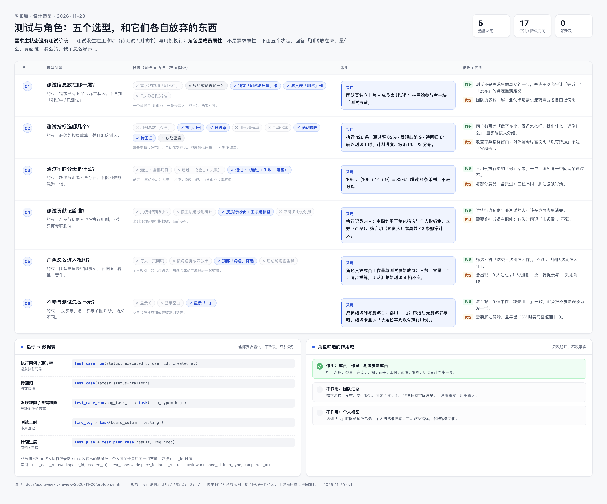

# 周回顾 · 团队与个人设计说明

日期：2026-11-20（v1）· 2026-11-21（v2 / v3）
范围：`周回顾` 路由（`review`）；团队与个人两种口径、周事件与当前快照、本周统计矩阵（新增 / 流转 / 完成 / 退出·异常）、完成与发布明细、测试与质量（含新增用例 / 修复缺陷）、文档与知识、成员工作量（含角色维度）、个人一周（含本周经手与我的文档）
性质：设计提案 + 高保真原型（v1–v3）；2026-11-21 已在本仓库实现团队 / 个人口径（后端 `/api/review`、前端 `review-team.js`）并通过真实账号验收
原型：[prototype.html](./prototype.html)（范围 / 周 / 项目 / 角色可切换，示例数据已标注）
截图（v3）：[团队 1440](./proto-team-full-1440-v3.png)、[本周统计](./proto-team-stats-1440-v3.png)、[展开「进入处理中」](./proto-team-detail-doing-1440-v3.png)、[展开「修复关闭」](./proto-team-detail-fixed-1440-v3.png)、[展开 390](./proto-team-detail-390-v3.png)、[个人 1440](./proto-me-full-1440-v3.png)、[文档卡](./proto-team-docs-1440-v3.png)、[我的文档](./proto-me-docs-1440-v3.png)、[成员抽屉](./proto-member-1440-v3.png)、[测试成员抽屉](./proto-member-test-1440-v3.png)、[角色=设计](./proto-member-role-design-1440-v3.png)、[空态](./proto-empty-1440-v3.png)、[错误](./proto-error-1440-v3.png)、[团队 390](./proto-team-full-390-v3.png)、[个人 390](./proto-me-full-390-v3.png)

v3 相对 v2 的变化（回应"周回顾先看总体统计，而不是流转卡片"）：

- 统计矩阵中的大数字与子项（如「22 进入处理中」「修复关闭 7」）可点击，在该行下方就地展开明细；同一时刻只开一行，Esc、收起、切换范围均可关闭。

- 删除「需求 / 工作项」五节点流转卡。团队首页改为「本周统计」矩阵：需求 / 工作项 / 测试 / 文档 四行 × 本周新增 / 本周流转 / 本周完成 / 本周退出·异常 四列，先回答"上周新增了什么、哪些动起来了、完成了什么"。
- 新增「本周完成」列表（23 项中的 6 项 + 其余 17 项按类型），与「本周发布」并排，把"完成了什么"落到具体条目。
- 成员表加「新增 / 推进 / 文档」三列；「推进」按工作项去重（31），与流转事件数（41）区分。
- 流转数字保留在统计矩阵内（22 进入处理中 / 11 提测 / 8 进入测试中，共 41 次、涉及 31 项），不再用箭头流程图表达。
- 完成节奏、当前池收进统计卡底部；快照口径不变。

v2 相对 v1 的变化：

- 补进新增、进入处理中、提测、进入测试中、完成与类型构成，回答"任务角度和需求角度分别发生了什么"。
- 发布卡补发布计划 KPI（计划 / 完成 / 超期 / 回滚）；交付卡补完成构成（故事 / 任务 / 缺陷）。
- 测试卡从 4 格扩到 6 格，补新增用例、修复关闭，并列出 3 个测试计划（含超期）。
- 新增「文档与知识」卡与个人「我的文档」，按类型、按人统计新增 / 更新 / 发布 / 草稿。
- 个人补「本周经手」，完成列表加类型标签；成员抽屉同步显示经手。
- 角色筛选联动文档贡献与文档空态；空态文案补文档动作。

---

## 0. 结论先行

**判断：周回顾是管理者的一周总账，不是流程图。页面顺序固定为「本周统计（新增 / 流转 / 完成 / 退出）→ 完成与发布明细 → 质量与文档 → 每个人 → 项目与风险」；个人口径保留并补齐「推进、在手、本周经手、我发起、我评审、我的文档」。**

现状只有个人口径：`review.js:39` 固定 `mine:1`，后端 `ReviewController.java:36` 在未传参数时也按个人处理。团队视角在「成员负载」和移动端「团队」页里，但那两处回答的是"现在忙不忙"，回答不了"这一周交付了什么、沉淀了什么"。因此不是加一个筛选，而是补一层**周事件汇总**。

七件事必须同时成立：

1. **事件与快照分开。** 历史周只能回放"发生了什么"（新增、流转、完成、发布、登记工时、文档动作），重建不出"上周三他在手几项、负载多少、文档草稿几篇"。凡属当前状态的一律标「此刻」并注明截至时间。
2. **统计先行，一行一类对象。** 需求、工作项、测试、文档是四类对象，数量含义不同，不能纵向相加。矩阵横向回答"这一类对象这周新增多少、流转多少、完成多少、退出多少"，而不是用流程图讲一条线走了几步。
3. **完成 ≠ 发布。** 完成由证据判定（工作项 + 用例 / 发布 / 人工判定）；发布只认成功 + 生产 + 非回滚 + 全量覆盖且工作项 `disposition=published` 的发布记录。两者分列，不合并成"交付"一个数；发布计划是计划侧对象，单独统计达成与超期。
4. **流转是本周发生的次数，不是漏斗。** 工作项流转共 41 次（22 进入处理中 + 11 提测 + 8 进入测试中），涉及 31 个不同工作项；同一项可连续流转，成员表按项去重。不做转化率，也不把"提测 11 / 进入测试中 8"读成 73% 转化。
5. **测试单独立层，不塞进需求状态。** 需求主状态只有 `review/pass/plan/done/closed`，测试发生在工作项（待测试 / 测试中）与用例执行。因此统计矩阵单设「测试」行，成员表单设「测试」列；开发、产品、负责人兼做测试时同样计入。
6. **文档是独立对象，单独成行。** 需求文档挂在需求下，按新增 / 更新 / 发布 / 草稿积压统计，并按人统计贡献。文档动作不改变需求或工作项状态，不能并进完成的分子。
7. **个人与团队共用一个页面、一套口径。** 团队在前、个人在后，范围可切换；团队口径只给空间主 / 管理员，个人口径所有人可用；个人测试卡按角色换指标，不另建页面。个人除完成 / 推进 / 在手外，补一条「本周经手」，把复测、评审、写文档、审报告这些不改变工作项状态的动作说清楚。

---

## 1. 现状审计

| 项 | 现状 | 证据 | 影响 |
|---|---|---|---|
| 口径 | 只有个人：`mine:1` 写死 | `frontend/js/views/review.js:39` | 负责人看不到团队一周 |
| 后端默认 | 不传 `mine` 即为个人 | `ReviewController.java:36` | 前端即使想切团队也没有现成参数契约 |
| 内容 | 完成、进行中、待确认完成、需求分布、工时、AI 周报 | `ReviewResponse.java:21-40` | 没有"新增 / 通过 / 开始 / 关闭 / 取消 / 发布" |
| 团队数据 | 成员负载在 `/api/mobile/workload`，仅管理者 | `MobileService.java:144-149` | 团队口径已有权限模型可复用 |
| 入口 | 侧栏「我的」组 | `router.js:146` | 团队视角没有自然入口 |
| 结论 | 有统计网格，无一句结论 | `index.html:2590` 起 | 负责人先看到表格，不知道本周结论 |

保留：完成 / 进行中的行结构、计时明细下钻（`review.js:335`）、AI 周报、任意历史周（`weekOffset`）。这些不重做，只重组。

现状截图不再复用：当前产品页只有个人口径，与 v3 原型结构差异已大到不适合作为对照。

---

## 2. 设计简报

| 项 | 内容 |
|---|---|
| 谁 | 空间主 / 负责人（团队视角，每周一次，3–5 分钟）；成员（个人视角，随时看自己的一周）；团队内开发、测试、产品、设计、负责人五种角色都要能在成员层找到自己 |
| 任务 | 团队：判断这周需求与工作项流转是否正常、发布计划是否达成、测试是否覆盖、文档是否沉淀、谁负载异常、下周要盯什么；个人：确认自己完成了什么、经手了什么、还在手什么、时间花在哪、在测试与文档里做了什么 |
| 决策 | 这周交付与质量是否达到预期？哪些工作项卡在待测试或测试中？文档有没有断档？谁需要支援？下周先处理哪几件事？ |
| 成功标准 | ① 第一屏 10 秒内回答"上周新增了什么、哪些动起来、完成了什么"；② 四类对象数字看得出差别、不混算；③ 任一成员 ≤2 次点击看到其一周完成与经手；④ 测试与文档各有独立入口且能落到人；⑤ 角色筛选联动成员明细、测试成员与文档贡献，并明确标注团队汇总仍为全团队口径；⑥ 所有数字能追溯到口径说明；⑦ 不把快照伪装成历史 |
| 范围 | 桌面 1440 为主，390 做窄屏降级；不改路由层级，不新增独立页面 |
| 约束 | 不改表结构；复用 `task` / `task_log` / `time_log` / `demand` / `demand_log` / `requirement_doc` / `req_doc_*` / `version_release*` / `test_case*` / `test_plan*`；团队口径限空间主 / 管理员；周界按空间时区、周一到周日 |

---

## 3. 口径模型（本设计的核心）

### 3.1 周事件 vs 当前快照

| 类型 | 指标 | 为什么不能混 |
|---|---|---|
| 周事件 | 需求新增 / 评审通过 / 开始排期 / 完成 / 发布覆盖 / 关闭 / 取消；工作项新增 / 进入处理中 / 提测 / 进入测试中 / 完成 / 取消；新增用例 / 新增缺陷 / 用例执行 / 修复关闭；文档新增 / 更新 / 发布；发布计划完成；登记工时 | 可按任意历史周重算 |
| 当前快照 | 此刻在手、当前逾期、当前阻塞、当前负载、当前需求池、待回归用例、遗留缺陷、文档草稿积压、发布计划超期 | 无法回到历史周，必须标「此刻」与截至时间 |

原型中：统计矩阵四列、完成节奏、到期兑现、近 4 周趋势、本周无记录、完成列表、工时、文档动作属于事件或事件回看；「此刻在手 46」「当前需求池」「负载」「逾期 / 阻塞」「待回归 6」「草稿积压 3」「计划超期 1」属于快照，卡片脚注与胶囊都写明。切到历史周时，快照继续显示"此刻"，不随周变化——这是有意为之，不假装能还原过去；到期兑现、近 4 周与本周无记录则按所选周重算。

### 3.2 指标定义

| 指标 | 定义 | 数据来源 |
|---|---|---|
| 本周新增（矩阵列） | 该对象本周内创建的条数；需求按 `demand`，工作项按 `task`（故事 / 任务 / 缺陷），测试按新增用例（另注新增缺陷），文档按 `requirement_doc` | 各对象 `created_at` |
| 本周流转（矩阵列） | 该对象本周发生的过程事件：需求为评审通过 / 开始排期，工作项为进入处理中 / 提测 / 进入测试中，测试为用例执行，文档为产生新版本 | `demand_log` / `task_log` / `test_case_run` / `requirement_doc_history` |
| 本周完成（矩阵列） | 需求按完成事件；工作项按 `completed_at`；测试按通过率与修复关闭；文档按本周首次发布 | 各对象完成字段 / 日志 |
| 本周退出 / 异常（矩阵列） | 需求关闭 / 取消；工作项取消；测试待回归（快照）/ 跳过；文档草稿积压（快照） | 各对象终止字段 + 当前状态 |
| 需求新增 | 本周内创建的需求数（不论现在处于什么状态） | `demand.created_at` |
| 评审通过 | 本周内发生 `pass` 的需求数（按需求去重） | `demand_log` action=`pass` |
| 开始（排期） | 本周内**首次**进入排期（`plan`）的需求数；`replan` 不计 | `demand_log` action=`plan`，排除本周前已有 plan |
| 完成 | 本周内发生 `complete` 的需求数；自动退回（`auto_reopen`）不回滚已计事件，但在脚注说明 | `demand_log` action=`complete` |
| 发布 | 本周内成功 + 生产 + 非回滚 + 全量覆盖的发布记录中 `disposition='published'` 的需求数（去重）；被后续回滚按工作项撤销的不计 | `version_release` + `version_release_item` |
| 关闭 | 本周评审不通过（`rej`）或以"重复"关闭的需求 | 本周 `demand_log` action=`rej`；`cancel` 且 `change_data.closeReason='dup'` |
| 取消 | 本周中途取消的需求 | 本周 `demand_log` action=`cancel` 且 `closeReason` 为空或 `cancel` |
| 工作项新增 | 本周内创建的工作项（故事 / 任务 / 缺陷），史诗单列；已删除不计 | `task.created_at` + `item_type` |
| 进入处理中 | 本周内**首次离开待处理**（`backlog`）进入任何非终态列（进行中 / 待测试 / 测试中）的工作项，每项每周最多计 1 次 | `task_log` action=`move`，`from_column='backlog'`，`to_column ∉ (done, canceled)` |
| 提测（待测试） | 本周内**首次提测**的工作项，按 `test_requested_at` 落周界；提测 ≠ 开始测试 | `task.test_requested_at` |
| 进入测试中 | 本周内**开始执行测试**的工作项，按 `test_started_at` 落周界 | `task.test_started_at` |
| 推进（去重） | 本周进入处理中 / 提测 / 进入测试中任一事件的工作项，按工作项去重；成员表「推进」列与统计矩阵说明用这个数（31），不等于流转次数（41） | `task_log` + 测试时间戳，按 `task_id` 去重 |
| 工作项完成 | 本周内 `completed_at` 落入周界、未取消的工作项；按 `item_type` 拆故事 / 任务 / 缺陷 | `task.completed_at` + `item_type` |
| 工作项取消 | 本周内进入 `canceled` 且未完成的工作项 | `task.canceled_at` / `task_log` |
| 此刻在手 | 当前负责人是我 / 该成员，且未完成、未取消的工作项 | `task` 当前状态 |
| 新增用例 | 本周内创建的测试用例；SQL 92 之前无创建人的存量不归人 | `test_case.created_at` / `created_by_user_id` |
| 修复关闭 | 本周内完成的缺陷工作项（`item_type='bug'`）；与工作项完成里的缺陷是同一批 | `task.completed_at` + `item_type='bug'` |
| 文档新增 / 更新 / 发布 | 新增按创建；更新按产生新版本快照（保存人）；发布按 `published_at` | `requirement_doc` / `requirement_doc_history` |
| 文档贡献（按人） | 新增记文档负责人，更新记保存人；同一篇被他人改过会分别计次 | `requirement_doc.owner_user_id` / `history.saved_by_user_id` |
| 文档草稿积压 | 当前快照：`status='draft'` 且最后更新超过 7 天 | `requirement_doc.updated_at` |
| 发布计划 | 计划发布日落入本周的 `version_release_plan`；完成按 `status='completed'`；超期 = 已过 `planned_at` 未完成 | `version_release_plan.status / planned_at` |
| 本周经手（个人） | 复测、评审需求、文档动作、审阅报告、发布审核等不改变工作项状态的事件 | 各域事件表按人过滤 |
| 登记工时 | 本周内 `time_log.minutes` 之和；计时与手工补记都算 | `time_log.started_at` |
| 完成节奏 | 本周每个自然日完成的工作项数，按 `completed_at` 日期分组；0 也显示，周末不省略 | `task.completed_at` |
| 到期兑现 | 截止日落在本周的工作项分三类：按期 = 已完成且完成日 ≤ 截止日；延期 = 已完成但完成日晚于截止日；未完成 = 当前仍未完成。分母含三类，按当前时点回看 | `task.due_date` / `task.completed_at` |
| 近 4 周趋势 | 以当前查看周为最后一周，向前取 4 个自然周的完成 / 新增 / 推进（推进按项去重）；第一格是起始周，口径与矩阵同源 | `task.created_at` / `task.completed_at` / `task_log` + 测试时间戳 |
| 本周无记录 | 查看周内没有新增 / 流转 / 完成 / 工时 / 文档 / 测试执行 / 新增用例 / 缺陷 / 需求动作 / 评论 / 发布记录的成员；只表示系统内没有记录，不推断工作状态 | 各域事件表按 `user_id` |
| 下一周到期 | 查看周的下一自然周内、截止且未完成的工作项（最多 5 条），附负责人 / 项目 / 状态；标签按今天显示「本周 / 下周 / 该周」，并给出 MM-dd 区间 | `task.due_date`；里程碑按 `project_milestone` 计划日 |
| 团队周报（纯文本） | 由页面同源数据生成的固定段落：结论 / 计划兑现 / 近 4 周 / 测试 / 发布 / 文档 / 需要关注 / 下一周到期 / 口径；不额外请求 | 前端 `teamReportText()` |
| 容量利用 | 团队登记工时 ÷（人数 × 本周工作日 × 每日容量），与单人负载同口径的团队值 | `time_log` + 成员容量 |
| 测试计划达成 | 本周应结束的测试计划中 `status='done'` 的比例；超期未完成计未达成 | `test_plan.status / planned_end` |
| 完成耗时 | 从首次动工到完成的工作日跨度（8h/天、跳周末） | `task_completion_record.first_started_at` |
| 负载 | 本周登记工时 ÷（本周工作日 × 每人每日容量）；容量默认 8h，成员可自定义 | 同成员负载口径 |
| 按期率 | 设了截止日期的完成项中，完成日期 ≤ 截止日的比例 | `task.completed_at` vs `due_date` |
| 逾期 / 阻塞 | 当前快照：逾期未完成、`is_blocked=1` 且未完成 | `task` 当前状态 |
| 执行用例 | 本周内每条执行记录计 1 条（同一用例重复执行逐条计）；团队数 = 成员列之和 | `test_case_run.created_at` / `status` |
| 通过率 | 通过 ÷（通过 + 失败 + 阻塞）；跳过与未执行不计入分母 | 同上 |
| 发现缺陷 | 本周新建、由失败用例转出或手工建的缺陷任务数（`item_type=bug`） | `test_case_run.bug_task_id` / `task` 创建 |
| 待回归 | 当前快照：最近一次执行仍为失败、且之后没有通过记录的用例数 | `test_case.latest_status` |
| 测试工时 | 本周登记在测试 / 缺陷工作项（`board_column='testing'` 或 `item_type='bug'`）上的工时 | `time_log` + `task` |
| 复测 | 本周工作项从「待测试」进入完成，且此前有失败记录的条数 | `task_log` / `completed_at` |
| 遗留缺陷 | 当前快照：成员负责需求下仍未关闭的缺陷任务数 | `task` 当前状态 |
| 角色 | 成员的职能标签：开发 / 测试 / 产品 / 设计 / 负责人；兼测试的成员保留主职能，测试贡献按执行记录计 | 成员职能配置（空间成员） |

五条硬规则：

- **去重按对象**：需求流转按 `demand_id` 去重；工作项「推进」按 `task_id` 去重（31），流转次数不去重（41）；成员表按 `user_id` 去重；用例按 `test_case_run.id` 逐条计；显示名兜底只用于历史脏数据，并打 `matchedByNameOnly` 标记。
- **行与行不合计**：统计矩阵四行是四类对象，页脚只做口径说明，不出现"总计 70 新增"这类跨对象求和；成员表合计只加人，不加对象。
- **0 不等于闲**：本周有完成但 0h 记为「未登记」，不显示 0%、不并入"空闲"。
- **「—」不等于 0**：不参与测试的成员在测试列显示「—」，与"参与了但 0 条"区分；角色筛选后无测试参与时测试合计也显示「—」。
- **测试与需求分层**：测试指标不进入需求主状态；同一需求可同时出现在"完成"与"测试通过"里，两个数各自成立。
- **不跨口径换算**："3.5h 工时"和"3 天完成耗时"并列展示，永不互相推算；用例通过率与需求完成率也不互相推导。
- **兑现与按期率分母不同**：「到期兑现」的分母是截止日在本周的全部工作项（含未完成），「完成按期率」的分母只含已完成项；两个数并列时不得相互替代。
- **无记录不等于空闲**：「本周无记录」只覆盖系统内事件（含评论、工时、需求动作），不接考勤；文案与脚注必须写成"请先确认"，不得作为绩效判断。
- **不补 Cycle Time / Lead Time**：演示与历史数据里首次开工时间存在先完成、后补开工的倒挂，算出的周期会出现负数；在时间戳可信之前不展示此类指标。

---

## 4. 信息架构

```
周回顾
├─ 范围：团队（空间主 / 管理员） | 我（所有人）
├─ 周：上周（默认） · 可按周前后翻 · 显示完整自然周
├─ 项目：全部 / 单项目（作用于本页所有卡片）
├─ 角色：全部 / 开发 / 测试 / 产品 / 设计 / 负责人（只筛选成员明细与文档贡献，团队汇总不变；个人视图隐藏）
├─ 团队
│  ├─ 结论条：一句话 + 较前一周
│  ├─ 本周统计（一行一类对象，四列；大数字 / 子项可点击就地展开明细）
│  │  ├─ 需求：新增 12 · 流转（评审通过 8 / 开始排期 7）· 完成 9（发布覆盖 6）· 退出（关闭 2 / 取消 1）
│  │  ├─ 工作项：新增 38（故事 / 任务 / 缺陷）· 流转 41 次（22 进入处理中 / 11 提测 / 8 进入测试中，涉及 31 项）· 完成 23 · 退出（取消 3）
│  │  ├─ 测试：新增用例 14 + 新增缺陷 9 · 执行 128 条（通过率 82%）· 修复关闭 7 · 待回归 / 跳过
│  │  ├─ 文档：新增 7 / 更新 12 / 发布 5；退出（草稿积压 3）
│  │  ├─ 明细行：类型 + 标题 + 归属 / 流转前后 + 时间；超过示例条数给「查看全部 N」
│  │  └─ 卡底：完成节奏、到期兑现（按期 / 延期 / 未完成）、近 4 周趋势、登记工时 / 容量利用 / 按期率 / 测试计划达成、当前快照（需求池 / 在手）
│  ├─ 本周完成（类型 + 工时 + 完成日 + 按期 / 已发布）+ 本周发布（计划 KPI + 记录）
│  ├─ 测试与质量：执行 / 通过率 / 新增用例 / 发现缺陷 / 修复关闭 / 待回归 + 结果比例 + 计划进度 + 参与成员
│  ├─ 文档与知识：新增 / 更新 / 发布 / 草稿积压 + 按类型 + 按人贡献 + 未写成员
│  ├─ 成员工作量：12 列（新增 / 推进 / 完成 / 在手 / 工时 / 负载 / 逾期 / 阻塞 / 测试 / 文档）+ 合计；超载 / 未登记 × 角色筛选；行打开成员抽屉（含经手）
│  ├─ 项目推进：按项目汇总需求四事件 + 工作项新增 / 完成 + 工时 + 状态
│  └─ 需要关注：逾期 / 阻塞 / 超载 / 未登记 / 本周无记录；下一周关注 + 下一周到期前 5 条（可点开工作项）
└─ 我
   ├─ 结论条：我的一周 + 经手摘要
   ├─ 6 格 KPI：完成 / 推进 / 此刻在手 / 工时 / 按期率 / 评审需求
   ├─ 本周经手：新增用例 / 复测 / 审阅报告 / 文档动作 / 评审 / 发布审核
   ├─ 本周完成（类型 + 工时 + 耗时 + 按期 + 已发布）
   ├─ 本周推进 + 其他进行中
   ├─ 此刻在手
   ├─ 工时去向（每日 + 按项目）
   ├─ 测试与质量 · 我的角色：按角色换 4 格指标 + 本周测试明细
   ├─ 我发起的需求 / 我评审的需求
   └─ 我的文档：3 篇示例 + 状态 / 时间
```

入口：沿用侧栏「我的 → 周回顾」（`router.js:146`），不新增菜单；范围用分段控件，不进筛选器。

---

## 5. 页面规格

### 5.1 团队（1440）

| 顺序 | 区块 | 内容 | 规则 |
|---|---|---|---|
| 1 | 页头 | H1 + 「原型 · 示例数据」；副标题"团队与个人的一周变化 · 数据更新于 …"；导出、复制周报（团队：复制团队周报；个人：复制总结） | 主操作唯一：复制周报；团队口径的 AI 周报入口隐藏 |
| 2 | 范围条 | 团队 / 我；周切换；项目；角色；周界说明 | 团队页签仅管理者可见；切换保留周、项目与角色；角色在个人视图隐藏 |
| 3 | 结论条 | 用一句话复述矩阵：新增 38（分类）、流转 41 次 / 31 项、完成 23（分类）、需求新增 12 / 完成 9 / 发布覆盖 6；第二句给工时、执行、文档、风险；右侧较前一周 | 有风险用警示色；空态不显示；数字必须与矩阵一致，不另造口径 |
| 4 | 本周统计 | 四行：需求 / 工作项 / 测试 / 文档；四列：本周新增 / 本周流转 / 本周完成 / 本周退出·异常；每格大数字 + 子项 + 一句口径；卡底完成节奏、到期兑现（按期 / 延期 / 未完成）、近 4 周趋势、登记工时 / 容量利用 / 按期率 / 测试计划达成、当前快照；脚注 | 一行一类对象，行间不合计；「工作项流转 41 次」与「涉及 31 项」并列；工作项完成含缺陷，缺陷在质量卡不重复计；快照标「截至 … · 不随周切换」；带虚线下划线的数字可就地展开明细（见下）；到期兑现的延期 / 未完成可下钻，近 4 周最新一周等于当前查看周 |
| 4a | 矩阵明细行 | 跨 5 列插入在所属行下方：标题「进入处理中 · 22 个工作项」+ 口径；条目 = 类型 chip + 标题 + 归属 / 流转前后 + 时间；底部注明示例条数 / 总数 | 同一时刻只展开一行；`aria-expanded` / `aria-controls` 指向明细行；再点同一数字、收起、Esc、切换范围均关闭；条目最多展示 6–8 条示例，超出给「查看全部 N」；条目点击打开详情（原型未接）；390 明细行转块、标题换行 |
| 5 | 本周完成 + 本周发布 | 左：完成 6 项（类型、项目 · 需求、工时、完成日、按期 / 延期、已发布），脚注"另有 17 项：故事 6 · 任务 6 · 缺陷 5"；右：发布计划 KPI（3 / 2 / 1 / 0）+ 2 条发布记录 | 完成列表只展开 6 项，其余给计数与"查看全部"；发布只列成功 + 生产；计划达成按计划日归属；两卡并排、各自按内容高度 |
| 6 | 测试与质量 | 6 格 KPI（执行用例 / 通过率 / 新增用例 / 发现缺陷 / 修复关闭 / 待回归）；通过 / 失败 / 阻塞比例条；测试计划进度（含超期）；参与成员（执行 · 通过率 · 新增 · 缺陷）；缺陷 P0–P2 | 通过率不含跳过；成员行按角色筛选联动；无参与者显示「该角色本周没有执行用例」；修复关闭与工作项完成里的缺陷是同一批 |
| 7 | 文档与知识 | 4 格 KPI（新增 / 更新 / 发布 / 草稿积压）；按类型分布；贡献成员（次数 · 新 / 更）；未写成员 | 按角色筛选联动；无动作显示「该角色本周没有文档动作」；不把文档数并进完成 |
| 8 | 成员工作量 | 成员 / 新增 / 推进 / 完成 / 在手 / 工时 / 负载 / 逾期 / 阻塞 / 测试 / 文档；合计（38 / 31 / 23 / 46 / 186.5h / 58% / 5 / 2 / 128-9 / 19） | 全员列出，含 0 事件；「推进」按项去重（31），不是流转次数（41）；0h 且有完成标「未登记」；测试列 = 执行 / 发现缺陷，不参与显示「—」；筛选后人数、容量、合计同步重算 |
| 9 | 项目推进 | 项目、需求四事件、工作项新增 / 完成、工时、状态 | 工作项新增 / 完成合计与统计矩阵一致（38 / 23） |
| 10 | 需要关注 | 5 个风险卡：逾期 / 阻塞 / 超载 / 未登记 / 本周无记录；下一周关注（到期 / 里程碑 / P0 在手 / 发布超期 / 测试计划超期 / 7 天无进展）；下一周到期前 5 条，含日期、标题、负责人 · 项目 · 状态 | 无记录只描述系统内没有记录，脚注要求先确认；下一周标签按今天显示「本周 / 下周 / 该周」并给 MM-dd 区间；条目点击打开工作项；卡下钻到完整列表为 P2 |
| 11 | 页脚 | 更新时间、示例数据声明、口径入口 | — |

### 5.2 个人（1440）

| 区块 | 内容 | 规则 |
|---|---|---|
| 我的一周 | 6 格 KPI；「此刻在手」标快照；下方「本周经手」条 | 完成、推进、工时、经手是事件 |
| 本周经手 | 新增用例 / 复测 / 审阅报告 / 文档动作 / 评审需求 / 发布审核 | 只列本周发生且有记录的；不并入完成 |
| 本周完成 | 类型（故事 / 任务 / 缺陷）+ 项目 · 需求；登记工时 · 完成耗时；完成日；按期 / 延期；已发布 | 「已发布」只在需求被成功生产发布覆盖时出现；类型标签用于对照团队完成构成 |
| 本周推进 | 本周首次进入进行中 / 待测试 / 测试中、仍未完成的项；进度与到期；另有「其他进行中」 | 创建但未动工不算；「推进」与团队成员表同口径 |
| 此刻在手 | 进行中 / 待测试 / 待处理；负责人 / 测试负责人 | 快照 |
| 工时去向 | 每日登记柱 + 按项目分布 | 计时 + 手工补记 |
| 测试与质量 · 我的角色 | 4 格指标随角色变：负责人=复测 / 审阅报告 / 发布审核 / 遗留缺陷；测试=执行用例 / 发现缺陷 / 待回归 / 通过率；开发=提测 / 修复缺陷 / 回归通过；产品=验收 / 关单。下列 3 条本周测试明细 | 无测试参与的角色显示「本周没有测试参与」，不显示 0 |
| 我发起的需求 | 创建人是我；当前空间；状态与等待 | 显示名兜底需标注 |
| 我评审的需求 | 有项目写权限且非本人提交；通过 / 待评审 / 驳回 | 与「我的工作 · 待评审」同口径 |
| 我的文档 | 3 篇示例：类型 · 项目 · 状态；更新 / 新建时间 | 只列我作为负责人或保存人产生过动作的文档；人次数可大于文档篇数 |

### 5.3 成员抽屉

从成员表任意行打开；不跳页，保留团队上下文。内容：姓名 / 职能、周与负载胶囊、6 格 KPI（新增 / 完成 / 推进 / 在手 / 工时 / 负载）、负载说明、项目分布、**本周经手**（完成 / 修复缺陷 / 文档次数（新 / 更）/ 代码评审 / 评审需求 / 新增用例 / 复测 / 审阅报告）、测试贡献（仅参与者：执行用例 / 发现缺陷 / 通过率 / 计划进度）、本周完成（工时 + 耗时 + 按期）、此刻在手（逾期 / 到期 / 状态）。底部「查看全部工作项」与关闭。Esc、遮罩、关闭按钮均可退出。不参与测试的成员不显示测试块，避免用 0 暗示"没干活"；经手只列有记录的动作，不补 0。

### 5.4 状态

| 状态 | 表现 | 动作 |
|---|---|---|
| 首载 | 结论条与卡片骨架；不阻塞页头 | — |
| 空 | "上周团队没有可汇总的交付记录"，解释"没有事件 ≠ 没在工作" | 查看工作项列表 / 刷新；导出与复制禁用 |
| 筛选空（项目 / 成员 / 角色） | 保持卡片，显示"当前项目下没有事件"；角色无测试参与时测试卡显示"该角色本周没有执行用例"，文档卡显示"该角色本周没有文档动作" | 清除筛选 |
| 错误 | 失败原因、接口与错误码、上次成功时间 | 重试 / 看我的回顾；导出禁用；不显示为 0 或空 |
| 部分失败 | 失败卡片内嵌错误行，其他卡片正常；页签 / 汇总计数显示 — | 单卡重试（P2） |
| 只读 | 成员看不到团队范围；个人视图无写操作 | — |
| 长文本 | 需求标题省略 + title；成员职能省略 | — |
| 大数据 | 成员表首屏 50 人，超出分页；项目表 20 行 + 查看全部 | — |

---

## 6. 权限

| 能力 | 空间主 / 管理员 | 成员 | 只读成员 |
|---|---|---|---|
| 团队范围 | 可见 | 隐藏团队页签，默认个人 | 隐藏 |
| 成员工作量 / 负载 | 可见 | 不可见 | 不可见 |
| 团队测试与质量（含成员执行量） | 可见 | 不可见 | 不可见 |
| 团队文档与知识（含成员贡献） | 可见 | 不可见 | 不可见 |
| 角色筛选 | 可用（成员、测试成员、文档贡献联动） | —（随团队范围隐藏） | — |
| 个人测试卡 | 可见（本人执行记录） | 可见 | 可见（只读） |
| 个人回顾 | 可见 | 可见 | 可见 |
| 我的文档 | 可见（本人负责 / 保存） | 可见 | 可见（只读） |
| 我评审的需求 | 按项目写权限 | 按项目写权限 | 不显示 |
| 导出 / 复制 | 可用（空 / 错时禁用） | 可用 | 可用 |

测试数据不额外放宽权限：团队执行明细沿用成员负载的管理者口径；个人只能看自己执行的用例，与"只看自己"一致。

团队口径复用现有管理权限：`MobileService.workload` 已调用 `requireManager`（`MobileService.java:145`），成员负载页同源。个人口径不要求额外权限，只看自己。

---

## 7. 后端与数据方案

### 7.1 接口

**扩展现有 `/api/review`，不新建页面级接口。**

```
GET /api/review?scope=team|mine&weekOffset=-1&reqId=&role=all
```

- 默认 `scope=mine`，与现状兼容；`scope=team` 需要空间主 / 管理员，否则 403。
- `role=all|dev|test|pm|design|lead` 只过滤 `members`、`quality.members`、`docs.members` 三组明细，`stats` 与 `quality` 汇总不变；响应回传 `role`。8 人空间前端本地过滤即可，大空间再下推服务端。
- 响应在现有字段上增加分组（个人字段保持原样，前端老逻辑可用）：

```json
{
  "weekOffset": -1, "weekStart": "2026-11-09", "weekEnd": "2026-11-15",
  "scope": "team",
  "stats": {
    "demands": {"created":12,"passed":8,"planned":7,"completed":9,"released":6,"closed":2,"cancelled":1,"delta":{"created":3,"completed":2}},
    "workItems": {
      "created":38, "createdByType":{"story":14,"task":15,"bug":9,"epic":0},
      "transitions":{"events":41,"items":31,"enteredDoing":22,"testRequested":11,"enteredTesting":8},
      "completed":23, "doneByType":{"story":8,"task":8,"bug":7}, "cancelled":3
    },
    "tests": {"newCases":14,"newDefects":9,"runs":128,"passed":105,"failed":14,"blocked":9,"skipped":6,"passRate":82,"fixed":7,"pendingRetest":6},
    "docs": {"created":7,"updated":12,"published":5,"draftBacklog":3},
    "pace": {"daily":[4,6,3,5,5,0,0],"started":31,"minutes":11190,"capacityMinutes":19200,"utilization":58,"onTimeRate":87,"testPlan":{"done":2,"total":3}},
    "pool": {"demands":{"review":14,"pass":5,"plan":22,"donePending":9},"tasks":{"open":46,"doing":19,"test":11,"testing":8,"backlog":8}},
    "asOf": "2026-11-20T09:20:00+08:00",
    "prev": {"created":32,"completed":21,"minutes":11810}
  },
  "releases": {
    "plans": {"total":3,"completed":2,"readyOverdue":1,"rolledBack":0},
    "items": [{"project":"客户门户","version":"2.4.0","at":"2026-11-14 18:30","by":"陈昊","demands":4,"tasks":15,"note":"DS-20261114-01"}]
  },
  "completions": {
    "items": [{"title":"对账导出优化","type":"story","project":"客户门户","demand":"对账导出优化","at":"2026-11-14","minutes":750,"durationDays":2,"onTime":true,"released":true}],
    "more": {"story":6,"task":6,"bug":5}
  },
  "members": [{"userId":"…","name":"王一帆","role":"dev","created":8,"started":7,"done":5,"open":8,"minutes":2760,"load":115,"overdue":1,"blocked":0,"docs":6,"test":null,"hand":{"fixed":1,"docs":6,"docNew":2,"docUpdated":4,"reviews":2}}],
  "quality": {
    "runs":128, "passRate":82, "newCases":14, "defects":9, "fixed":7, "pendingRetest":6, "minutes":2520,
    "results":{"passed":105,"failed":14,"blocked":9,"skipped":6},
    "members":[
      {"userId":"…","name":"周媛","role":"test","runs":86,"passRate":84,"newCases":9,"defects":6},
      {"userId":"…","name":"李婷","role":"pm","runs":24,"passRate":83,"newCases":3,"defects":2}
    ],
    "plans":[{"name":"客户门户 2.4.1 回归","status":"running","progress":68,"due":"2026-11-18","overdueDays":2}],
    "defectsByPriority":{"closed":7,"p0":1,"p1":3,"p2":5}
  },
  "docs": {
    "created":7, "updated":12, "published":5, "draftBacklog":3,
    "byType":[{"type":"产品需求","count":7},{"type":"技术方案","count":5},{"type":"测试记录","count":4},{"type":"会议纪要","count":3}],
    "members":[{"userId":"…","name":"王一帆","role":"dev","total":6,"created":2,"updated":4}],
    "silent":["孙悦","赵子墨"]
  },
  "projects": [{"reqId":"…","name":"客户门户","created":5,"started":3,"completed":4,"released":4,"tasksDone":9,"minutes":4680,"status":"released"}],
  "risks": {"overdue":5,"blocked":2,"overloaded":2,"unlogged":2,"nextDue":12,"p0":3,"pendingRelease":9,"releaseOverdue":1,"testPlanOverdue":1,"stale":4}
}
```

`members[].test` 为 `null` 表示本周不参与测试（前端显示「—」），与 `{runs:0,defects:0}` 区分。`members[].started` 是按工作项去重的「推进」（31），不是流转次数；`created` 为本周新增，`docs` 为文档动作次数。

个人视图继续用现有 `completed / progressTasks / pendingDone / workMinutes / counts`，新增：

- `progressTasks`：本周首次进入任一处理列、仍未完成的项（页面「推进」，与团队同口径）；
- `openTasks`：此刻在手；
- `completedByType`：本周完成的故事 / 任务 / 缺陷，列表类型标签用；
- `hand`：`{newCases, retest, reportReviews, docs, docNew, docUpdated, demandReviews, releaseApprovals}`，驱动「本周经手」；
- `myDemandsCreated`、`myDemandsReviewed`；
- `myDocs`：我作为负责人或保存人本周产生动作的文档；
- `onTimeRate` 已在 `stats` 中；
- `myTest`：`{role, metrics:[{key,label,value,hint}], items:[…]}`，按成员主职能返回 4 个指标与 3 条明细，前端不写死指标名。

工时下钻保留 `/api/review/hour-logs`，团队卡片传 `mine=null`。

### 7.2 查询与索引

全部为聚合查询，不改表：

```sql
-- 需求事件（按周、按项目）
SELECT action, COUNT(DISTINCT demand_id) FROM demand_log
WHERE workspace_id=? AND created_at>=? AND created_at<? AND action IN ('pass','plan','complete')
GROUP BY action;

-- 新增（含后来关闭 / 取消的，新增是创建事件）
SELECT COUNT(*) FROM demand WHERE workspace_id=? AND created_at>=? AND created_at<?;

-- 关闭 / 取消：本周日志 + closeReason
SELECT
  SUM(action='rej' OR (action='cancel' AND JSON_UNQUOTE(change_data->'$.closeReason')='dup')) AS closed,
  SUM(action='cancel' AND COALESCE(JSON_UNQUOTE(change_data->'$.closeReason'),'cancel')='cancel') AS cancelled
FROM demand_log WHERE workspace_id=? AND created_at>=? AND created_at<?;

-- 发布覆盖需求：成功 + 生产 + 非回滚 + 全量覆盖 + item 已发布
SELECT COUNT(DISTINCT i.demand_id)
FROM version_release_item i
JOIN version_release r ON r.workspace_id=i.workspace_id AND r.id=i.release_id
WHERE r.workspace_id=? AND r.result='success' AND r.environment='production'
  AND r.operation<>'rollback' AND r.coverage='full'
  AND i.disposition='published'
  AND r.occurred_at>=? AND r.occurred_at<?;

-- 成员：完成 / 工时一次分组
SELECT owner_user_id, COUNT(*) FROM task WHERE workspace_id=? AND completed_at>=? AND completed_at<? AND canceled_at IS NULL GROUP BY owner_user_id;
SELECT user_id, SUM(minutes) FROM time_log WHERE workspace_id=? AND started_at>=? AND started_at<? GROUP BY user_id;

-- 用例执行：按人、按结果分组（同一个 run 只计一次）
SELECT executed_by_user_id, status, COUNT(*) FROM test_case_run
WHERE workspace_id=? AND created_at>=? AND created_at<? GROUP BY executed_by_user_id, status;

-- 发现缺陷：本周执行失败转出的缺陷（按缺陷任务去重）
SELECT COUNT(DISTINCT bug_task_id) FROM test_case_run
WHERE workspace_id=? AND created_at>=? AND created_at<? AND status='failed' AND bug_task_id IS NOT NULL;

-- 待回归：最近一次仍失败（当前快照）
SELECT COUNT(*) FROM test_case WHERE workspace_id=? AND latest_status='failed';

-- 测试工时：测试列工作项 + 缺陷
SELECT SUM(tl.minutes) FROM time_log tl JOIN task t ON t.id=tl.task_id AND t.workspace_id=tl.workspace_id
WHERE tl.workspace_id=? AND tl.started_at>=? AND tl.started_at<? AND (t.board_column='testing' OR t.item_type='bug');

-- 测试计划进度（发布前回归）
SELECT p.name, p.status, p.planned_end,
       SUM(c.result='passed') AS passed, COUNT(*) AS total
FROM test_plan p JOIN test_plan_case c ON c.plan_id=p.id
WHERE p.workspace_id=? AND p.status IN ('running','done') GROUP BY p.id;

-- 工作项流转：本周日志按 to_column 去重到工作项（每项每列只计 1 次）
SELECT to_column, COUNT(DISTINCT task_id) FROM task_log
WHERE workspace_id=? AND action='move' AND created_at>=? AND created_at<?
  AND to_column IN ('doing','test','testing') GROUP BY to_column;

-- 工作项新增 / 完成按类型
SELECT item_type, COUNT(*) FROM task
WHERE workspace_id=? AND created_at>=? AND created_at<? GROUP BY item_type;
SELECT item_type, COUNT(*) FROM task
WHERE workspace_id=? AND completed_at>=? AND completed_at<? AND canceled_at IS NULL GROUP BY item_type;

-- 完成节奏（按天，空日补 0 在前端做）
SELECT DATE(completed_at) AS d, COUNT(*) FROM task
WHERE workspace_id=? AND completed_at>=? AND completed_at<? AND canceled_at IS NULL GROUP BY d;

-- 修复关闭 = 本周完成的缺陷，与完成构成同一批
SELECT COUNT(*) FROM task
WHERE workspace_id=? AND item_type='bug' AND completed_at>=? AND completed_at<? AND canceled_at IS NULL;

-- 新增用例（SQL 92 前的存量 created_by_user_id 为空，归「未记录」）
SELECT created_by_user_id, COUNT(*) FROM test_case
WHERE workspace_id=? AND created_at>=? AND created_at<? GROUP BY created_by_user_id;

-- 文档新增 / 更新 / 发布 / 草稿积压
SELECT COUNT(*) FROM requirement_doc WHERE workspace_id=? AND created_at>=? AND created_at<?;
SELECT saved_by_user_id, COUNT(*) FROM requirement_doc_history
WHERE workspace_id=? AND created_at>=? AND created_at<? GROUP BY saved_by_user_id;
SELECT COUNT(*) FROM requirement_doc WHERE workspace_id=? AND published_at>=? AND published_at<?;
SELECT COUNT(*) FROM requirement_doc WHERE workspace_id=? AND status='draft' AND updated_at<?;

-- 发布计划：按计划日归周，完成 / 待发 / 超期
SELECT status, COUNT(*) FROM version_release_plan
WHERE workspace_id=? AND planned_at>=? AND planned_at<? GROUP BY status;
```

被后续回滚撤销的发布项需再排除（与 `DemandCompletionService` 判定一致）：存在更晚的成功 + 生产 + `operation='rollback'` 且 `related_release_id` 指向该发布、覆盖同一 `task_id` 的记录时，该工作项不计发布证据。

建议索引（随 P1 迁移，仅加索引）：

```sql
ALTER TABLE demand ADD INDEX idx_demand_ws_created (workspace_id, created_at);
ALTER TABLE demand_log ADD INDEX idx_demand_log_ws_action_time (workspace_id, action, created_at);
ALTER TABLE task ADD INDEX idx_task_ws_completed (workspace_id, completed_at);
ALTER TABLE task_log ADD INDEX idx_task_log_ws_col_time (workspace_id, to_column, created_at);
ALTER TABLE test_case ADD INDEX idx_case_ws_created (workspace_id, created_at);
ALTER TABLE requirement_doc ADD INDEX idx_doc_ws_created (workspace_id, created_at);
ALTER TABLE version_release_plan ADD INDEX idx_plan_ws_planned (workspace_id, planned_at);
```

### 7.3 性能

- 一次请求返回全部卡片；成员与项目用 `GROUP BY` 聚合，避免按人 N+1。
- 首屏目标：8 人 / 4 项目 / 一周，后端 < 300ms；50 人空间 < 800ms。
- 成员表超过 50 人分页；项目表超过 20 行折叠。
- 同一空间 + 周可缓存 60s（可选），刷新按钮绕过。
- 时区：周界按空间时区计算；`released_at`、`completed_at` 在 SQL 侧换算，不在前端拼日期。

---

## 8. 竞品参考

| 产品 | 做法 | 采用 / 不采用 |
|---|---|---|
| Jira「Created vs Resolved」 | 按周期对比新建与已解决，团队仪表盘看趋势 | 采用"新增 vs 完成"并列；卡底补近 4 周方向（完成 / 新增 / 推进），仍以单周为主视图 |
| Azure DevOps 团队仪表盘 | 按工作项类型汇总本周新建 / 关闭 / 活动，再下钻列表 | 采用"一行一类对象 + 先数字后列表" |
| 云效 效能洞察 | 先给新增 / 完成 / 流动总览，再按项目、成员下钻 | 采用"先总量、后明细、再人员"的阅读顺序 |
| Linear Insights | 按团队 / 项目 / 周期看 Issue 数、Effort、Cycle / Lead Time、Triage Time、Issue Age；嵌在现有视图里，没有独立"周回顾" | 采用"嵌在团队上下文、按周期切片"；不搬 Lead Time 等指标（数据不具备） |
| Azure DevOps Capacity | 每人每日容量、休假、容量条对比剩余工作；容量 ≠ 实际工时 | 采用"负载 = 工时 ÷ 容量"与超载提示；不采用未来排期 |
| 云效 工作负荷 | 8h/天饱和、异常登记（>8h/天、>40h/周）、过去完成情况 | 采用"未登记"与超载两类异常；不做未来 30 天 |
| 禅道 统计 | 员工工作汇总表，一段时间内所有任务状态与消耗，可导出 | 采用成员汇总表 + 导出；不做全量任务清单 |
| 禅道 测试报告 | 按版本 / 计划汇总用例执行数、通过率、缺陷与优先级 | 采用"执行量 + 通过率 + 缺陷"三件套；不复刻用例管理 |
| 云效 测试管理 | 计划 → 用例 → 执行三层，执行人维度可查 | 采用"计划进度 + 执行人"；无计划时直接用执行记录聚合 |
| 飞书项目 人员排期 | 跨空间、按估分 / 人天看过去与未来 | 本期只做本空间、只看过去一周；跨空间列为 P3 |
| Jira worklog | 预估 vs 登记工时分开 | 采用"工时与完成耗时分开"；不做预估偏差（本期不引入预估对比） |

结论：竞品普遍把"周期回顾"做成现有视图的一个时间切片，而不是新报表；同时先给新增与完成的对照，再让人下钻。本设计沿用"切片 + 总量先行"，团队层用统计矩阵替代流程图，成员层复用负载模型。

---

## 9. 设计决策记录



上图把「测试放在哪、量什么、算给谁、怎么筛、缺了怎么显示」五个问题连同被否方案、数据表映射与角色筛选作用域放在一页；下表是可检索的文字版，含其余决定。

| 决定 | 替代方案 | 代价 | 何时反悔 |
|---|---|---|---|
| 扩展 `/review`，团队在前个人在后 | 新建"团队周报"页 | 页面更长 | 团队数据超过 2 屏仍读不完时拆分 |
| 统计矩阵取代流转卡片 | 五节点流程图 / 交付概览 KPI | 看不到"一条线走到哪"，换来一屏读完四类对象 | 需要解释单条需求的旅程时，另开需求详情或批次视图 |
| 矩阵四列固定为新增 / 流转 / 完成 / 退出 | 按对象各定指标 | 部分对象某列较弱（如文档流转） | 对象增加或指标口径分化时按行定制列 |
| 工作项流转次数与涉及项数并列 | 只给一个数 | 需要多一句解释 | 用户只关心"推动了多少项"时可隐藏次数 |
| 完成与发布分列 | 合并成"交付" | 多一个数字 | 业务确认"完成即交付"且发布不再单独验收 |
| 快照标「此刻」不随周切换 | 尝试还原历史快照 | 切历史周时信息不完整 | 引入每日快照表后可回放 |
| 负载 = 工时 ÷ 容量，0h 标未登记 | 用 0% 表示空闲 | 需要成员维护容量 | 容量成为必填且默认 8h 稳定后简化 |
| 团队范围仅管理者 | 全员可看团队汇总 | 成员看不到团队总量 | 组织决定透明化，改为"仅隐藏个人负载明细" |
| 成员行打开抽屉，不跳页 | 跳成员工作台 | 抽屉内容有限 | 需要跨周对比时跳成员页 |
| 关闭 / 取消按 `close_reason` 拆 | 统一算"关闭" | 两个数 | 业务只关心终止总量时合并 |
| 周界固定周一到周日 | 可配置周期 | 不支持自定义周期 | 有双周 / 迭代回顾需求时另开 |
| 导出 / 复制在空错时禁用 | 允许导出空周报 | 少一个入口 | 需要"空周报模板"时恢复 |
| 需求 / 工作项 / 测试 / 文档同在一张矩阵 | 每类对象一张卡 / 一个合并总数 | 矩阵行高不一，卡片更高 | 某类对象指标继续膨胀、需要单独成页时拆分 |
| 工作项流转保留「进入处理中 / 提测 / 进入测试中」三个计数 | 只留一个"推进" | 多两项数字 | 团队不区分提测与开始执行时合并 |
| 完成列表只展开 6 项，其余给计数 | 23 项全列 | 看不到全部标题 | 需要逐项核对时进"全部完成"列表 |
| 成员表加「新增 / 推进 / 文档」 | 只留完成 / 在手 | 表更宽，390 需隐藏列 | 成员列超过 12 列时改为列配置 |
| 完成构成在统计行与完成列表脚注各出现一次 | 每个位置都拆一次 | 需要脚注说明同批 | 页面增加"构成"专页时集中 |
| 文档单独成卡，不并入完成 | 把文档数加进"交付" | 多一块内容、口径更多 | 业务明确"交付 = 工作项 + 文档"时合并 |
| 发布计划与发布记录同卡分开展示 | 只列已发布版本 | 两个数（计划 / 实际） | 计划不再作为管理对象时删计划 KPI |
| 个人"本周经手"单列，不并入完成 | 把复测 / 评审算作完成项 | 多一条信息 | 完成定义扩大到"任何经手动作"时合并 |
| 测试独立成行，不进需求状态 | 给需求加"测试中 / 已测试"状态 | 多一块内容 | 需求状态模型扩大并包含测试阶段时合并 |
| 测试贡献按执行记录落到人，不按角色分组 | 只统计专职测试 | 兼测试的人也要维护职能 | 空间允许一人多角色且需要分摊比例时细化 |
| 测试列「—」表示不参与 | 统一显示 0 | 需要额外解释 | 用户反馈必须逐人对比 0 时改文案 |
| 角色筛选只筛明细、不改汇总 | 汇总随角色重算 | 汇总与明细人数不一致 | 需要"只看测试团队的交付"时增加独立口径 |
| 个人测试指标按角色取字段 | 每人固定 6 格 | 后端要返回角色化结构 | 角色字段缺失时退回统一 4 格 |
| 矩阵子项在表内就地展开 | 抽屉 / 跳明细页 | 行高波动，示例条数受限 | 展开内容超过 20 条或需要排序 / 筛选时改抽屉 |
| 明细条目给「流转前后」而非只给状态 | 只显示当前状态 | 一行更长 | 有状态时长需求时改为状态时间线 |
| 卡底加「到期兑现」与「近 4 周」 | 只给单周完成数 | 脚注更密，需要解释两个分母 | 数据量不足以看趋势，或团队明确只看单周时删趋势 |
| 团队周报恢复为页头主操作 | 团队视图隐藏复制，只留个人 | 复制内容需与页面同源，口径变化要同步 | 有正式导出模板后改为导出 |
| 「本周无记录」只描述系统记录 | 用「空闲 / 无产出」判定 | 可能被误读为没上班，需要脚注 | 接入考勤 / 请假数据后可合并 |
| 下一周到期列出前 5 条可点 | 只给计数 | 卡片变高 | 超过 5 条需要分页或跳转列表时收入二级页 |

---

## 10. 分期

**P1（本次设计范围）**

- 团队 / 个人范围切换；团队限管理者。
- 本周统计矩阵（需求 / 工作项 / 测试 / 文档 × 新增 / 流转 / 完成 / 退出）、完成节奏、到期兑现（含延期 / 未完成下钻）、近 4 周趋势、当前池；矩阵子项就地展开前 N 条明细（含「查看全部」入口）；本周完成 + 本周发布（含计划 KPI）；测试与质量（6 格，含新增用例 / 修复关闭）；文档与知识；成员工作量（12 列，含新增 / 推进 / 文档 / 测试与角色筛选）；项目推进、需要关注（含本周无记录与下一周到期条目）。
- 个人 6 格 KPI、本周经手、本周完成（类型）、本周推进 / 其他进行中、在手、工时去向、测试与质量（按角色）、我发起 / 我评审 / 我的文档。
- 结论条、服务端周界、空 / 错 / 只读；导出与复制；成员抽屉（含经手）。
- 只加索引，不改表。

**P2**

- 矩阵明细的排序 / 筛选与完整分页、完成列表「全部完成」、风险卡、成员行、文档贡献下钻到明细列表（保持页内展开）。
- 部分失败独立重试；保存筛选（项目 / 成员）；导出字段选择。
- 团队成员对比（本周 vs 上周）；成员容量设置入口；文档贡献的趋势对比。

**P3**

- 跨空间聚合；自定义周期（双周 / 迭代）；每日快照表以支持历史"在手 / 负载"回放。
- 周回顾订阅 / 定时推送；与 AI 周报合并为"一键汇报"。

---

## 11. 验收清单

**口径**

1. 统计矩阵四行数字成立：需求 12 / 8+7 / 9+6 / 2+1；工作项 38 / 41 次（22+11+8，涉及 31 项）/ 23 / 取消 3；测试 14 / 128 条 / 82% / 7 修复关闭 / 待回归 6 / 跳过 6；文档 7 / 12 / 5 / 草稿 3。
2. 工作项新增 38 = 故事 14 + 任务 15 + 缺陷 9；完成 23 = 故事 8 + 任务 8 + 缺陷 7；流转 41 次与涉及 31 项有意不等，成员「推进」合计 31，三列合计分别为 38 / 31 / 23。
3. 完成列表 6 项 + 其余 17 项 = 23；17 = 故事 6 + 任务 6 + 缺陷 5。
4. 「修复关闭 7」与完成构成里的缺陷 7 是同一批，不重复计入总数。
5. 发布覆盖 6 个需求、2 次成功生产发布；发布计划 3 个，完成 2、就绪待发超期 1、回滚 0；只统计成功 + 生产 + 非回滚 + 全量。
6. 文档新增 7 / 更新 12 / 发布 5 / 草稿 3；按人 19 次 = 6+4+3+3+2+1，新增 7、更新 12 分别闭合。
7. 「此刻在手 / 负载 / 逾期 / 阻塞 / 待回归 / 草稿积压 / 计划超期」标注快照与截至时间，切历史周不变。
8. 0h 且有完成显示「未登记」，不显示 0%、不判定空闲。
9. 工时与完成耗时并列展示，不互相换算。
10. 测试成员执行数之和 = 测试卡执行总数（周媛 86 + 李婷 24 + 张启明 18 = 128）；缺陷之和 = 9（6+2+1）；新增用例之和 = 14（9+3+2）；通过率 = 105 ÷ 128，跳过不计。

**团队**

11. 团队范围仅空间主 / 管理员可见；成员进入默认个人。
12. 8 人空间成员表 8 行，含 0 事件成员；合计 38 / 31 / 23 / 46 / 186.5h / 58% / 5 / 2 / 128-9 / 19，容量 320h。
13. 超载 / 未登记筛选各出 2 人，只影响成员表，不改变汇总。
14. 角色筛选只改成员表、测试成员与文档贡献，团队汇总、容量与「本周无记录」保持全团队口径；成员表合计行按筛选后成员重算，负载列显示「按角色过滤」并注明容量按全团队计算，不冒充团队负载。
15. 不参与测试的成员测试列显示「—」；角色全部无测试参与时测试合计也是「—」，文档卡显示"该角色本周没有文档动作"。
16. 成员行可点击 / Enter 打开抽屉；Esc、遮罩、关闭均可退出；抽屉 6 格 KPI（新增 / 完成 / 推进 / 在手 / 工时 / 负载）、显示「本周经手」，测试参与者多一块测试贡献。
17. 统计矩阵子项已就地展开（见「矩阵明细」）；完成列表「全部完成」、发布记录、文档卡、风险卡均有下一步（P1 可为占位提示）。

**个人**

18. 完成项带类型标签（2 故事 / 2 任务），含工时、耗时、完成日、按期 / 延期；被成功生产发布覆盖时显示「已发布」；KPI 完成 4、推进 2、在手 6、工时 18.0h。
19. 「本周经手」显示新增用例 2、复测 2 条、审阅报告 1 份、文档 3 次（新 1 / 更 2）、评审需求 5 个、发布审核 1 次；经手不增加完成数。
20. 本周推进只含本周首次进入处理列且仍未完成的 2 项；其他进行中单列。
21. 此刻在手按状态分组，含测试负责人。
22. 测试卡按角色返回 4 个指标与 3 条明细；无测试参与时显示"本周没有测试参与"，不显示 0。
23. 我发起按创建人（含显示名兜底并标注）；我评审排除本人提交；我的文档只列本人负责 / 保存过的文档。

**状态 / 权限**

24. 首载、空、筛选空、错误、只读齐全；错误不显示为 0 或空。
25. 空 / 错时导出与复制禁用，并说明原因。
26. 无项目写权限不显示「我评审的需求」。
27. 角色筛选只在团队视图出现；个人视图隐藏且不改变个人数据。

**矩阵明细**

33. 矩阵中所有大数字与子项都可点击；点击后在该行下方插入一行跨 5 列的明细，按钮 `aria-expanded=true`，`aria-controls` 指向明细行 id。
34. 同一时刻只展开一行；切到另一数字时前一行关闭且按钮复位；再点同一数字、点「收起」、按 Esc、切换团队 / 我都会关闭。
35. 「进入处理中」展开标题为「进入处理中 · 22 个工作项」，示例 8 条，条目含「待处理 → 进行中」；「修复关闭」为「修复关闭 · 7 个缺陷」，7 条全部显示；示例不足时注明「显示前 N 项 / 共 M」，并提供「查看全部 M」。
36. 390 展开明细行转块、条目两栏、标题换行，页面 `scrollWidth` 仍等于 390。

**管理补充（11-21）**

37. 卡底「到期兑现」显示按期 / 总数，按期、延期与未完成三个数字均可点；点击后在矩阵下方就地展开明细，按期 = 完成日不晚于截止日，延期口径为完成日晚于截止日。
38. 「近 4 周」三行（完成 / 新增 / 推进）各带迷你折线、最新值与相对上一周的变化；最新一格等于当前查看周，翻周后整组一起移动。
39. 成员表与「本周无记录」卡使用同一 `idle` 标记：查看周内无新增、流转、完成、工时、文档、测试、评论、需求动作、发布记录的成员才计入；脚注写明"不代表没上班"。
40. 「需要关注」列出下一周到期前 5 条，含 MM-dd、标题、负责人 · 项目 · 状态；点击打开工作项抽屉；周标签按今天显示「本周 / 下周 / 该周」，并带 MM-dd 区间。
41. 团队视图页头「复制」可用，菜单文案为「复制团队周报（纯文本）」，复制内容含结论 / 计划兑现 / 近 4 周 / 测试 / 发布 / 文档 / 需要关注 / 下一周到期 / 口径；个人视图恢复「复制总结」，团队不显示 AI 周报入口。
42. 390 下卡底按列堆叠，完成节奏与近 4 周之间无多余空白，页面仍无横向溢出。

**响应式 / 可访问性**

28. 1440 与 390 均无横向溢出（`scrollWidth` 等于视口）。
29. 390 收起侧栏；统计矩阵转为带列名的两列块；质量 6 指标 / 发布计划 4 指标两列；成员表隐藏新增 / 推进 / 在手 / 测试 / 文档等次要列（测试细节走抽屉与测试卡）；卡片标题换行、操作不被裁切；表格与文档卡不撑破页面。
30. 行可键盘打开；焦点环可见；状态不只靠颜色表达（类型构成、通过率均配文字）。

**数据**

31. 示例数据均有标注；验收用真实账号复核数量。
32. 接口一次返回全部卡片；50 人空间首屏 < 800ms。

---

## 12. 原型与验证

- 单文件原型：`prototype.html`（v3），使用 `frontend/css/tokens.css` 的令牌；页面壳层与侧栏尺寸对齐 2026-11-19 全站改版原型（侧栏 216、顶栏 46、卡片圆角 11）。
- 校验脚本：`tools/e2e/weekly-review-proto.mjs`，无头 Chrome 真实打开 `file://`，77 项断言全部通过：统计矩阵四行四列数字（38 / 41 次 / 31 项 / 23 / 取消 3，需求 12 / 8+7 / 9+6 / 2+1，测试 14 / 128 / 82% / 7，文档 7 / 12 / 5 / 3）、矩阵子项展开（22 进入处理中 8 条示例与流转前后、7 修复关闭 7 条、单行互斥、aria 指向、Esc 与切换范围收起、390 转块）、完成列表 6 项与脚注 17 项、发布计划 KPI、文档 4 指标与 6 位贡献人、测试 6 指标、成员 12 列与合计（38 / 31 / 23 / 46 / 186.5h / 58% / 5 / 2 / 128-9 / 19）、角色筛选联动（成员 / 测试 / 文档）、抽屉 6 格 KPI 与 Esc、个人类型标签 / 经手 / 我的文档、范围切换、空 / 错态与按钮禁用、1440 / 390 无横向溢出、390 统计矩阵两列块与卡片标题换行、无控制台错误。
- 截图（v3）：`proto-team-1440-v3.png`、`proto-team-full-1440-v3.png`、`proto-team-stats-1440-v3.png`、`proto-team-detail-doing-1440-v3.png`、`proto-team-detail-fixed-1440-v3.png`、`proto-team-detail-390-v3.png`、`proto-team-docs-1440-v3.png`、`proto-me-1440-v3.png`、`proto-me-full-1440-v3.png`、`proto-me-docs-1440-v3.png`、`proto-member-1440-v3.png`、`proto-member-test-1440-v3.png`、`proto-member-role-design-1440-v3.png`、`proto-empty-1440-v3.png`、`proto-error-1440-v3.png`、`proto-team-390-v3.png`、`proto-team-full-390-v3.png`、`proto-me-390-v3.png`、`proto-me-full-390-v3.png`。
- 实现验证（11-21）：`node tools/e2e/review-team.mjs` 用真实 `admin` 登录、真实接口与本地 8080/8081，覆盖到期兑现与下钻（按期 / 延期 / 未完成三个数字、`aria-controls`）、近 4 周（含最早可选周不重复）、本周无记录、下一周到期点开抽屉、团队周报文案、角色筛选、翻周与切换范围保留周次、空 / 错态复制禁用、1440 / 390 无横向溢出；后端 `mvn clean test` 1589 项通过。实现截图保存在 `/tmp/hg-review-*.png`（临时目录，不作为仓库交付物）。

---

## 13. 未覆盖与假设

- **已实现（11-21）**：矩阵子项与到期兑现的按期 / 延期 / 未完成在页内展开（含 `aria-controls`）；下一周到期条目可点开工作项；团队周报以纯文本复制；本周无记录与近 4 周趋势已落地；切换团队 / 我会保留当前周。
- **未实现**：矩阵明细只展示前 8 条并注明总数，「查看全部」入口未接；风险卡没有完整清单下钻，完成列表的「查看全部」跳分析·完成记录但未带本周过滤；导出接口、AI 周报并入团队周报未做。
- **不做 Cycle Time / Lead Time**：演示数据与历史日志里首次开工时间存在倒挂（完成早于开工），周期会算出负数；在时间戳修正前不展示，避免用错数做管理判断。
- **明细条数**：明细列表是示例，最多展示前 8 条，标题与底部注明总数（如「显示前 8 项 / 共 22 个工作项」），不能当作完整清单核对。
- **移动端**：390 是窄屏降级，不是移动端信息架构；真机应接入现有 App 外壳与底部导航。
- **矩阵不可加总**：四行是四类对象，页脚只解释口径，不提供跨行总计；若业务坚持要一个"本周总量"，需先定义统一计量单位（本条不建议）。
- **流转次数 vs 涉及项数**：41 是事件次数（同项可多次），31 是去重工作项；成员表「推进」用 31，矩阵流转格同时给两个数，不能互相替代。
- **完成列表**：页内只展开 6 项代表性条目，其余给计数；「查看全部」跳分析·完成记录，但该页按月筛选，尚未带本周过滤。
- **统计矩阵的"新增"**：测试行同时给新增用例与新增缺陷两个数（14 / 9），它们不从属于同一列含义，页内用子标签区分。
- **部分失败**：规格已写，原型未画独立重试。
- **AI 周报**：现有能力保留，P1 建议并入「复制周报」，原型未展示其生成过程。
- **评审人**：需求仍无指派评审人字段，「我评审」按项目写权限推导，与「我的工作」一致。
- **角色来源**：角色取空间成员的主职能；兼测试的人不存第二角色，测试贡献只按执行记录计入，个人测试卡的指标集仍按主职能选取。
- **测试口径**：执行数、通过率、缺陷均来自 `test_case_run` / `test_case` / `task(item_type=bug)`；线上历史执行记录若不完整，首版可能低于实际，需在口径说明中注明起始时间。
- **用例创建人**：SQL 92 之前的用例 `created_by_user_id` 为空，按人新增记为「未记录」，团队新增总数不受影响；新建用例从上线后开始完整。
- **文档归属**：`requirement_doc` 没有 `created_by`，新增按负责人、更新按 `requirement_doc_history.saved_by_user_id`；分享与评论不计入贡献。老文档的 `published_at` 在升级时回填为创建时间，首周「发布」可能偏低。
- **文档动作计数**：同一篇文档一周内多次保存按多次计；「新增 + 更新 19 次」是人次口径，不等于 19 篇文档。
- **发布计划**：计划日期调整后按当前 `planned_at` 归周，不保留计划变更历史；「超期」按今天判断，历史周看到的是当前超期状态而非当时状态。
- **工作项流转**：依赖 `task_log` 的 `move` 记录；若线上历史日志从某版本才开始完整，首批周回顾的流转数会低于实际完成数，需在首次上线说明中标注。
- **测试卡规模**：参与者超过 3 人时成员明细只列前 3，其余走"测试报告"；原型 3 人即上限示例。
- **390 测试列**：窄屏隐藏成员表测试列，仅保留测试卡与抽屉，属有意的降级。
- **数据假设**：示例周为 11-09—11-15，8 人、容量 320h、4 个项目、38 个新增工作项、19 次文档动作、14 条新增用例、3 个发布计划；上线验收须用真实空间核对。
- **历史快照**：不引入每日快照表，因此历史周不显示当时的在手 / 负载，只显示"此刻"。
- **时区**：周界按空间时区；跨时区成员看到的"本周"一致，个人本地日期可能差一天，需在口径说明中注明。
