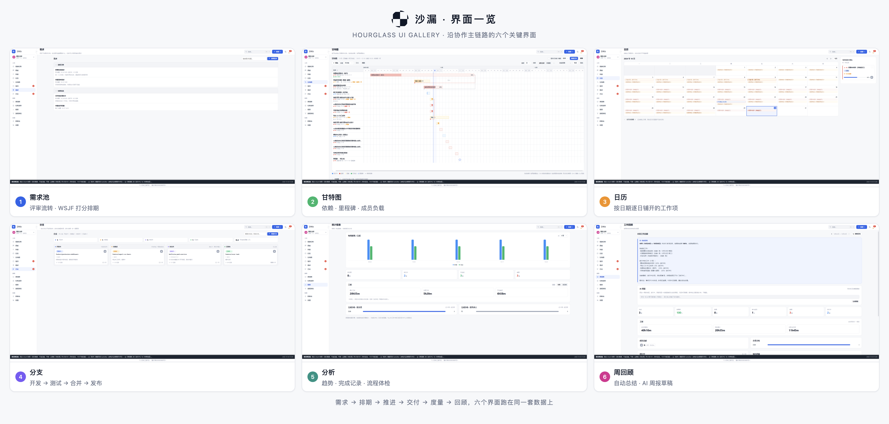
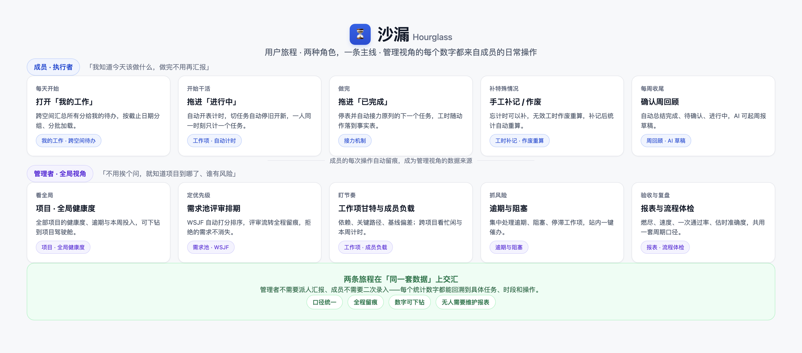
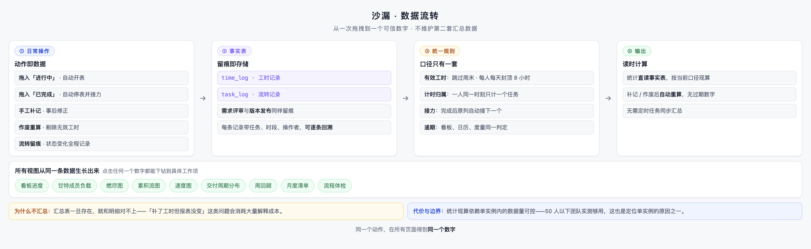
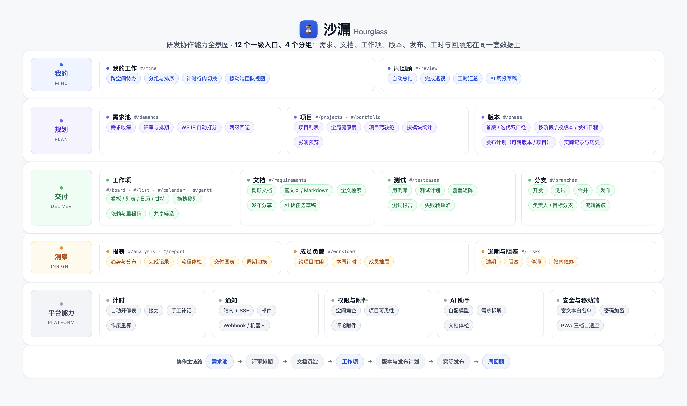
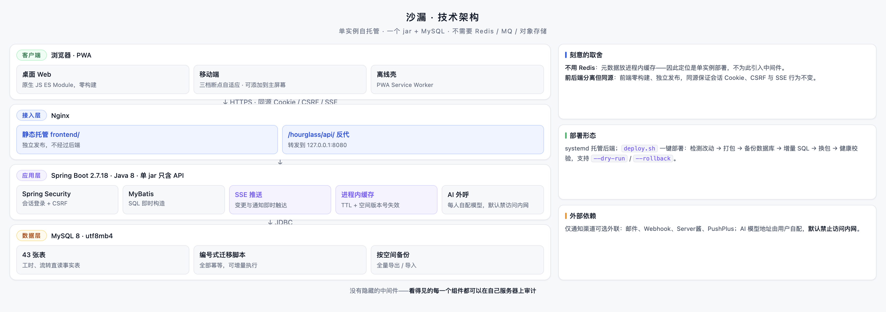

# 沙漏 · 产品说明

> 面向小团队的私有化研发协作工作台 —— 需求、评审、文档、任务、版本、回顾跑在同一套数据上。

---

## 沙漏是什么

沙漏把研发协作的整条链路收进一个可以自己部署的系统里：

> 需求池提想法 → 评审排期 → 文档沉淀方案 → 拆成工作项 → 看板 / 日历 / 甘特推进 → 绑定版本发布 → 周回顾与月度清单

进度、工时、成员负载、逾期风险和交付报表都从日常操作里自动产生，**不需要任何人二次录入**。

## 先看界面

以下是沿协作主链路的六个关键界面——需求池、甘特图、日历、分支、报表、周回顾。所有视图读的是同一套数据，任何一个数字都能下钻到具体工作项。

## 为谁而做

**推荐 50 人以下的研发团队使用**：有需求管理和迭代节奏，但没有专职 PMO。你们不需要再买一个重型平台，也不该继续用聊天记录当需求池。

| 你是 | 沙漏替你解决 |
| --- | --- |
| 团队负责人 | 不用挨个问就知道项目到哪了、谁有风险、时间花在哪 |
| 开发成员 | 打开「我的工作」就知道今天做什么，做完不用再写汇报 |
| 项目负责人 | 评审、排期、版本交付一条线，发布说明自动汇总 |
| 运维 / IT | 一个 jar + MySQL 的自托管系统，数据不出内网 |

## 核心主张：任务管理不是目的，工时和回顾才是

多数工具止步于"任务移动了"；沙漏的差异化在移动之后发生：

- **移动任务驱动计时** —— 拖入「进行中」自动开表，拖入「已完成」自动停表并接力下一个；一人同一时刻只计一个任务，杜绝月底回忆式补录。
- **统计直读事实表** —— 工时、燃尽、负载直接读 `time_log` / `task_log`，不维护第二套汇总数据；补记、作废后自动重算，不存在报表和明细对不上。
- **每个数字可回溯** —— 点击任何统计都能下钻到具体任务、时段和操作；度量只做可解释统计，不引入无法解释的模型输出。

## 能力全景

四个能力层：业务前台（需求与知识）、工作项执行、洞察度量、平台能力。

## 部署形态：小而完整

单实例、自托管：**一个 jar + MySQL**，不需要 Redis / MQ / 对象存储。前端零构建，由 Nginx 直接托管；`deploy.sh` 一键部署、备份、增量升级、健康校验，支持 `--dry-run` / `--rollback`。数据不经过任何第三方云服务。

## 明确不做的

多租户 SaaS、大规模横向扩展、多人实时协同编辑表格、预测型统计与 AI 评分、外部平台迁移工具。**这不是能力不够，是刻意的范围克制**——小团队要的是每个功能都用得上、每个数字都可信。

## 进一步了解

| 文档 | 内容 |
| --- | --- |
| [项目介绍](项目介绍.md) | 背景、信息模型、模块地图、机制取舍 |
| [用户使用手册](用户使用手册.md) | 全功能操作手册与口径解释 |
| [快速上手指南](快速上手指南.md) | 新团队 30 分钟跑通主链路 |
| [管理员指南](管理员指南.md) | 部署、升级、备份、通知、AI 配置 |
| [常见问题](常见问题.md) | 口径、统计、部署的高频疑问 |

---

许可：[PolyForm Noncommercial License 1.0.0](../LICENSE)（源码可用，**禁止商用**；企业内网部署、对外交付、试点评估等商业场景需向版权持有人另行取得商业授权）。版权与历史沿革见 [NOTICE](../NOTICE)；内嵌第三方库与后端依赖沿用其原始开源许可证，清单见 [THIRD-PARTY-NOTICES.md](../THIRD-PARTY-NOTICES.md)。
