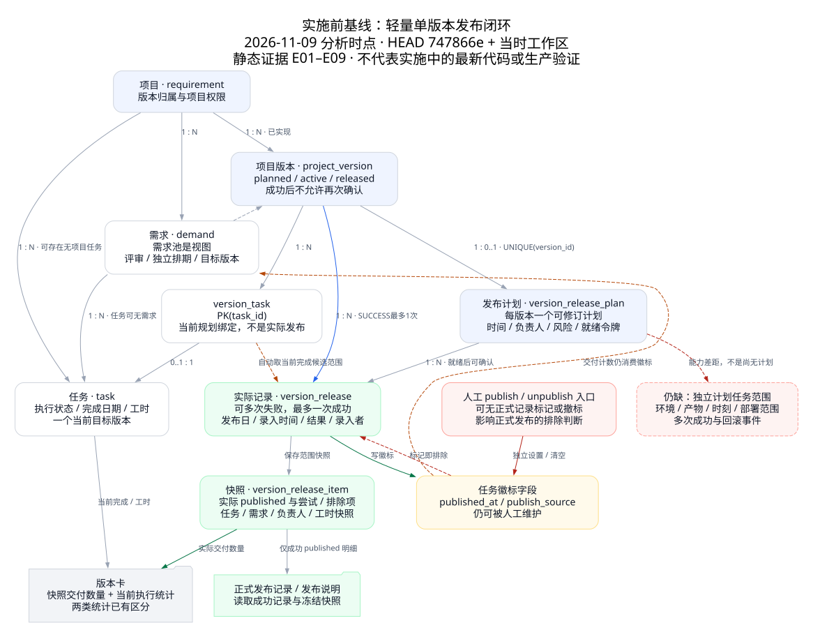
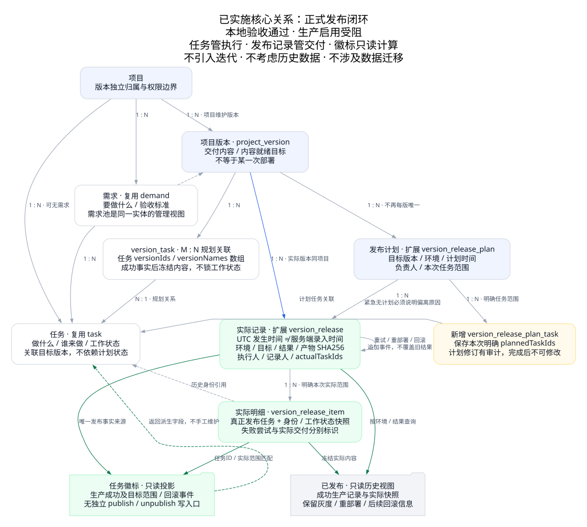
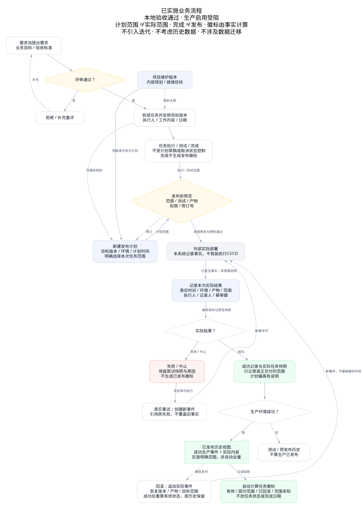

# 沙漏项目管理系统：最新业务架构分析与优化方案

> 更新日期：2026-11-10（延续 11 月 9 日报告）；当前证据为**工作区源码契约、最终独立验证结果及实际读取的安全浏览器验收摘要**，不是生产部署证明。`747866e` 与 E01–E14 仅保留为 11 月 9 日实施前历史基线。
>
> 阶段：**A–E 已实施，本地正确性门禁通过：全量 Java、真实 MySQL／API、真实 headless Chrome 桌面／移动端仿真、权限与未知请求恢复均已有完成证据；七对交付 PNG 已重拍、配对 SHA256 一致并完成视觉查看，架构视觉与部署安全隔离检查通过。生产配置写入被权限检查拦截，生产启用未闭合，尚未启用新库。**核验边界见第 2 节。
>
> 范围：**不引入迭代，不处理历史数据、不实施历史迁移或删除。**新模型启用后的发布记录与快照持续保留；腾讯原运行 catalog 已核实为 `hourglass`（46 表），规划新库 `hourglass_20261110` 尚不存在，原库必须保留。

## 0. 当前实施概述（2026-11-10，本地验收通过／生产阻塞）

**A–E 已全部获批并实施。工作区已实现正式事实单一权威、显式计划／实际范围、同版多计划／多成功事件、任务规划 M:N、结构化目标及回滚投影。本地正确性门禁通过；真实浏览器采用 1440／390px 仿真，不是真实物理手机测试。本地 full demo、生产环境事件元数据或接口成功均不构成生产部署证明。**

### 0.1 当前源码契约

1. **五张正式交付表**：复用 `version_release_plan`、`version_release`、`version_release_item`、`version_log`，新增 `version_release_plan_task`。版本可有多个独立计划和多条实际事件；不再保留“单版单 plan／单 success”限制（C01–C03）。
2. **任务规划 M:N**：`version_task` 使用空间＋任务＋版本复合主键；任务读写统一 `versionIds`／`versionNames` 对齐数组，不保留 task 的 scalar `versionId`／`versionName` 兼容或双写。需求的单值目标版本和事件的实际版本是各自身份，不能误删为任务兼容字段（C01、C06）。
3. **三个范围独立**：版本内容范围、`plannedTaskIds`、`actualTaskIds` 分别保存。preview 在项目互斥后对当前锁定任务批量读取 M:N 关系，所有同 ID 实例使用同一组排序对齐数组；未选择的计划项明确返回 omitted 理由并保存 `not_selected` 快照，不自动把所有 done 项当交付（C02、C04）。
4. **事实状态／维度**：计划 `draft/ready/canceled/completed`（completed 为成功确认结果，非普通保存状态）；实际 `success/failed`；环境生产／预发布／测试，**源码及 API 字面值是 `production/staging/test`，prod 是生产简称而不是额外枚举**；覆盖 `full/partial/unknown`；操作 `deploy/redeploy/rollback`。显式保存 `artifactRef`＋64 位 SHA-256 `artifactDigest`、UTC 微秒发生时间／录入时间、结构化 `targetKeys`、实际执行人和服务器确定的录入人（C02、C03）。
5. **只读生产徽标**：只投影正式成功生产事件；失败、计划或测试成功不生成生产徽标。投影按 occurredAt → recordedAt → id 排序；成功 rollback 只撤销引用成功事件对应的 task-target 有效事实，不清除后续 success、其他环境／目标或历史。保留 `everPublished`，有效状态分为 `unpublished/effective/partial/rolled_back/unknown`（C05）。
6. **权限与冻结**：事实录入／回滚／计划及整版 `applyTasks` 范围变更限定 owner、admin 或有写权限的项目负责人；任务负责人不因此获得整版管理权。实际执行人是当前、未停用成员元数据，**不要求其具备 manager 权限**；录入人才接受管理权限复核。success 冻结正式版本内容成员关系及当次不可变快照，不锁任务工作状态；已有成功生产事件的产物不可换，补丁建新版本（C02、C07）。
7. **SnapshotDone 修正**：`VersionReleaseItem.boardColumn` 已捕获并写入 SQL；release-note 使用捕获状态计算 doneCount，不因 success 把异常未完成项伪造成 done，也不以今日任务状态改写当次完成数（C08）。
8. **外围收口**：需求追溯按捕获身份和真实事件；版本删除保护任务、需求、发现版本、计划、审计和正式事实；Epic 带子项不能孤立跨项目。JSON **v13 仅搬运工作项**，已包含版本 startDate、需求日期／canceled、M:N 引用并预检；真实 MySQL 的 JSON 整体原子回滚、完整 mysqldump＋空库恢复及正式五表内容／键比较均已通过（C09–C12；第 0.2 节）。

### 0.2 当前可信验证状态

以下转录主 agent 已明确报告的完成证据，执行边界见第 2 节；各项统计分别计量，**821 tests、484 场景断言与 990 回读 checks 不合并为一个测试 suite**：

| 检查 | 已报告结果与限制 |
|---|---|
| 最终独立源／全量 Java 8 | `/tmp/hourglass-ae-validation-20261110-main-7fc2/java-publish` 与当前 `backend` 提交候选 src 及测试快照 **514 files 零差异**（仅排除无引用的未跟踪旧 DTO `TaskPublishRequest.java`，不提交也不删除该本地文件）；Java 8 `mvn -o -B test package` exit 0，Surefire **821 tests／0 failures／0 errors／0 skipped**。含异常未完成项发布不得伪造 done 的加强 VersionPhase 断言；已取代此前专项及跳 tests 打包的阶段性结果，原 core 45／后续 38 不再另行累加 |
| 独立真实 MySQL 8 | `hourglass_delivery_20261110` 加载 52 表；authenticated health 证明真实 JDBC catalog；不是腾讯生产新库 |
| 真实 SQL 14 mandatory 场景 | `tools/e2e/delivery-release.py`，run=`afca027b3341`，**484 passed／0 failed／0 unverified，14 mandatory 场景全部完成**。真实 SQL 故障、并发、权限撤销等待、JSON 整体原子 rollback、完整 mysqldump＋空库恢复＋五表内容／键比较均已执行；无 SKIP 充当 PASS |
| 场景隔离／清理 | 上述场景自建 **8 users／12 workspaces 全部清理，remaining 0**；既有数据前后未变。此清理范围不与下列 full demo 的新命名空间混算 |
| 真实本地 full API demo | 新命名空间已完成：**8 users／4 workspaces／11 projects／33 versions／66 demands／275 tasks／528 subtasks／264 comments／792 timeLogs／44 docs／44 cases／44 runs／11 testPlans／11 attachments／11 views／44 releasePlans／66 events**。此前 smallDemo 已通过；本次 full 不是 production seed |
| full demo 回读／事实分布 | **990 checks 通过**；264 个非 Epic tasks 的生产状态：22 effective／11 rolled_back／11 partial／220 unpublished。66 events：11 test success／11 production failed／22 production deploy success／11 redeploy success／11 rollback success；记录生产环境事实不代表已远程部署 |
| 前端专项 | **107 个 JS 文件语法检查通过，3 个单元 suite 通过／0 失败**；此前需求 VM、25 项 drawer 生命周期及 optional demand 专项亦通过，与浏览器断言独立计量 |
| 静态结构／文档 | 五张 formal DDL bodies 与 baseline 一致、全部 Mapper XML parse；**16 项 baseline convergence** 通过；check-docs copies／links／52 tables 及 **14 checker tests** 通过 |
| 真实浏览器 | backend **8120**／frontend **8121** 的真实 headless Chrome：**12 个导航入口 × 1440／390px，72 assertions**；权限 **29**；恢复 **27／3 场景**（响应丢失、请求丢失及其后的页面刷新＋原键查询失败，保留完整原 body/key、不盲重试）；planTime **6**；截图检查 **16**，各组不合并 |
| Golden 复核／隔离 | 先前 desktop **20**／mobile **12** golden assertions **未重跑**；本轮各 **3 个 LIVE 记录／任务状态证据检查**通过。最终复跑未新建空间，**1 个自建浏览器 fixture 空间留在本地作为正式证据**；不得将 SQL 场景 remaining 0 扩写为全部本地数据已清理 |
| PNG／SVG／部署安全 | **仅七对 delivery PNG 是本轮新截图**，已重拍、docs／frontend SHA256 配对一致并有视觉查看证据；旧 overview 图仍属历史布局。七张新截图均已由主 agent 最终逐图查看并核对配对 SHA256。三个 SVG 已完整渲染逐图确认，两张目标图的最终状态标题更新后也已重新渲染查看；部署安全 **212 项隔离检查通过（含 73 段脚本语法）**，不是生产执行 |
| 交付／生产 | **提交推送结果以 Git 为准；生产部署与 production full seed 阻塞、未执行**。目标服务器 `43.156.155.204` 的原运行 catalog=`hourglass`（46 表）保留，`hourglass_20261110` 不存在；缺少显式 `DB_NAME`，且生产写入 `/etc/hourglass.env`／`/etc/hourglass-backup.cnf` 被策略拒绝，均未执行，不绕过权限检查（第 11 节） |

第 3／4／5 节及附录 A 的 E01–E14 是历史对照，不是今日缺陷列表。当前源码定位见附录 A.2 的 C01–C14；验收门禁见第 11 节。

## 1. 已确认的职责与业务关系

### 1.1 职责划分

| 对象 | 负责什么 | 不负责什么 |
|---|---|---|
| 需求池 | 需求的收集、评审、规划和追溯视图 | 不复制成另一套需求实体 |
| 需求 | 要做什么、价值、验收条件 | 不用一个目标版本替代整个需求实际交付 |
| 任务 | 具体做什么、谁负责、执行状态与工时 | 不直接依赖发布计划状态，不人工维护交付事实 |
| 项目版本 | 项目独立维护，定义交付什么 | 不等于某一次环境部署 |
| 发布计划 | 关联版本，确定计划时间和本次计划任务范围 | 不证明已经执行或交付 |
| 实际发布记录 | 实际发布时间、环境、结果、本次真正发布的任务 | 不把当前所有 done 任务自动当成实际内容 |
| 已发布 | 基于实际发布记录展示发布历史 | 不提供第二套版本、任务和日期 CRUD |
| 任务徽标 | 反映任务实际发布状态，自动计算 | 不提供独立人工发布／撤标操作 |

**核心原则：任务状态管工作完成情况，发布记录管实际交付情况。**

### 1.2 关系与三种范围

- 项目 → 版本：1:N，保留现有归属。
- 需求 → 任务：通常 1:N；任务可以没有主需求。需求文档继续是内容载体，不替代业务需求。
- 任务 → 目标版本：已实现显式 M:N 规划关联及数组契约，不是发布证据；同任务多版本不复制开发工时。
- 版本 → 发布计划：已实现 1:N；计划 → 实际记录：1:N 关系承载尝试历史，成功确认后 completed 计划不复用，后续成功使用新计划或受控无计划事实。
- 实际记录 → 本次任务：通过不可变明细快照关联；一个任务可出现在多个真实事件中，但不能因此重复计算开发工时。
- 已发布／徽标：正式事实的只读查询投影，不另建人工维护实体。

**版本范围**回答“这个版本定义交付什么”；**计划范围**回答“这个窗口准备交付哪些任务”；**实际范围**回答“这次真正交付了哪些任务”。三者通常相关，但不必相等。未执行计划不产生发布徽标；发布失败不产生新的成功徽标，也不清除更早的成功证据。

## 2. 本轮证据与验证边界

此前静态核对已覆盖相关完整函数：服务、Controller、DTO、Mapper、SQL、前端发布抽屉／任务抽屉／需求详情及删除与备份路径。证据索引区分两代：**E01–E14 是 11 月 9 日实施前源码定位；C01–C14 是 11 月 10 日源码核对时点的 sourceRefs**，旧行号不作为今日源码证据。

- **静态确认**：C01–C14 证明已核对的数据形状、函数路径与门禁；运行结果另列，不从源码存在推断通过。
- **已报告验证**：最终独立 Java 提交候选源快照与当前 backend 提交候选 src／测试 514 files 零差异，全量 Java、真实 SQL 14 mandatory、本地 full API／990 回读、真实浏览器及前端／文档专项已完成；具体范围与独立计数见第 0.2 节。
- **安全摘要实读**：`/tmp/hourglass-ae-validation-20261110-main-7fc2/final-validation-results.json` 的 `ok=true`，逐组登记导航、权限、恢复、计划时间、截图、JS／unit 与 retainedOwnedWorkspaces；其 remainingBlockers 空只指本地验证，不能抵销生产权限阻塞。
- **历史风险**：第 3–5 节与 E01–E14 完整保留发现时的触发路径、原因及优先级；其中待验收措辞亦属历史，不是今日缺陷或门禁状态。
- **批准契约／取舍**：第 6–10 节区分已实施规则与未落地的可选细节；批准不等于验收。
- **未闭合生产门禁**：显式 `DB_NAME` 缺失，生产配置写入被策略拒绝；腾讯新库部署与 production full seed 未执行。提交推送结果以 Git 为准。

C13／C14 的 JS sourceRefs 已按本次最新实际函数行号重定位；其余索引保留原核对时点。最终 Java 结果有源快照零差异证明，不从 HEAD、旧 jar 或旧截图推断结果。

**本次文档核验边界**：只更新指定既有公开文档及六组正文副本；读取安全验收摘要和源码定位、运行 check-docs／14 个文档 checker 单测，不自行复跑 Java／业务浏览器／API／DB／部署，不读取凭据、不操作 Git。其他运行证据采用主 agent 明确报告；本地正确性门禁通过不等于生产启用。

## 3. 历史基线：11 月 9 日实施前真实实现（非今日源码）

> **本节整体为历史回放。**下文“当前／现有／尚未”均指 11 月 9 日分析时点；单版单计划／单 success、人工双权威及 scalar 任务版本等已由本轮实施替换，不能作为 11 月 10 日缺陷引用。今日状态见第 0／11 节及 C01–C14。

### 3.1 历史实体及约束

| 当前对象 | 当前实现 | 边界／证据 |
|---|---|---|
| 项目 | `requirement` / `Requirement` 实际是项目 | 历史命名不代表业务需求 |
| 业务需求 | `demand`，评审、目标排期、规划日期和日志 | 与详细文档分工，保留现有基础 |
| 任务／版本关联 | `version_task` 的主键是 `task_id` | 一个任务最多一个当前版本，尚非 M:N（E01） |
| 发布计划 | `version_release_plan` | `UNIQUE(version_id)`，每版本一个计划（E01） |
| 实际记录 | `version_release` | 可多条失败记录；生成列唯一键限制每版本最多一条成功（E01） |
| 发布明细 | `version_release_item` | 保存任务、需求、负责人、完成日期、工时及 disposition 快照（E01、E02） |
| 发布审计 | `version_log` | 记录版本／计划／发布操作（E02） |
| 任务发布字段 | `published_at`、`publish_source`、`published_release_id` | 成功版本发布与人工标记均可写入，人工撤标也可清空（E03、E04） |
| 发布说明／卡片 | 正式明细快照与当前执行统计分开 | 已有不可变说明、实际发布／排除数量；当前任务／投入统计仍实时（E06） |

### 3.2 当前主路径

1. 需求评审、排期，拆成任务并关联同项目目标版本；任务独立执行和计时。
2. 管理者保存版本发布计划，选择计划日期、负责人、说明和风险；ready 要求日期与负责人。没有显式计划任务列表，范围令牌来自当前版本任务关联。
3. 发布预览检查当前版本任务：已带发布标记、未完成、没有完成日期、晚于声明实际发布日期完成的任务被排除。
4. 确认提交实际日期 `publishedOn`、成功／失败、说明／失败原因、幂等键、计划 revision 和预览令牌。没有环境、产物、实际任务 ID 列表或独立实际执行人。
5. 服务锁项目及当前数据、复核权限和令牌；重复相同请求返回同一记录，不同内容复用键被拒。
6. 失败保存尝试快照，不写新任务徽标，计划仍可继续；成功把所有未排除任务记为 published，写任务徽标、版本 released、计划 completed。
7. 实际记录与明细、审计在事务中处理；通知安排在提交后执行。提交后发送失败有日志，但未看到持久化通知重试队列。
8. 历史及正式发布说明读取快照；任务徽标仍读取可人工改写的任务字段。任务历史接口只返回成功且明细为 published 的正式记录。

当前成功确认必须有 ready 计划，已 released 版本禁止再次确认。因此，“同版测试成功后生产”“同版多批灰度成功”“成功后重新部署”等还不能用现行模型正常表达（E01、E02）。

### 3.3 历史基线关系图

[现状 DOT](audit/业务架构现状-2026-11-09.dot) 已明确为 **11 月 9 日 prebaseline**。蓝色为当时规划，绿色为事实／查询，红色为当时人工旁路及缺口，不能拿这些红色节点指认今日缺陷。当前执行统计可以合法变化，正式快照不应随之变化；本次不修改图，最新渲染已完整查看，历史基线标注保持。

### 3.4 已实现且应保留的护栏

- 项目行锁作为同项目排期、范围调整与发布的数据库互斥；多个项目按稳定顺序加锁，相关数据用当前锁定读取。
- 版本／计划 revision、状态条件更新、影响行数检查、预览范围哈希与请求幂等。
- 发布事实及快照事务处理，通知在提交成功后执行。
- 已有正式记录的版本／项目不能普通硬删；收尾最新版本删除还拒绝任务绑定（含回收站）和需求目标引用（含 canceled），不再自动解绑；空间清空／覆盖恢复也保护计划、审计和快照，包括未执行的计划。
- 需求后端拒绝排入 released 版本；需求更新明确拒绝直接换项目。
- JSON 恢复有外层事务；需求版本引用清理已有逐行 CAS，不是无并发保护的旧批量覆盖。

这些是**静态确认的机制**，不是已经验证无竞态、无旁路或恢复完全可靠的结论（E02、E07、E08、E10–E12）。

## 4. 历史对照：11 月 9 日对更早报告的修正

> 本表是实施前对更早结论的纠偏，表内“最新／当前／仍缺”均为当时口径，并非今日再次确认；当前修复状态另见第 11 节。

| 更早结论 | 11 月 9 日历史裁决 |
|---|---|
| 没有发布计划、实际记录和冻结明细 | 撤销：当前已实现三张正式表及审计 |
| 发布只提交空对象、写 NOW()，不能记录失败或实际日期 | 撤销：已有实际日期、success／failed、幂等和预览确认；仍缺精确时间及环境等维度 |
| 正式发布说明全部由实时任务重建 | 撤销：已使用实际快照 |
| 版本卡没有真实发布数量、所有统计混为历史 | 撤销：已区分快照发布数量和当前执行／投入；实时统计本身不是缺陷 |
| 发布和编辑没有 revision／锁／条件守卫 | 撤销：相关护栏已存在，运行效果待验证 |
| 后端可排入 released 版本、需求换项目静默忽略 | 撤销：当前后端均明确拒绝 |
| JSON 不带正式发布记录，必然是完整证据备份缺陷 | 撤销：README 明确 JSON 为工作项搬运，正式证据由 MySQL 备份承担；分别验证两种契约 |
| 需求清版本引用没有 CAS，JSON 恢复必然分批半提交 | 修正：逐行 CAS 与外层事务已存在；仍需验证相关业务流程及真实回滚 |
| 普通版本删除会自动清需求目标但保留 plan 状态 | 收尾撤销：最新代码直接拒绝有任务／需求目标引用的删除；发现版本引用仍需补齐 |
| JSON 需求规划日期遗漏，canceled 恢复会变 review | 收尾撤销：最新代码已补齐日期、状态、预检及对应测试；版本 startDate 缺口仍保留 |

**11 月 9 日当时仍成立的问题**包括人工双权威、非显式范围、单次成功约束、事实维度及权限不足，以及外围一致性。它们解释 A–E 的实施动机，不是今日源码缺陷结论。R01–R11 相关核心路径已实施，R12 最终验收仍未闭合；详细状态见第 11 节。

## 5. 历史风险登记：11 月 9 日实施前原因与优先级

> **R01–R12 保留发现时原文用于历史对照，不将其“当前证据”解释为 11 月 10 日源码。**人工双权威、单版单 plan／success、scalar 版本及 SnapshotDone 不再列为当前缺陷；SnapshotDone 最新捕获状态修正在第 0.1／C08。已实施并不意味着运行风险全部验证完毕。

P0 是当时到达业务模型前的事实完整性阻断，**不表示发现了生产事故或 HTTP 越权漏洞**。P1／P2 及负责方均为原建议分工。

| 编号／历史等级 | 11 月 9 日证据、原因及影响 | 原优化与验证信号 | 原建议负责方 |
|---|---|---|---|
| R01／P0 | 人工 publish 不创建正式记录；unpublish 可清除版本来源徽标。发布排除直接检查 `publishedAt`，需求交付也统计该字段。人工标记既可冒充交付，又会排除后续正式发布候选（E02–E05） | 正式记录＋实际快照成为唯一来源；移除人工写入口；同一任务在历史、抽屉、列表、需求详情口径一致 | 后端＋查询＋前端 |
| R02／P0 | 计划未保存选定任务；实际请求未提供任务范围；所有符合 done／日期条件的当前版本任务自动记为发布（E02、E09） | 显式计划任务关系和实际 taskIds；完成是预检条件，不是实际上线证据；计划 3 项、实际 2 项时只这 2 项有新证据 | 发布服务＋前端 |
| R03／P1 | 每版本一个计划、最多一次成功；ready 和 released 状态把一次活动与版本生命周期绑定（E01、E02） | 同版本 N 计划／N 事件；失败重试、测试后生产、真实重部署均保留独立事实 | 模型＋服务 |
| R04／P1 | 实际只有 DATE，缺环境、产物、目标范围和独立实际执行人；`released_by` 是当前录入用户（E01、E02、E09） | 实际时间与录入时间分开；明确环境／产物／范围、执行人／录入人，生产与测试可区分 | 契约＋模型 |
| R05／P1 | 有写权限的任意版本任务负责人即可确认整个版本；计划负责人只是元数据，并非发布授权（E08） | 管理者／项目负责人或明确授权发布者确认；任务负责人提交信息不自动获得整版发布权；服务端重验 | 权限＋产品 |
| R06／P1 | 非 canceled 需求时间线仍从目标版本 releasedAt 推断发布；详情按可人工写的 publishedAt 计算交付（E05、E07） | 从实际明细中的需求身份追溯；目标承诺、当前执行、实际交付和验收分开 | 需求查询＋前端 |
| R07／P1 | 收尾最新代码已拒绝删除仍有任务（含回收站）或需求目标（含 canceled）引用的版本，撤销“删除自动清空目标但保留 plan”的旧缺陷；仍未看到 foundVersion 发现版本引用的删除门禁或清理，项目解除引用也未清该字段（E10） | 保留新的引用门禁，验证显式有因解除目标及日志；补齐发现版本保护／清理；有事实版本继续禁止硬删 | 版本＋任务＋需求 |
| R08／P1 | JSON 版本对象仍未包含 startDate。收尾最新代码已补需求 plannedStart／plannedEnd 导出恢复、canceled 状态及日期预检，并新增往返测试；不再把这些需求字段列为未实现缺陷（E11、E14） | 补版本开始日期；验证现有需求日期／状态往返及事务；明确 released 绑定搬运不支持；不强行让 JSON 复制正式证据 | 备份契约＋测试 |
| R09／P1 | version_task 仍以 taskId 唯一；跨版本绑定仍非显式 M:N（E01） | 若批准原跨版本目标，同步全部数组读取／关联入口和去重统计；不抢旧关联、不复制工时 | 任务＋报表＋备份 |
| R10／P1 | Epic 保持 epic 类型换项目时，子任务引用未立即处理；仅降级类型会清子项，后续编辑子项才修复（E13） | 禁止带子项单独跨项目，或原子整体处理；不能依赖下次编辑自愈 | 任务服务＋测试 |
| R11／P2 | 版本 targetDate 仍称计划发布；抽屉刷新不重取版本能力；刷新／重新预览会丢失待确认失败请求的键（E09） | 日期名称分离、刷新能力；响应丢失先查原请求结果，未确定结果前不生成新事件键 | 前端＋接口 |
| R12／验收门禁 | 有单测和 E2E 源码，但本轮未执行；故障注入脚本存在 SKIP 条件；目标新契约尚无完整验证（E14） | 完整测试＋真实 MySQL＋全角色浏览器；关键场景 SKIP 不能当通过；不得宣称生产可用 | 测试＋发布验收 |

R11 的**历史风险**不是后台幂等失效，而是当时刷新／重开可能丢失不确定请求。当前抽屉已保存原完整请求与键，刷新／重开先查询原键；查询失败不清请求、不生成新事件，明确拒绝后也须查询再显式重置，并重新加载服务端能力（C13）。响应丢失及角色变化的真实浏览器验收仍待结果。

## 6. 已批准模型与当前实施取舍：复用并扩展

[目标关系 DOT](audit/推荐核心实体关系-2026-11-09.dot) 已同步为 **已实施、本地验收通过、生产启用受阻**，不宣称生产已经部署。黄色表示相对历史基线新增的计划任务关系；M:N、紧急记录及事件关联已有当前源码，精确定位见 C01–C14。目标图已重新渲染并查看，历史现状图未改。

### 6.1 已实施核心结构与保留取舍

| 对象 | 当前实施 | 契约／限制 |
|---|---|---|
| `version_release_plan` | 多条独立计划，复用原表 | id、versionId、plannedAt、ownerUserId、environment、targetKeys、coverage、notes、risks、revision；ready 修改／取消有因审计；completed 不覆盖或复用 |
| `version_release_plan_task` | 已新增，五张 formal 表之一 | planId＋taskId 主键，空间身份 FK；同空间／项目／版本范围服务校验，独立 plannedTaskIds |
| `version_release` | 同版多次实际事件，无单 success 唯一约束 | 显式 actualTaskIds、精确时间、环境、SHA-256 产物、结构化目标、结果／操作、执行人／录入人、关联与幂等；真实尝试新事件，不改写旧结果 |
| `version_release_item` | 不可变事实／尝试／未选择快照 | 原始任务／需求／目标身份、名称／内容摘要、boardColumn、completedAt、工时、disposition／reason；success 不伪造工作完成状态 |
| `version_log` | 复用审计 | 计划／范围／版本调整及确认原因，不通过删除历史“撤标” |
| `version_task` | 已实施显式 M:N | 任务统一 versionIds／versionNames 对齐数组，无 task scalar 兼容；增减某版本不抢其他绑定；成功后内容成员关系冻结 |
| 项目版本 | 保留项目身份、name、startDate、targetDate、revision 与现有状态字段 | targetDate 展示为目标就绪日；**没有新增独立 versionNo 字段，也未实施 ready／archived 新生命周期**，不把原可选设计当现有字段 |
| 已发布／任务徽标 | 正式事实只读投影 | 不建独立 CRUD 或缓存权威；publishedAt 等响应摘要由服务派生，非人工可写交付事实 |

复用现有 Service 与正式实体，不另建同义发布系统。计划范围是承诺，实际快照是已发生事实；必要的时间语义不同，不是双权威维护。

### 6.2 已采用的事实字段与状态契约

- **时间**：occurredAt 接收带偏移时间，服务规范化 UTC、截断微秒并拒绝未来；recordedAt 服务器 UTC，二者分开。计划使用 plannedAt 单个时间点；**没有另加开始／结束窗口或实际起止字段**。
- **环境**：字面枚举 `production/staging/test`（生产简称 prod，不新增 prod 兼容）；不增加环境配置菜单。
- **产物**：必填 artifactRef 与 64 位十六进制 SHA-256 artifactDigest；digest 归一小写，版本名不能替代产物身份。生产成功后的 ref／digest 不允许换产物。
- **目标范围**：显式 targetKeys 数组和 `full/partial/unknown`；已知覆盖至少一个目标键，未知不宣称全量。当前采用目标键而非新 targetId 业务表；不从自由文本百分比推断实际环境。
- **身份与权限**：executorUserId 独立记录，校验当前成员、账号存在／未停用并锁定成员元数据，**不 require manager**；releasedBy／releasedByName 由服务器记录入人，录入人必须通过当前管理授权复核。计划负责人也是元数据，不自动授权。
- **状态**：计划 `draft/ready/canceled/completed`，普通 save 只接受前三者；success 完成关联计划，失败留尝试。actual result 仅 `success/failed`，operation 仅 `deploy/redeploy/rollback`；**aborted、running 未实施**，不引入部署引擎或 CI/CD。
- **关联**：失败的真实重试使用新 deploy 事件关联 failed 并给原因；redeploy／rollback 关联匹配环境、产物、目标的成功非 rollback 事件，redeploy 同版本，rollback 任务／目标为原实际子集。同请求重发保持原完整请求与幂等键。

现有 planned／active／released 字段继续保留，但当前 confirm 不再以 released 一次终态阻止后续计划／事件；正式内容成员关系依据成功事实冻结，工作状态和实时工时不锁。versionNo／name 分离及 ready／archived 生命周期仅保留为未来可选细节，不属于本次已实施字段。

测试候选与生产产物分别记录；成功生产后的 ref／digest 冻结，重部署使用同一产物，有代码变化的补丁建新版本。

### 6.3 计划门禁与实际事实录入必须分开

ready 计划必须有时间、负责人及明确任务；preview 检查任务完成／日期、需求及计划偏差，确认复核 revision 和完整范围令牌。预览不是部署，测试证据齐备仍属业务验收要求，不能仅凭 preview 宣称完成。

**门禁不抹掉已发生事实。**当前异常未完成项、计划非 ready、实际版本或环境／范围偏差会产生 warning，受控成功录入需管理权限与 deviationReason；显式实际范围不被自动 done 选择替代。快照保存当时 boardColumn，success 不伪造 done；徽标根据实际事实而非现在工作状态计算。

无计划紧急记录已实现且原因必填；计划与实际版本同项目校验，保留原目标与偏离原因。completed 计划不可复用，但可新建计划或受控紧急记录。本期不引入跨项目发布列车或组件编排（C02–C04、C08）。

## 7. 自动只读徽标的统一规则

| 事实／场景 | 徽标与历史规则 |
|---|---|
| 只有目标版本、ready 计划、任务 done | 不产生实际发布徽标 |
| 新发布失败 | 记录尝试，不新增成功徽标；更早成功证据仍保留（未实施中止枚举） |
| 正式记录 success，任务确属本次实际快照 | 建立对应环境／目标的交付证据；生产／非生产分开 |
| 测试环境成功 | 历史展示测试成功事实；当前生产徽标不变化，不另称已实现测试徽标 |
| 生产灰度成功 | 显示实际目标范围／部分上线；不能自动显示全量交付 |
| 真实重部署 | 新事件，同任务不增加独立交付数或开发工时 |
| 成功回滚 | 新回滚事实，原成功仍在历史；只撤销所引用事件的 task-target 有效事实，保留后续 success 及其他环境／目标 |
| 回滚失败 | 不宣布恢复成功，不修改原上线结果 |
| 任务重开、改名、需求取消、后续改规划 | 不抹掉此前实际交付事实；当前执行／承诺与历史并列 |
| 任务软删或受控物理清理 | 保留原始身份与发布快照；不级联删除实际证据 |

徽标至少区分**曾发布过**与**当前有效／部分有效／已回滚／未确认**。最后一条成功记录未必代表整个环境当前唯一版本：灰度可能并行，回滚可能只覆盖部分目标。缺少范围或实际观测时，只能说明“最后记录的发布”，不能假装掌握真实环境状态。

当前列表、看板、抽屉、需求详情与版本页使用后端只读投影及共享格式函数（C05、C09、C14）。publishedAt 表示最近有效生产事实日期，不是人工编辑入口；失败／测试／回滚均保留在历史。客户端不能通过摘要或独立 publish／unpublish 写入交付事实；不宣称另有已实现的通用事实纠正 CRUD。

## 8. 已批准流程及特殊场景（本地含真实浏览器通过，生产阻塞）

[目标流程 DOT](audit/推荐业务流程-2026-11-09.dot) 已同步为已实施、本地验收通过、生产启用受阻。绿色为记录及只读投影；部署和回滚发生在外部，本系统记录事实，**接口成功不等于执行了远程部署**。最新 SVG 已完整渲染并逐图查看；图表可读性不替代业务运行验收。

正常路径：需求评审 → 拆任务并关联目标版本 → 独立执行；版本规划与发布计划可提前进行 → 计划显式选任务 → 就绪预检 → 外部实际部署 → 录入实际环境、时间、产物、结果及任务 → 冻结快照 → 自动查询徽标与发布历史。

| 场景 | 推荐表达 |
|---|---|
| 同版测试后生产 | 不同环境／计划／事件；测试成功不产生生产徽标 |
| 同计划失败再成功 | 两次真实事件，成功才形成新交付；重试关联前次失败 |
| 计划 11 月 15 日、实际 11 月 16 日 | 分别保存；保留计划调整审计，不用改计划日期美化准时率 |
| 计划 3 个任务，实际仅 2 个 | 保留原计划；实际仅 2 个快照为交付，另 1 个未交付并解释 |
| 需求拆至两个版本 | 目标意向与任务范围差异可见；需求可部分交付，不能目标版一发布就算全部完成 |
| 同任务回移植至两版本 | 显式版本关联与各次实际证据；独立新增工作应开新任务，不重复计原任务工时 |
| 成功后同产物重新部署 | 新 redeploy 事件，不新建假补丁、不复制工时 |
| 紧急新补丁 | 新版本；受控无计划事实录入可作为例外，不能直接改旧版内容 |
| 灰度扩容／部分回滚 | 明确各次目标范围，新事件不覆盖旧事实；有效性按目标计算 |
| 需求取消后查询历史 | 停止未来承诺，但保留已发生的实际交付，不能删除历史段落来抹事实 |

需求“关联工作项已交付”不等于业务验收完成：必须明确必需范围，有验收要求还需证据。没有任务或尚未确定范围的需求不能因空集合算 100%。review 的评估任务不自动构成正式承诺，rej 需求新增正式范围需重新评审；这些门禁需明确落实位置并验收。

## 9. 一致性、统计、删除和备份

### 9.1 事务与并发

已保留项目行锁、revision、当前读取、条件更新及影响行数裁决。当前令牌覆盖计划／实际任务、版本／计划 revision、环境、产物、目标、执行人及偏离理由，并纳入当前锁定任务的批量 M:N 对齐数组；相关确认上下文变化会拒绝旧预览（C02、C04）。真实 SQL 14 mandatory 场景已完成，包含事务、并发及权限撤销等待；484 passed／0 failed／0 unverified，详见第 0.2 节。

记录、实际快照、计划关联与审计在同一事务中完成；通知仍在提交后发送，幂等命中不能重复通知。通知持久化重试是否必要按产品可靠性要求另行评估，不在本轮顺手增加基础设施。

当前五张正式表已定义必要唯一键及 FK，服务端校验同空间／项目；计划任务 FK 阻止误删引用任务，实际快照保存原始 taskId 而不随当前任务级联消失。Mapper 当前锁定读取绕过缓存及 RR 快照读，不能只信前端过滤；真实数据库约束及 SQL 故障回滚已有 14 mandatory 场景完成证据（C01、C04、C10；第 0.2 节）。

### 9.2 统计口径

| 指标 | 推荐来源 |
|---|---|
| 发布／失败／重部署次数 | 正式事件数，按 result、operation、环境筛选 |
| 新增交付任务数 | 成功生产的新增交付身份去重；测试、恢复、重部署不重复增加 |
| 当前有效任务覆盖 | 成功交付与成功回滚的目标范围，未知不算全量 |
| 版本卡实际发布／排除数量 | 实际事件快照；多事件后分别显示事件数与去重任务数 |
| 当前完成率／投入工时 | 当前任务和 time_log；可以变化，明确“当前” |
| 全局开发工时 | 执行事实一次计入；M:N 或多次部署不能 JOIN 放大；版本分摊需明确规则 |
| 需求交付 | 实际快照中的需求身份、明确范围及验收证据，不用目标版日期代替 |
| 首次生产发布 | 新模型成功生产事件，不按旧首版日期把未绑定任务折入实际交付 |
| 准时率 | 确认计划时间与实际事件时间，并保留承诺调整审计 |

**不要冻结所有任务状态或当前工时以保历史。**要冻结的是当次事实快照；现行版本卡已把实际发布数量与当前执行指标分开，这一设计应保留。

### 9.3 删除与项目归属

- 继续禁止普通删除有正式记录的项目／版本，计划取消或归档不能删掉记录。
- 版本已有任务／需求目标／发现版本引用（含回收站及 canceled）、计划或审计时均拒绝普通删除，**发现版本保护已实施**；解除目标经有因调整与审计，不静默清空。相关后端回归、真实 SQL 并发、JSON 恢复及本地真实浏览器验证已有完成证据，范围见第 0.2 节，不从清单推断每一删除交互均有专项 PASS（C07、C09、C10）。
- 需求已明确禁止直接换项目，不重复实现旧缺陷修复。
- Epic 有子项时禁止孤立跨项目移动，或使用明确授权的原子整体操作；未完成计划与事实引用一并检查。
- 空间清空／JSON 覆盖恢复仍保留当前证据保护，不能为了方便恢复取消这些护栏。

### 9.4 两种备份契约分别验收

**JSON v13 是工作项搬运，不是正式发布证据备份。**仅接受 v13；任务必须提供 versionIds 数组及项目／版本／需求字典，预检重复、跨项目、Epic、日期与引用。版本 startDate、需求 plannedStart／plannedEnd 和 canceled 已进入导出／恢复；不再列为当前遗漏（C11、C12）。

导出空间有成功正式版本时拒绝 JSON 搬运；导入 released 或带 releasedAt 的版本在覆盖删除前拒绝。正式证据不伪装成 JSON 支持，已有交付五表任一行时空间清空／覆盖恢复会拒绝。import 外层 REQUIRED 事务包住所有阶段，批次只切语句；真实 MySQL 中途故障下的 JSON 整体原子 rollback 及新格式往返已通过，不根据过时注释推断半提交。

正式证据备份／恢复包含**五张表：version_release_plan、version_release_plan_task、version_release、version_release_item、version_log**，不能再写成漏掉 plan_task 的“四表”。五表 DDL bodies 与 baseline 一致是结构证据；**完整 mysqldump、空库恢复及五表内容／键比较均已真实执行并通过**，属于 run=`afca027b3341` 的 14 mandatory 场景，未以 SKIP 充当 PASS。只验新模型同格式，不建设旧格式兼容、历史映射或跨模型恢复；腾讯原库另有 46 表全量 dump 逐字节恢复证明（第 11 节），但本地新模型恢复通过不等于腾讯新库已部署。

## 10. 当前 API、权限与 UI 契约（本地 API／专项／真实浏览器通过）

### 10.1 接口复用

当前 Controller 提供 GET／POST `/api/versions/{id}/release-plans` 列表／新建独立计划，PUT `release-plan` 必须携带独立 id；POST `release-preview`／`release`，GET `release-records`（支持 key 查原幂等结果）／`release-history`。确认返回正式记录及快照，不是状态标记空对象（C03、C13）。

| 能力 | 当前实施与边界 |
|---|---|
| 多计划 | 独立 id，与版本关联；不再按版本唯一查计划 |
| 计划保存／预览 | plannedTaskIds、plannedAt、环境、目标、coverage、revision；没有额外时间窗口字段 |
| 实际记录 | actualTaskIds、UTC occurredAt、环境、SHA-256 产物、结果、目标、执行人、偏离原因、令牌和幂等；服务器决定录入人 |
| 重试／重部署／回滚 | 新事件关联原事实；同请求查询／重试原键，不把响应不确定当新尝试 |
| 任务摘要／历史 | 正式记录只读投影；无人工 publish／unpublish 双权威，失败／测试／回滚历史仍可查询 |
| 查询 | 项目可见性鉴权；前端已做结果／环境／操作筛选与分页，不把前端分页宣称服务端分页契约 |
| 任务版本 M:N | 统一 versionIds／versionNames 数组，多选及去重统计，JSON v13 映射；不保留 task 单值双写 |

Service 已使用 403 授权拒绝、404 不存在／不可见、409 revision／上下文／幂等冲突及 422 部分业务门禁，参数校验沿用统一处理；真实 HTTP／SQL 场景及本地 full API 已通过，含权限撤销等待验证；角色浏览器权限 29 断言已通过，1440／390px 为真实 Chrome 仿真而非物理手机。前端能力不是授权边界。

### 10.2 权限收敛

**当前事实录入、回滚、计划管理及整版 applyTasks 变更范围仅 owner、admin 或有写权限的项目负责人可执行。**任意任务负责人整版确认的历史旁路已移除。任务负责人可按现有任务级规则有因调整自己任务规划版本，但不能绕过整版范围 manager-only 门禁或成功内容冻结（C06、C07）。

计划负责人／实际执行人是独立元数据，实际执行人只校验当前空间成员、账号存在及未停用，不 require manager；录入人由服务端确定且在锁定读取后再次鉴权。未额外增加“按环境授权发布者”角色；开发／测试成员不因环境值或执行人身份取得录入权。viewer 继续全空间只读，不误称为逐项目 none 隐藏，隔离策略未顺带变更。

Service 重验空间／项目及当前能力，客户端不能冒充录入人；抽屉刷新已重取版本与权限，并先恢复原键结果（C02、C07、C13）。真实 SQL 权限撤销等待、25 项 drawer 生命周期专项及真实 Chrome 权限 29 断言均已通过（独立口径），不会凭执行人元数据放宽授权。

### 10.3 菜单与交互

不机械增加七个顶级菜单，不增加迭代入口：

- **需求池**继续一个入口，详情区分目标、当前任务、实际交付与验收。
- **任务**继续执行视图，显示只读环境／范围徽标和事件链接；删除“人工发布／撤标”和“先撤标才能改状态”的权威路径，历史保护不靠锁死执行状态。
- **版本详情**当前抽屉按“内容／发布计划／发布历史”分区，多计划独立选择；不把分区称为另建二级页签，也不重复维护版本身份。
- **计划范围与实际范围**分别可见、分别选择，展示差异及原因；不能只有 done 候选列表没有实际选择。
- **已发布**是历史的成功生产筛选；测试、失败、灰度和回滚可展开，不建立独立 CRUD。
- **日期**分别称“目标就绪日”“计划发布时间／窗口”“实际发布时间”“录入时间”；版本 targetDate 不再称实际发布活动时间。
- **文档／分支发布**解释为内容可见性或人工流程标记，不作为真实生产部署证据；阶段名称可改“上线前投入／上线后维护”。

浏览器回归目标包括正常路径、范围偏离、无任务／失败／部分灰度／回滚、角色变化、响应丢失、移动端及非发布操作。最终真实 Chrome 已完成 12 入口／1440＋390px 导航 72、权限 29、恢复 27／3 场景、计划时间 6、截图 16 断言；先前 desktop／mobile golden 20／12 未重跑，本轮各 3 个 LIVE 记录／任务状态检查通过。七对 delivery PNG 已重拍并配对一致、视觉查看；本次不以 VM、API 或旧 overview 图代替该真实浏览器证据。计划时间保留墙钟且零秒不误判脏改动、date-only 不添时间、selected／omitted 明列、移动端关闭按钮 sticky 可达、事件处理项次、生产曾交付去重数与当前生效数分开，不推断待交付数量；SW v120。

## 11. A–E 已批准实施状态与验收门禁

**A–E 已全部获批并实施，本地正确性门禁通过；生产启用未闭合。**下表登记本地完成证据与生产边界，不能把仿真浏览器、本地 full demo 或隔离部署脚本验证当作生产执行。原库保留，无历史 migration 或删除。

| 批次 | 当前实施状态／契约 | 最终本地结果／生产边界 |
|---|---|---|
| A：实际事实与徽标权威 | 已实施显式 actualTaskIds、正式事件＋快照唯一权威、生产／非生产分离、UTC／SHA-256／执行人 vs 录入人、manager-only 录入及只读投影。R01／R02／R04／R05／R06 不再作今日缺陷（C02–C05、C07–C09） | 全量 Java、14 mandatory 及本地 full API／回读通过；264 非 Epic tasks 的投影为 22 effective／11 rolled_back／11 partial／220 unpublished。真实 Chrome 权限 29 断言通过；桌面／移动 golden 旧 20／12 断言未重跑，本轮各 3 个 LIVE 记录／任务状态检查通过 |
| B：计划范围与多次活动 | 已实施 plan_task、多计划、多 success、revision／完整 token／原键幂等及 afterCommit。R03 已替换（C01–C04、C13）；计划墙钟不转 UTC、零秒精度归一不误判脏改动、selected／omitted 分列 | SQL 并发、44 releasePlans／66 events 回读及 drawer 专项通过；Chrome 恢复 27 断言／3 场景、planTime 6 断言通过。页面刷新＋查询失败仍保留原完整 body/key，不盲重试 |
| C：外围一致性 | foundVersion／回收站／canceled／plan_task／审计删除保护、需求快照追溯、Epic 项目门禁与 JSON v13 日期／状态／数组整体事务已收口，R07／R08／R10 不再作今日缺陷（C07、C09–C12） | 真实 SQL 故障、JSON 原子 rollback、完整 mysqldump＋空库五表内容／键比较通过。SQL 场景自建 8 users／12 workspaces remaining 0、既有数据未变；另 1 个浏览器 fixture 空间保留作正式本地证据，最终复跑未建新空间 |
| D：跨版本与特殊事件 | 已实施 M:N 无 task scalar、目标级 deploy／redeploy／rollback 有效性；R09 已替换（C05、C06）。SnapshotDone 捕获状态及 omitted 理由已实施（C04、C08）；事件处理项次、生产曾交付去重数与当前生效数分开展示 | SQL 14 mandatory、full demo 66 events 分布及加强 VersionPhase 断言通过（明细见第 0.2 节）；Chrome 截图 16 断言、七对 PNG 重拍／SHA256 一致并视觉查看。移动关闭可达；日期值不伪造时分秒，SW v120 |
| E：完整验收与启用 | **本地正确性门禁通过**：源 parity 514 files；Java 821／0 failure／0 error／0 skip；SQL 14 mandatory 484／0 failed／0 unverified；full API 990 回读；JS syntax 107 files、3 unit suites；文档 14 checker tests、baseline convergence 16 项，各项独立计量 | Chrome 12 入口／1440＋390px 导航 72、权限 29、恢复 27、planTime 6、截图 16 断言通过；3 SVG 视觉确认、部署隔离 212（含脚本语法 73）通过。**生产因权限拒绝与显式 DB_NAME 缺失阻塞，新库与 production full seed 未执行；提交推送结果以 Git 为准** |

R11 原请求丢键风险已由原完整请求／键保留、先查询与当前能力刷新收口（C13），真实浏览器恢复 27 断言已通过。R12 的本地正确性子门禁已关闭，生产启用仍受下述权限与配置门禁阻塞。所有统计保持独立，不相加成一个 suite，不把旧 golden 20／12 写作本轮重跑，也不额外累加此前 45／38 专项。

**腾讯部署前门禁**：原运行 catalog 已核实为 `hourglass`（46 表），`hourglass_20261110` 不存在；现有 env 仅含 `AUTH_USER`、`AUTH_PASSWORD`、`DB_PASSWORD`、`AI_CRYPTO_KEY`，缺少已证明需显式配置的 `DB_NAME`。原库、配置、jar、前端和附件已保存为独立受限备份，gzip／归档检查通过；原 46 表 SQL 已恢复到本次独占临时空库并与原库全量数据 dump 逐字节一致，临时检查库已清理，原库保持。部署安全隔离验证 212 项通过，但新库部署与 production full seed 尚未执行。正式启用前须补齐已证明的显式 DB_NAME；不依赖默认 catalog、不覆盖或迁移历史。当前生产配置准备被权限检查拦截：写入 `/etc/hourglass.env` 及创建受限 `/etc/hourglass-backup.cnf` 均未执行；不得改用其他入口绕过，生产部署与生产 full seed 因此阻塞。

### 11.1 回归与验收矩阵（清单不是 PASS 结果）

专门独立环境的新建数据应至少覆盖以下；已知实测状态只以第 0.2 节为准，不能从清单或测试源码存在推断通过：

1. **需求／任务**：评审、排期、撤回／取消、重开、拆任务、文档、计时、完成／重开、软删、循环任务；发布不改变执行或完成日期。
2. **范围**：版本 4 项、计划 3 项、实际 2 项；异常未完成项的预检与受控事实录入；实际偏离版本／日期；跨空间／项目拒绝。
3. **事实／徽标**：计划不执行、失败后成功、失败不抹旧成功、测试／生产区分、重复请求、真实重复部署、无人工旁路、所有列表与需求详情口径一致。
4. **多次活动**：一个版本多个计划和成功事件；不同产物、灰度范围、紧急记录、成功／失败回滚，目标级有效性与历史不互相覆盖。
5. **并发**：预览后任务／需求／计划变更、发布与版本编辑交错、同键并发、不同键真实事件、响应丢失后的结果查询、第二任务写入故障回滚。
6. **删除／归属**：无事实版本的需求撤排／日期／日志／foundVersion；有计划／失败／成功事实的保护；Epic 父子项目；物理任务清理仍保留快照。
7. **统计**：多版本、多事件 JOIN 不放大；实际／当前指标分开；需求验收未完成不夸大；取消不抹已发生事实。
8. **权限／浏览器**：owner／admin／项目负责人／授权发布者／任务负责人／dev／qa／read／none／viewer；直连 HTTP 与页面能力一致；移动端和非发布任务操作无回归。
9. **JSON 搬运**：新格式支持日期／状态／关联往返；released 绑定不支持的说明；中途失败外层事务原子回滚。
10. **MySQL 备份恢复**：计划／plan_task／记录／明细／日志**五表**完整恢复，唯一键／必要 FK／事务及并发由真实数据库验证；完整 mysqldump＋空库恢复＋五表内容／键比较已执行并通过，非生产恢复证明。

上述清单保留回归目标，不将每一条自动标成 PASS。最终独立 Java 8 test package exit 0、821 tests／0 failures／0 errors／0 skipped；SQL run=`afca027b3341` 的 14 mandatory 场景为 484 passed／0 failed／0 unverified，含真实事务／并发／故障／权限撤销等待／JSON 原子回滚／全库备份恢复，不以 SKIP 当 PASS；本地 full API 990 回读 checks 完成。真实 Chrome 导航 72、权限 29、恢复 27／3 场景、planTime 6、截图 16 断言分别通过；早先 golden 20／12 未重跑、各 3 个 LIVE 证据复核通过。七对新 PNG 配对一致并视觉查看；1 个自建浏览器空间留作证据，最终复跑未建新空间。各组计数不合并；生产启用及 production full seed 仍阻塞，非物理手机验收。

## 12. 已确认范围、推荐细节与行业取舍

### 12.1 决策边界

**用户已确认**：各对象职责；项目独立版本；计划时间与范围；实际时间／环境／结果／任务；已发布基于正式记录；任务不依赖计划状态；徽标自动计算不独立维护；不引入迭代、不处理历史数据或数据迁移。

**已获全部实施批准（2026-11-10）**：用户要求按本方案完成 A–E 批次，完整验证后提交、推送远程、部署腾讯云，并重新插入完整模拟数据。规划 M:N、数组契约、实际时区与环境、产物／目标结构、权限、紧急记录及灰度／回滚规则均在本次实施范围内；是否实现正确以实际代码和运行验收为准，不以批准或源码存在代替验证。

不安排旧状态转换、数据清洗／回填、历史发布补录、legacy 类型、旧备份兼容、双写或兼容字段。不把生产存量审计作为前置条件。**排除历史数据不等于授权删除或清空任何数据库。**腾讯云原库保留，采用独立新库启用新模型，不复制历史记录；模拟数据通过 API 使用新命名空间新增。部署前完整备份原库、配置及附件，软件回退恢复对应配置，不覆盖数据库内容。

### 12.2 行业机制参考

沿用原分析中的官方参考，本轮未重新联网核对竞品版本或实际页面，不把以下概念机械等同为生产部署：

| 参考对象 | 可借鉴机制 | 沙漏取舍 |
|---|---|---|
| Jira 项目版本／Fix versions | 项目归属、交付版本与缺陷影响版本区分 | 保留项目版本和关联；版本 released 标记不能替代实际生产事实 |
| GitLab Release／Deployment | 代码发布内容与环境部署历史分开，回滚保留新事件 | 保存产物与环境事件；先人工记录事实，不建设 CI/CD 平台 |
| 禅道需求／构建／发布 | 内容、执行与交付分工，构建关联需求／Bug | 借鉴职责，不为对标引入产品／应用／组件／迭代层级 |

官方参考：

- [Jira：Manage versions](https://support.atlassian.com/jira-cloud-administration/docs/manage-versions/)
- [GitLab：Releases](https://docs.gitlab.com/user/project/releases/)
- [GitLab：Environments](https://docs.gitlab.com/ci/environments/)
- [GitLab：Deployments](https://docs.gitlab.com/ci/environments/deployments/)
- [禅道：维护产品](https://www.zentao.net/book/zentaopms/45.html)
- [禅道：创建发布](https://www.zentao.net/book/zentaopms/888.html)
- [禅道：项目构建](https://www.zentao.net/book/zentaopms/1530.html?fullScreen=K4mhPlH7)

## 附录 A：历史与当前代码证据索引

### A.1 E01–E14：11 月 9 日实施前历史 sourceRefs

**以下路径／行号及结论原样保留历史分析含义，不指向今日函数，也不保证链接落到当前相同语义。**文件已修改，旧链接不能作为当前缺陷证据；核对今日实现须使用 A.2 的 C01–C14。测试名／源码存在不代表执行通过。

| 编号 | 11 月 9 日历史证据位置 | 当时支持的事实（非今日） |
|---|---|---|
| E01 | [sql/63_delivery_release.sql:28](file:///Users/kongxiangjin/Documents/沙漏/hourglass/sql/63_delivery_release.sql#L28)、[记录及唯一键:46](file:///Users/kongxiangjin/Documents/沙漏/hourglass/sql/63_delivery_release.sql#L46)、[明细:74](file:///Users/kongxiangjin/Documents/沙漏/hourglass/sql/63_delivery_release.sql#L74)、[sql/baseline/01_schema_full.sql:875](file:///Users/kongxiangjin/Documents/沙漏/hourglass/sql/baseline/01_schema_full.sql#L875) | 现有三表、每版本一计划／一次成功、当前单版本关联 |
| E02 | [backend/src/main/java/com/hourglass/service/VersionReleaseService.java:112](file:///Users/kongxiangjin/Documents/沙漏/hourglass/backend/src/main/java/com/hourglass/service/VersionReleaseService.java#L112)、[计划门禁:197](file:///Users/kongxiangjin/Documents/沙漏/hourglass/backend/src/main/java/com/hourglass/service/VersionReleaseService.java#L197)、[确认:212](file:///Users/kongxiangjin/Documents/沙漏/hourglass/backend/src/main/java/com/hourglass/service/VersionReleaseService.java#L212)、[排除:374](file:///Users/kongxiangjin/Documents/沙漏/hourglass/backend/src/main/java/com/hourglass/service/VersionReleaseService.java#L374)、[提交后通知:444](file:///Users/kongxiangjin/Documents/沙漏/hourglass/backend/src/main/java/com/hourglass/service/VersionReleaseService.java#L444) | 范围推导、实际请求、记录／快照／徽标写入、幂等与 afterCommit |
| E03 | [backend/src/main/java/com/hourglass/service/TaskPublicationService.java:51](file:///Users/kongxiangjin/Documents/沙漏/hourglass/backend/src/main/java/com/hourglass/service/TaskPublicationService.java#L51)、[撤标:88](file:///Users/kongxiangjin/Documents/沙漏/hourglass/backend/src/main/java/com/hourglass/service/TaskPublicationService.java#L88)、[backend/src/main/resources/mapper/ReleaseMapper.xml:97](file:///Users/kongxiangjin/Documents/沙漏/hourglass/backend/src/main/resources/mapper/ReleaseMapper.xml#L97)、[徽标写入／清空:124](file:///Users/kongxiangjin/Documents/沙漏/hourglass/backend/src/main/resources/mapper/ReleaseMapper.xml#L124) | 人工标记不建正式记录、可撤版本徽标；正式任务历史筛选 |
| E04 | [frontend/js/core/task-drawer.js:551](file:///Users/kongxiangjin/Documents/沙漏/hourglass/frontend/js/core/task-drawer.js#L551)、[人工操作:606](file:///Users/kongxiangjin/Documents/沙漏/hourglass/frontend/js/core/task-drawer.js#L606) | 徽标读取任务字段、人工发布／撤标 UI 与请求 |
| E05 | [frontend/js/views/demands.js:1782](file:///Users/kongxiangjin/Documents/沙漏/hourglass/frontend/js/views/demands.js#L1782) | 需求交付计数仍统计 publishedAt，含人工来源 |
| E06 | [backend/src/main/java/com/hourglass/service/VersionPhaseService.java:152](file:///Users/kongxiangjin/Documents/沙漏/hourglass/backend/src/main/java/com/hourglass/service/VersionPhaseService.java#L152)、[当前统计:175](file:///Users/kongxiangjin/Documents/沙漏/hourglass/backend/src/main/java/com/hourglass/service/VersionPhaseService.java#L175)、[快照说明:442](file:///Users/kongxiangjin/Documents/沙漏/hourglass/backend/src/main/java/com/hourglass/service/VersionPhaseService.java#L442)、[frontend/js/views/phase.js:785](file:///Users/kongxiangjin/Documents/沙漏/hourglass/frontend/js/views/phase.js#L785)、[当前指标标签:807](file:///Users/kongxiangjin/Documents/沙漏/hourglass/frontend/js/views/phase.js#L807) | 正式说明与发布数量已用快照，当前投入／完成单独呈现 |
| E07 | [backend/src/main/java/com/hourglass/service/DemandService.java:314](file:///Users/kongxiangjin/Documents/沙漏/hourglass/backend/src/main/java/com/hourglass/service/DemandService.java#L314)、[编辑项目门禁:524](file:///Users/kongxiangjin/Documents/沙漏/hourglass/backend/src/main/java/com/hourglass/service/DemandService.java#L524)、[排期:596](file:///Users/kongxiangjin/Documents/沙漏/hourglass/backend/src/main/java/com/hourglass/service/DemandService.java#L596) | canceled 时间线已调整，非取消仍按目标版日期推断；禁止换项目／排入 released |
| E08 | [backend/src/main/java/com/hourglass/service/ReleasePermissionService.java:34](file:///Users/kongxiangjin/Documents/沙漏/hourglass/backend/src/main/java/com/hourglass/service/ReleasePermissionService.java#L34)、[发布授权:95](file:///Users/kongxiangjin/Documents/沙漏/hourglass/backend/src/main/java/com/hourglass/service/ReleasePermissionService.java#L95)、[backend/src/main/java/com/hourglass/service/DeliveryScopeLock.java:19](file:///Users/kongxiangjin/Documents/沙漏/hourglass/backend/src/main/java/com/hourglass/service/DeliveryScopeLock.java#L19) | 任意范围任务负责人发布权，项目管理权与项目行锁 |
| E09 | [backend/src/main/java/com/hourglass/dto/ReleasePlanRequest.java:9](file:///Users/kongxiangjin/Documents/沙漏/hourglass/backend/src/main/java/com/hourglass/dto/ReleasePlanRequest.java#L9)、[ReleaseConfirmRequest.java:11](file:///Users/kongxiangjin/Documents/沙漏/hourglass/backend/src/main/java/com/hourglass/dto/ReleaseConfirmRequest.java#L11)、[controller/ProjectVersionController.java:108](file:///Users/kongxiangjin/Documents/沙漏/hourglass/backend/src/main/java/com/hourglass/controller/ProjectVersionController.java#L108)、[frontend/js/views/phase.js:1003](file:///Users/kongxiangjin/Documents/沙漏/hourglass/frontend/js/views/phase.js#L1003)、[提交范围:1130](file:///Users/kongxiangjin/Documents/沙漏/hourglass/frontend/js/views/phase.js#L1130) | 实际 API／DTO／交互；无显式计划／实际任务 ID、环境及产物 |
| E10 | [backend/src/main/java/com/hourglass/service/ProjectVersionService.java:200](file:///Users/kongxiangjin/Documents/沙漏/hourglass/backend/src/main/java/com/hourglass/service/ProjectVersionService.java#L200)、[mapper/DemandMapper.java:114](file:///Users/kongxiangjin/Documents/沙漏/hourglass/backend/src/main/java/com/hourglass/mapper/DemandMapper.java#L114)、[resources/mapper/TaskMapper.xml:499](file:///Users/kongxiangjin/Documents/沙漏/hourglass/backend/src/main/resources/mapper/TaskMapper.xml#L499) | 最新版本删除的任务／需求门禁；发现版本引用缺口；需求清理已有 CAS |
| E11 | [README.md:86](file:///Users/kongxiangjin/Documents/沙漏/hourglass/README.md#L86)、[backend/src/main/java/com/hourglass/dto/BackupData.java:158](file:///Users/kongxiangjin/Documents/沙漏/hourglass/backend/src/main/java/com/hourglass/dto/BackupData.java#L158)、[service/backup/BackupExportService.java:330](file:///Users/kongxiangjin/Documents/沙漏/hourglass/backend/src/main/java/com/hourglass/service/backup/BackupExportService.java#L330)、[service/BackupService.java:168](file:///Users/kongxiangjin/Documents/沙漏/hourglass/backend/src/main/java/com/hourglass/service/BackupService.java#L168)、[需求日期／状态恢复:406](file:///Users/kongxiangjin/Documents/沙漏/hourglass/backend/src/main/java/com/hourglass/service/BackupService.java#L406)、[released 绑定校验:799](file:///Users/kongxiangjin/Documents/沙漏/hourglass/backend/src/main/java/com/hourglass/service/BackupService.java#L799) | JSON 搬运边界、版本开始日期缺口；需求日期／状态已补齐、外层事务和关联拒绝 |
| E12 | [deploy/backup.sh:45](file:///Users/kongxiangjin/Documents/沙漏/hourglass/deploy/backup.sh#L45)、[backend/src/main/java/com/hourglass/service/TaskCascade.java:63](file:///Users/kongxiangjin/Documents/沙漏/hourglass/backend/src/main/java/com/hourglass/service/TaskCascade.java#L63)、[证据保护:260](file:///Users/kongxiangjin/Documents/沙漏/hourglass/backend/src/main/java/com/hourglass/service/TaskCascade.java#L260) | 全库导出路径、空间清空／恢复的发布证据保护；未证明恢复通过 |
| E13 | [backend/src/main/java/com/hourglass/service/TaskCommandService.java:257](file:///Users/kongxiangjin/Documents/沙漏/hourglass/backend/src/main/java/com/hourglass/service/TaskCommandService.java#L257)、[子项清理:301](file:///Users/kongxiangjin/Documents/沙漏/hourglass/backend/src/main/java/com/hourglass/service/TaskCommandService.java#L301)、[Epic 校验:560](file:///Users/kongxiangjin/Documents/沙漏/hourglass/backend/src/main/java/com/hourglass/service/TaskCommandService.java#L560)、[TaskCommandServiceEpicValidationTest.java:166](file:///Users/kongxiangjin/Documents/沙漏/hourglass/backend/src/test/java/com/hourglass/service/TaskCommandServiceEpicValidationTest.java#L166) | Epic 跨项目子项未即时处理，现有测试主要验证后续自愈 |
| E14 | [backend/src/test/java/com/hourglass/service/BackupImportBatchTest.java:149](file:///Users/kongxiangjin/Documents/沙漏/hourglass/backend/src/test/java/com/hourglass/service/BackupImportBatchTest.java#L149)、[需求日期／状态往返:427](file:///Users/kongxiangjin/Documents/沙漏/hourglass/backend/src/test/java/com/hourglass/service/BackupImportBatchTest.java#L427)、[tools/e2e/delivery-release.py:440](file:///Users/kongxiangjin/Documents/沙漏/hourglass/tools/e2e/delivery-release.py#L440)、[故障注入:618](file:///Users/kongxiangjin/Documents/沙漏/hourglass/tools/e2e/delivery-release.py#L618)、[并发:661](file:///Users/kongxiangjin/Documents/沙漏/hourglass/tools/e2e/delivery-release.py#L661) | 已有测试资产、新增需求往返用例及部分 SKIP 分支，本轮未执行 |

### A.2 C01–C14：11 月 10 日当前 sourceRefs（源码核对时点）

每项给出实际函数／DDL 范围，链接起始行可直接定位，均为绝对路径。C13／C14 已按最新 JS 行号复核重定位，其余保留原静态核对时点；**本表登记实施路径，运行完成证据另见第 0.2 节，不由源码索引推断全场景 PASS 或生产部署**。历史、本地完成证据与生产未闭合门禁分别登记。

| 编号 | 当前 sourceRefs（行号范围） | 当前支持的事实 |
|---|---|---|
| C01 | [baseline M:N:876–884](file:///Users/kongxiangjin/Documents/沙漏/hourglass/sql/baseline/01_schema_full.sql#L876)；[五张 formal DDL:951–1064](file:///Users/kongxiangjin/Documents/沙漏/hourglass/sql/baseline/01_schema_full.sql#L951)；[交付 SQL:28–154](file:///Users/kongxiangjin/Documents/沙漏/hourglass/sql/63_delivery_release.sql#L28) | M:N 复合主键；plan、plan_task、record、item、log 五表，含 board_column；无单版单 plan／success 唯一键。仅新模型结构，不是对原库历史执行 migration 的证据 |
| C02 | [VersionReleaseService.lockVersion:124–139](file:///Users/kongxiangjin/Documents/沙漏/hourglass/backend/src/main/java/com/hourglass/service/VersionReleaseService.java#L124)；[savePlan:141–198](file:///Users/kongxiangjin/Documents/沙漏/hourglass/backend/src/main/java/com/hourglass/service/VersionReleaseService.java#L141)；[confirm:226–307](file:///Users/kongxiangjin/Documents/沙漏/hourglass/backend/src/main/java/com/hourglass/service/VersionReleaseService.java#L226)；[context:408–492](file:///Users/kongxiangjin/Documents/沙漏/hourglass/backend/src/main/java/com/hourglass/service/VersionReleaseService.java#L408)；[validateRelation／validate／dimensions:516–552](file:///Users/kongxiangjin/Documents/沙漏/hourglass/backend/src/main/java/com/hourglass/service/VersionReleaseService.java#L516)；[afterCommit:589–610](file:///Users/kongxiangjin/Documents/沙漏/hourglass/backend/src/main/java/com/hourglass/service/VersionReleaseService.java#L589) | 管理录入与项目互斥；多计划、显式实际范围、原键重放、UTC／SHA-256、受控异常及事件关系；executor 当前成员／未停用元数据不 require manager；生产产物冻结；通知提交后 |
| C03 | [ReleasePlanRequest:12–34](file:///Users/kongxiangjin/Documents/沙漏/hourglass/backend/src/main/java/com/hourglass/dto/ReleasePlanRequest.java#L12)；[ReleasePreviewRequest:9–34](file:///Users/kongxiangjin/Documents/沙漏/hourglass/backend/src/main/java/com/hourglass/dto/ReleasePreviewRequest.java#L9)；[ReleaseConfirmRequest:9–21](file:///Users/kongxiangjin/Documents/沙漏/hourglass/backend/src/main/java/com/hourglass/dto/ReleaseConfirmRequest.java#L9)；[ProjectVersionController:108–152](file:///Users/kongxiangjin/Documents/沙漏/hourglass/backend/src/main/java/com/hourglass/controller/ProjectVersionController.java#L108) | 独立计划 API、精确实际时间、production/staging/test、coverage／operation／result 精确枚举；completed 由成功确认生成，不在 save 枚举；查询原幂等键 |
| C04 | [preview:200–224](file:///Users/kongxiangjin/Documents/沙漏/hourglass/backend/src/main/java/com/hourglass/service/VersionReleaseService.java#L200)；[populateTaskVersions:494–514](file:///Users/kongxiangjin/Documents/沙漏/hourglass/backend/src/main/java/com/hourglass/service/VersionReleaseService.java#L494)；[token:560–566](file:///Users/kongxiangjin/Documents/沙漏/hourglass/backend/src/main/java/com/hourglass/service/VersionReleaseService.java#L560)；[ReleaseMapper 当前范围／批量 M:N:29–56](file:///Users/kongxiangjin/Documents/沙漏/hourglass/backend/src/main/resources/mapper/ReleaseMapper.xml#L29)；[计划关系／状态写入:90–132](file:///Users/kongxiangjin/Documents/沙漏/hourglass/backend/src/main/resources/mapper/ReleaseMapper.xml#L90) | 当前锁定 batch M:N、所有任务实例对齐排序数组、完整上下文 token；omitted 返回理由，实际 not_selected 明细在 confirm:292–297 保存；状态／revision 条件守卫 |
| C05 | [TaskPublicationService.enrichTasks:29–49](file:///Users/kongxiangjin/Documents/沙漏/hourglass/backend/src/main/java/com/hourglass/service/TaskPublicationService.java#L29)；[project:60–104](file:///Users/kongxiangjin/Documents/沙漏/hourglass/backend/src/main/java/com/hourglass/service/TaskPublicationService.java#L60)；[records／visibleRecords:106–131](file:///Users/kongxiangjin/Documents/沙漏/hourglass/backend/src/main/java/com/hourglass/service/TaskPublicationService.java#L106)；[ReleaseMapper 历史／投影排序:137–165](file:///Users/kongxiangjin/Documents/沙漏/hourglass/backend/src/main/resources/mapper/ReleaseMapper.xml#L137) | 正式成功生产只读投影；发生时间→录入时间→id；rollback 仅引用 task-target、保留后续 success；失败／计划／测试不徽标；当前任务物理消失后仍可按项目权限查历史 |
| C06 | [Task.versionIds／versionNames:125–127](file:///Users/kongxiangjin/Documents/沙漏/hourglass/backend/src/main/java/com/hourglass/entity/Task.java#L125)；[TaskSaveRequest:91–96](file:///Users/kongxiangjin/Documents/沙漏/hourglass/backend/src/main/java/com/hourglass/dto/TaskSaveRequest.java#L91)；[VersionTaskMapper.enrichTasks:32–54](file:///Users/kongxiangjin/Documents/沙漏/hourglass/backend/src/main/java/com/hourglass/mapper/VersionTaskMapper.java#L32)；[VersionTaskMapper.xml:41–75](file:///Users/kongxiangjin/Documents/沙漏/hourglass/backend/src/main/resources/mapper/VersionTaskMapper.xml#L41)；[TaskCommandService.applyVersionBinding／assertAdjustVersion:612–698](file:///Users/kongxiangjin/Documents/沙漏/hourglass/backend/src/main/java/com/hourglass/service/TaskCommandService.java#L612) | Task 数组读写无 scalar；null 保留／创建继承需求目标，空数组显式解除；任务级调整权限、原因／审计、成功版本成员冻结；M:N 不抢其他绑定 |
| C07 | [ReleasePermissionService 管理裁决:34–94](file:///Users/kongxiangjin/Documents/沙漏/hourglass/backend/src/main/java/com/hourglass/service/ReleasePermissionService.java#L34)；[ProjectVersionService.applyTasks:305–360](file:///Users/kongxiangjin/Documents/沙漏/hourglass/backend/src/main/java/com/hourglass/service/ProjectVersionService.java#L305)；[版本／项目删除:201–262](file:///Users/kongxiangjin/Documents/沙漏/hourglass/backend/src/main/java/com/hourglass/service/ProjectVersionService.java#L201) | 整版范围变更 manager-only（无变化不写）；成功内容成员关系冻结；版本／项目保护正式事实、计划、日志及 task／demand／foundVersion 引用 |
| C08 | [VersionReleaseItem:7–27](file:///Users/kongxiangjin/Documents/沙漏/hourglass/backend/src/main/java/com/hourglass/entity/VersionReleaseItem.java#L7)；[snapshot:356–378](file:///Users/kongxiangjin/Documents/沙漏/hourglass/backend/src/main/java/com/hourglass/service/VersionReleaseService.java#L356)；[ReleaseMapper 快照写入:179–185](file:///Users/kongxiangjin/Documents/沙漏/hourglass/backend/src/main/resources/mapper/ReleaseMapper.xml#L179)；[VersionPhaseService.releaseNote／latestSuccess:380–433](file:///Users/kongxiangjin/Documents/沙漏/hourglass/backend/src/main/java/com/hourglass/service/VersionPhaseService.java#L380)；[snapshotReleaseNote:435–503](file:///Users/kongxiangjin/Documents/沙漏/hourglass/backend/src/main/java/com/hourglass/service/VersionPhaseService.java#L435)；[versionStats:94–186](file:///Users/kongxiangjin/Documents/沙漏/hourglass/backend/src/main/java/com/hourglass/service/VersionPhaseService.java#L94) | boardColumn 真实捕获、SQL 持久化、release-note 按捕获状态 doneCount，不以 success 伪造 done；实际／当前指标分开，任务身份去重 |
| C09 | [DemandService.gantt:157–231](file:///Users/kongxiangjin/Documents/沙漏/hourglass/backend/src/main/java/com/hourglass/service/DemandService.java#L157)；[timelineOf:251–390](file:///Users/kongxiangjin/Documents/沙漏/hourglass/backend/src/main/java/com/hourglass/service/DemandService.java#L251)；[DemandMapper 真实历史／日期:361–383](file:///Users/kongxiangjin/Documents/沙漏/hourglass/backend/src/main/resources/mapper/DemandMapper.xml#L361)；[demands.loadDemandTasks:1775–1811](file:///Users/kongxiangjin/Documents/沙漏/hourglass/frontend/js/views/demands.js#L1775) | 捕获需求身份追溯；取消不抹真实事件，日期不由当前目标版本推断；详情用 effective／partial／everPublished 而非人工 publishedAt 计数，任务交付不冒充业务验收 |
| C10 | [TaskCommandService.update:187–342](file:///Users/kongxiangjin/Documents/沙漏/hourglass/backend/src/main/java/com/hourglass/service/TaskCommandService.java#L187)；[TaskCascade 五表保留清单:62–68](file:///Users/kongxiangjin/Documents/沙漏/hourglass/backend/src/main/java/com/hourglass/service/TaskCascade.java#L62)；[lockPurgeTasks／assertWorkspaceCanBeRebuilt:230–276](file:///Users/kongxiangjin/Documents/沙漏/hourglass/backend/src/main/java/com/hourglass/service/TaskCascade.java#L230) | Epic 带子项不孤立跨项目；工作状态与发布事实独立；任务 purge 保计划／冻结成员引用；空间覆盖重建检查 plan_task 在内五表，拒绝删掉正式证据 |
| C11 | [BackupData FORMAT_VERSION:12](file:///Users/kongxiangjin/Documents/沙漏/hourglass/backend/src/main/java/com/hourglass/dto/BackupData.java#L12)；[任务数组:116–117](file:///Users/kongxiangjin/Documents/沙漏/hourglass/backend/src/main/java/com/hourglass/dto/BackupData.java#L116)；[版本／需求字段:158–209](file:///Users/kongxiangjin/Documents/沙漏/hourglass/backend/src/main/java/com/hourglass/dto/BackupData.java#L158)；[BackupExportService.export:104–438](file:///Users/kongxiangjin/Documents/沙漏/hourglass/backend/src/main/java/com/hourglass/service/backup/BackupExportService.java#L104) | JSON v13 工作搬运，M:N、startDate、需求日期／状态；导出成功正式版本／released 内容拒绝，不携正式事实或人工徽标 |
| C12 | [BackupService 外层事务／importData:167–229](file:///Users/kongxiangjin/Documents/沙漏/hourglass/backend/src/main/java/com/hourglass/service/BackupService.java#L167)；[importReferenceData:253–669](file:///Users/kongxiangjin/Documents/沙漏/hourglass/backend/src/main/java/com/hourglass/service/BackupService.java#L253)；[importTaskBatch:685–937](file:///Users/kongxiangjin/Documents/沙漏/hourglass/backend/src/main/java/com/hourglass/service/BackupService.java#L685)；[validateTransfer／日期预检:1504–1601](file:///Users/kongxiangjin/Documents/沙漏/hourglass/backend/src/main/java/com/hourglass/service/BackupService.java#L1504) | 覆盖前严格 v13／引用／日期／released 预检；版本开始日、需求日期／canceled 及任务 M:N 映射恢复；批次共用 REQUIRED 外层事务；真实 JSON 整体原子故障回滚及恢复完成证据见第 0.2／9.4 节，不代表支持正式事实 JSON 搬运 |
| C13 | [phase.openReleaseDetail:1015–1357](file:///Users/kongxiangjin/Documents/沙漏/hourglass/frontend/js/views/phase.js#L1015)；[计划墙钟／脏检查:1086–1098](file:///Users/kongxiangjin/Documents/沙漏/hourglass/frontend/js/views/phase.js#L1086)；[原键恢复:1112–1131](file:///Users/kongxiangjin/Documents/沙漏/hourglass/frontend/js/views/phase.js#L1112)；[能力／内容刷新:1193–1220](file:///Users/kongxiangjin/Documents/沙漏/hourglass/frontend/js/views/phase.js#L1193)；[selected／omitted 预览:1239–1270](file:///Users/kongxiangjin/Documents/沙漏/hourglass/frontend/js/views/phase.js#L1239)；[发送／不确定响应:1271–1288](file:///Users/kongxiangjin/Documents/沙漏/hourglass/frontend/js/views/phase.js#L1271) | 多维计划／实际独立选择；plannedAt 保留本地墙钟，不 UTC 错移；归一零秒而保留原值、不误报脏改动；selected／omitted 明列。完整原 body/key 保留、刷新先查、查询失败不生新键也不盲重试，重验当前能力；Chrome 恢复 27／planTime 6 断言见第 0.2 节 |
| C14 | [format 数组／日期／徽标／快照:128–183](file:///Users/kongxiangjin/Documents/沙漏/hourglass/frontend/js/lib/format.js#L128)；[task-drawer 只读摘要／历史:551–588](file:///Users/kongxiangjin/Documents/沙漏/hourglass/frontend/js/core/task-drawer.js#L551)；[list.taskCell:334–364](file:///Users/kongxiangjin/Documents/沙漏/hourglass/frontend/js/views/list.js#L334)；[board.cardHTML:171–305](file:///Users/kongxiangjin/Documents/沙漏/hourglass/frontend/js/views/board.js#L171)；[demands.loadDemandTasks:1775–1811](file:///Users/kongxiangjin/Documents/沙漏/hourglass/frontend/js/views/demands.js#L1775)；[phase.versionDeliverySummary:785–795](file:///Users/kongxiangjin/Documents/沙漏/hourglass/frontend/js/views/phase.js#L785)；[SW v120:4](file:///Users/kongxiangjin/Documents/沙漏/hourglass/frontend/sw.js#L4) | 共享只读生产徽标、数组格式及全部历史；日期值仅显示日期，不伪造时间。当前 stats 的生产曾交付去重数／当前生效数与事件处理项次分开，不推断待交付数量；真实浏览器最终核对为 8 项次／4 项曾交付／2 项生效。移动关闭保持可达，真实仿真浏览器／PNG 证据见第 0.2 节 |

## 附录 B：交付物与复核方式

- 本报告：完整保留 11 月 9 日实施前历史基线及 R01–R12 来龙去脉，同步 A–E 当前契约、C01–C14、本地最终验收结果与生产权限／配置阻塞边界。
- [现状 DOT](audit/业务架构现状-2026-11-09.dot) / [SVG](audit/业务架构现状-2026-11-09.svg)。
- [目标关系 DOT](audit/推荐核心实体关系-2026-11-09.dot) / [SVG](audit/推荐核心实体关系-2026-11-09.svg)。
- [目标流程 DOT](audit/推荐业务流程-2026-11-09.dot) / [SVG](audit/推荐业务流程-2026-11-09.svg)。

DOT 是可维护源文件，SVG 为本地 Viz／Graphviz 渲染的派生结果。现状图 source 已明确标为 11 月 9 日实施前基线，目标图 source 已同步为已实施、本地验收通过、生产启用受阻，图的阶段标注与第 0.2／11 节的最新运行结果一致，不宣称生产已部署。最新三个 SVG 已通过 XML 解析，并由独立本地 headless Chrome 完整渲染后逐图查看，确认标题、中文节点和范围可读，现状图保持历史基线标注。此项只验证架构配图；业务页面另有第 0.2 节的真实 headless Chrome 仿真与七对新 PNG 证据。check-docs copies／links／52 tables 及 14 checker tests 与 baseline convergence 16 项均为独立验证，不并入业务浏览器断言。

**当前状态（2026-11-10）：A–E 已实施，本地正确性门禁通过；生产启用未闭合。**E01–E14 与第 3／4／5 节完整保留为历史，C13／C14 已按最新 JS 行号复核。最终源 parity 514 files、Java 821／0 failures／0 errors／0 skipped、SQL 14 mandatory 484／0 failed／0 unverified、本地 full API 990 回读、Chrome 导航 72／权限 29／恢复 27（3 场景）／planTime 6／截图 16、JS 107 syntax files／3 unit suites、部署隔离 212（含脚本语法 73）、文档 14／baseline convergence 16、三个 SVG 视觉检查均独立通过。旧 golden desktop 20／mobile 12 未重跑，仅各 3 个 LIVE 记录／任务状态证据检查；七对 delivery PNG 重拍、配对 SHA256 一致并视觉查看，旧 overview 图仍历史。SQL 场景 remaining 0 不代表所有本地数据清理：另 1 个自建浏览器 fixture 空间保留作证据，最终复跑未建新空间；full demo 非 production seed。生产 `43.156.155.204` 原 `hourglass` 46 表及配置／jar／前端／附件已备份，原库全量 dump 逐字节恢复证明通过且原库保留；新 `hourglass_20261110` 不存在。显式 DB_NAME 缺失，`/etc/hourglass.env` 与 `/etc/hourglass-backup.cnf` 生产写入被策略拒绝、均未执行，生产部署／full seed 因此阻塞，不绕过权限。提交推送结果以 Git 为准；不引入迭代、不迁移或删除历史。
