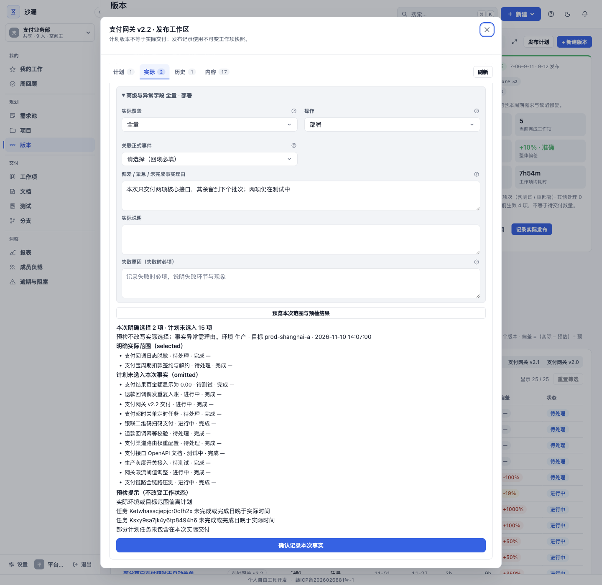
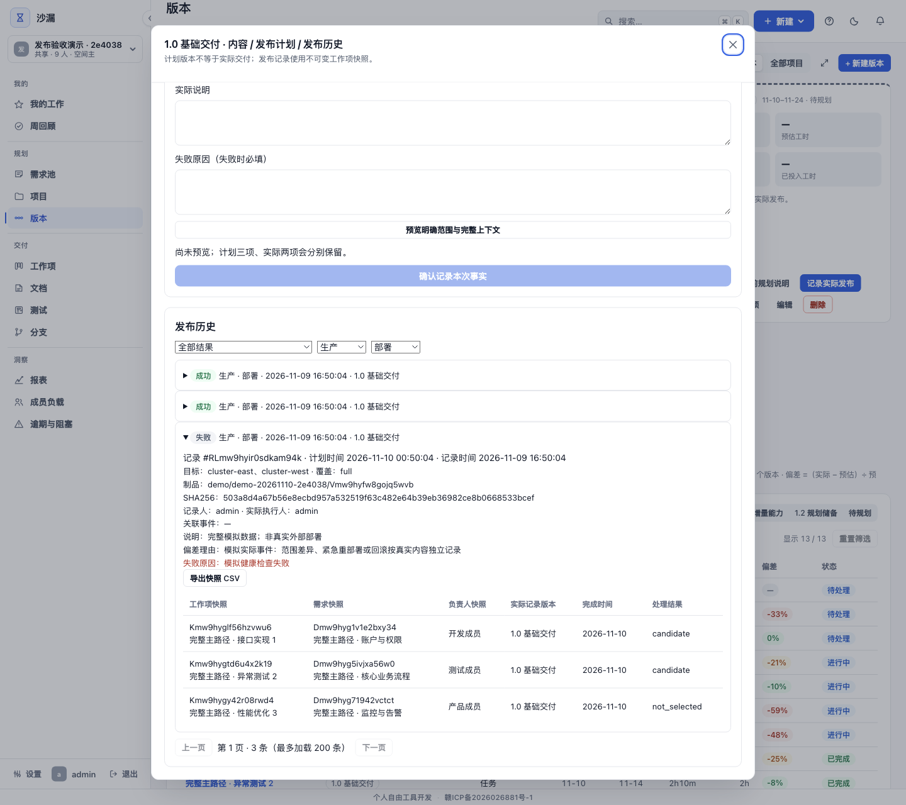
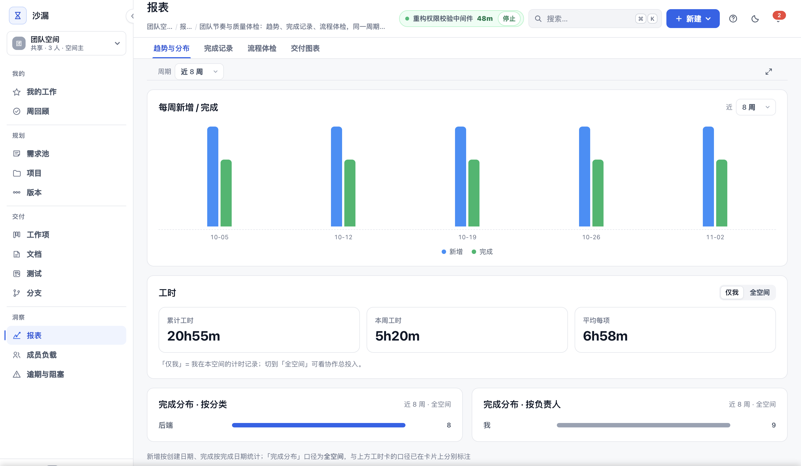

# 别再问「这个版本做到哪了」

**版本进度要分别回答：计划什么、完成什么、实际发布什么、投入怎么算。**

*题图：仓库现有桌面端交付预览界面截图，用于展示范围核对入口；不是客户验收文件或部署成功证明。*

---

假设在一次例会上，开发说接口完成了，测试说还没收到可验证的环境，负责人说版本范围昨天又改过。三个人未必说错，只是各自回答了不同的问题。

要说清「这个版本做到哪了」，不能只有一个百分比。**范围、完成与实际发布应该各有记录，再通过关联查到来源。**

## 先把计划从事实里分出来

计划版本表达准备交付什么，可以随着评审和排期调整。工作项完成表达执行结果，不能据此断言已经部署，更不能断言客户已认可。

沙漏（Hourglass）是面向小型项目制研发团队的自托管研发交付工作台。它把版本规划范围、跨版本发布计划与实际发布记录分开，工作项可以关联多个计划版本。关联在哪个版本里，不意味着已经在该版本发布。

发布前的说明可以展示当前规划范围，实际发布确认后读取保存的快照。历史记录因此有了独立于当前规划的落点，不必在以后回头猜「当时是不是也包含这一项」。

## 实际发布，需要另一次确认

发布负责人先在工作台之外部署并检查，再人工确认本次实际发布范围。系统保存快照、制品引用与 SHA256 等信息，供后续查找和核对。

*图：仓库现有桌面端发布历史界面截图，展示发布事实的记录入口；画面不作为真实客户交付或签认证据。*

这份记录不执行部署、不自动验证流水线。SHA256 可帮助核对制品一致性，不证明部署成功，也不是数据库之外的防篡改保护。客户验收电子签名当前未提供，客户认可仍要由相应流程承接。

所以计划三项、完成三项、实际发布两项，并不矛盾。第三项可以因为依赖或发布策略继续等待，重要的是把差异写清，而不是让它随着绿色状态被抹掉。

## 投入，是另一份需要解释的记录

复盘版本还要问时间花在哪里。自动计时只累计工作日、个人工作时段内的有效时间：周末不计，默认时段 9–18 点；每日上限可配置，默认 8 小时。

人工补记则单条支持 1 分钟到 24 小时，日期非未来，不经过周末、时段或每日封顶裁剪，但会加入当天已用额度。两类来源必须分别解释，不能把默认自动计时规则套在所有汇总工时上。

完成任务后的计时接力也有条件：仅在本人没有运行中的计时、且原列还有任务时发生，接上的是否为当前工作需要核对。

*图：仓库现有统计界面截图，说明投入汇总入口；不证明特定投入数值，也不具有结算效力。*

这些记录适合投入分析，缺少计费率、审核锁账和客户签认，不能直接作为可结算工时。「交付账本」是连接需求、任务、投入与发布的比喻，不是财务账本。

## 查得到，还要保得住

核心数据可以放在自己的基础设施上，但必须有人运维。正式发布证据需要全库与附件备份，空间 JSON 导出不是正式发布证据备份。

配置外部 AI、邮件、机器人时会向外发送相应内容，不能因为自托管就承诺数据永不出内网。50 人只是参考规模，使用前需验证环境、集成要求及现有许可，不能理解为性能保证或企业生产免费。

最终要验证的，是团队能否从实际发布回到任务和需求，从投入回到记录及口径。这样再问「这个版本做到哪了」，答案才不只是「我再去问一下」。

---

延伸阅读：[任务完成了，为什么还不算交付？](博客专栏/系列三/06-项目进度怎样才能一眼看清.md) · [自托管不等于免维护：交付数据谁来守护](博客专栏/系列五/12-项目管理不该成为团队的新负担.md)
