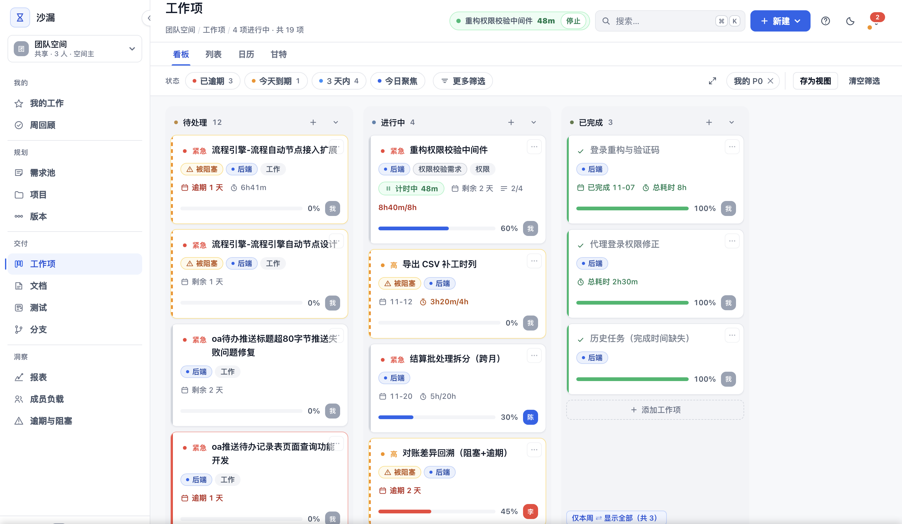
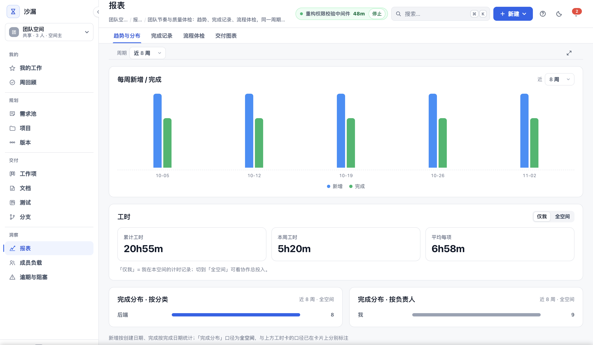

# 功能越多，项目管理就越高效吗？

**要减少的是重复搬运，不是交付追溯。**

*题图：复用仓库现有业务流程图，说明从需求到复盘的关联；不表示自动部署或客户验收。*

---

设想一次项目周会：需求在文档里，任务在看板上，工时在表格里，实际发布结果在群聊里。每个入口都能工作，负责人还是得把同一件事重新拼起来。

这不是某个客户案例，也不是效率测试。它提醒我们，功能数量只说明工具覆盖了什么，**不说明记录之间有没有接起来。**

## 少功能，不一定少负担

把审批、工时和发布记录都删掉，界面会更清爽，但需要这些记录的团队只能回到表格和聊天。负担没有消失，只是移出了工具。

低频控制也有价值。权限复核、备份恢复、发布确认可能很少发生，却决定出了问题能不能追查。判断能力该不该保留，要问它服务哪段交付链路、缺了会断掉什么证据，以及结果能否被解释和校正。

大型平台、纯看板、表格协作都有适用条件。应比较的是自身约束和重复维护成本，而不是用一张未经实测的表宣布谁更强、谁只适合多少人。

## 研发交付工作台，连接什么

沙漏（Hourglass）的定位是**面向小型项目制研发团队的自托管研发交付工作台**。它尝试让需求、工作项、有效工时、版本实际发布和复盘互相关联。

可以借用「交付账本」来理解这件事：约定了什么，做了什么，记录了怎样的投入，确认发布了什么。但它不是财务账本，不提供可结算工时，也不把内部发布确认等同于客户验收签认。

一项工作从文档拆出来后，关联需要核对；一个任务完成后，实际发布需要另行确认。工具可以减少重复整理，不能保证所有信息天然完整，更不能替人判断。

*图：仓库现有看板界面截图，展示执行入口；画面内容不作为真实客户数据或节省时间的证据。*

## 顺手记录，也要能校正

拖入「进行中」可以开始计时，完成时可以停表。接力只在本人没有运行中的计时、原列还有任务时发生，接上的是否是当前工作还要检查。

自动计时仅计算工作日，周末不计，按个人工作时段累计，默认 9–18 点；每日上限可配置，默认 8 小时。人工补记单条可为 1 分钟到 24 小时，日期非未来，不经过周末、时段和每日封顶裁剪，但会加入当天已用额度。

所以「自动记录」不等于不用补记，也不等于时长永远正确。团队仍需解释记录来源并作废错误记录；缺少计费率、审核锁账和客户签认，就不能把这份投入统计直接拿来结算。

*图：仓库现有统计界面截图，用于说明汇总入口；截图不证明所有数字均正确或具有结算效力。*

实际发布则由负责人在部署和检查之后人工确认，保存快照、制品引用及 SHA256。系统不执行部署、不自动验证流水线，没有客户验收电子签名，也没有数据库之外的防篡改保证。

## 最后要验证的，是能否持续使用

外包研发和 IT 交付是优先验证客群，不是市场空位结论，也不排除有类似需求的互联网产品团队。50 人只是参考规模，需要自己的环境验证。

自托管让核心数据由团队掌握，也必须有人负责运维和全库、附件备份。配置外部 AI、邮件或机器人会发送相应内容，不能承诺数据永不出内网。使用前还应核对现有许可，不能把自托管理解为企业生产免费。

先拿一个范围可控的真实项目验证：能否从发布和投入回到需求及工作项？遗漏能否校正？必要的维护责任能否承担？

项目管理的目标不是把工具用满，也不是把功能删光，而是让投入可解释，让交付可追溯。

---

延伸阅读：[我们为什么选择做研发交付工作台](博客专栏/系列二/03-我们为什么不想再做一个大而全的平台.md) · [项目制团队怎样选择交付工具？](博客专栏/系列四/11-小团队真的需要复杂的项目管理系统吗.md)
