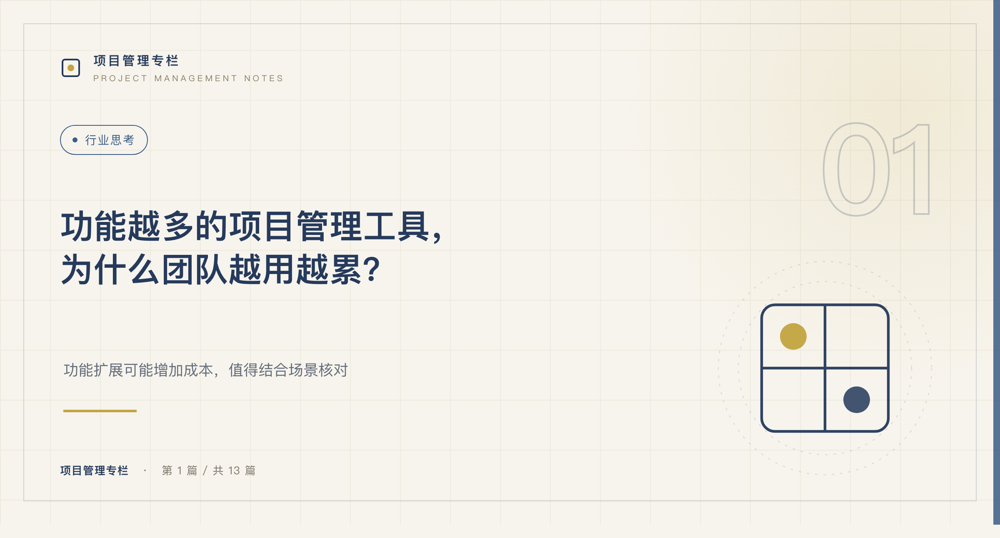
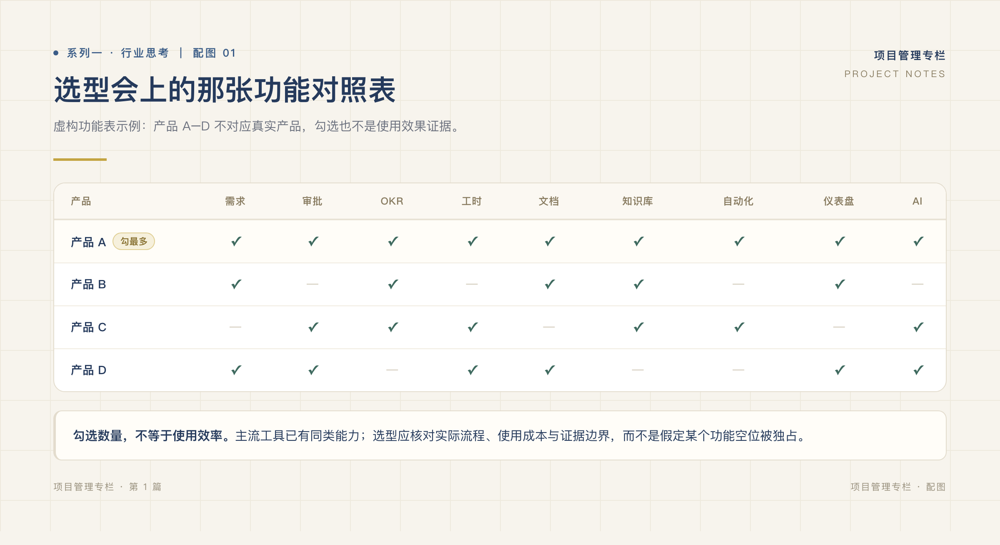
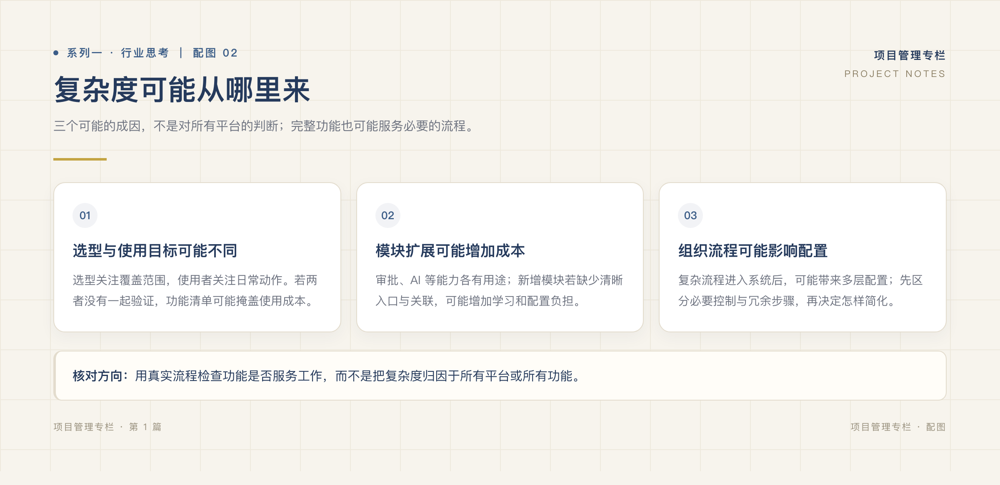
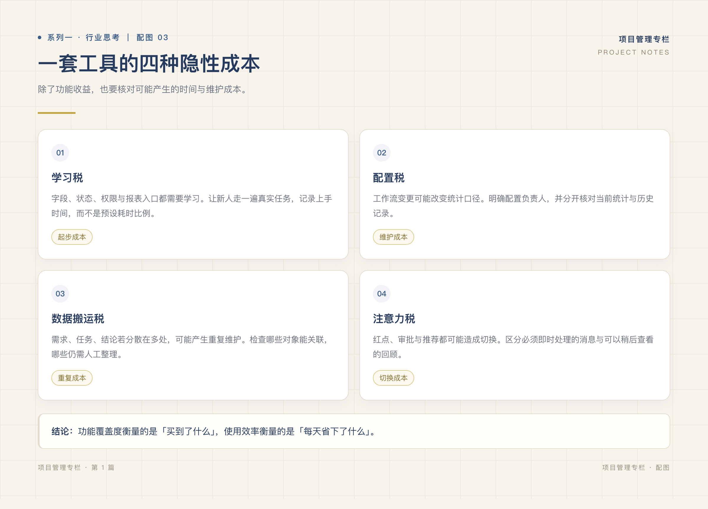

# 功能越多的项目管理工具，为什么团队越用越累？

*系列一 · 行业思考篇 ｜ 第 1 篇*

*封面：专栏编辑制作，不含产品品牌或界面。*

---

《哈佛商业评论》2022 年发表过一项追踪研究：三家财富 500 强企业的 137 名员工，平均每天在不同应用和网页之间切换约 1200 次；每次切换后重新定位的时间加起来，每周接近 4 小时——一年约 5 个工作周，占全年工作时间的 9%。

这不是项目管理工具的专属测量，但它描述的机制，项目团队每天都在经历：需求写在文档里，任务拆在看板上，进度重述在周报里，实际发布结果散落在群聊里。每个入口都在正常工作，负责人却要把同一件事重新拼一遍。

而在选型会上，这个问题通常被一张功能清单掩盖：横轴是功能，纵轴是候选工具，需求、审批、工时、文档、自动化、报表……哪一行的勾多，哪一行就显得更稳妥。

**功能覆盖回答的是「能不能做」，回答不了「团队每天怎样做」。** 这篇只讨论一件事：功能变全之后，团队的负担究竟从哪里来。

*图：专栏编辑制作的假设选型示例，不对应真实产品排名或市场结论。*

## 一、先承认：功能多，常常是合理选择

把「功能多」直接等同于臃肿，对做选型的人不公平。至少三种诉求真实存在：

**问责与合规。** 审计留痕、权限复核、发布确认不是装饰。出了事故要回答「谁改的、谁批的、当时发了什么」，这些能力平时低频，关键时刻是底线。

**规模与协作半径。** 二十人坐在同一间办公室，口头同步能补上记录之间的缝隙；两百人、跨客户、跨外包团队时，缝隙必须落在系统里，否则只会在更大的范围里断开。

**单一平台的集成红利。** 同一平台内的模块天然共享一套数据，理论上比拼接五个独立工具省下集成与搬运。

这些诉求都成立。问题出在一个常被忽略的前提上：**功能之间的连接，不会随功能数量自动增长。** 选型清单买得到模块，买不到模块之间的关联。关联要么由产品原生做好，要么由使用者每天手工补上——而清单上看不见这一项。

## 二、负担的来源：断开的记录，由人拼接

功能叠加之后，负担通常从三个地方长出来：

**选型视角与执行视角错位。** 决策者检查覆盖、控制和扩展性，执行者只想尽快找到今天的工作。两种诉求都合理，但若只用选型清单决定日常入口，常用路径就会变长：成员每天穿过为「万一要用」准备的页面，去找「天天要用」的那一个。

**模块叠加，流程没跟着改。** 新模块满足新需求，也带来新字段、新权限、新维护规则。如果原有流程不做相应合并，同一信息就有了第二份、第三份拷贝，而拷贝之间的同步责任，默认落在人身上。

**组织流程原样搬上屏幕。** 有的审批承接必要控制，有的只是把重复确认搬了个地方。工具上线不会自动区分两者，每一步的目的仍需团队自己审视。

*图：专栏编辑制作的分析框架，列出三种可能因素，不是行业统计或定论。*

三个来源的共同点：每新增一个入口，信息多了一份拷贝；拷贝之间的关联断开时，由人重新拼接。

## 三、团队实际承担的四类成本

把负担拆开，是四类可以分别观察的成本：

| 成本 | 典型表现 | 观察方法 |
| --- | --- | --- |
| 学习成本 | 成员要理解字段、状态、权限和入口 | 看新成员完成一次真实任务要问几个人 |
| 配置成本 | 规则需要有人维护，流程改了报表口径要跟着改 | 看上一次流程调整花了多久、谁付的账 |
| 搬运成本 | 同一信息在几处维护，断开后由人重新拼接 | 数一次常见汇总要打开几个入口 |
| 注意力成本 | 通知和待办不分优先级，人人被无关变化打断 | 看一天里有多少次点开通知后再也没回到原任务 |

搬运成本最容易被清单遗漏，也最有迹可循。以客户临时加一个字段为例：需求文档改一次，看板任务改一次，版本计划改一次，周报再解释一次；如果发布结果只在群里说一声，月底复盘还要再拼一次。开头那项 HBR 研究里每周近 4 小时的重新定位，买的正是这类切换——而且相当一部分切换发生在同一工具的不同模块之间：每换一次入口，脑子就要重新装载一次上下文。

注意力成本同样有研究支撑。加州大学欧文分校 Gloria Mark 团队对知识工作者的追踪研究发现，一次打断之后，人平均需要约 23 分钟才能回到原来的任务。当每个模块都推送通知，「全部可见」就变成了「全部打断」。

*图：专栏编辑制作的成本分类示意，不代表已测量的耗时或行业发生比例。*

要划清一条界线：配置与控制本身不是浪费。发布确认、权限复核、备份恢复即使低频，也是团队不能放弃的能力。**要减的是重复搬运，不是必要控制。** 把两者混在一起，减法就会减错地方。

## 四、换一组问题评估工具

下次选型或复盘，除了功能清单，再记录五个事实：

1. 完成一次常见操作——比如「确认本周实际发布了什么」——要经过几个入口？
2. 同一信息要重复填写几次？
3. 汇总数字能否查到来源？
4. 实际发布能否和任务完成分开？
5. 数据由谁维护，错了由谁校正？

这组问题没有统一的合格分钟数，换工具也不保证变快。它的作用是定位：成本来自必要控制，还是重复动作与断开的记录。前者保留并明确负责人，后者才是减法该减的地方。

功能多可以高效，功能少也可以很累，差别在连接。下一篇讨论怎样减少重复，而不把交付追溯一起删掉。

## 参考来源

- Rohan Narayana Murty, Sandeep Dadlani, Rajath B. Das, [How Much Time and Energy Do We Waste Toggling Between Applications?](https://hbr.org/2022/08/how-much-time-and-energy-do-we-waste-toggling-between-applications), Harvard Business Review, 2022-08-29。样本为三家财富 500 强企业的 137 名员工。
- Gloria Mark（加州大学欧文分校）等关于碎片化工作的系列研究：一次打断后平均约 23 分钟才能回到原任务，见 [Focused, Aroused, but so Distractible](https://www.microsoft.com/en-us/research/wp-content/uploads/2016/10/p903-mark.pdf)（2016）对该结论的引述。

---

**下一篇：[项目管理，是不是该做减法了？](02-项目管理是不是该做减法了.md)**