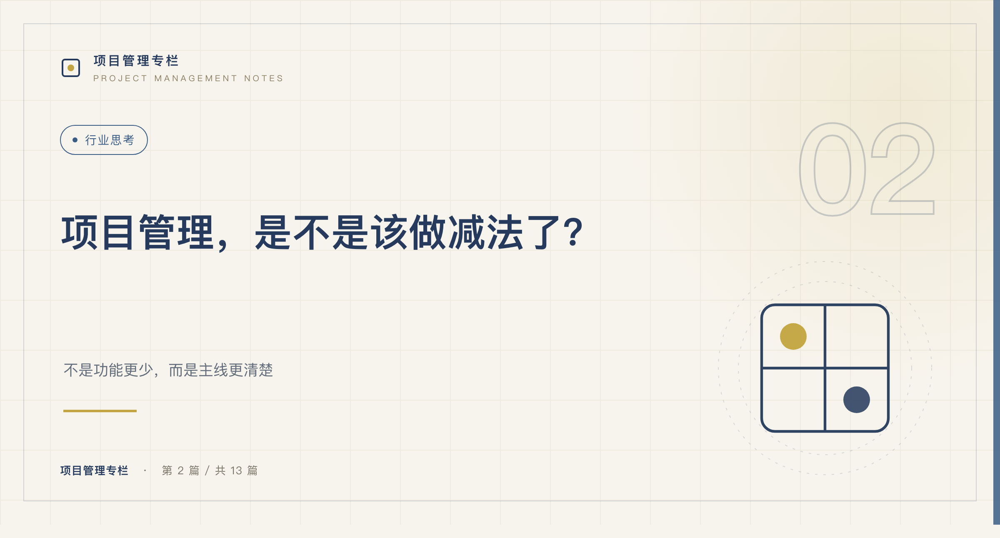
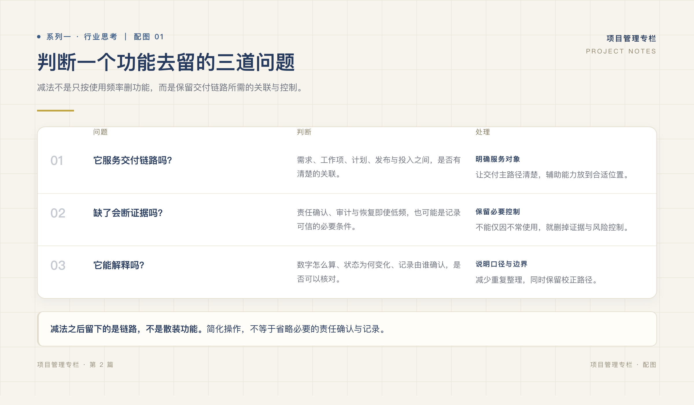
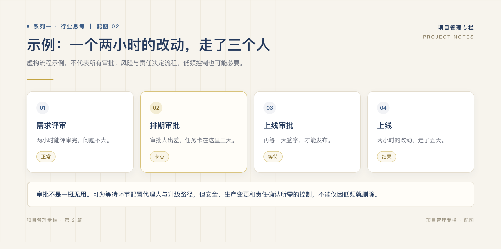

# 项目管理，是不是该做减法了？

*系列一 · 行业思考篇 ｜ 第 2 篇*

*封面：专栏编辑制作，不含产品品牌或界面。*

---

如果删掉审批、工时和发布记录，只留一个任务列表，项目管理就会更轻松吗？

不一定。原来需要的确认和证据可能只是转移到表格里，由人重新维护。**减法应该减少重复动作，而不是减少追溯。**

## 三问，不以使用频率决定去留

一个需求从提出到交付，会经过约定、执行、投入记录和发布确认。判断某个能力是否必要，先沿着这条链路问：

**它服务哪一段？** 能否帮助明确范围、责任、事实或后续复盘，而不是只提供一个新入口。

**缺了它会断掉什么证据？** 权限复核、发布确认、备份恢复可能很少发生，却关系到关键时刻能不能查证、恢复和解释，不能因低频而删除。

**结果能否被解释和校正？** 数字从哪里来、状态为何变化、记录错误怎么办，都应有路径。更短的操作不应换来更难解释的结果。

*图：专栏编辑制作的判断框架，围绕交付链路、证据连续性与可解释性，不是按日常使用频率删功能。*

使用频率适合帮助安排入口，不足以决定能力是否存在。常用动作放在主路径，低频控制提供清楚入口和负责人，重复的信息尽量不要求再填一次。

## 审批轻重，要看风险而不是人数

设想一个八人团队，对每次改动都要求需求、排期、上线三次确认。若三步只是在重复询问「同意吗」，等待可能超过它带来的价值。

但同样是八个人，涉及生产数据删除、敏感权限或客户验收时，多一道独立确认可能必要。问题不是「小团队不该审批」，而是每次确认是否承担不同责任，结论是否留下出处。

*图：专栏编辑制作的假设流程示例，讨论重复确认与必要低频控制的区别，不对应真实客户案例。*

真正能简化的，是把重复说明合并、让审批者直接看到关联记录，而不是拿团队规模替所有风险做判断。

## 减法还要防止把工作推给别人

省去一个字段后，谁补充解释？省去发布确认后，谁证明实际范围？省去历史留存后，谁在交接时重建时间线？

如果答案都变成「负责人到时候整理」，界面虽然轻了，协作却未必轻。任何简化都应说明保留什么、转交给什么外部流程、由谁负责。

复杂工作流不是天然坏，默认路径也不是天然够用。先明确团队的控制、证据与集成要求，再决定哪些可以合并、哪些必须保留。

## 留下的是一条可追问的路径

减法后的目标不是一张更短的功能表，而是让约定找到任务、投入找到来源、完成区别于实际发布，复盘还能回到当时的决定。

下一篇从具体产品选择出发，讨论为什么把研发交付作为工作台的主线，以及这种选择需要承担的边界。

---

**上一篇：[功能越多的项目管理工具，为什么团队越用越累？](01-功能越多的项目管理工具为什么团队越用越累.md)**

**下一篇：[我们为什么选择做研发交付工作台](../系列二/03-我们为什么不想再做一个大而全的平台.md)**
