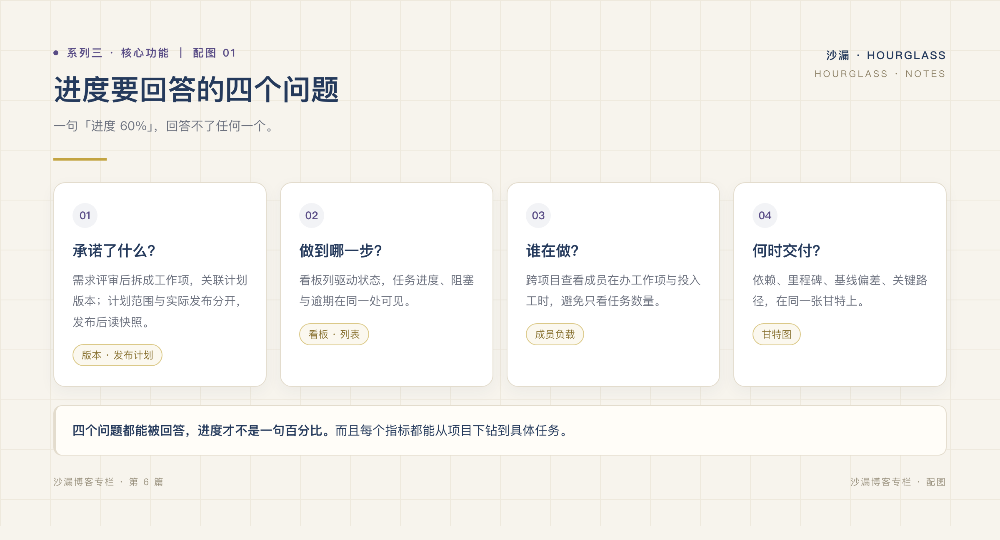
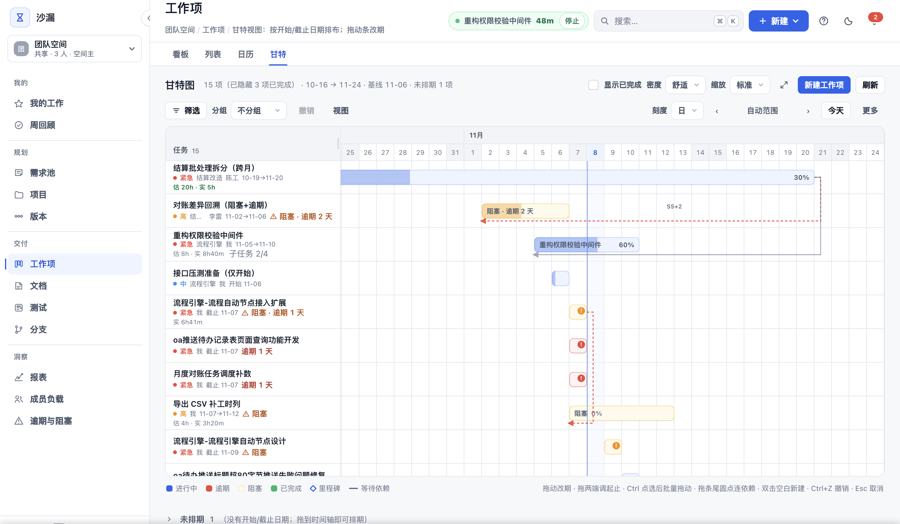

# 项目进度，怎样才能一眼看清？

*系列三 · 核心功能篇 ｜ 第 6 篇*

---

「进度 60%」大概是项目管理里最没用的一句话。

它不告诉你还剩什么，不告诉你是谁在拖，也不告诉你 60% 是不是本周的真实状态。很多时候，这个数字只是负责人凭感觉填的。

进度真正的含义，是四个问题能不能被回答：**承诺了什么、做到哪一步、谁在做、什么时候能交。**

*图：四个问题分别对应版本、看板、负载与甘特。*

## 先看清楚「全部项目」

团队一多，最怕的不是某个项目出问题，而是没人知道哪个项目正在出问题。

项目总览把全部项目放在一屏里：健康度、逾期数量、本周投入。哪个项目红了、谁这周排满了，不用挨个点进去看。

更关键的是，每个指标都能往下点：从项目到看板，从看板到具体任务。**进度不是一句结论，而是一条可以走到底的路径。**

## 看板管当下，甘特管未来

看板回答「现在进行到哪」，甘特回答「接下来会怎样」。

甘特图里，任务按时间铺开，依赖关系（FS / SS / FF / SF）、里程碑、基线偏差、关键路径都在。改期支持多步撤销，误拖一下不用重来；可以导出 CSV、A3 打印，也能生成只读分享链接发给客户。

对管理来说，真正有用的不是那条漂亮的条形图，而是两个信号：**哪条路径一动就影响交付，哪个任务已经偏离了最初的计划。**

*图：依赖、里程碑、基线偏差和关键路径，都在同一张甘特上。*

## 版本，把「承诺」变成清单

一个版本发布前，团队最常争论的是「这版到底包含了什么」。

沙漏里，工作项可以关联多个计划版本；版本内容、跨版本发布计划和实际发布证据分开——未发布时发布说明展示当前规划范围，发布后读不可变快照；版本阶段仍区分首版与迭代两套口径，未完成项按开始日归组。

于是「这个版本承诺了什么」不再靠回忆，而是一份能直接发出去的清单。

## 一个真实的使用时刻

周一早上九点二十，周会前十分钟。

打开项目总览，两个项目标黄，一个标红；点进标红的项目，看板上三个任务逾期，其中一个被阻塞；切到甘特，发现关键路径上的任务比基线晚了两天。

十分钟后开会，讨论直接从「怎么办」开始，而不是从「大家最近在忙什么」开始。

**进度可视化的价值，不是让管理者多看一眼，而是让会议少绕一圈。**

下一篇，我们把视角从项目拉到个人：任务分配与跟踪，能不能再少一点动作？

---

**上一篇：[少一些功能，多一些值得信任的数字](../系列二/05-少一些功能多一些值得信任的数字.md)**
**下一篇：[任务分配与跟踪，能不能少一点动作？](07-任务分配与跟踪能不能少一点动作.md)**
