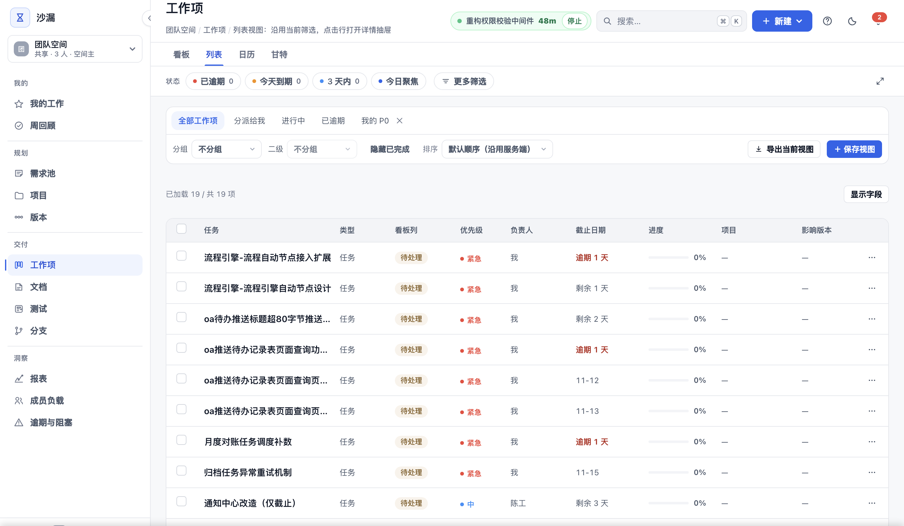
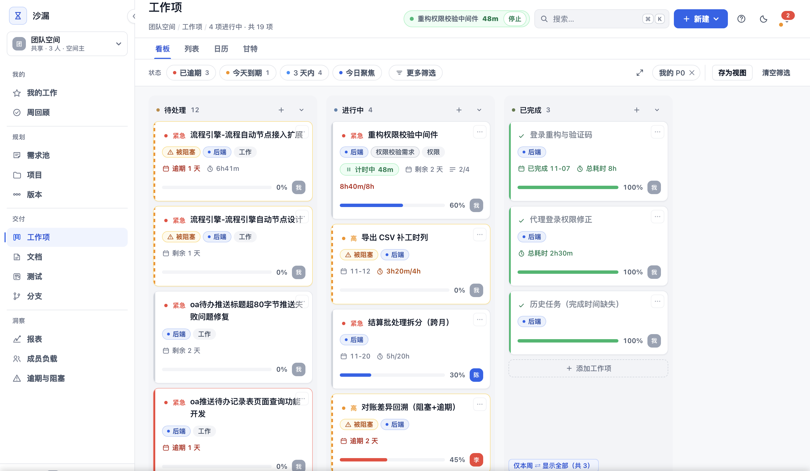
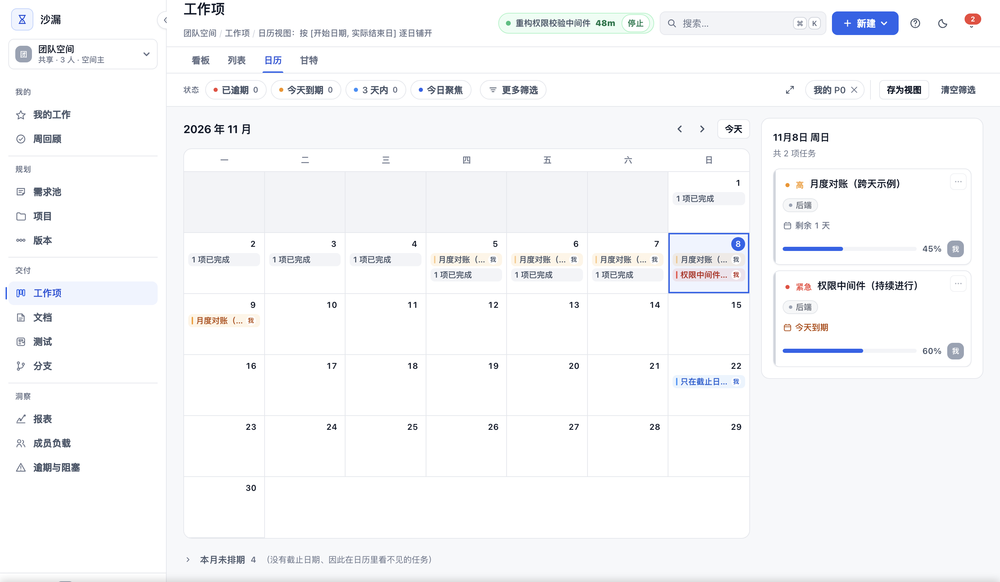

# 任务分配与跟踪，能不能少一点动作？

*系列三 · 顺手记录篇 ｜ 第 7 篇*

*封面：专栏编辑制作的主题图。*

---

早上九点，开发成员打开系统，想知道今天先做什么。开始工作后，他还要记得更新状态、切换计时；下午被拉去排查另一个项目，晚上才想起原任务还挂着计时。

任务管理的难点不只是「有地方记」，而是**能否把记录放进常见动作，同时保留人的检查与校正。**

## 先减少寻找和重复筛选

沙漏（Hourglass）的「我的任务」聚合分派给自己的工作，不用跨空间翻。看板、列表、日历和甘特共享筛选，同一批工作换视图不用重新定位。

*图：仓库现有任务列表界面截图，展示筛选与定位入口；截图不证明所有工作已完整分派。*

列内新增、拖拽改状态，减少跳转。真正要观察的是：成员是否少了重复填写，而不是把「能拖拽」当作状态准确的保证。分派、筛选条件和工作归属仍需核对——临时帮别人做的工作，不会自动出现在你的待办里。

## 计时可以顺手，当前工作仍要检查

把自己的任务拖入「进行中」，计时开始；一个人同一时刻只运行一个任务的计时。切换工作时，核对当前计时对象是不是你正在做的事。

任务完成后可以停表。自动接力有条件：**仅在本人没有运行中的计时、且原列还有任务时发生。** 接上之后看一眼：它是不是当前工作？如果临时去开会、排查另一项目，就需要调整——自动接力不该变成新的误记来源。

*图：仓库现有看板界面截图，展示任务与计时信息；不代表每次完成都会自动接力或计时一定准确。*

工时怎么算、补记和自动计时有什么区别，[05 少一些功能，多一些值得信任的数字](../系列二/05-少一些功能多一些值得信任的数字.md) 专门讲。这里只记住一条：漏记可补记，错误可作废，但记录的理由和归属要核对。

## 风险入口，不代替跟进责任

逾期、阻塞和停滞工作项可以集中查看，前提是日期、状态和阻塞信息有人维护。集中视图减少寻找，但不会自动发现全部风险。

发现问题后，写清原因、跟进人和下一步。系统内催办是协作入口——消息发出去，对方是否处理、外部依赖是否解除，仍要跟进。

*图：仓库现有日历界面截图，用于说明按日期查看任务；不作为自动预警效果或交付日期保证。*

## 少动作，不省确认

进度达到 100% 但未归档的工作项，会出现在待确认范围。完成确认与快照保留执行事实，但版本实际发布和客户验收，是另外两件事。

工具能减少重复操作，无法让团队从此不用回忆、不用补记。好的顺手记录，应让错误更容易被发现和处理，而不是让自动化承担它无法判断的责任。

下一篇讨论另一个记录问题：决定的出处怎样留在协作链路里。

---

**上一篇：[任务完成了，为什么还不算交付？](06-项目进度怎样才能一眼看清.md)**

**下一篇：[少开一次会，靠的不是沟通技巧](08-少开一次会靠的不是沟通技巧.md)**