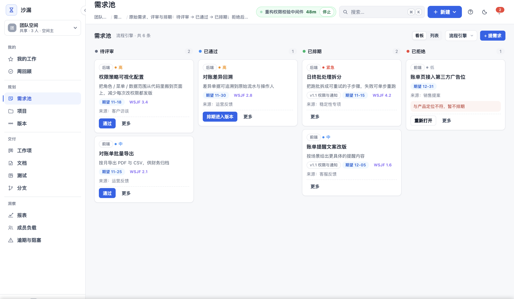
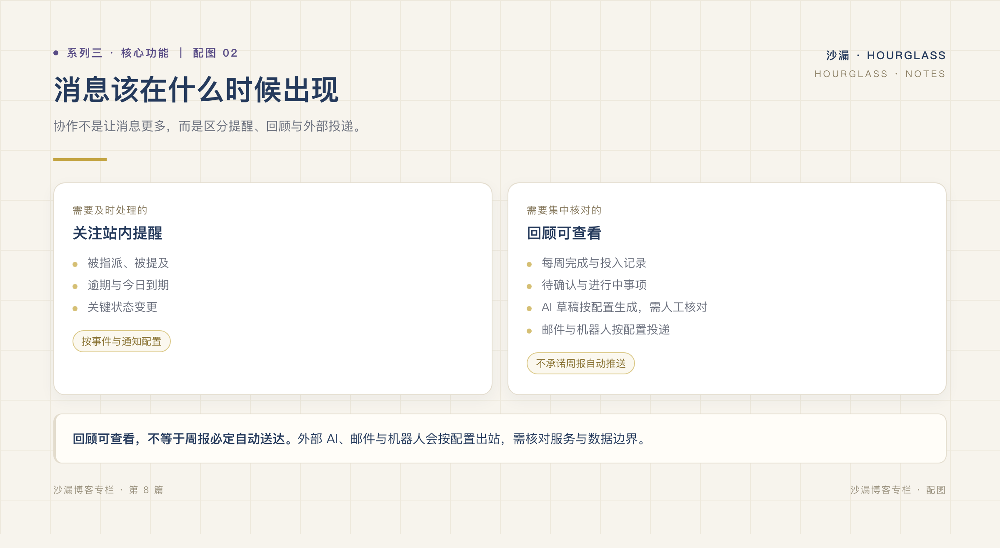
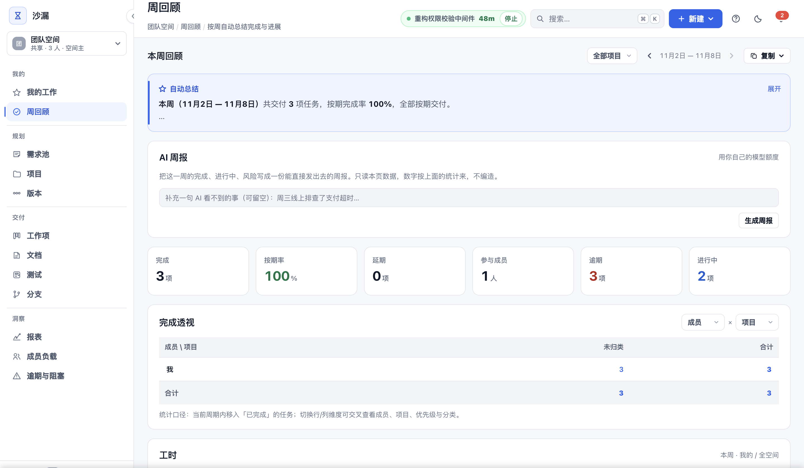

# 少开一次会，靠的不是沟通技巧

*系列三 · 核心功能篇 ｜ 第 8 篇*

---

周三下午，联调卡住了。

后端的说法是「接口早就好了」，前端说「字段对不上」，测试说「没人通知我提测」。三个人说的都是真的，只是各自看到的信息不一样。

于是拉会。半小时后，结论是：需求评审时改过一版字段，改动记在文档评论区里，但没同步到任务。

**大多数「沟通问题」，本质上是信息没有落在同一个地方。**

## 每一个决定，都该有出处

需求池里，一条需求从待评审到已通过、已排期，每一步都有记录；拒绝的需求不会消失，补充说明后可以重新评审。

*图：待评审、已通过、已排期、已拒绝，四列状态一眼看清，拒绝也留痕。*

文档支持多级目录、全文检索和历史快照；可以发布分享，也可以让 AI 拆出任务草稿。

这些机制的价值不在「功能齐全」，而在于：**当有人问「当时为什么这么定」，答案还在原地，不用去翻三个月前的群聊。**

## 把关系和关系之间连起来

一个任务，可以指向它来源的需求、对应的文档、要发布的版本，以及它所在的分支。

分支有四态：开发、测试、合并、发布，允许任意方向切换，也允许打回；开发和合并两套时间口径分开统计。

于是「这个改动走到哪一步了」不再需要问人。点开任务，上下游都在。

## 通知，要按人的节奏来

协作不是让消息更多，而是让消息在对的时候出现。

站内通知加即时推送，邮件可以按个人偏好投递；也支持外部机器人。每日汇总、逾期与今日到期有角标提醒。

关键是「按需」：**需要立刻知道的，即时到；只需要了解的，汇总到。** 不是所有变化都值得打断一个人。

*图：按紧急程度分流，而不是把所有变化都推给所有人。*

## 周回顾：把一周的事实收拢

周五下午，打开周回顾。

这一周完成了什么、什么还在等确认、什么正在进行，已经分好区；工时自动汇总；可选 AI 生成一份周报草稿，你再补充那些数字看不到的事，比如「周三排查了一次支付超时」。

注意这里的顺序：**先有事实，再有表达。** 不是先写周报再找数据，而是数据本来就在，周报只是换一种说法。

*图：周回顾自动汇总完成、进行中与工时，不需要二次录入。*

## 协作的终点，是少开一次会

回到开头的联调问题。

如果字段变更关联在需求上，需求关联在任务上，任务有分支和版本，那么「为什么字段对不上」在下一次打开任务时就能看见，不需要三个人再对一次时间线。

工具不能代替沟通，但它可以让很多沟通变得不必要。

下一篇开始，进入场景篇：用一个团队的一周，把这些机制放回真实工作里。

---

**上一篇：[任务分配与跟踪，能不能少一点动作？](07-任务分配与跟踪能不能少一点动作.md)**
**下一篇：[一个 20 人团队的一周：项目管理到底在管什么](../系列四/09-一个二十人团队的一周.md)**
