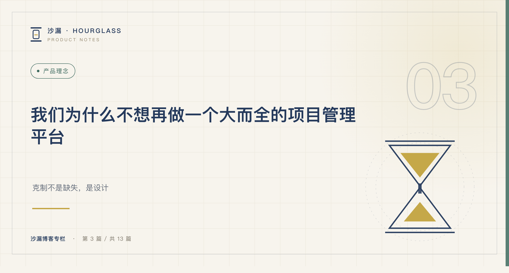
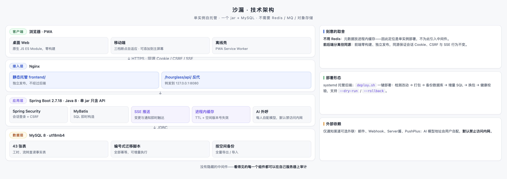

# 我们为什么不想再做一个大而全的项目管理平台

*系列二 · 产品理念篇 ｜ 第 3 篇*

---

写到这里，终于可以介绍我们自己了。

但先说清楚一件事：沙漏不是一个「什么都能做」的平台。恰恰相反，我们花了很长时间决定**不做什么**。

## 它最初只是一个看板

沙漏的前身，是一个给个人用的任务看板。需求、任务、进度都在上面，够用，也简单。

后来团队变大了一点，问题开始出现：需求记在聊天里，方案写在文档里，任务在看板上，交付靠口头。看板还在，但它只看得见「执行」，看不见执行之前和执行之后发生了什么。

最直接的一次是月底：要回答「这个版本到底承诺了什么、各自做到哪一步」，没人能一句话说清。那天我们意识到，缺的不是一个更漂亮的看板，而是一条能从头走到尾的线。

于是它被重新设计——**需求池提想法，评审排期，文档沉淀方案，拆成工作项推进，编排版本与发布计划，确认实际发布，最后回到周回顾。**

一条线，一套数据。

*图：需求、评审、文档、任务、版本、回顾，共用一套数据。*

## 服务对象，决定了产品边界

我们主要服务一类团队：**推荐 50 人以下的研发团队使用，有需求管理和迭代节奏，但没有专职 PMO。**

这个范围听起来窄，但它是所有设计取舍的起点。

因为服务他们，我们不需要处理多组织、多租户的隔离问题；不需要为几十种审批流提供可视化编排；不需要做一个插件市场，让第三方来补齐能力。

也因为服务他们，我们必须保证：**新成员半小时内能跑通一次完整操作，团队不需要有人专职维护工具。**

## 三个主动的取舍

**第一，不做多租户 SaaS，只做单实例自托管。**
一个 Java 服务 + 一个 MySQL，就能跑起来。不需要 Redis、消息队列、对象存储。数据放在自己的服务器上，不出内网。代价是它不适合大规模横向扩展——这是我们主动接受的。

*图：单实例、前后端同源，一个 Java 服务加一个 MySQL。*

**第二，不做插件市场和复杂可配置工作流。**
可配置意味着灵活，也意味着每个团队都要先当一次实施顾问。我们更愿意把默认路径做对：打开就能用，用不惯的地方再改。

**第三，不追求「覆盖所有场景」。**
不做多人实时协同编辑表格，不提供从其他平台的迁移工具，也不做强预测类的能力。这些不是能力不足，而是它们会把产品重新推回「大而全」。

## 那它到底留下了什么

留下的，是这条链路上的每个环节都做得足够扎实：

需求池支持评审流转与自动打分；文档有历史快照和分享；任务能在看板、列表、日历、甘特之间用同一套筛选推进；版本把规划范围、跨版本计划和实际发布证据分开，发布说明在发布后读快照；周回顾自动生成；工时随任务动作自动记录。

这些能力也不少了。区别在于——**它们不是并列的功能模块，而是同一条链路上的不同站点。** 用得上就顺手，用不上也不会挡路。

如果你们是几百人的组织、需要复杂审批与强合规，市面上有比我们更合适的选择。我们不打算说服你。

但如果你是一支想「把事说清楚」的小团队，接下来的文章，也许会有点用。

下一篇，我们聊聊这些设计背后的四条原则：为什么简单不是功能少，而是用户不用想。

---

**上一篇：[项目管理，是不是该做减法了？](../系列一/02-项目管理是不是该做减法了.md)**
**下一篇：[好的工具，应该让复杂的工作变简单](04-好的工具应该让复杂的工作变简单.md)**
