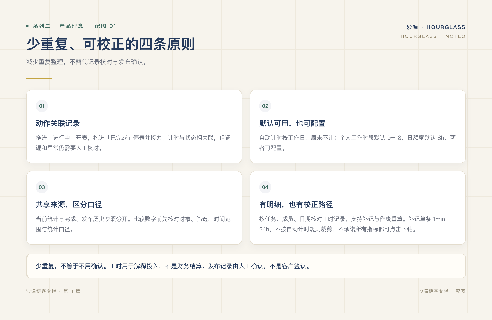
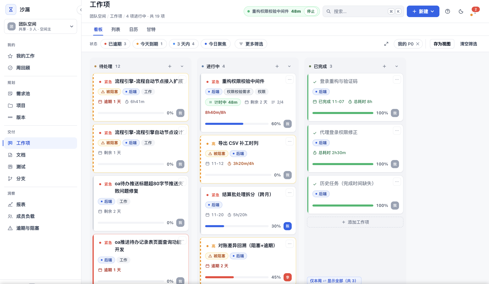

# 好的工具，应该让复杂的工作变简单

*系列二 · 产品理念篇 ｜ 第 4 篇*

---

一个新同事加入团队的第三天，我让他独立建一个任务、拖到进行中、再关联到需求。

他花了四十秒。没有问人，也没有翻文档。

这件事听起来很小，但它其实回答了一个大问题：**工具到底是在帮你思考，还是在让你先学会它？**

## 简单，不是功能少

很多人把「简单」理解成「按钮少」。于是做出来的产品确实清爽，但一到真实场景就不够用。

我们理解的简单，是另一件事：**用户不需要为使用工具而额外思考。**

不用想「这个状态该在哪改」，不用想「这两个数字为什么对不上」，不用想「我现在该点哪个入口」。动作和目标之间，没有多余的步骤。

## 四条原则

*图：四条原则指向同一个目标——用户不需要为使用工具而思考。*

**一、一个动作，只做一件事。**

拖任务进「进行中」，状态变了，计时也开始了；拖进「已完成」，计时结束，并自动接上下一个任务。用户只做了一个动作，系统承担了后续。

这不是聪明的自动化，而是把「本来就要做的事」合并到同一个动作里。

*图：拖拽改状态的同时，计时、剩余天数和进度都在任务卡上。*

**二、默认值应该真的能用。**

新建一个空间，看板列、分类、基本角色都是配好的。团队可以改，但不改也能开始工作。

很多工具的默认配置只是占位符，逼着用户先做一轮设置。我们把「开箱可用」当成一条硬指标——**如果默认值不能用，那它就不该叫默认值。**

**三、同一个问题，只能有一个答案。**

逾期就是逾期，完成就是完成。看板、日历、报表用的是同一套规则：有效工时跳过周末、每人每天封顶 8 小时；逾期判定不因页面不同而变化。

统一口径听起来是技术细节，实际是信任问题。**两个页面给出两个数字，团队就会开始怀疑所有数字。**

**四、每个数字都能点开。**

看到「本周投入 42 小时」，你应该能点进去看到：哪些任务、哪个人、哪一天、哪次记录。看不到来源的汇总，本质上只是一句无法验证的结论。

## 简单是有成本的

这四条原则，每一条都在增加实现难度。

把计时绑进拖拽动作，意味着要处理并发、补记、作废和跨任务切换；统一口径意味着所有模块不能各算各的；数字可下钻意味着不能只存汇总，要保住原始记录。

但这些成本应该由产品承担，而不是转嫁给用户。**工具的价值，就是把复杂度留在系统里，把简单留给使用者。**

## 简单之后，还剩一个更难的问题

动作变少了，界面变清爽了，接下来要回答的是：**这些记录，值不值得相信？**

毕竟一个工具可以很好用，同时数字很不准。下一篇，我们聊聊「可信」这件事——为什么我们宁可少做几个智能功能，也要保证每个数字能被解释。

---

**上一篇：[我们为什么不想再做一个大而全的项目管理平台](03-我们为什么不想再做一个大而全的平台.md)**
**下一篇：[少一些功能，多一些值得信任的数字](05-少一些功能多一些值得信任的数字.md)**
