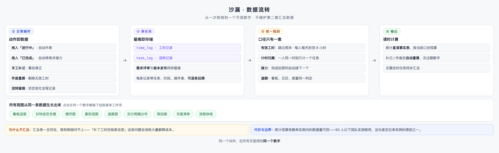
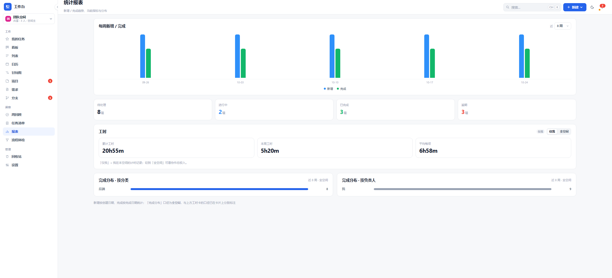

# 少一些功能，多一些值得信任的数字

*系列二 · 产品理念篇 ｜ 第 5 篇*

---

周会上，有人放了一张图：本周团队投入 187 小时。

有人问了一句：「这怎么算出来的？」

会议室安静了几秒。做图的人说：「系统导出的。」再往下，就没人知道了。

这不是个例。很多工具都能给你一个漂亮的数字，但很少能告诉你这个数字是怎么来的。**而一个无法解释的数字，最终只会被当成装饰。**

## 可信，比智能更重要

这几年，项目管理工具都在加 AI：预测延期、自动评分、智能排期。

我们不反对尝试，但我们做了一个相反的选择：**先保证每一个已有的数字是真的，再谈更聪明的分析。**

原因很简单。小团队的决策依赖这些数字：这周谁排满了、这个版本会不会延、上个月时间花在哪。如果数字本身不可信，越智能的结论，风险越大。

## 数字是怎么来的

沙漏的做法是：统计不另存一套汇总，而是直接读原始记录。

工时读计时流水，任务流转读操作记录。补记了一条工时，或者作废了一条记录，相关统计会自动重算——不需要有人记得「去刷新一下报表」。

这带来一个直接的好处：**报表和明细永远对得上。** 你看到的 187 小时，可以拆到项目、任务、人、日期，甚至某一次开关计时。

*图：统计直接读原始记录，不在中间维护第二套汇总数据。*

## 口径必须统一

数字不可信，很多时候不是算错，而是各算各的。

同一个任务，看板上算逾期，日历上不算；工时在个人页是一种算法，在团队页又是另一种。每个页面单独看都合理，放在一起就互相矛盾。

所以我们把规则写死在一处：有效工时跳过周末、每人每天封顶 8 小时、跨空间一起算；逾期、完成数、进度各由一套规则计算，所有视图共用。

**口径统一不是为了让统计更漂亮，而是为了让团队不必再开一次会来解释差异。**

## 我们刻意不做的

- **不做预测型指标。** 不预测「这个任务还需要几天」，不输出无法回溯的风险评分。
- **不做 AI 打分。** 需求优先级用 WSJF 这类可解释的方法，四项填齐才计分，过程和依据都留痕。
- **不让 AI 直接写库。** AI 可以帮忙拆任务、起草周报、检查文档，但结果必须由人确认后才会保存。

这些限制会让产品看起来「不够智能」。但换来的是：**每个出现在界面上的数字，都能被追问到底。**

## 可信之后，才有洞察

当数字可信了，分析才有意义。

趋势、完成记录、流程体检（一次通过率、需求开工延迟、估时准确度）、燃尽与累积流，才有被认真看的价值。因为它们不是猜的，是从团队自己的操作里长出来的。

*图：趋势、工时与分布来自同一套记录，数字可下钻、可导出。*

下一篇开始，我们进入具体功能：先说一个最朴素的问题——项目进度，怎样才能一眼看清。

---

**上一篇：[好的工具，应该让复杂的工作变简单](04-好的工具应该让复杂的工作变简单.md)**
**下一篇：[项目进度，怎样才能一眼看清？](../系列三/06-项目进度怎样才能一眼看清.md)**
