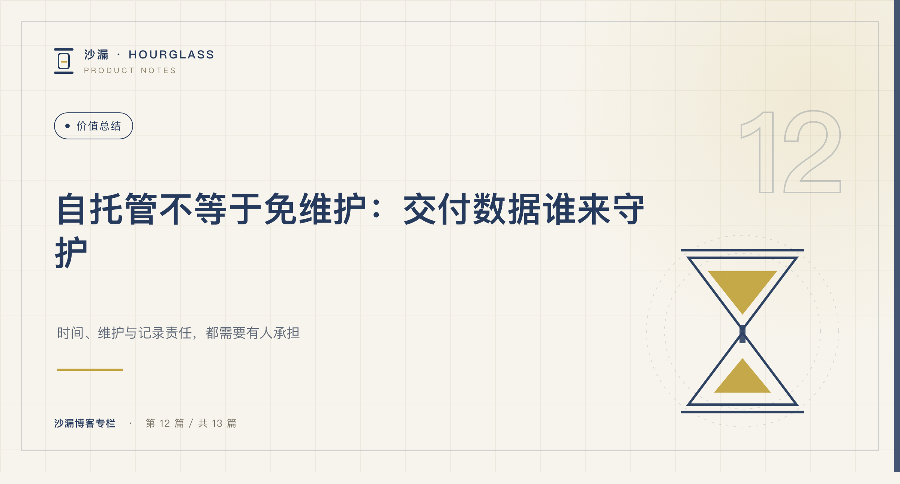
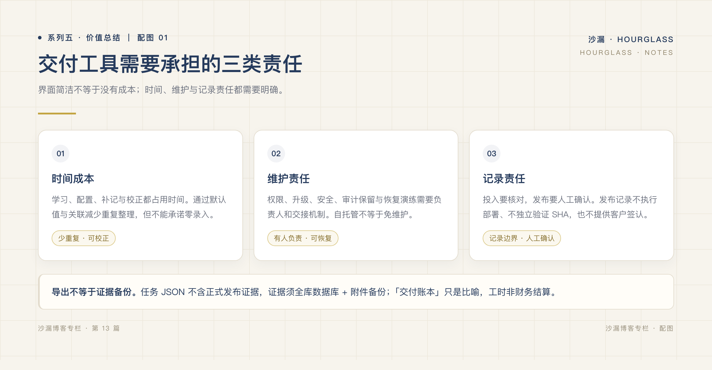
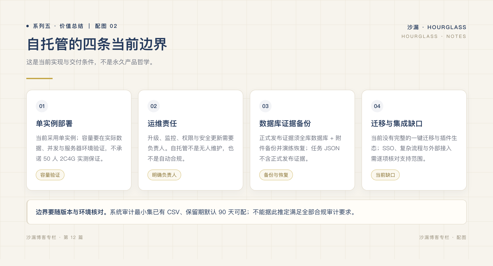

# 自托管不等于免维护：交付数据谁来守护

*系列五 · 运维与验证篇 ｜ 第 12 篇*

*封面：专栏编辑制作的主题图。*

---

需求、投入和发布历史放进了自己的服务器，第二天发现附件打不开。此时最重要的问题不是工具轻不轻，而是：谁知道附件在哪里？最近一次可恢复备份是什么时候？

这是假设问题，也是自托管选型不能跳过的问题。**核心数据自有，意味着拥有控制权，也意味着承担保护它的责任。**

## 自托管，不是自动合规

沙漏（Hourglass）采用单实例自托管形态，核心数据可以保存在团队自己的基础设施上。但服务器在内网，并不自动满足权限、审计、保留期限或合规要求。

配置外部 AI、邮件服务、机器人 Webhook 时，会向外部发送相应内容。开启前应核对服务地址、发送内容、访问凭据和组织允许的范围；敏感项目不能仅凭「自托管」三个字作判断。

系统已有审计最小集，覆盖登录、权限、导出、删除等关键事件，支持 CSV 导出，默认保留 90 天且可配置。管理员仍需设置符合自身要求的保留策略并复核权限；最小集不是对每项业务操作的全面审计，也不是合规认证。

## 三份责任，不会因界面简洁而消失

**时间责任**：有人安排升级窗口、排查故障，并核对恢复后的数据与功能。部署组成较少，不等于这些工作不再需要。

**维护责任**：有人照看 Java 服务、MySQL、前端托管、磁盘及附件目录，处理访问控制、凭据、补丁和监控。负责人不必是专职岗位，但必须明确，还要有交接人。

**记录责任**：需求变更由谁确认，计时错误由谁校正，实际发布由谁核对。自动汇总只能读取已留下的记录，不能发现所有漏记和错误关联。

*图：专栏编辑制作的责任框架，分别讨论时间、维护与记录责任，不代表已测量的维护成本。*

如果团队没有人愿意承担这些责任，应认真评估有运维支持的其他方案，而不是把免维护当成自托管产品的默认特性。

## 导出不等于正式证据备份

空间 JSON 导出可以用于支持范围内的数据迁移与整理，但**不是正式发布证据备份**，不能据此声称全系统记录都能完整恢复。

正式证据应使用全库与附件备份。除了定期备份，还要检查数据库和附件的时间一致性、保存位置及访问权限，并实际做恢复演练。制品引用指向外部位置时，还要另行保证该位置的可访问性和留存。

发布快照保存的是应用里的历史记录，SHA256 帮助核对制品；它们不代替备份，也不提供数据库之外的防篡改保护。客户签认或监管需要的证据，应有额外的制度与工具承接。

## 单实例的边界要提前确认

当前形态不提供横向扩展或高可用保证。50 人只是参考规模，服务器配置、并发、附件体量和项目数量都需要实际验证，不能直接变成容量承诺。

目前也没有 SSO、API Token、任务 CSV 导入和 Docker 部署支持。上线前要确认这些缺口是否影响身份管理、迁移和日常运维；Webhook 不能补成企业微信免登。

*图：专栏编辑制作的边界框架，包含单实例、运维、备份与当前集成缺口，不是高可用或安全认证图。*

使用资格则应按照现有许可核对，自托管不等于企业生产免费。部署步骤可参考仓库 [部署说明](../../../deploy/README.md)，这里不承诺统一部署耗时。

下一篇收束全系列：把关联、事实和责任放进一个真实项目中验证，而不是再背一遍功能清单。

---

**上一篇：[项目制团队怎样选择交付工具？](../系列四/11-小团队真的需要复杂的项目管理系统吗.md)**

**下一篇：[让投入可解释，让交付可追溯](13-让项目管理回归简单.md)**
