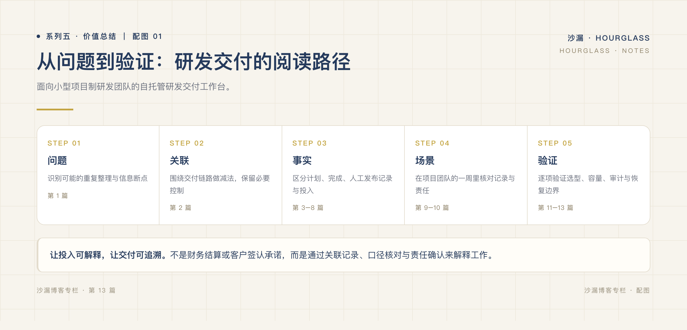

# 让投入可解释，让交付可追溯

*系列五 · 运维与验证篇 ｜ 第 13 篇*

*封面：专栏编辑制作的主题图。*

---

一条需求做完了，负责人能找到它的任务，却找不到实际发布范围；工时有一个总数，却解释不了补记和计时的区别。这样的记录看似完整，追问时仍然会断。

这个专栏的结论不是「功能越少越好」，也不是「工具会替你管理」。我们更想回答：**团队能否沿着记录解释投入，并找到当时确认的交付事实。**

## 五段阅读，通向一个问题

前两篇讨论行业问题：重复录入和复杂配置可能增加成本，但低频的控制与留痕不应被一并删去。

03–05 解释定位与口径：服务哪条链路，如何让动作可校正，怎样解释有效工时。06–08 连接完成与发布、日常记录和决策出处。09–11 用虚构场景、断链诊断与选型约束检验这些关联。12–13 则把维护责任和真实项目验证放到台前。

*图：专栏编辑制作的阅读路径，依次为问题、关联、事实、场景、验证；不是客户转化或使用效果数据。*

无需从头背下全部功能。关心发布就从 06 开始，关心选型就从 11 开始，再回到 05 核对工时口径、12 核对维护要求。

## 用一个项目，而不是一句口号验证

可以选择一个边界清楚、允许评估的真实项目。先核对现有许可，明确负责人、部署环境与允许的外部连接，再完成一轮具体工作：

1. **留下约定**：记录一条需求及其决定出处，拆成工作项，检查需求、方案和计划版本的关联。
2. **解释投入**：核对自动计时、人工补记与作废，说明规则差异；不把有效工时直接当成可结算工时。
3. **区分事实**：任务完成之后，另行部署、检查并人工确认实际发布，保留未发布范围。
4. **查回来源**：从发布和投入记录回到工作项、需求与方案，检查有无断链，再补充复盘解释。
5. **验证可持续**：检查权限、外部发送配置与集成缺口，完成全库和附件备份及恢复演练。

不要求在固定天数内证明成功，也不预设节省多少时间。记录实际操作中的重复、漏记、无法恢复的数据和必要的外部流程，才有继续使用或放弃的依据。

## 给「通过」一个可核对的标准

当有人问「这次交了什么」，能找到人工确认的发布范围，而不是只有一个绿色任务。当有人问「时间花在哪」，能找到记录及其口径，而不是把估时当实耗。

同样重要的是：有人愿意维护系统，有人能解释和校正记录，关键数据能够恢复。做不到其中一项，就明确留下问题，不用「小而美」掩盖缺口。

客户验收、计费审核、完整合规等要求，可能需要其他系统或流程。识别这种边界，是验证结果的一部分，不是失败后才补上的免责声明。

## 沙漏的主张，落在责任里

沙漏（Hourglass）是**面向小型项目制研发团队的自托管研发交付工作台**。「交付账本」只是说明需求、工作项、有效工时、实际发布与复盘的关联，不是财务记账或结算承诺。

我们优先验证外包研发和 IT 交付场景，也愿意听取其他具有同类需求的团队反馈。适用与否，取决于实际约束，不取决于行业标签或人数。

减少重复操作，不减少追溯；让自动化帮忙，不让它代替确认。最后值得留下的，不是更短的功能清单，而是一条团队能够持续维护、解释和检验的交付链路。

---

*沙漏 Hourglass · 面向小型项目制研发团队的自托管研发交付工作台*

**上一篇：[自托管不等于免维护：交付数据谁来守护](12-项目管理不该成为团队的新负担.md)**

**回到专栏目录：[00-专栏策划](../00-专栏策划.md)**
