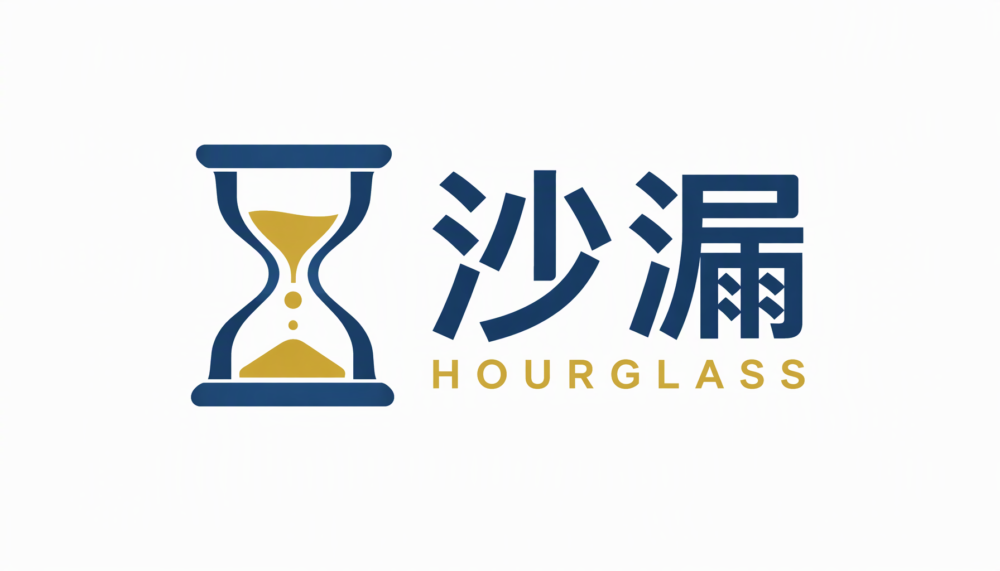
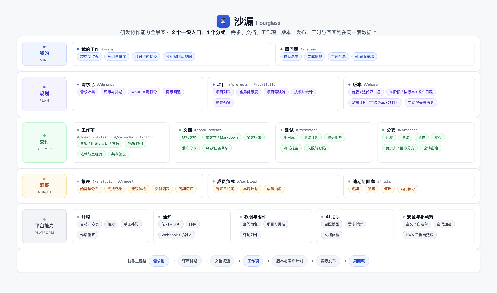

# 让项目管理回归简单，让团队专注真正重要的事

*系列五 · 价值总结篇 ｜ 第 13 篇*

---

前面十二篇，其实只讨论了一件事：

**项目管理工具，应该帮团队把事说清楚，而不是给团队增加一件要管的事。**

*图：从发现问题到愿意尝试，五个阶段层层递进。*

## 我们走过的五个阶段

**发现问题。** 功能越加越多，不是因为产品经理不聪明，而是因为行业奖励「加功能」：卖给决策者要看清单，同质化竞争靠加模块，组织复杂度被原样搬进系统。

**产生共鸣。** 复杂度不是免费的。学习、配置、搬数据、被入口打断，这些成本最终都由一线团队承担。功能覆盖度很高，日常使用率很低。

**认同理念。** 减法不是阉割，而是让主线清楚。判断标准只有三条：服务主线吗、每天都用吗、能解释吗。

**了解产品。** 我们把研发协作收进一条链路：需求、评审、文档、任务、版本、回顾，共用一套数据。计时跟着动作走，统计直读记录，每个数字都能点开。

**产生兴趣。** 但最终要不要用，不该由一篇文章决定，而该由你自己的团队决定。

## 三个问题，留给你自己

**第一，你们的痛点是「说不清」，还是「不够灵活」？**
如果流程本身复杂、需要大量定制，重型平台更合适。如果问题是信息散落、数字对不上，轻量系统可能更快见效。

**第二，你们愿意为工具配一个人吗？**
如果答案是不愿意，那就别选一个需要实施顾问的系统。默认值能不能用，比功能多少更重要。

**第三，数据放在哪里，你们在意吗？**
如果在意，自托管是值得认真考虑的选项；如果不在意，也要确认导出能力，别把迁移成本留到未来。

## 沙漏的答案

我们的选择一直没变：**不做大而全，只做真正有用的项目管理。**

*图：沙漏，一个自托管的研发协作工作台。*

- 服务 50 人以下、没有专职 PMO 的研发团队；
- 一条从需求到回顾的链路，一套统一口径的数据；
- 一个 jar + 一个 MySQL，数据不出内网；
- 每个统计数字都能下钻，每个能力都服务于主线。

*图：四个分组、12 个一级入口，共用一条主线与一套数据。*

它不完美，也有明确的边界。但如果这个专栏里有哪一段让你点了头，那它大概就是为你做的。

## 如果愿意，花二十分钟看看

想上手可以直接部署一份（见仓库 `deploy/README.md`，约 30 分钟），初始化数据库后就能建项目。

（自己部署就没有「演示数据被重置」这回事，可以放心往里放真实业务数据。）

如果想直接用自己的数据试，也可以部署到自己的服务器上：一个 Java 服务、一个 MySQL，按文档走一遍即可。

体验之后，欢迎告诉我们哪里不好用。**一个克制的产品，最怕的不是批评，而是没人愿意说真话。**

---

*沙漏 Hourglass · 面向小团队的私有化研发协作工作台*
*不做大而全，只做真正有用的项目管理。*

**回到专栏目录：[00-专栏策划](../00-专栏策划.md)**