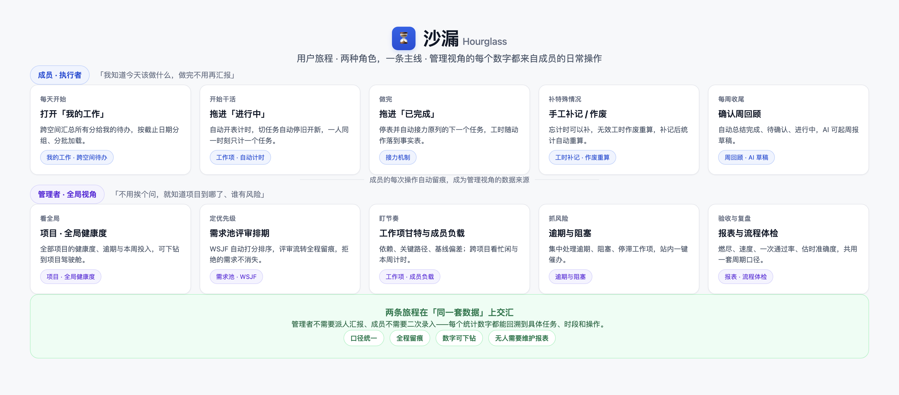

# 一个 20 人团队的一周：项目管理到底在管什么

*系列四 · 场景应用篇 ｜ 第 9 篇*

> 文中团队与项目为示例，用于说明机制，不指代真实客户。

---

「云账」是一支八人的研发团队，做一个面向小商户的账单系统。

他们不算大，但已经过了「靠喊一嗓子就能对齐」的阶段。下面这一周，是很多小团队的常态。

*图：成员负责执行留痕，管理者读取同一套数据——两条旅程在一处交汇。*

## 周一：把想法变成可执行的清单

上午，产品在需求池里提了三条需求：对账单导出、批量修改备注、账单提醒。

评审时，团队用 WSJF 打分——按价值与紧迫度排序，四项填齐才计分。分数不是拍脑袋，过程也留了痕。两条通过，进入排期；一条被拒，理由写清楚，以后可以重开。

下午拆任务，挂到甘特上，顺手标了一个里程碑：月底发版。

**周一真正完成的，不是「开了个会」，而是把模糊的想法变成了一份有顺序、有归属的清单。**

## 周二：需求变了，但没人失联

客户临时要求导出的格式再加一个字段。

产品改了需求说明，在文档里更新方案，相关任务自动指向这条需求。开发在看板上把任务拖进「进行中」，计时开始。

如果这时有人问「为什么改」，打开任务就能看到需求、文档和变更记录。**变化本身不可怕，可怕的是变化只存在于某个人的记忆里。**

## 周三：阻塞被看见，而不是被拖着

一个第三方接口的权限迟迟没批下来，对应任务被标记为阻塞。

阻塞在「逾期与阻塞」视图里集中出现，负责人直接在系统里催办。同一天，甘特上那条关键路径的偏差开始变红。

如果没有这个视图，这件事大概会在周五的例会上才被提起——而那时，距离发版只剩两天。

## 周四：评审不再靠回忆

方案评审，文档有历史快照，讨论落在评论里。

评审结束，用 AI 把文档拆成任务草稿，人工确认后入库。不是让 AI 替团队做决定，而是省掉「把结论再敲一遍」的机械工作。

## 周五：回顾是一次读取，不是一次拼凑

下午，团队打开周回顾：本周完成 9 项、待确认 2 项、进行中 4 项；工时自动汇总；三条需求已经排进本月的版本，实际发布后，发布说明按不可变记录生成。

负责人补了一句 AI 看不到的话：「周三接口权限的事，下周要提前一周申请。」

十分钟，周报完成。**不是因为他们写得快，而是因为该记的东西早就记下了。**

## 这一周，管理到底在管什么

回头看，这个团队没有做任何「额外的管理动作」。

没有单独填进度表，没有手工统计工时，没有为了周报翻聊天记录。他们只是正常地评审、拆任务、拖看板、写文档——管理信息是这些动作的副产品。

这大概就是项目管理理想的样子：**工具退到背景里，工作本身被看见。**

但现实里，很多团队的一周并不是这样。下一篇，我们拆解三种最常见的失序，以及它们真正的成因。

---

**上一篇：[少开一次会，靠的不是沟通技巧](../系列三/08-少开一次会靠的不是沟通技巧.md)**
**下一篇：[进度混乱、任务没人跟进，问题通常不在执行力](10-进度混乱任务没人跟进问题不在执行力.md)**
