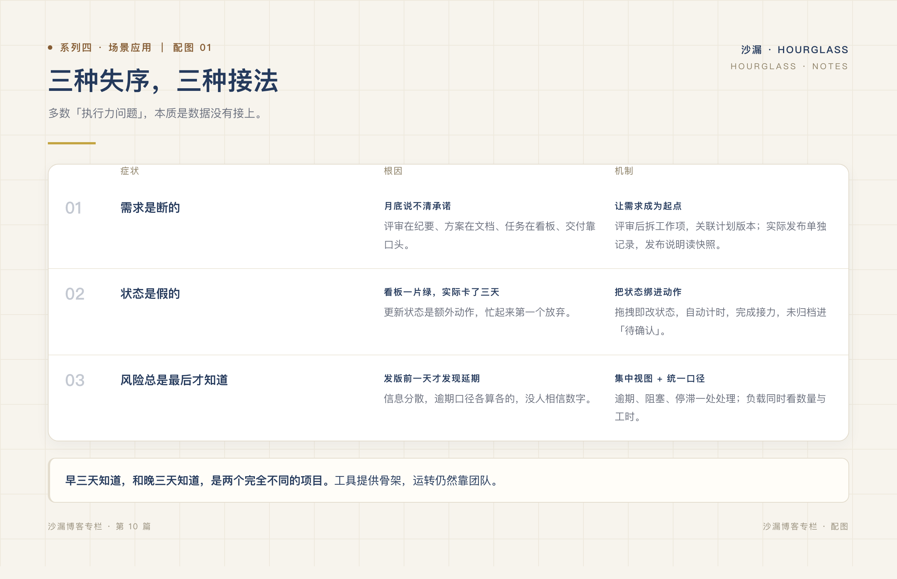
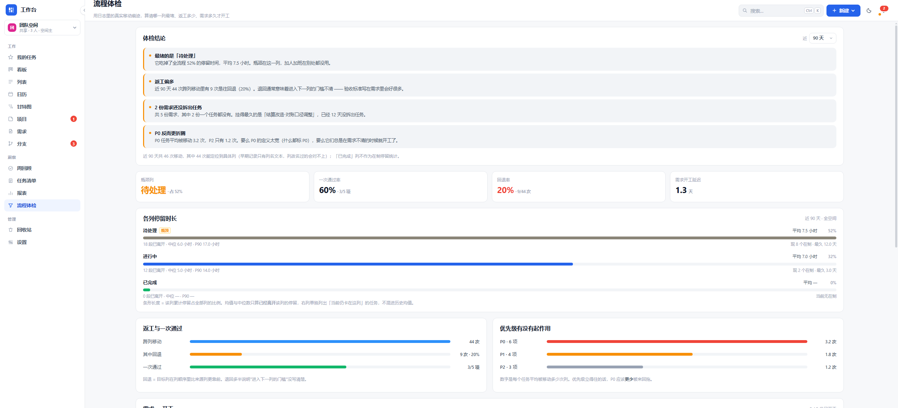

# 进度混乱、任务没人跟进，问题通常不在执行力

*系列四 · 场景应用篇 ｜ 第 10 篇*

---

项目延期之后，复盘会上最常见的结论是：「跟进不够及时」「执行力要加强」。

这个结论通常没错，但它没有用。因为它指向的是人，而人很难一夜之间改变。更值得问的是：**为什么这个团队会「跟进不及时」？**

多数时候，答案不在态度里，而在数据里。

*图：症状、根因、机制一一对应——先接数据，再谈执行。*

## 失序一：需求是断的

**症状**：月底问「这个版本承诺了什么」，没人能一句话答上来；需求文档、任务看板、发布记录各说各的。

**根因**：需求从评审到交付，中间换了三次容器。评审结论在会议纪要里，方案在文档里，任务在看板上，交付靠口头。每一段都有人负责，但没有一段接着上一段。

**机制**：让需求成为主线的起点。需求通过评审后拆成工作项，工作项关联计划版本，实际发布单独记录；发布说明读实际快照，不把完成当发布。断点被接上，问题才有唯一答案。

## 失序二：状态是假的

**症状**：看板上一片绿色，实际却有两件事卡了三天；进度填了 80%，但没人知道剩下 20% 是什么。

**根因**：状态更新是额外动作。人忙起来第一件事就是停止更新工具，于是看板逐渐变成「上周的快照」。

**机制**：把状态变更绑进动作本身。拖拽即改状态，拖入进行中自动计时，完成后自动接力；进度到 100% 但未归档的进入「待确认」，逼一次确认。**当更新状态不需要额外时间，它才可能真实。**

## 失序三：风险总是最后才被知道

**症状**：延期是在发版前一天发现的；某人已经连续两周超负荷，但直到他请假才被注意到。

**根因**：风险信息分散在各处，且没有统一的判定口径。这个页面说逾期，那个页面说正常，最后谁也不信。

**机制**：集中视图 + 统一口径。逾期、阻塞、停滞的工作项放在一个地方；成员负载同时看任务数量和投入工时；逾期判定与看板、日历共用一套规则。

风险不会消失，但它可以被更早看见。**早三天知道，和晚三天知道，是两个完全不同的项目。**

*图：哪一列最堵、返工多少、需求多久才开工，都从操作记录里算出来。*

## 一个简单的自检

不用急着换工具，先用四个问题检查现在的状态：

1. 新同事能在半小时内独立完成一次「建任务 → 推进 → 完成」吗？
2. 周会前，你能在十分钟内说清每个项目的风险吗？
3. 月末的工时数字，经得起「这小时花在哪」的追问吗？
4. 团队里有多少功能，是买了但一个月没用过的？

如果前三个答案是否定的，第四个答案往往很刺眼。

## 工具不是解药，但可以是骨架

需要说明：以上三种失序，换一个工具不会自动消失。工具能做的是提供骨架——让需求有出处、状态有动作、风险有出口。真正让它运转的，仍然是团队自己。

但如果骨架本身是断的，再强的执行力，也只能用来补洞。

下一篇，我们换到选型视角：小团队到底需不需要一套复杂的项目管理系统？

---

**上一篇：[一个 20 人团队的一周：项目管理到底在管什么](09-一个二十人团队的一周.md)**
**下一篇：[小团队，真的需要复杂的项目管理系统吗？](11-小团队真的需要复杂的项目管理系统吗.md)**
