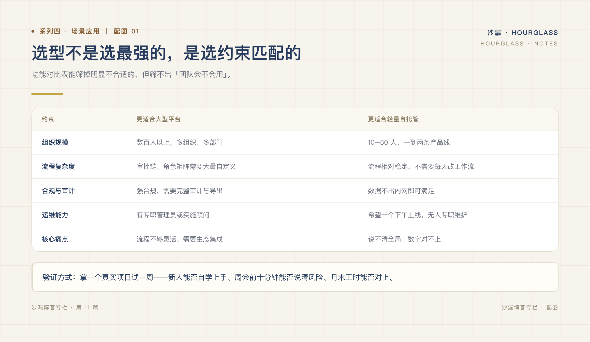

# 小团队，真的需要复杂的项目管理系统吗？

*系列四 · 场景应用篇 ｜ 第 11 篇*

---

这个问题，我在选型讨论里听过太多次。

正方说：「现在简单，以后人多了还得换，不如一步到位。」
反方说：「先跑起来再说，工具不是重点。」

两边都有道理。问题在于，大多数讨论停留在「功能够不够」，而没有先问一个更基础的问题：**你们的约束是什么？**

## 什么时候，确实需要大平台

不绕弯子。以下情况，重型系统是合理选择：

- **多组织、多部门协作**，需要严格的租户隔离与权限体系；
- **强合规或审计要求**，每一步操作都要可追溯、可导出；
- **流程本身复杂**，审批链、角色矩阵无法用默认流程覆盖；
- **规模在数百人以上**，需要横向扩展与专职管理员；
- **需要生态集成**，插件市场、开放平台是刚需。

这些场景下，「简单」不是优点，而是能力不足。硬用小工具，最后会逼团队用表格和聊天去补，反而更乱。

## 什么时候，轻量就够了

另一类团队，特征也很清楚：

- 10–50 人，一到两个产品线；
- 有需求评审和迭代节奏，但没有专职 PMO；
- 流程相对稳定，不需要每天改工作流；
- 最痛的问题是「说不清全局」，而不是「流程不够灵活」。

对这类团队来说，重型系统的很多能力，买回来就是闲置资产。**而闲置的模块不会安静地待着——它们会增加入口、配置和解释成本。**

*图：同样的约束下，两类产品的适用边界。*

## 被忽略的两个成本：迁移与归属

选型时很少有人问这两个问题，但它们影响很大。

**一是迁移成本。** 数据搬进一个系统容易，搬出来难。字段映射、附件、历史记录，往往要重新整理一遍。换一次工具，等于交一次学费。

**二是数据归属。** 数据在谁的服务器上、能不能完整导出、停止付费后还能不能访问——这些在试用期不重要，在出问题时很重要。

对研发团队来说，代码和数据都是资产。协作数据放在别人那里，至少应该是一个被认真考虑过的决定，而不是默认选项。

## 用一周时间验证，而不是用一张表

功能对比表能筛掉明显不合适的，但筛不出「团队会不会用」。

更实际的做法是：拿一个真实项目，试一周。只看三个点：

1. **新人能不能自己跑通一次完整操作**，不需要培训；
2. **周会前十分钟，能不能说清风险**，不需要临时统计；
3. **周末回看，工时和进度对不对得上**，不需要回忆补录。

三点都过，再谈功能和价格；有一点过不了，再多的勾也没意义。

## 没有最好的系统，只有合适的边界

写这些，不是想说「轻量一定更好」。

大型平台解决的是复杂组织的复杂问题，它们的存在有充分理由。真正的错误，是让一支二十人的团队，去承担一套为两百人设计的系统。

**选型不是选最强的，是选约束匹配的。**

下一篇进入最后一个系列：既然轻量有边界，那它到底能帮团队卸下什么，又会留下什么。

---

**上一篇：[进度混乱、任务没人跟进，问题通常不在执行力](10-进度混乱任务没人跟进问题不在执行力.md)**
**下一篇：[项目管理，不该成为团队的新负担](../系列五/12-项目管理不该成为团队的新负担.md)**
