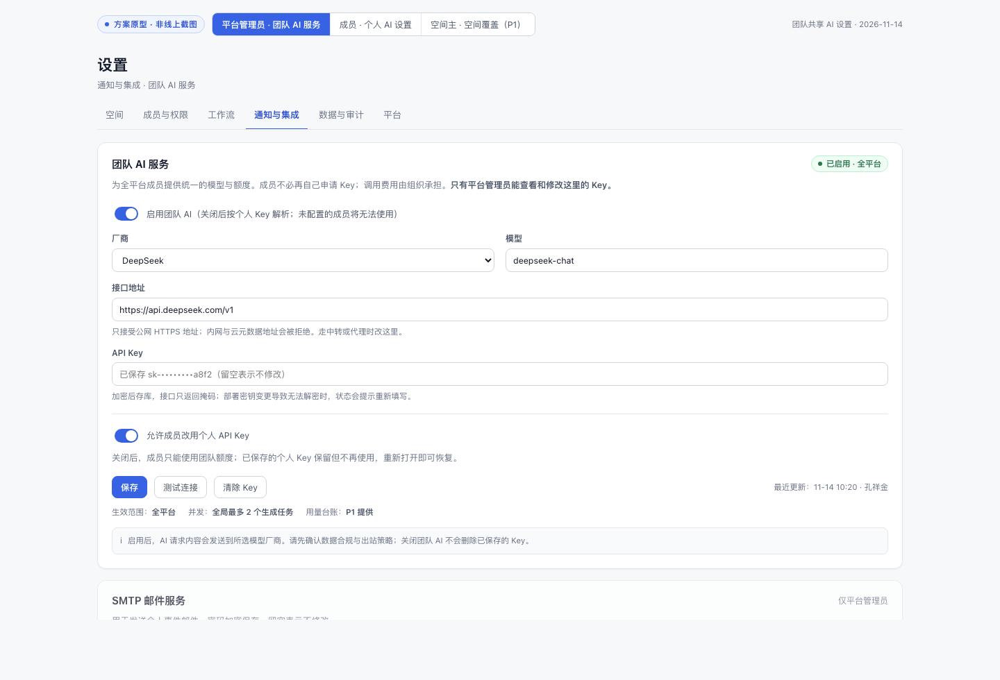
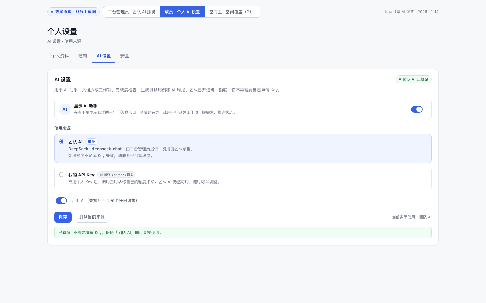
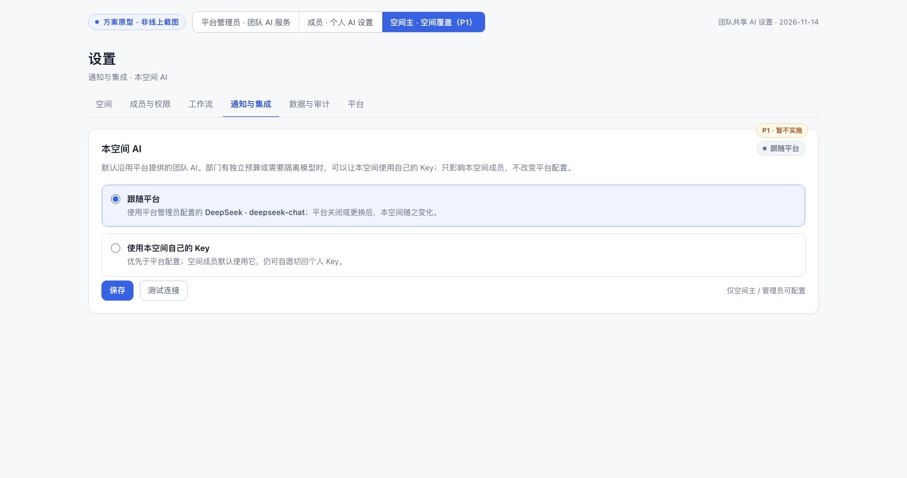

# 团队共享 AI 设置 · 方案分析（2026-11-14）

> 状态：设计待评审。本文只做方案，不改产品代码、不改数据库。
> 结论：可行。建议先做平台级「团队 AI」统一配置，空间级覆盖与用量台账放到下一批。

## 1. 为什么现在要改

当前 AI 配置只属于账号：每个用户在个人设置里选厂商、填 Key、开开关。`app_user` 存四个字段，`AiConfigService` 按 `userId` 解析，文档拆工作项、完成度检查、生成测试用例、周报、投入总结、AI 助手六处调用都走同一入口。这个模型适合 BYOK，也保护了个人额度，但它有三个绕不开的问题。

| 问题 | 现在的表现 | 统一配置后 |
| --- | --- | --- |
| 新成员入职 | 每个人自己申请 Key、选模型，问「用哪个模型」 | 管理员配一次，成员打开开关即可 |
| Key 轮换 / 离职 | 无法统一换；旧 Key 留在各自账号 | 平台一处替换，全员下一个请求生效 |
| 成本与口径 | 谁付谁用，公司看不到总量；模型不统一 | 团队额度可对账，模型与地址统一 |
| 合规说明 | 只能逐个告知「内容会发给哪家模型」 | 管理员选定厂商，文档统一披露 |

`docs/AI能力规划-2026-11-11.md` 里原本写的是「P0 继续 BYOK，P2 评估空间级」。现在需求提前，建议把「平台级统一」提到 P0，空间级仍放 P1。

## 2. 现状约束（代码证据）

- 配置字段在账号表：`sql/12_ai_config.sql` 给 `app_user` 加了 `ai_provider / ai_base_url / ai_model / ai_api_key / ai_enabled`；Key 用 `AiCrypto`（AES-GCM，`v1:` 前缀）加密，接口只回掩码（`AiConfigService.java:78-100`）。
- 解析入口只有一个：`AiConfigService.resolve(userId)`（`AiConfigService.java:183`），关闭或未配置时直接拒绝，不会静默借用别人的额度。
- 六个调用点都已有空间上下文：`AiInvestmentService:42`、`AiReviewService:56`、`AiTestCaseService:66`、`AiReqDocService:74/169`、`AiAssistantService:248`。所以把 `resolve(userId)` 改成 `resolve(userId, workspaceId)` 不需要往上补参数。
- 管理员配置已有先例：SMTP 是单行表 `mail_setting`（`sql/baseline/01_schema_full.sql:418`），接口 `/api/admin/mail-settings`（`AdminMailSettingsController`），页面在「设置 → 通知与集成」，仅平台管理员可见（`frontend/js/views/settings.js:349`）。团队 AI 可以照这个骨架做。
- 权限拦截现成：`/api/admin/**` 统一要求管理员（`SecurityConfig.java:49`），前端再按实时角色复核，两层都在。
- 并发与超时是全局的：`AiClient` 同时只放 2 个上游请求（`AiClient.java:47`），总预算 150 秒。共享 Key 之后，这 2 个槽位会变成团队共享资源，需要把「谁在占用」说清楚。
- 目前没有用量落库：Token 数只回给页面（`dto/AiUsage.java`），刷新即丢。共享额度后，「谁用了多少」会从「不重要」变成「管理员会问」。

## 3. 设计原则

1. **共享不等于强制。** 成员可以不用 AI，也可以在管理员允许时切回自己的 Key。组织买的是便利，不是强制外发。
2. **来源透明。** 成员在设置页一眼看到「当前用谁的额度」；失败提示直接说「找谁」。
3. **不做静默回落。** 团队 Key 失效或超额时，不会偷偷改用个人 Key。避免两件事：账单落到个人、内容发给另一家厂商。
4. **Key 只进不出。** 共享 Key 只有平台管理员能看掩码、改、测；普通成员只看到「已由管理员配置」。审计只记改了哪些项，不落明文或密文。
5. **增量兼容。** 没有共享配置时，所有行为与现在完全一致；个人配置一条不删。

## 4. 配置分层与生效规则

### 4.1 三层的职责

| 层级 | 谁能配 | 作用范围 | 存放位置 | 阶段 |
| --- | --- | --- | --- | --- |
| 平台共享（团队 AI） | 平台管理员 | 整个部署 | 新表 `ai_shared_setting`，`scope='platform'` | P0 |
| 空间共享（部门 AI） | 空间主 / 管理员 | 单个共享空间 | 同表，`scope='workspace'` | P1 |
| 个人（我的 Key） | 本人 | 自己的调用 | `app_user.ai_*`（现状不动） | 已有 |

个人空间不提供空间级配置：它是个人数据区，没必要再维护一份 Key，直接继承平台。若客户希望个人空间不消耗公司额度，P1 再加一个「个人空间是否继承团队 AI」的开关，默认继承。

### 4.2 解析顺序

```
1. 个人总开关关闭            → 不发请求
2. 用户选择「只用个人」且允许 → 个人
3. 空间共享已启用且完整       → 空间共享（P1）
4. 平台共享已启用且完整       → 平台共享
5. 个人配置完整且允许       → 个人
6. 都不满足                 → 报错，按原因给下一步
```

两个细节：

- **第 3/4 步只看「是否配置并启用」，不看调用是否成功。** 已经在用团队 Key，但上游返回 401/429 时，错误直接抛给用户，并提示联系管理员；不会在调用失败后改用个人。否则同一句话在故障时突然从公司账单变成个人账单，没人能解释。
- **「用户选择个人」是一个显式偏好。** 新增 `app_user.ai_prefer`：空 = 自动（团队优先），`personal` = 只用个人。选了个人的用户如果个人配置不完整，直接报错，不回落团队。

### 4.3 组合矩阵

| 团队 AI | 允许个人 Key | 个人已配置 | 用户选择 | 结果 |
| --- | --- | --- | --- | --- |
| 未配置/关闭 | 是 | 是 | 自动 | 个人 |
| 未配置/关闭 | 是 | 否 | 自动 | 报错：两边都不可用 |
| 未配置/关闭 | 否 | 是 | 自动 | 报错：个人被管理员关闭 |
| 已启用 | 是 | 是 | 自动 | 团队 |
| 已启用 | 是 | 是 | 个人 | 个人 |
| 已启用 | 是 | 否 | 个人 | 报错：个人配置不完整 |
| 已启用 | 否 | 是 | 自动 | 团队（个人 Key 保留但不使用） |
| 已启用 | 否 | 是 | 个人 | 团队，并在设置页说明个人已被关闭 |
| 任意 | 任意 | 任意 | 关闭 AI | 不发请求 |

最后一行的「关闭 AI」沿用现有 `ai_enabled`。团队开通后不自动替成员打开：是否把文档内容发给外部模型，应当由本人点一次。个人设置页在团队可用时显示一条「团队 AI 已就绪，打开开关即可使用」的提示，降低这一步的摩擦。

## 5. 数据模型

### 5.1 新表

```sql
CREATE TABLE ai_shared_setting (
  id             BIGINT       NOT NULL AUTO_INCREMENT,
  scope          VARCHAR(16)  NOT NULL COMMENT 'platform / workspace',
  scope_id       VARCHAR(64)  NOT NULL DEFAULT '0' COMMENT 'platform 固定为 0；workspace 存空间 ID',
  provider       VARCHAR(24)  DEFAULT NULL,
  base_url       VARCHAR(255) DEFAULT NULL,
  model          VARCHAR(64)  DEFAULT NULL,
  api_key        VARCHAR(512) DEFAULT NULL COMMENT 'AES-GCM，v1: 前缀',
  enabled        TINYINT(1)   NOT NULL DEFAULT 0,
  allow_personal TINYINT(1)   NOT NULL DEFAULT 1 COMMENT '仅 platform 行生效',
  updated_by     VARCHAR(64)  DEFAULT NULL,
  updated_at     DATETIME     DEFAULT NULL,
  PRIMARY KEY (id),
  UNIQUE KEY uk_ai_shared_scope (scope, scope_id)
) ENGINE=InnoDB DEFAULT CHARSET=utf8mb4;
```

### 5.2 账号表增量

```sql
ALTER TABLE app_user
  ADD COLUMN ai_prefer VARCHAR(16) DEFAULT NULL
  COMMENT 'AI 来源偏好：NULL/auto=团队优先，personal=优先个人';
```

### 5.3 取舍说明

- **一张表带 scope，而不是 platform / workspace 两张表。** P1 上线时不用再建表、改映射；平台行用固定 `scope_id='0'`，唯一键保证单行。
- **不复用 `app_user` 存团队 Key。** 团队 Key 不属于任何账号；`updated_by` 只记操作人。删账号不会删团队配置，换管理员也不用转移。
- **不新建通用 key-value 设置表。** 表格字段固定、需要类型校验和掩码返回，专用表更直白，也便于以后加 `daily_token_limit` 之类的列。
- **`allow_personal` 只认平台行。** 空间级不做「禁止个人」：那是公司级政策，下放到空间会产生同一账号在不同空间行为不一致。

## 6. 接口设计

### 6.1 平台管理员

| 方法 | 路径 | 说明 |
| --- | --- | --- |
| GET | `/api/admin/ai-settings` | 读取配置；Key 只回掩码 |
| PUT | `/api/admin/ai-settings` | 保存；`apiKey` 空=不改，`clearKey=true`=清除 |
| POST | `/api/admin/ai-settings/test` | 用**表单当前值**测一次，不落库 |

`test` 与个人设置不同：个人是「先保存再测试」，团队配置改一次影响全员，所以测试只发候选配置，确认可用再保存。候选里 `apiKey` 为空时，用已保存的 Key 解密后测试。保存时如果 `enabled=true`，要求厂商、地址、模型和 Key（Ollama 除外）齐全；只想先存草稿就保持关闭。状态为「已保存但关闭」不影响任何调用。

返回字段：

```json
{
  "enabled": true,
  "provider": "deepseek",
  "baseUrl": "https://api.deepseek.com/v1",
  "model": "deepseek-chat",
  "hasKey": true,
  "apiKeyMasked": "sk-••••••a8f2",
  "keyBroken": false,
  "allowPersonal": true,
  "status": "已就绪：全员调用走团队额度",
  "updatedBy": "孔祥金",
  "updatedAt": "2026-11-14 10:20",
  "presets": [ ... ]
}
```

### 6.2 个人设置

保留现有三个接口，扩展字段，不改路径：

- `GET /api/ai/config?workspace=...` 增加 `team` 与 `prefer`：

```json
{
  "enabled": true,
  "prefer": "auto",
  "source": "shared",
  "sourceName": "团队 AI",
  "team": {
    "available": true,
    "scope": "platform",
    "provider": "deepseek",
    "model": "deepseek-chat",
    "status": "由平台管理员提供，费用由团队承担"
  },
  "allowPersonal": true,
  "provider": "deepseek",
  "model": "deepseek-chat",
  "hasKey": true,
  "apiKeyMasked": "sk-••••a8f2",
  "status": "已就绪",
  "presets": [ ... ]
}
```

原有字段保留，前端平滑改版；`source` 是解析后的实际来源，`team.scope` 为 `platform` / `workspace`，便于 P1 显示「本空间提供」。

- `PUT /api/ai/config` 增加可选 `prefer`（`auto` / `personal`），其余语义不变。
- `POST /api/ai/config/test` 测试**解析后的来源**，返回增加 `source`，让页面能说清「刚刚测的是团队 AI」。测试忽略个人总开关（和现在一样，没启用也要能先测通），但仍然遵循来源偏好：选了「我的 Key」就测个人，避免测的和用的不是同一套。

页面状态约定：团队可用但没有个人 Key 时，「我的 API Key」选项置灰并提示「先填写并保存」；管理员关闭个人 Key 时，选项同样置灰，但保留已保存的 Key 和切换记录。

### 6.3 空间级（P1，预留）

`GET/PUT/POST /api/workspaces/{id}/ai-settings`，权限为空间主 / 管理员，个人空间返回 400。路径与现有空间设置接口一致，前端不需要新概念。

### 6.4 错误信息

错误信息要能回答「发生了什么、找谁、还能怎么办」。建议统一成下面这组：

| 场景 | 提示 |
| --- | --- |
| 平台已关闭个人 Key，且团队 AI 未启用 | 平台已关闭个人 API Key，且没有启用团队 AI，请联系平台管理员 |
| 团队 Key 无法解密 | 团队 AI 的 Key 无法解密（部署密钥变更过），请联系平台管理员重新填写 |
| 团队 Key 无效 | 团队 AI 的 Key 无效，请联系平台管理员 |
| 团队额度/频率受限 | 团队 AI 额度或频率受限，请稍后再试；如持续出现请联系管理员 |
| 用户选了个人但没配完 | 你选择了「我的 API Key」，但配置不完整，请补全或切回团队 AI |
| 两边都没有 | 还没有可用的 AI：请联系平台管理员开通团队 AI，或在个人设置填写自己的 Key |

在 `AiConfig` 上加 `source` / `sourceLabel`，`AiClient` 的错误前缀带上来源（「团队 AI：Key 无效」「我的 API：Key 无效」）。否则同一个 401，用户不知道去改哪一处。

## 7. 界面与入口

### 7.1 平台管理员：设置 → 通知与集成 → 团队 AI 服务

复用 SMTP 卡片的位置与样式，不新增一级菜单。卡片包含：启用开关、厂商、模型、接口地址、Key、是否允许个人 Key、状态行、保存 / 测试 / 清除。下图为方案原型。



几个交互约定：

- 关闭团队 AI、清除 Key、关闭「允许个人 Key」，以及更换厂商 / 模型 / 地址，都要二次确认，并说明影响（「全员将改用个人 Key」或「未配置个人 Key 的成员将无法使用 AI」）。
- 状态行直接写最近更新人与时间；Key 解不开时变红并提示重填，不显示「已启用」。
- 「允许成员改用个人 API Key」默认开。默认值决定了组织的控制感：默认开，成员不被卡住；需要收紧时再关。
- 地址保存时就过 `OutboundUrlGuard`（拒绝内网与云元数据地址），与个人配置一致；Ollama 例外沿用现有规则。

### 7.2 成员：个人设置 → AI 设置

把原来的一整块表单改成「来源选择 + 可折叠的个人表单」。团队 AI 可用时，默认选中团队，个人表单收起；不需要填 Key。



- 顶部状态胶囊显示实际来源（「团队 AI 已就绪」）。
- 「团队 AI」卡片只读展示厂商与模型，说明费用由团队承担、异常找谁。
- 「我的 API Key」保持现有表单，选中后才展开；切回团队不删个人 Key。没有个人 Key 或管理员关闭个人 Key 时，选项置灰并说明原因。
- 管理员关闭个人 Key 时，个人卡片置灰并说明「已保存的 Key 保留，但不会使用」；不隐藏，避免用户以为自己的 Key 丢了。
- 「测试当前来源」按钮按实际来源测，避免用户以为测的是个人 Key。
- 右下角助手的启动状态（「模型已就绪 / 未配置模型」）也按解析后的来源判断：团队可用时显示「团队 AI 已就绪」，隐私说明改成「消息会发送到团队配置的模型服务」。
- 来源选择用原生 radio 加 `fieldset / legend`，键盘可达；状态不只用颜色区分，保证读屏与色弱用户能读懂。

AI 结果区（拆任务、周报、助手）在 Token 数旁边补「团队额度 / 我的额度」小标签，放到 P1：它要改多个结果渲染点，不影响 P0 的「用谁的 Key」。

### 7.3 空间主：设置 → 通知与集成 → 本空间 AI（P1）

默认「跟随平台」，可选「使用本空间自己的 Key」。只影响本空间成员，不改变平台配置。个人空间不显示这张卡片。



### 7.4 角色说明与文档同步

`settings.js` 的角色权限说明表要加两行：平台管理员可配「团队 AI」；空间主 / 管理员可配「本空间 AI（P1）」。管理员指南、用户使用手册 §15.1、接口契约、常见问题、CHANGELOG 同步更新；用户手册要把「每个用户自配」改成「平台可统一提供，个人可选」。

## 8. 安全、审计与成本

### 8.1 Key 与出站

- 共享 Key 复用 `AiCrypto`，与个人 Key 同一把部署密钥。生产必须用 `AI_CRYPTO_KEY` 覆盖默认值，否则数据库导出后团队 Key 与个人 Key 一起失守。`AI_CRYPTO_KEY` 变更后两处都会解不开：管理员页和个人页都要显示可操作的提示，而不是 500。
- 接口永不回明文。共享 Key 的掩码只回给能管理它的人（平台管理员，P1 的空间主 / 管理员）；个人 Key 的掩码只回给账号本人。普通成员看团队配置时只回 `hasKey` 和厂商 / 模型，减少无必要的暴露。
- 保存与调用两端都过 `OutboundUrlGuard`。共享地址是管理员填的，但仍然是外部输入，不能因为身份高就跳过校验。若公司使用内网模型网关，需要部署层开启 `AI_ALLOW_PRIVATE_NETWORK=true`，并由管理员确认网络边界；默认仍然拒绝内网与云元数据地址。
- 日志与审计不写 Key、不写完整请求正文。现有 `AiClient` 已只记模型与状态码，沿用。

### 8.2 审计

新增动作 `ai_shared_config_update`，目标类型 `ai_shared_setting`，目标 ID 为 `platform`（P1 为空间 ID）。明细只写「服务商、接口地址、模型、总开关、允许个人 Key、API Key（已更新/已清空）」这类字段名，和现有 `ai_config_update` 的口径一致。

个人设置里的来源切换也记一条：`ai_config_update` 明细增加「来源：团队 / 个人」。这样「谁在什么时候改了扣费口径」可查。

### 8.3 成本与滥用

P0 只做三件事：全员共用全局 2 个并发槽；管理员页展示生效范围与最近更新时间；错误信息区分「额度受限」。这能挡住大部分误操作，但挡不住有意刷。

并发也需要观察：一次拆需求通常 20–60 秒，2 个槽位在 10 人同时使用时就会排队。P0 不改现有上限，先看真实峰值；P1 把并发数做成环境配置，并按来源或空间分配，避免一个空间占满全平台的槽位。

P1 再加：

- `ai_usage_daily(day, user_id, workspace_id, source, calls, prompt_tokens, completion_tokens)` 按天聚合，管理端可看「谁用得多、哪个功能最贵」。
- 每人每日次数 / Token 上限，管理员可设，默认不限；超限返回 429 并说明「今日团队额度已用完」。
- 空间级额度（配合空间覆盖）。

这些不影响 P0 的接口形状，表可以后补。

### 8.4 数据外发披露

统一 Key 之后，实际接收内容的是管理员选定的厂商。管理员指南要写清：管理员启用团队 AI 是组织层面的选择；成员打开个人开关，才表示同意把自己的请求内容发到该地址。敏感部署应关闭团队 AI 或改用内网 Ollama。这与现有「自托管不等于不出站」的表述保持一致。

## 9. 兼容、迁移与回滚

1. **先发 SQL 与后端，不配置共享行。** 没有 `scope='platform'` 的记录时，解析顺序落到个人，行为与现在一致。
2. **迁移时保留存量用户的真实选择。** 已经有个人 Key 或使用 Ollama 的账号，`ai_prefer` 初始化为 `personal`；其余保持 NULL（自动）。否则团队一开通，这批人会静默从自己的厂商切到公司厂商，账单和数据去向都变了。他们会在个人页看到「团队 AI 已就绪」，自愿切过来。
3. **管理员保存并启用。** 没有个人 Key、偏好为自动的成员，下一个 AI 请求开始走团队。
4. **存量用户不会被自动打开 AI。** `ai_enabled=0` 保持关闭；个人页出现「团队 AI 已就绪」提示，点开关才生效。
5. **配置变更无需重启。** 解析每次都读库，管理员保存后下一个请求生效；不需要清缓存或重启服务。
6. **回滚只改一个开关。** 关闭团队 AI 后，自动偏好的成员回到个人配置；明确选择个人的成员一直没受影响。
7. **删空间（P1）。** 在删除空间的既有事务里清 `scope='workspace'` 的行；平台行永不受影响。
8. **换部署密钥。** 两处 Key 同时失效，管理员重填团队 Key、成员按需重填个人 Key；期间 AI 功能只报配置错误，不影响其它功能。

## 10. 改动清单

### 10.1 后端

| 文件 | 改动 |
| --- | --- |
| `sql/13_ai_shared_setting.sql` | 建表 + `app_user.ai_prefer`，幂等写法照 `sql/12` |
| `entity/AiSharedSetting.java`、`mapper/AiSharedSettingMapper.java` + XML | 单行 CRUD |
| `service/SharedAiSettingService.java` | 读写、测试、状态、审计；复用 `AiProviders` / `AiCrypto` / `OutboundUrlGuard` |
| `service/AiConfigService.java` | 注入共享服务；`resolve(userId, workspaceId)`；视图增加来源；保存 `prefer`；错误分型 |
| `dto/AiConfig.java` | 增加 `source` / `sourceLabel` |
| `dto/AiConfigView.java`、`AiConfigRequest.java` | 增加 `team`、`allowPersonal`、`prefer` |
| `dto/SharedAiSettingsRequest.java`、`SharedAiSettingsView.java` | 管理端入参 / 出参 |
| `controller/AdminAiSettingsController.java` | 三个管理端接口，`requireAdmin()` 与 SMTP 一致 |
| `controller/AiController.java` | `GET /api/ai/config` 接受 `workspace` |
| `service/AiAssistantService.java` | `bootstrap` 改用 `view(userId, workspaceId)`，`aiReady` 认团队配置；隐私说明按来源措辞 |
| 五个 AI 服务的六处调用 | `resolve(userId)` → `resolve(userId, workspaceId)` |
| `common/AiClient.java` | 错误前缀带来源；并发槽位的提示说明是团队共享 |
| `test/...` | 解析矩阵、权限、审计不含 Key、解密失败分支 |

不需要改 `SecurityConfig`：`/api/admin/**` 已经统一拦截。

### 10.2 前端

| 文件 | 改动 |
| --- | --- |
| `frontend/index.html` | 个人 AI 面板改「来源选择」；「通知与集成」加团队 AI 卡片 |
| `frontend/js/views/profile.js` | 渲染来源、折叠个人表单、按来源测试、保存 `prefer` |
| `frontend/js/core/assistant.js` | 启动状态与隐私说明按来源显示 |
| `frontend/js/views/settings.js` | 管理员卡片读写 / 测试 / 确认弹窗；角色说明表加行 |
| `frontend/css/components.css` 或 `views.css` | 来源卡片样式，沿用现有 token |
| `frontend/sw.js` | 版本号与预缓存清单更新 |

移动端沿用现有栅格：来源卡片纵向排列，个人表单展开后单列；不新增横向滚动。

## 11. 验收清单

- [ ] 没有团队配置时，六个 AI 功能与现在表现完全一致（个人配置回归）。
- [ ] 管理员保存团队配置后，成员打开启用开关即用，不必填 Key；页面显示「团队 AI」。
- [ ] 成员切到「我的 Key」后走个人；切回团队不丢个人 Key。
- [ ] 关闭「允许个人 Key」后，个人配置被忽略但保留；重新打开即恢复。
- [ ] 团队 Key 解密失败 / 401 / 429 三种错误分别有可执行提示，且不回落个人。
- [ ] 非管理员访问 `/api/admin/ai-settings` 返回 403；普通成员看不到团队 Key 的掩码。
- [ ] 审计记录包含来源与改动项，不包含 Key 明文或密文。
- [ ] 关闭团队 AI 后，自动偏好成员回到个人配置；个人配置也没有时提示明确。
- [ ] 助手启动状态能区分「团队 AI 已就绪 / 个人 AI 已就绪 / 未配置」，隐私说明与来源一致。
- [ ] 已启用且有个人 Key 的存量账号，迁移后仍走个人，不会静默切换。
- [ ] 1440 与 390 宽度下，来源卡片、表单、按钮不溢出。
- [ ] 管理员指南 / 用户手册 / 接口契约 / 角色说明 / CHANGELOG 已同步。

## 12. 分期

**P0（建议本批）**：平台共享配置、解析优先级、个人来源选择、允许个人 Key、错误分型、审计、原型落地、文档同步。

**P1**：空间级覆盖、按人 / 按空间的用量台账与每日上限、管理员用量页、AI 结果区显示本次来源、并发上限可配置并按来源分配。

**P2**：多 Key 轮换与故障转移、按功能配置模型（便宜模型跑用例、强模型拆需求）、本地模型作为组织级选项、内网免鉴权网关（无需 Key，仅靠网络边界）。

## 13. 需要拍板的四件事

1. **共享配置放在平台还是空间？** 建议平台 P0、空间 P1。若客户是多公司共用一套部署，空间级要提前到 P0。
2. **是否允许成员继续用自己的 Key？** 建议允许，管理员可一键关闭。完全禁止会让自带额度的老用户立刻断供。
3. **团队开通后是否自动替成员打开 AI？** 建议不自动，个人页给一键提示。把「内容发给外部模型」的决定留给本人。
4. **团队 Key 调用失败时是否自动改用个人 Key？** 建议不自动。自动回落会让账单和数据去向都变得不可解释。

## 附：原型文件

- [原型 HTML](audit/prototypes/shared-ai-settings-proto-2026-11-14.html)（可切换管理员 / 成员 / 空间主三个视角）
- [管理员视角截图](audit/prototypes/shared-ai-admin-2026-11-14.png)
- [成员视角截图](audit/prototypes/shared-ai-member-2026-11-14.png)
- [空间覆盖截图（P1）](audit/prototypes/shared-ai-space-2026-11-14.png)
