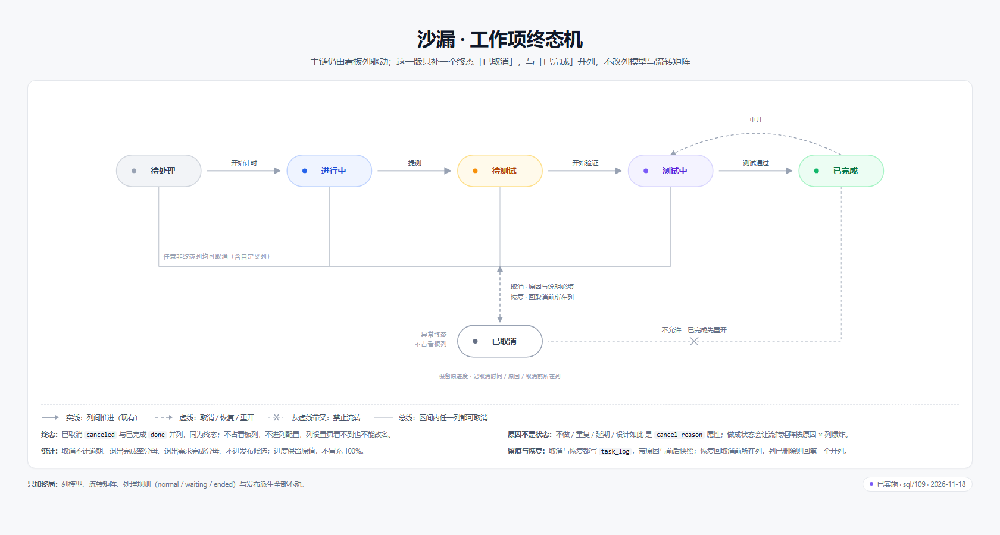

# 工作项终态模型设计（2026-11-18）

> 状态：已实施（2026-11-18，迁移 `sql/109_task_canceled.sql`）。口径与改动清单见下文；原型见 [workitem-terminal-state-proto-2026-11-18.html](preview/workitem-terminal-state-proto-2026-11-18.html)，配图见 `diagrams/workitem-terminal-state.png`。

## 结论

- 工作项只补一个终态「已取消」，`canceled`，与「已完成」并列；不新增第六个看板列，也不进列配置。
- 状态值复用 `board_column`，不新增状态字段；新增 `canceled_at`、`cancel_reason`、`cancel_from` 三个可空列承载元数据。
- 进入只能从非终态列发起，取消必须填原因与说明；出口只有「恢复」，回到取消前所在列，该列已删除则回第一个开列。
- 已完成不能直接取消，须先重开；已取消不能拖到任何列，只能恢复。
- 取消后不计逾期、退出完成率分母、退出需求完成分母、不进发布候选；进度保留原值，不冒充 100%。

## 为什么只加终态

现在的列模型已经能表达「在哪儿做」，缺的是「不做了」这个终局。现状只有两个替代品，都不合格：

- 软删除：记录进回收站，不再出现在任何视图，无法被检索与被统计，也无法回答「这个版本砍掉了什么」。
- 阻塞：阻塞是进行中的标记，工作项仍在链上，仍占逾期与完成率分母。

反过来也不做多状态。禅道给缺陷配了七个解决方式（重复、不予解决、设计如此、延期、外部原因等），TAPD 允许 31 个自定义状态与逐流转勾选；一旦把原因做成状态，流转矩阵就从「列 × 列」变成「原因 × 列 × 列」，测试面、报表口径和拖拽规则同时失控。沙漏的选择是把原因降级为属性，状态只保留「终止」这一个语义。

与需求侧对称：需求是 5 个主状态加一个异常终态「已关闭」，工作项是列驱动的主链加一个异常终态「已取消」。两边都只有「正常推进」和「不做了」两个方向。

## 状态机

实线是现有列间推进；虚线是新增的取消与恢复，以及已完成的重开；灰虚线带叉是禁止流转；下方总线表示区间内任一列（含自定义列）都可取消。

## 流转与留痕

| 动作 | 起点 | 终点 | 必填 / 限制 | 留痕 |
| --- | --- | --- | --- | --- |
| 取消 | 任意非终态列（含自定义列） | 已取消 | 原因（四选一）+ 说明；已完成不允许 | `task_log` 写 `from/to`、原因、前后快照；落 `canceled_at` / `cancel_reason` / `cancel_from` |
| 恢复 | 已取消 | `cancel_from`；该列已删除时回第一个开列 | 说明 | `task_log` 写 `from/to`、原因、前后快照；清空三个取消字段 |
| 禁止 | 已完成 | 已取消 | — | 先重开，再按上一条取消 |
| 禁止 | 已取消 | 任意列 | — | 只能走恢复动作，不接受拖动 |
| 不改 | 主链列之间 | — | 沿用现有三态流转矩阵 | 现有 `task_log` |

取消与恢复复用既有 `change_data` 能力，不新增日志表、不改日志格式。

## 取消原因

| 原因 | 码值 | 典型对象 | 说明写法要求 |
| --- | --- | --- | --- |
| 不做 | `not_do` | 故事 / 任务 | 写清楚为什么不做，恢复时作为依据 |
| 重复 | `dup` | 缺陷 / 任务 | 指向合并到哪一条 |
| 延期 | `deferred` | 故事 / 任务 | 写清暂缓到什么时候、等什么 |
| 设计如此 | `design` | 缺陷 | 写清按哪条设计行为处理 |

原因只用于解释与筛选，不参与状态判定；统计上区分「砍掉」与「合并」，避免把重复单算成需求缩水。

## 与三个相近概念的区别

| 概念 | 是什么 | 记录在哪 | 能否出现在看板 | 能否被统计 | 出口 |
| --- | --- | --- | --- | --- | --- |
| 已取消 | 终态，不做了 | 工作项自身字段 | 否 | 是，单列统计 | 恢复 |
| 删除 | 软删除进回收站 | `deleted_at` | 否 | 否 | 回收站恢复 |
| 阻塞 | 进行中的卡点标记 | `is_blocked` 等 | 是，仍在原列 | 是，计入「逾期与阻塞」 | 解除阻塞 |

## 口径影响

| 口径 | 现状 | 加终态后 |
| --- | --- | --- |
| 逾期 | 未进完成列且过截止日即逾期 | 已取消不计；取消一张逾期卡，逾期数立即减一 |
| 完成率 | 已完成 / 全部未删除工作项 | 分母剔除已取消；否则取消会被当成「制造完成率」的手段 |
| 需求完成判定 | 工作项全部完成且最新用例全部通过 | 已取消同时退出「总条数」与「已完成条数」；全取消的需求不算完成，至少要有 1 条完成 |
| 发布候选 | 按列筛候选 | 已取消不进入候选与发布明细 |
| 版本内容冻结 | 以成功正式生产发布为准 | 不变；冻结后取消一张候选卡不回退已发布内容 |
| 清单与我的工作 | 列表默认显示全部未删除 | 默认不显示已取消；已取消只从看板工具条「已取消」入口查看（按原因筛选、逐条恢复），不进任何列表 / 日历 / 甘特 |

## 改动清单（已实施 · 2026-11-18）

**数据库**

- `task` 表加 3 个可空列：`canceled_at`、`cancel_reason`、`cancel_from`；MySQL 8 走 INSTANT，不重写表、不回填历史数据。
- 不新增表、不新增索引；`task_log` 零改动。

**后端（约 10 个文件，按判定 / 入口 / 视图分三组）**

- 判定：常量表加 `COL_CANCELED`；到期判定加终态排除；统计分桶加取消桶；进度不强制 100%。
- 高风险三处：看板拼列时把 `canceled` 加入已知列，否则「未知列折进第一个开列」会把已取消记录塞回待处理；需求完成 SQL 里 `sum(board_column='done')` 的多处口径要同步剔除；`<> 'done'` 的开放列判定要改为同时排除取消。
- 入口：流转校验拒绝以取消作为普通目标列；工作流新增取消与恢复两个动作，复用关计时、需求完成刷新、审计与通知；抽屉改列下拉不出现已取消。
- 视图：看板与清单默认排除；新增已取消列表查询；版本候选与发布明细排除。

**前端（3 个文件）**

- 卡片菜单与抽屉增加取消入口（原因 + 必填说明），已完成卡片只保留重开。
- 新增已取消视图：按原因筛选、逐条恢复、恢复必填说明。
- 顶部指标与列计数改为剔除口径。

**实施落点（当前代码）**

| 层 | 文件 | 做了什么 |
| --- | --- | --- |
| 迁移 | `sql/109_task_canceled.sql` | `task` 加 `canceled_at` / `cancel_reason` / `cancel_from`，可重复执行 |
| 后端 | `common/Consts.java`、`service/TaskSupport.java` | `COL_CANCELED`、原因枚举与规则 `canceled`（不计时、不计逾期） |
| 后端 | `service/TaskWorkflowService.java` | 拖拽 / 批量 / 改列拒绝进出终态；新增 `cancel` / `restore` 动作，关计时、写审计与快照、通知与需求完成刷新 |
| 后端 | `service/TaskCommandService.java` | 字段编辑只允许原列与目标列同为 `canceled`，不会把终态卡悄悄复活 |
| 后端 | `controller/TaskController.java` | `GET /api/tasks/canceled`、`POST /api/tasks/{id}/cancel`、`POST /api/tasks/{id}/uncancel`（恢复避开回收站的 `/restore`） |
| 后端 | `mapper/TaskMapper.xml`、`service/TaskQueryService.java` | 开放列 / 清单 / 我的工作 / 甘特 / 统计排除已取消；已取消独立分页与原因计数 |
| 前端 | `views/board.js`、`index.html` | 工具条「已取消」入口 + 计数徽标；「!」口径弹层补终态行与状态机图 |
| 前端 | `views/canceled.js`、`css/workcolumn.css` | 已取消视图：原因筛选、逐条恢复、加载更多（每页 100） |
| 前端 | `core/task-actions.js`、`core/task-drawer.js`、`core/templates/task-drawer.js` | 卡片菜单与抽屉的取消 / 恢复入口，成功后收起抽屉并刷新各视图 |
| 前端 | `lib/format.js`、`core/state.js` | `canceled` 的名称 / 颜色 / 规则特例：不计时、不计逾期、不生成到期徽标 |

**复核修正（2026-11-18 第二轮）**

- 统计口径补全：周回顾（待完成 / 进行中 / 状态分桶）、估时样本与覆盖率分母、成员负载与剩余工时、流程体检的任务与需求拆解缺口、需求与项目集进度、需求 / 需求文档 / 分支 / 版本下的任务清单与计数、标签计数，全部排除已取消。
- 发布链路：版本的候选范围与计划范围查询排除已取消，已取消不会成为发布候选或计入承诺基线；已发布历史明细保持原样。
- 提醒：到期提醒与逾期提醒的扫描语句排除已取消，取消后的卡不再触发提醒。
- 共享甘特：对外分享的甘特数据源与站内同口径，不带已取消。
- 入口：已取消页行内「恢复」直接使用行数据，不再依赖看板缓存；恢复 / 取消后同步刷新任务缓存，避免旧列事实残留。
- 接口：`GET /api/tasks/canceled` 省略 `limit` 时默认一页 100 条，服务层仍夹在 1..100。
- 预览稿：已取消页的原因 chip 真实生效，恢复与取消动作可在预览里演示。

## 与业界对照

Jira 用「状态 + Resolution」两层表达终止，Resolution 取值为 Fixed / Won't Fix / Duplicate / Cannot Reproduce 等，状态类别归入 Done。禅道把缺陷状态做到 active / resolved / closed，再用「解决方案」细分七种。两者共同点是**终止语义只有一个，原因是它的属性**。沙漏沿用这一点，同时不引入自定义状态：主状态由列决定，原因固定四类，避免逐流转配置带来的规则碎片。

## 已定口径

1. 全部工作项都取消的需求，不算完成。已实施：需求完成口径只数未取消工作项，全取消时 `taskCount = 0`，不满足完成条件。
2. 完成率分母剔除已取消，界面在帮助口径里注明分母口径。
3. 原因枚举固定四类：不做 / 重复 / 延期 / 设计如此；后续要加走版本升级，不做空间级自定义。

## 原型与历史版本

- 原型：`preview/workitem-terminal-state-proto-2026-11-18.html`，单文件离线可交互；支持 `#view=canceled`、`#drawer=`、`#menu=`、`#cancel=`、`#restore=`、`#theme=dark` 深链逐屏查看。
- 本文配图：`diagrams/workitem-terminal-state.png`，终态机，2026-11-18。
- 现状全景图 `diagrams/state-machine.html` 本轮未改动：它描述的是加入终态前的运行时行为，下一轮把终态并入工作项主链一段。
