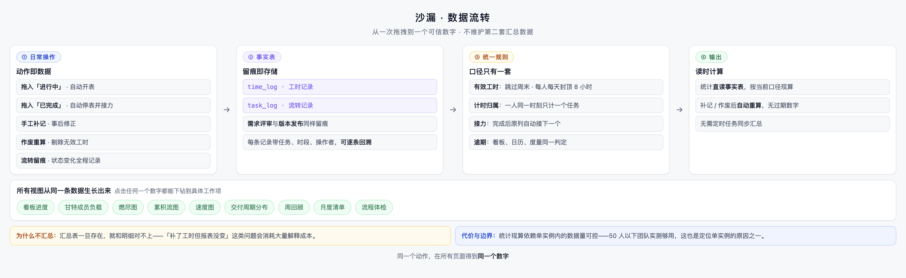
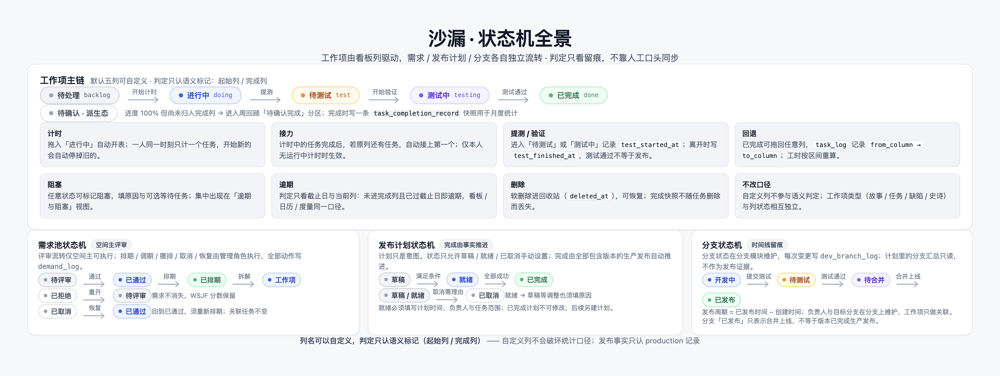
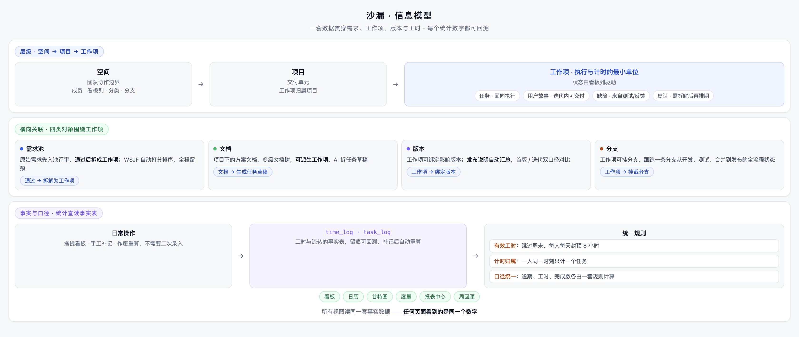

# 沙漏 · 常见问题

> 按场景分四类：口径与统计、日常使用、部署运维、选型对比。数字口径问题居多——沙漏所有页面共用一套规则，多数疑问都能用"同一套数据"解释。

---

## 一、口径与统计

### 为什么我的工时不是整整 8 小时？

**有效工时**有两条硬规则：跳过周末；**每人每天合计封顶 8 小时**，同一天多个任务共用这一额度（跨空间一起算）。计时器记录的是真实时段，落到"有效工时"时按这两条收敛。

### 我同时开了两个任务的计时，怎么算？

不会发生。计时是「人」的属性：**一人同一时刻只计一个任务**，开始新的会自动停掉旧的并明确提示。这是刻意设计，避免工时重复计算。

### 完成一个工作项后，为什么原列自动开始了下一个工作项？

「完成后接力」：计时中的工作项被完成后，若原列还有工作项，自动接上第一个；**仅在本人当前没有运行中计时时生效**。不需要手动掐表，也不多算一分钱工时。

### 报表里的数字和看板对不上？

不会——看板、日历、报表读的是**同一套事实数据**（`time_log` / `task_log`），逾期、工时、完成数各由一套统一规则计算：

如果觉得某个数字奇怪，点击它——**每个统计都能下钻到具体任务、时段和操作**。不存在第二套汇总数据，所以也不存在"汇总没更新"的问题。

### 补记 / 作废工时后，报表会变吗？

会，立即变。统计直读事实表，补记或作废后**按当前口径现算**，没有需要等待的汇总任务。这也是为什么历史回顾会随后续修正而更新——留痕保留的是操作记录，数字永远是当前口径。

### "待确认"是什么状态？我不是已经拖到「已完成」了吗？

「已完成」且**尚未归档**的工作项会出现在周回顾的「待确认完成」分区——它在提醒你"进度 100% 了，但还没正式归档"。归档时会落一条完成快照（`task_completion_record`），用于月度统计。状态机全景如下：

### 已完成的任务又拖回去了，工时会删除吗？

不会删除。`task_log` 记录列的往返（`from_column → to_column`），工时按区间重算。留痕的意义就在这：**操作历史不丢失，数字按最新口径呈现**。

### WSJF 分数为什么填不了？

设计如此：WSJF 得分由「业务价值 / 紧迫度 / 工作量」字段**自动推导，不可手填**——四项填齐才计分。避免"拍脑袋排序"又给排序找借口。

## 二、日常使用

### 我自定义了看板列，统计会不会乱？

不会。列名、颜色都可以改，但判定只认列的**语义标记**（起始列 / 完成列）——自定义中间列不会破坏任何统计口径。

### 需求评审拒绝了，这个需求就没了？

没有。被拒绝的需求保留在池中，**可重开后再次评审**；评审流转（通过 / 拒绝 / 排期 / 重开）全部留痕。拒绝不等于删除，是"现在不做"。

### 文档能不能直接变成任务？

可以：文档支持「拆成任务草稿」，也可用 AI 生成草稿；**AI 结果需人工确认后才落库**。

### 手机上能用吗？

可以。三档断点自适应，HTTPS 下 PWA 可「添加到主屏幕」像 App 一样使用；手机端另有团队视图，完成率与成员负载可按本周 / 本月 / 近 30 天切换，逾期与待处理始终是当前快照。

## 三、部署与运维

（详细步骤见仓库 `deploy/README.md` 与 [管理员指南](管理员指南.md)。）

### 为什么要自己部署，不能用 SaaS？

数据自有是沙漏的核心定位：整套系统部署在自己的服务器上，**数据不经过任何第三方云服务**。适合对数据敏感、或想把协作数据和其他系统放在一起的团队。

### 真的只需要一个 jar 和 MySQL？

是。没有 Redis、MQ、对象存储。成员关系和空间元数据放**进程内缓存**（TTL 失效）——这也是定位单实例的原因，不要直接做多副本横向扩展。

### 能从 Jira / 禅道迁移过来吗？

不提供迁移工具。内部备份按空间全量导出 / 导入，跨沙漏实例迁移很方便；从外部平台迁移是刻意的「明确不做」，避免做不可靠的半吊子映射。

## 四、选型对比

### 和纯任务看板（Trello 类）比，沙漏多了什么？

看板工具止步于"任务移动了"；沙漏多了三件事：**需求池与评审**（想法有来处和去处）、**移动即计时**（工时不需要二次录入）、**周回顾与月度清单**（自动从留痕生成）。信息模型上，需求、文档、任务、版本、工时共用一套数据：

### 和大型研发管理平台（Jira / 云效类）比，少了什么？

少了专职 PMO 才用得起来的复杂工作流、插件市场、多租户和横向扩展。**这不是能力差距，是范围取舍**：50 人以下团队要的是每个功能用得上、每个数字都解释得清。对照见 [项目介绍 · 边界与取舍](项目介绍.md)。

### 预测型的功能（估时预测、AI 评分）会有吗？

不会有。沙漏的度量只做**可回溯统计**——每个数字都能点开看到由哪些任务、哪段时间、哪次操作算出来。无法解释的模型输出与"口径可解释"的产品主张冲突。

---

更多文档：[产品说明](产品说明.md) · [快速上手](快速上手指南.md) · [用户使用手册](用户使用手册.md) · [管理员指南](管理员指南.md)
