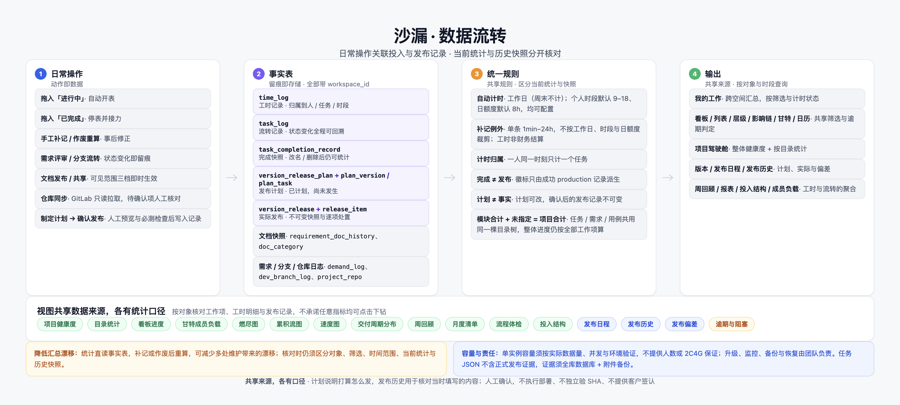
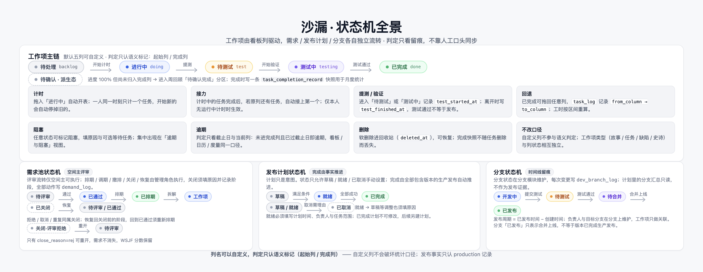
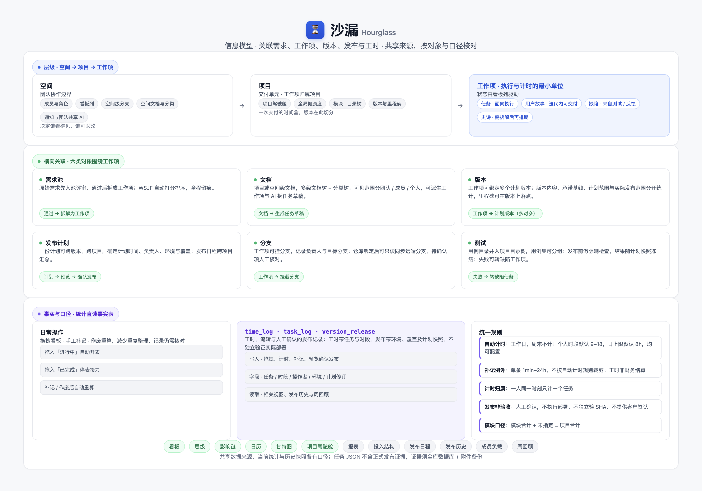

# 沙漏 · 常见问题

> 沙漏是面向中小研发团队的自托管轻量项目管理工具：**低成本上手，干活即记录，进度自动可见，从需求到发布全链路可追溯。**

> 按场景分四类：口径与统计、日常使用、部署运维、选型对比。数字口径问题居多——沙漏所有页面共用一套规则，多数疑问都能用"同一套数据"解释。

> 维护者：kongxiangjin · 邮箱 [1351882069@qq.com](mailto:1351882069@qq.com)

---

## 一、口径与统计

### 为什么我的工时不是整整 8 小时？

**自动计时**只计个人工作时段内的工作日，周末不计；工作时段默认 09:00–18:00，每日额度默认 8 小时，两者可在个人设置调整。额度跨任务、跨空间共享，并扣减当天已记工时；计时区间不等于实际专注工作时间。

**手工补记不同**：单条 1 分钟–24 小时，日期不晚于今天，不按周末 / 工作时段 / 每日额度裁剪；当天补记占用后续计时额度。不能把默认 8 小时理解为所有工时记录的硬上限。

### 工时能直接用来收费、结算或考核吗？

不能直接等同。工时记录供投入分析、复盘和对账参考，准确性依赖及时启停与校正。当前没有合同计费率、审核锁账、客户确认和非计费分类；自动接力后也要检查接上的是否当前工作。记录时长不等于产出价值，不宜单凭工时评价个人表现。

### 我同时开了两个任务的计时，怎么算？

不会发生。计时是「人」的属性：**一人同一时刻只计一个任务**，开始新的会自动停掉旧的并明确提示。这是刻意设计，避免工时重复计算。

### 完成一个工作项后，为什么原列自动开始了下一个工作项？

「完成后接力」：计时中的工作项被完成后，若原列还有工作项，自动接上第一个；**仅在本人当前没有运行中计时时生效**。减少手动启停，但应核对接上的任务；这里记录投入，不计算费用。

### 报表里的数字和看板对不上？

先核对空间、项目、成员、时间范围和指标定义，再区分**当前统计、完成快照和发布快照**。共用事实数据不意味着不同口径的页面应显示相同数字：

从对应工作项、工时记录或发布条目核对来源。统计直读事实数据减少汇总漂移，但不保证源记录天然准确；同口径仍异常时，应记录筛选条件和明细交由维护者排查。

### 补记 / 作废工时后，报表会变吗？

工时统计与历史回顾会按当前口径重算，没有需要等待的汇总任务；但**正式发布记录及发布说明显示 / 导出读取不可变快照**，不随改工时、改名、调期、需求取消或回滚漂移，不能用当前统计改写历史证据。

### "待确认"是什么状态？我不是已经拖到「已完成」了吗？

进度 100% 但尚未移入完成列的工作项属于「待确认完成」；移入 done 时记录完成快照（`task_completion_record`），用于月度统计。完成快照不是发布记录，done 也不会自动获得发布徽标。下图是当前工作项状态机及其与需求、发布计划、分支状态的对照：

### 已完成的任务又拖回去了，工时会删除吗？

不会删除工时；task_log 记录列的往返，统计按当前口径重算。发布事实不锁任务完成 / 回退 / 计时，无需先撤徽标（正式徽标只读）；成功事实冻结的是内容关联，不能借任务回退或删除破坏关联与历史。多版本 / 多事件不放大全局工时，当前统计不能改写发布快照。

### WSJF 分数为什么填不了？

设计如此：WSJF 得分由「业务价值 / 紧迫度 / 风险缓解 / 工作量」字段**自动推导，不可手填**——四项填齐才计分。避免"拍脑袋排序"又给排序找借口。

## 二、日常使用

### 刚加入空间，为什么项目列表是空的？

新加入的「成员」**默认不参与任何项目**，只能看到被分配为「可参与」「可测试」或「只读」的项目；未分配的项目在项目、工作项、看板、报表里都不出现。请联系空间主或管理员：可在「设置 → 成员与角色」点你所在行的「分配项目」，或在「项目可见范围」矩阵里勾选。邀请链接页面会显示邀请时已预分配的项目数，加入后即生效；也可能在建项目时就被创建者选为初始成员（可参与 / 只读），无需再分配。「可测试」需加入后通过「分配项目」设置。

几种不需要分配的情况：空间主 / 管理员天然看到全部项目；查看者全局只读；**早期加入的成员**沿用「默认全部可参与」，只有被单独设为「不可见」的项目才看不到。成员改成管理员再改回成员时，沿用此前分配的项目权限，不会因此扩大或清空。

### 项目集、项目、分类是什么关系？项目集能看到所有项目吗？

项目集是空间级的**可选归组**，层级是「空间 → 项目集 → 项目 → 分类」。它只做分组与项目级只读汇总：不授予权限，集内项目仍按各自成员可见；没有可见项目的项目集不会出现在普通成员列表里；项目也可以不归集，显示在「未分组」。新建、改名、排序与删除项目集仅空间主或管理员可操作，删除只解除归组，不删项目、工作项与历史。分类仍是项目内的目录树：项目写成员可新增、改名与排序，删除仅空间主、管理员或项目负责人可操作。

### 项目列表里的「公共容器」是什么？

升级到项目集模型时，原项目会拆成多个子项目，原项目保留为**公共容器**，承接没挂到子项目的工作项、需求、用例、文档、仓库与分支；版本与发布记录归新子项目。它仍是普通项目，标签只说明来源，不表示特殊权限或状态。

### 我自定义了看板列，统计会不会乱？

不会。列名、颜色都可以改，但判定只认列的**语义标记**（起始列 / 完成列）——自定义中间列不会破坏任何统计口径。

### 工作项不做了怎么办？

用「取消」，不用删除：任意非终态列的工作项都可取消，须选原因（不做 / 重复 / 延期 / 设计如此）并填说明，进入系统终态「已取消」；归档页可检索、可逐条恢复，恢复回到取消前所在列。已取消不计逾期，也退出完成率分母；「已完成」须先重开才能取消。**取消与删除不同**：删除是进回收站的软删除，保留 30 天后可彻底删除；取消是可统计的终态归档，不消失。

### 需求评审拒绝了，这个需求就没了？

没有。被拒绝的需求保留在池中，**可重开后再次评审**；评审流转（通过 / 拒绝 / 排期 / 重开）全部留痕。拒绝不等于删除，是"现在不做"。

### 需求目标可空吗？调期会自动改旧任务吗？

排期可暂不指定目标版本；选定目标时须同项目且未发布；计划起止独立于期望日期。调期（含清空目标） / 撤排 / 取消 / 恢复须原因与 revision，不改旧任务；取消保留原目标与日期、不取消任务，恢复到 pass 并清目标与计划起止。仅 Task 与版本为 M:N，使用 versionIds/versionNames 数组，保存省略 / null 保留、[] 解绑，显式改变关联须原因与权限；Demand / TestPlan 仍是单目标 versionId，不根据需求目标隐式改绑任务。

### 删除版本会自动解除任务绑定吗？

不会。已发布或有实际尝试（包括失败）、仍有任务绑定（含回收站）或需求目标引用（含已取消）的版本受保护。无证据版本先按权限有因调整引用，回收站任务先恢复、已取消需求有因恢复以清目标；无引用后才可删除并清理计划。成功事实冻结的关联不能更改，也没有人工撤标解锁删除的路径；历史证据始终保留。

### 发布计划在哪里看？为什么线上找不到入口？

入口在菜单「版本」页（默认按版本）：每张版本卡片上的「计划与历史」打开发布工作区的计划范围，「记录实际发布」直达实际发布；工作区按「计划范围 / 实际发布 / 历史与内容」三步组织，历史与内容合并了发布记录、操作记录与版本内容。工具栏「操作 → 发布计划与记录」在单版本时直接打开，多版本时先让你选择版本，不再静默挑一个。计划范围页的版本选择器按项目分组，当前版本固定勾选，可再加入其他版本 / 项目，任务池自动取所选版本并集；实际记录仍只属当前版本。页面看起来没更新时先强制刷新（Cmd/Ctrl+Shift+R）让 PWA 换取新版本，必要时关闭标签页重开。查看只需项目可见；维护计划与确认结果默认限空间主、管理员或项目负责人（且对该项目可写），空间可在「设置 → 工作流 → 发布权限」勾选「项目可写成员」放开给所有项目可写成员，查看者始终不能操作。

### 发布计划列表在哪？和版本、发布记录是什么关系？

侧边栏「版本 → 发布计划」打开发布计划列表：跨项目列出全部可见计划，可按范围（全部项目 / 项目集 / 单项目）、状态、环境、时间窗（未来 30 天 / 近 30 天 / 前后 3 个月 / 全部时间）与搜索筛选。每行显示覆盖版本、环境、计划窗口、就绪检查（取覆盖版本里最差的结论：N 项未通过 / N 项提醒 / 通过）、执行人与状态，行内可直接打开工作台、记录发布或生成交付报告。版本页「范围 → 发布计划」和版本卡底部的「查看全部发布计划」跳到同一列表，时间窗预选前后 3 个月。计划存的是「打算何时、发哪些版本」，不等于实际发布：实际结果以对应版本的发布记录为准。已发布、已关闭、已取消的版本不能再加入新计划；已加入计划的版本可移除，但移除后不能再加回来。归档项目不进入列表；普通成员只看到自己可见项目下的计划。

### done、生产发布徽标与实际事件有什么区别？

done 是工作完成状态，徽标优先由成功 production 记录只读投影（publishSource=record），展示 publishedAt/publishedReleaseId/everPublished/publicationState/publicationTargets；状态 unpublished/effective/partial/rolled_back/unknown。test/staging 或失败不代表生产已发布。只有从其他系统迁移、没有发布记录的历史工作项，才允许空间主、管理员或项目负责人人工补录「已发布（人工）」，须填生效日期与原因；人工标记只用于徽标与「发布态」筛选，不写版本发布记录、不改 publicationState，也不参与需求交付阶段派生、交付报告与版本统计，撤销后保留历史并回落为未发布。发布计划可跨版本 / 跨项目；一个版本生产只成功部署一次，改动走新 hotfix 版本，同一制品可 redeploy / rollback，替换制品须新建版本。版本内容 / plannedTaskIds / actualTaskIds 三范围分开，实际范围只属当前版本；计划须全部包含版本都完成成功生产部署 / 重部署才完成，test/staging、rollback 与部分成功不算。完成计划不可改，后续新计划或有未按计划发布的原因的紧急无计划事实。实际 context 明确带 UTC offset 的 occurredAt（不同于 recordedAt）、环境 / targetKeys / coverage、制品及 64hex SHA256（选填）、操作 / 关联事件 / 执行人和唯一 ≤500 项实际任务数组。预览显示 not_selected、候选与警告，不静默排除事实，未完成事实需发布维护权限及 deviationReason。rollback 新增事件并按目标撤销关联引用，保留 ever 历史及后续不同成功，不解锁内容关联。

### 谁能排期或发布？同名负责人算有权吗？

不算，身份只认账号 ID。发布管理、计划维护、预览与确认按空间配置判定（设置 → 工作流 → 发布权限）：默认空间主、管理员、项目负责人，可加选项目可写成员，提交时重新检查；任务负责人无整版本权，计划负责人元数据不赋权，releasedBy 为服务器当前登录者，executorUserId 不能冒充。任务显式改变版本关联仍限管理者或该任务负责人且可写，不能绕过冻结；正式徽标只读，历史迁移人工标记由同页「人工标记工作项发布」单独配置（默认同前，可加选项目可写成员）；需求评审通过 / 拒绝 / 重开需要项目写权限，未指派时可被项目可写成员认领。viewer/read/none 无权。

确认带 result/notes/failureReason/scopeToken/planRevision/idempotencyKey；响应未知时 sessionStorage 保留同 body/key，先 GET release-records?key=... 再重复原请求，确定结果后决定新键，不刷新清理或盲换键。任务 release-records 查所有可见事件，不只看最新成功。

### V1.0 已发布，还能往里加任务吗？首版统计就是发布证据吗？

成功事实后版本内容关联冻结，新增内容另建版本；同一计划可跨版本 / 跨项目，版本生产只成功部署一次，改动走新 hotfix 版本，同一制品可 redeploy / rollback，不能回改完成计划或旧内容。首版折算只用于统计，不创建绑定、徽标或实际证据；缺正式记录须明确未知，不补造历史。本次不新增迭代模块、不做历史迁移。需求取消保留实际快照，零关联任务不能 100% 验收。

### 文档能不能直接变成任务？

可以：文档支持「拆成任务草稿」，也可用 AI 生成草稿；**AI 结果需人工确认后才落库**。

### AI 助手的对话存在哪里？关掉页面会丢吗？

会话只保存在当前浏览器（按账号与空间隔离，最多最近 10 段），不上传到服务器；换设备或清除浏览器数据后看不到旧会话，点「清空本机会话」即可删除本机记录。再次打开助手可继续上一次的对话，发给模型的历史只有你的提问和 AI 归纳，查询类回答不进入后续历史。发布摘要等 AI 草稿同样不落库，改完复制走即可。

### 测试同事只做测试，怎么授权？

在项目授权里给「可测试」，而不是「可参与」：他能查看该项目，维护用例与测试计划、记录执行结果、推进「待测试 / 测试中」的工作项，但不能改工作项正文、分类或项目资料。测试计划的执行人必须对计划所属项目有「可参与」或「可测试」权限，否则保存时会被拒绝。

### 测试计划指派后在哪里执行？

计划保存或改派执行人后，计划会进入对方的「我的工作 → 待我执行的测试计划」，并发一条「测试计划指派」通知；执行人打开计划即可圈选用例、批量记录结果。未指派或执行人未变化不会重复打扰，改派时只通知新执行人。

### 发布准备提醒会改工作项状态或阻断发布吗？

不会。发布准备只做发布前提醒与核对：负责人可逐项确认或标记风险，可向全部项目成员 / 仅负责人 / 指定成员推送站内、邮件或企业微信群提醒并收集回执；T-7 / T-3 / T-1 提醒未确认负责人，T-0 提醒计划负责人与关注者。推送、回执与确认都不改变工作项状态，也不参与发布检查或阻断发布。发送提醒要求空间主、管理员或计划涉及项目的负责人都可管理；企业微信群只发到空间配置的群，不能按人送达。

### 手机上能用吗？

可以。三档断点自适应，HTTPS 下 PWA 可「添加到主屏幕」像 App 一样使用；「我的工作」在手机端为底部 tab，空间主与管理员另有「团队」页签，可按本周 / 本月 / 近 30 天切换；逾期与待处理始终是当前快照。

## 三、部署与运维

完整基线脚本会重建表，不是幂等无损升级脚本，不得在已有库重跑；正常部署脚本只支持新空库；软件-only 回退不足，须匹配 SQL 恢复并单独授权。正式证据备份包含 `version_release_plan`、`version_release_plan_version`、`version_release_plan_task`、`version_release`、`version_release_item`、`version_log` 六表，不能漏计划任务范围。

（详细步骤见仓库 `deploy/README.md` 与 [管理员指南](管理员指南.md)。）

### Qoder 或其他外部工具能直接查沙漏的数据吗？

能查、不能改。管理员或成员先创建**只读个人访问令牌**（`POST /api/auth/tokens`，需当前密码），再用仓库里的只读 MCP 侧车（`tools/mcp/hourglass-mcp`）把它接到 Qoder；侧车默认只监听本机 8788，对外暴露必须设置侧车密钥。工具覆盖空间、项目、工作项、需求、文档、用例、版本、我的工作与搜索，权限仍按令牌所属账号复核；撤销令牌或改密码后立即失效。建任务、写文档等写接口尚未开放。

### 为什么要自己部署，不能用 SaaS？

核心数据由团队在自己的服务器保管，适合有自托管需求的研发交付团队。但启用外部 AI、邮件或机器人会向所配置服务发送相应内容，需配置出站、脱敏与访问策略。内网部署不是合规认证，仍需有人负责备份、恢复、安全与升级。

### 真的只需要一个 jar 和 MySQL？

后端是 jar + MySQL，前端仍需要 Nginx 或等价静态服务及反向代理。没有 Redis、MQ、对象存储。成员关系和空间元数据放**进程内缓存**（TTL 失效）——这也是定位单实例的原因，不要直接做多副本横向扩展。

### 能从 Jira / 禅道迁移过来吗？

可以导入基础数据，但不做整包工程迁移。工作项、需求、测试用例、工时四类对象支持 Excel / CSV 迁移导入（「设置 → 数据与审计 → 迁移导入」），流程是模板下载 → 字段映射 → 预检 → 写入 → 失败行回执；单次最多 1000 行、8MB，逐行校验，单行失败不影响其余行。字段按表头别名识别（中英文均可），负责人、评审人、状态列按名称匹配当前空间的成员与看板列。

导入只**新建记录**：不按原编号覆盖已有数据，不搬运评论、附件与发布证据，也不迁移原平台的工作流、字段配置等工程元数据。已有发布计划或发布尝试的空间不能覆盖导入 / 清空 / 删除；正式发布证据迁移仍用数据库备份，JSON 按空间导出的是任务备份，不是正式发布凭证。旧平台如需增量同步，仍要按接口自行对接或手工重建。

### JSON 备份能保留需求排期、恢复发布历史吗？

### JSON 备份能保留需求排期、恢复发布历史吗？

需求池 `plannedStart` / `plannedEnd` 以可空的 `yyyy-MM-dd` 字符串导出；旧备份缺字段 / null / 空白为空，单边日期也合法，不从任务或版本日期补推。导入保留 canceled；原始无目标的 plan 保留 plan 状态与计划起止；原始显式非空目标 ID 重映射后须有效且同项目，目标丢失 / 映射无效时置空，仅此类 plan 按原规则回 pass 并清计划起止，不把已取消需求自动恢复，也不重排任务。非法计划日期或开始晚于结束会在任何覆盖删除前返回 400，原数据不被删除，即使目标无效也不能跳过日期校验。

JSON 只搬运工作数据：任务 versionIds 数组、version.startDate、需求日期与 canceled；不转移正式发布证据，不能恢复或覆盖已有成功发布及其他计划 / 历史证据。空间只要存在发布计划（含空草稿）、任何发布尝试（含失败）、条目、版本日志或已发布任务，就拒绝覆盖导入 / 清空 / 删除；请导入新空间，正式证据用 MySQL 备份恢复。发布记录页可以导出不可变条目快照 CSV，历史日志可查询，但不提供发布历史 JSON 导出。

## 四、选型对比

### 和纯任务看板（Trello 类）比，沙漏多了什么？

相比只维护任务状态的用法，沙漏把**需求评审、操作计时、实际发布与周回顾**相连。不同看板产品也有扩展能力，应按实际版本比较，而不是认定同类工具都止步于拖拽。计时与回顾减少重复整理，不免除记录校正：

### 和大型研发管理平台（Jira / 云效类）比，少了什么？

当前不提供完整工作流引擎、插件市场、多租户与横向扩展；外部数据只支持 Excel / CSV 新建导入，缺增量更新、评论与附件迁移，也没有 SSO、写接口和 CI/CD 流水线联动（已支持 GitLab 仓库分支只读同步，但不会触发或读取流水线；只读个人访问令牌已提供，见接口契约）。前者是当前范围取舍，后者是采用缺口，不都包装成“刻意克制”。大型平台也可服务中小团队，应按流程、身份、集成与运维约束选择。对照见 [项目介绍 · 边界与取舍](项目介绍.md)。

### 发布快照就是客户验收、SHA256就是防篡改吗？

不是。系统由有权限的人确认记录实际发布，保留当次范围、时间、目标、制品引用和哈希，不执行部署、不自动验证流水线，也没有客户验收签名或独立可信时间戳。应用层只读快照不能阻止数据库管理员直接改数据库，不能包装为外部防篡改证明。

### 系统审计、企业微信免登、对外 API 已有吗？

已有系统审计最小集、管理员查询与 CSV 导出，默认保留 90 天、可配置；不代表满足全部合规审计。企业微信免登已按「一个空间可启用多家企业」实现：成员显式绑定后可在企微内免密进入，企业与空间由管理员登记和启用；机器人 Webhook 通知仍不等于免登。对外只读 API 已有个人访问令牌（`hg_...`），写接口与外部管理接口尚未开放。

### 预测型的功能（估时预测、AI 评分）会有吗？

当前不以不可解释的模型评分替代项目事实。度量优先提供可核对的记录与统计口径，但并非每个汇总数字都已有点击下钻入口；比较数据时仍需核对任务、时间窗口和筛选条件。AI 建议属于辅助判断，不作为绩效或结算依据。

---

## 五、联系与支持

文档与功能相关问题可先在本页检索；仍未解决时，请联系维护者 kongxiangjin：

- 维护者：kongxiangjin
- 邮箱：[1351882069@qq.com](mailto:1351882069@qq.com)
- GitHub：[@kong0827](https://github.com/kong0827)
- 项目仓库：[kong0827/hourglass](https://github.com/kong0827/hourglass)
- 问题反馈与建议：[GitHub Issues](https://github.com/kong0827/hourglass/issues)

---

更多文档：[产品说明](产品说明.md) · [快速上手](快速上手指南.md) · [用户使用手册](用户使用手册.md) · [管理员指南](管理员指南.md)
