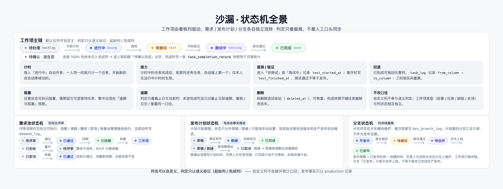
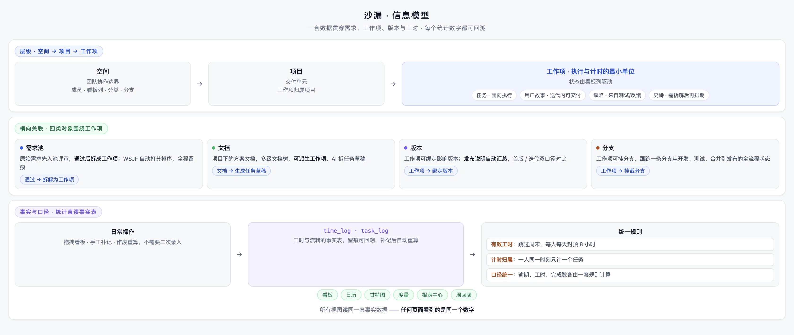

# 沙漏 · 快速上手指南

> 目标读者：第一次接触沙漏的团队。照着做，**30 分钟内跑通从想法到周回顾的完整链路**。
> 已部署好？直接从第 1 步开始。还没部署？先看 [管理员指南](管理员指南.md)。

---

## 上手总览

你要做的事，就是下图这条线：

第一次使用只需要走六步：**建空间 → 建项目 → 提想法 → 拆工作项 → 看板推进 → 周回顾**。计时、工时、报表会在你推进的过程中自动产生。

---

## 第 1 步 · 创建空间（2 分钟）

1. 登录后创建**空间**——空间是团队协作的边界，成员、看板列、模块、分支等配置都在空间层维护。
2. 邀请成员并分配角色：**空间主 / 管理员 / 成员 / 查看者**。日常干活给「成员」，只看不改的干系人给「查看者」。

> 首次登录且未带页面链接时，成员落「我的工作」，空间主 / 管理员落「全局健康度」，查看者落「项目」；之后刷新或分享链接会保留当前页面。

## 第 2 步 · 建第一个项目（3 分钟）

1. 在「规划 > 项目」里点「新建项目」，填名称、描述，状态选「进行中」。
2. 项目是交付单元，后面的工作项都归属项目。

## 第 3 步 · 需求池提想法（5 分钟）

1. 进「需求池」，把团队要做的想法提交为需求。先别纠结怎么排——**先提出来，评审再定**。
2. 填写「业务价值、紧迫度、工作量」，WSJF 自动打分排序，四项填齐才计分。
3. 评审（仅空间主可执行）：通过 → 排期；拒绝 → 可重开后再次评审，全程留痕。

工作项有自己的状态机（由看板列驱动），需求池则是评审状态机——两者对照如下：

## 第 4 步 · 拆成工作项（10 分钟）

1. 已通过 / 已排期的需求，在详情中点「**拆分为任务**」——生成的工作项自动关联该需求。
2. 类型按粒度选：**任务**（1–2 天的具体工作）、**用户故事**（迭代内可交付）、**缺陷**（问题反馈）、**史诗**（需要拆解的大需求）。
3. 给每个工作项填：负责人、优先级、开始日 / 截止日、预估耗时（可选）。
4. 有方案要沉淀的，写到「文档」里——支持把文档拆成任务草稿。

## 第 5 步 · 看板推进（10 分钟）

这是日常最常用的动作：

1. **拖入「进行中」→ 自动开表计时**。开始下一个任务会自动停掉上一个——你不需要手动掐表。
2. **拖入「已完成」→ 自动停表**，并接力原列的下一个任务；忘计时可以手工补记，记错了可以作废重算。
3. 筛选条件在看板、列表、日历、甘特之间**共享**；甘特图上能看到依赖、里程碑、关键路径和成员负载。

> **为什么是拖拽驱动计时，而不是填工时表？** 因为工时从你的日常操作里自然产生——月底不用回忆"这周干了啥"，时间记录一直在。详见 [数据流转图](diagrams/data-flow.png)。

## 第一次周回顾（第 6 步 · 收尾）

到周五，打开「我的 > 周回顾」：

- 自动总结一周的**已完成、待确认、进行中**三个分区，互斥不重复；
- 可选 AI 生成周报草稿（结果需人工确认才落库）；
- 月度清单从完成快照自动生成，不需要任何人维护。

所有这些数字都来自你这周的拖拽和计时——**同一套数据，所有页面同一个数字**：

---

## 接下来

- 想看每个功能的完整说明 → [用户使用手册](用户使用手册.md)
- 口径有疑问（比如"为什么我的工时不是 9 小时"）→ [常见问题](常见问题.md)
- 管理员要配通知、AI、备份 → [管理员指南](管理员指南.md)
