# 沙漏 用户使用手册

> 适用版本：沙漏 1.0.0  
> 阅读对象：最终用户（项目经理、开发、测试、管理者等）  
> 更新日期：2026-11-13  
> 文档维护：kongxiangjin（[1351882069@qq.com](mailto:1351882069@qq.com) · [@kong0827](https://github.com/kong0827)）

---

## 0. 产品定位与命名由来

### 0.1 面向中小团队的轻量项目管理工具

沙漏是面向中小研发团队的自托管轻量项目管理工具。它不追求成为功能无所不包的平台，而是把需求、文档、工作项、测试、工时、版本与发布记录连接起来：**低成本上手，干活即记录，进度自动可见，从需求到发布全链路可追溯。**

这条记录链也可以理解为团队的「项目记忆」：计划、完成与实际发布分别留痕，同类需求再次出现时能查到上次怎么估、哪里返工、为什么改。它不是财务账本或客户验收系统。自动计时减少重复录入，仍需修正；实际发布由授权人员确认，不代替部署执行、独立流水线验证或客户签收。先判断团队是否需要这条记录链与自托管，再判断功能是否适合，不仅按人数或行业选工具。

### 0.2 小而美，美而精

- **小**，是范围克制。围绕真实工作保留必要能力，不堆砌复杂层级、无关字段和繁重配置，也不因为其他产品具备某项功能就盲目加入。
- **美**，是清晰顺手。页面突出重点，常用操作直接可见，信息容易理解；团队不需要先学习一套复杂方法，才能开始管理日常协作。
- **精**，是细节可靠。同一指标在各页面保持同一口径，操作结果有明确反馈，异常状态有清楚说明，常用流程在反复使用后依然稳定、顺畅。

### 0.3 为什么叫「沙漏」

**沙漏是产品名，也是对时间与交付关系的提醒：计划只有持续流转，才会沉淀为成果。**

- **上半部**象征计划、待办与需求池——尚未落地的任务；
- **下半部**象征交付、完成与价值沉淀——已经产出的成果；
- **中间细腰**象征关键路径与瓶颈，提醒团队关注流转效率，而不只是增加并行工作；
- **沙粒流动**象征真实的时间投入，以及从计划到交付的持续转化。

这个名字与沙漏的计时、甘特排期、交付节奏和周回顾能力相呼应，也表达了产品的态度：尊重每一份时间投入，让团队看见工作如何一步步变成结果。

---

## 1. 产品简介

沙漏是面向中小研发团队的自托管轻量项目管理工具。它以「工作项」为执行主线，连接需求提出、评审排期、文档沉淀、任务执行与版本发布记录，让项目进展与投入有可查询的来源。工作完成、记录实际发布和客户验收是不同环节。

第一次使用时，建议先阅读本章与第 2 章完成基本设置，再按需要查阅工作项、执行视图、需求池、文档、测试、版本和报表等章节；想先建立整体概念，可先读 1.3「对象模型」；遇到统计疑问时，可直接查看第 18 章「统一口径解释」。

### 1.1 核心能力

- **执行与记录相连**：移动任务可以驱动计时，计时沉淀为周回顾与月度清单，减少重复整理。
- **指标来源可解释**：关键指标复用工时与流转等记录；比较时需对齐筛选、日期及当前指标 / 历史快照，不是所有页面必须显示同一个数字。
- **全局进展可查询**：项目健康度、成员负载、逾期与阻塞、报表基于协作记录生成，仍需及时纠正漏记、误计和状态偏差。
- **核心数据自行托管**：后端 jar + MySQL，前端由 Nginx 托管，不依赖 Redis / MQ；启用外部 AI、邮件或机器人时可能发送业务内容，自托管不等于免维护、绝不出站或自动合规。

### 1.2 数据层级

```
空间（Workspace）
 └─ 项目集（Project Set）：可选归组，只读汇总，不授权
     └─ 项目（Project）
         └─ 工作项（Item）：任务 / 用户故事 / 缺陷 / 史诗
```

- **空间**：团队协作边界。成员、看板列、标签、分支等公共配置在空间层维护。
- **项目集**：空间级的可选归组，用于把同一业务方向的项目放在一起查看。它只做分组与项目级只读汇总，不改变项目权限；项目可以暂不归集，显示在「未分组」。
- **项目**：交付单元，工作项、需求目标版本与计划交付版本归属项目；版本不能跨项目绑定。
- **工作项**：执行与计时的最小单位，状态由看板列驱动。

| 工作项类型 | 说明 |
| --- | --- |
| 任务 | 具体工作单元，通常由需求或故事拆解而来，粒度约 1–2 天，面向执行。 |
| 用户故事 | 从用户视角描述的功能需求（"作为谁，我希望什么，以便什么"），一个交付批次（版本）内可交付。 |
| 缺陷 | 已交付功能与预期行为不符的问题，来自测试或使用反馈。 |
| 史诗 | 大粒度需求集合，一个交付批次做不完；任务、故事、缺陷都可挂到某个史诗下。 |

> 工作项类型与史诗字段旁有「!」图标，点击可查看类型说明。

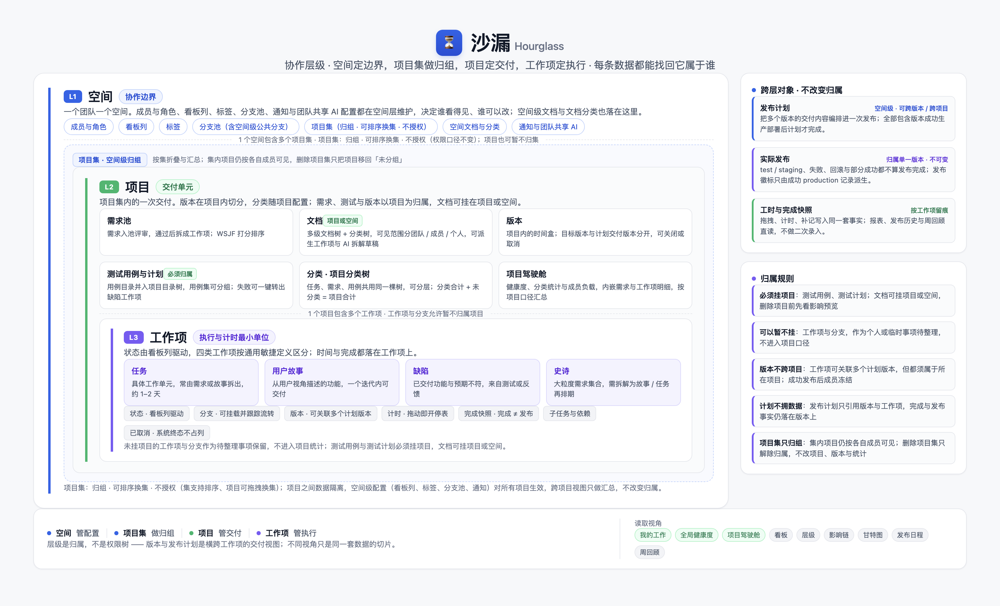

### 1.3 对象模型：对象、层级与常见工具对照

这一节回答三个问题：每个对象是什么、它们怎么连、和常见项目管理工具怎么对应。读完可以判断一件事该建成项目、分类、史诗还是任务，也能避免把不同产品里的同名概念直接套用。

#### 1.3.1 全景：组织线、交付线、聚合线

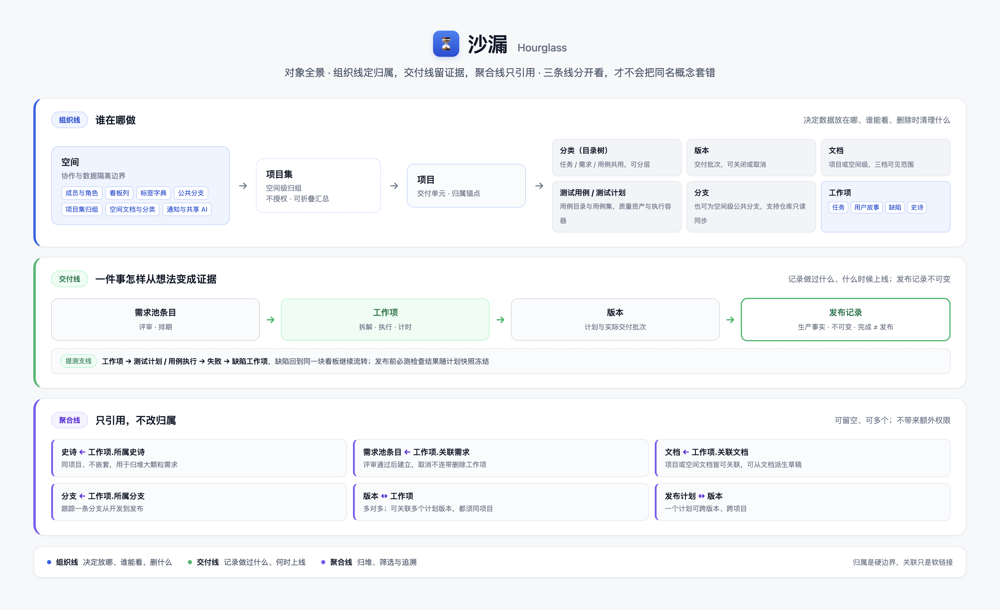

三条线要分开看：

- **组织线**决定数据放在哪、谁能看、删除时清理什么。
- **交付线**记录“做过什么、什么时候上线”，发布记录是不可变证据。
- **聚合线**用于归堆、筛选和追溯，可以留空、可以多个，**不会因为关联就获得额外权限，也不会改变对象的归属**。

#### 1.3.2 对象速查

| 对象 | 一句话定义 | 上级 / 归属 | 归属是否必填 |
| --- | --- | --- | --- |
| 空间 | 团队协作与数据隔离的边界 | 无 | — |
| 项目集 | 空间级的可选归组，只做分组与只读汇总 | 空间 | 不必填（项目可未分组） |
| 项目 | 一个可交付的工程或产品单元 | 空间（可归入项目集） | 必填 |
| 分类 | 项目内可分层的业务目录树 | 项目 | 分类必挂项目；工作项可“未分类” |
| 标签 | 跨项目的自由标记 | 空间级标签字典 | 不必填 |
| 工作项 | 执行与计时的最小单位 | 项目 | 可空（允许待整理事项） |
| 需求池条目 | 等待评审、排期的原始需求 | 项目 | 必填 |
| 需求文档 | 可分层组织的方案文档节点，可挂项目或空间 | 项目或空间 | 项目级必填项目；空间文档可不挂项目 |
| 版本 | 一个计划或已执行的交付批次 | 项目 | 必填 |
| 发布计划 / 发布记录 | 跨版本的发布范围与不可变事实 | 版本（计划可跨项目） | 记录必挂版本；计划至少覆盖一个版本 |
| 里程碑 | 项目级的一条达成条件（版本发布 / 工作项完成 / 人工确认） | 项目 | 必填 |
| 分支 | 一条 Git 分支的交付生命周期 | 空间或项目 | 可空 |
| 测试用例 / 测试计划 | 质量验证资产与批量执行容器 | 项目 | 必填 |
| 完成记录 / 工时 | 完成瞬间快照与实际投入 | 工作项 | 随工作项 |

#### 1.3.3 逐个说明

本节只说明沙漏自身的定义；与 Jira、禅道等工具的逐项对照见 1.3.5。

**空间（Workspace）**

空间是数据隔离单元，也是成员、看板列、标签字典、公共分支与通知的维护边界。一个账号可以同时属于多个空间，不同空间的数据互不可见。

- **个人空间**：首次登录自动生成，适合个人待办。
- **共享空间**：由管理员创建并邀请成员；可以有**多位空间主**且权限完全等权，但任何时刻至少保留一位。
- **四档角色**：空间主（Owner）、管理员（Admin）、成员（Member）、查看者（Viewer）；查看者全局只读。
- 项目级再按“成员 × 项目”设四档：可参与、可测试、只读、不可见。**空间角色不自动等于项目权限**。

**项目集（Project Set）**

项目集是**空间级**的可选归组（如「流程引擎」「结算平台」），用于把同一业务方向的项目放在一起查看，不参与权限判定。

- 项目可以归入一个项目集，也可以不归集；未归集项目在项目列表的「未分组」下平铺。
- 项目集只做分组与项目级只读汇总（项目数、任务完成情况、进度），不生成版本、发布计划或发布记录，也不把集内数据合并成一个可操作的实体；集内项目仍按各自成员可见。
- 新建、改名、排序与删除项目集仅空间主或管理员可操作；删除只解除归组，项目、工作项、需求与权限都不受影响。
- 项目集名称只对能看见其下至少一个项目的成员显示；没有可见项目的项目集不会出现在普通成员的列表里。
- 项目集自身可填说明、负责人、计划起止与标识色，状态为「进行中 / 已交付 / 已搁置」；负责人只用于展示，不据此获得维护权，集状态也不等于集内项目的状态。
- 表头的项目数、工作项数、完成数、工时与进度按当前查看者可见的项目实时计算，不把集内数据合并成一个可操作对象。

**项目（Project）**

项目是交付单元：工作项、分类、版本、需求文档、测试用例与测试计划都围绕项目组织；文档也可以放在空间级「空间文档」下，不挂具体项目。项目有状态（进行中 / 已暂停 / 已完成）、负责人、计划起止日、首版上线日，可归档、可手动排序。

- **公共容器**：从旧版本升级到项目集模型时，原项目会拆成多个子项目，原项目保留为公共容器，承接未挂到子项目的工作项、需求、用例、文档、仓库与分支；版本与发布记录归新子项目。公共容器仍是普通项目，项目列表里带「公共容器」标签，可正常使用，不承担特殊权限。

> 命名提醒：早期代码与接口用 `requirement` 表示“项目”，`/api/reqs` 也是项目接口；需求池条目才用 `demand`。看到“需求”字样时，先分清是项目、需求池条目，还是需求文档。

**分类（Category）**

分类是**项目级**的目录树（如前端、后端、测试、设计，或期货业务里的套保申请、额度管控等业务分区）：可以分层，节点必挂项目，不是项目之上的对象。工作项、需求池条目与测试用例共用这一棵树，一条记录只挂一个节点；文档另有独立的文档分类树。

- 一个工作项最多一个分类，一个需求池条目、一条测试用例也最多挂一个目录节点。
- 工作项可以没有分类，显示为“未分类”；驾驶舱按分类统计时，“未分类”单独成组，且不能作为筛选项。
- 新建、改名、换上级、同级排序与删除都在项目驾驶舱的「分类」面板维护，也可在用例页筛选条的「目录」弹层里操作；层级不限，只禁止成环，同级重名会被拒绝。
- 删除目录要求其下没有子目录、没有被动态分组规则引用；仍有工作项 / 需求 / 用例时必须选择迁移目标，缺省迁到项目内其他节点。
- 维护权限：项目写成员可新增、改名、换上级与同级排序；删除仅空间主、空间管理员或该项目负责人可操作。查看者只读。
- 用例的「目录」就是这棵树，不是另一套字典：在任一处改名或调层级，工作项、需求与用例看到的是同一结构。

**工作项（Item）**

工作项是执行与计时的最小单位，任务、用户故事、缺陷、史诗四类共用同一套载体和看板。

- **状态由看板列驱动**：内置待处理、进行中、待测试、测试中、已完成五列，可自定义列与流转规则。另有系统保留终态「已取消」：不占看板列，也不进列配置与流转矩阵（见 5.11）。
- 常用字段：类型、标题、描述、优先级（P0–P3）、负责人、起止日期、预估工时、进度、分类、标签、阻塞、循环规则。里程碑不是工作项字段，见项目级里程碑。
- **“子任务”是检查清单**：勾选即完成，不单独进看板、不单独计时，也不是独立工作项。
- 工作项可以暂不归属项目（作为待整理的个人或临时事项）；但一旦不挂项目，分类恒为“未分类”，也不能绑定项目版本。
- 删除进入回收站保留 30 天；完成时会留下完成记录快照，实际投入由计时和工时日志累计。

**四种类型的边界**

| 类型 | 什么时候用 | 不要用来做什么 |
| --- | --- | --- |
| 任务 | 1–2 天能做完的具体动作，面向执行 | 不要拿它做需求收集和评审 |
| 用户故事 | 从用户视角描述、一个交付批次内可交付的一条功能 | 系统不强制“作为谁、我希望、以便”模板，它只是一个类型标记 |
| 缺陷 | 已交付功能与预期不符，需要修复与回归 | 不要用它记录新功能；缺陷有严重度、发现环境、复现步骤、发现版本等专属字段 |
| 史诗 | 聚合一个跨多个交付批次的大主题，便于看整体进度 | 不要把它当成项目之上的一层；它本身仍是工作项 |

需要特别注意的两条层级事实：

1. **没有强制的“史诗 → 用户故事 → 任务”三层**。故事、任务、缺陷是平级类型，都可以直接挂到同一个史诗下，也都可以不挂；系统不会因为建了故事就要求再拆任务。
2. **史诗不能嵌套**：史诗不能再挂到另一个史诗下，必须与子工作项属于同一项目，并且不能形成循环归属。把史诗改成其他类型时，其下子项的史诗关联会自动解除。

**需求池（Demand pool）**

需求池条目是**评审与排期对象**，不是工作项：它不能进看板、不能计时、不能提测。它回答“做不做、为什么做、什么时候做”，通过后再拆成工作项执行。

- 必须挂在某个项目下；需求池按项目归属和统计。
- 主状态独立于工作项：待评审 → 已通过 → 已排期 → 已完成；完成由工作项与用例证据自动判定，评审不通过、中途取消与重复需求统一进入已关闭，并保留关闭原因和关闭前阶段。评审流转需要项目写权限，排期、关闭与恢复由管理者执行，全部留痕。
- 已排期与已完成需求另有只读派生阶段：已排期给待开工 / 推进中，已完成给待发布 / 已交付，默认由真实开工、工作项、用例与生产发布证据派生；人工判定只能补充已完成需求，真实生产发布证据始终优先。
- 可填来源、需求性质（新功能 / 体验优化 / 缺陷 / 其他）、优先级、期望时间、验收标准、分类、目标版本、独立的需求计划起止日期。
- 填齐 WSJF 四项（业务价值、紧迫度、风险缓解、工作量）后自动算分，不能手填得分。
- 调期、撤排、关闭、恢复**不会自动修改已有任务的版本、日期或状态**。
- 可拆分为工作项，拆分后自动建立关联；关闭需求不会连带关闭或删除任务。

> 需求池里的“类型”指需求性质，不是工作项类型；不要和任务 / 故事 / 缺陷 / 史诗混用。

**需求文档（Document）**

需求文档是可分层组织的方案文档，和需求池条目是两类对象：需求池条目是“要做什么”的请求，需求文档是“准备怎么做”的文字资产。

- 文档可以挂在项目下，也可以放在空间级「空间文档」里；分类是一棵可自定义的独立分类树（多层、可同级排序），不再固定为四类。
- 正文支持 HTML 与 Markdown；有草稿 / 生效 / 完成状态、历史、评论与分享。每篇文档还可设团队共享 / 指定成员 / 仅自己三档可见范围（见 8.4）。
- 可关联需求池条目和工作项，也可让 AI 从文档拆出工作项草稿、检查完成度。

**版本与发布（Version / Release）**

版本是项目级的**交付批次**，不是迭代，也不是冲刺。

- 版本状态：计划中 / 进行中 / 已发布 / 已关闭 / 已取消；一个工作项可以关联多个计划交付版本，存为多对多关系。关闭表示这一轮交付结束但未发布，取消表示这一轮作废，两者都必须填写原因并保留历史；关闭与取消的版本不再计入发布节奏，也不能再加入发布计划或新增工作项。
- 进入「进行中」时记录一次承诺基线（当时关联的工作项与预估），之后范围增删或改预估都能与基线对比，基线本身不回写。历史版本没有快照时显示为空，不补造。
- 版本内容、发布计划范围、实际交付范围是三个独立口径：关联版本不等于入选计划，入选计划也不等于实际交付。
- 一次生产发布成功后，版本内容关联冻结；需要新增内容应另建版本，后续修复走 hotfix。约定「一个交付批次一个版本」，hotfix、跨迭代发布都单独建版本并在名称上区分（例如 `2.4.0`、`2.4.1-hotfix`），不要在同一版本里混入另一批交付。
- 发布计划可以跨版本、跨项目；发布记录是不可变事实，支持重新部署与回滚，回滚不会删除原记录。
- **完成不等于发布**：工作项进入“已完成”只是工作状态；只有成功的生产发布记录才产生发布证据。
- 关闭或取消版本需要项目写权限，项目负责人即可操作，不必同时拥有发布权限；已发布的版本不能关闭或取消。
- 产品没有 Sprint / 迭代对象。“首版 / 迭代”只是按项目首版上线日自动归组的统计口径，不是可创建的对象。

**项目里程碑（Milestone）**

里程碑是项目级的**结果标记**，不是工作项，也不是「打勾的任务」。一条里程碑只表达一条达成条件，状态由证据推导：

- 三种达成方式，创建后不改：**版本发布后**（该版本有成功的生产发布 / 重部署）、**工作项完成后**（关联工作项全部完成）、**人工确认**（评审、验收等系统内没有完成信号的节点，由有权限的人确认，可撤销）。
- 状态：未达成 / 已达成 / 已延期 / 已取消 / 已达成（后回滚）/ 证据缺失。延期按目标日期实时计算；取消必须填原因并保留记录；工作项型的关联工作项被删除或移出项目后，进度分母仍按关联条数计并标为「证据缺失」，不会因为剩下几项都完成就自动达成。
- 自动里程碑不接受手动标记：发布型只认 production 全量成功发布，测试环境、部分覆盖、失败与回滚不算，回滚后重新部署成功会恢复已达成；工作项型只看完成状态，重新打开工作项会回到未达成。
- 改期只改目标日期，不动条件，必须填写原因；名称、负责人、关键标记与说明可编辑，版本或工作项条件创建后不改。
- 里程碑不占工作项的数量、预估与燃尽。项目驾驶舱、甘特图与版本卡都会显示，详情里能看到证据与操作日志。
- 旧版工作项上的「里程碑」勾选已在升级时一次性映射为人工确认型里程碑；旧标记列仍为兼容保留，新数据不再使用。

**分支（Branch）**

分支跟踪一条 Git 分支“拉分支 → 开发 → 测试 → 合并 → 发布”的生命周期，可以是项目级分支，也可以是空间级公共分支。

- 四态：开发中、待测试、待合并、已发布；四个时间点记录首次进入该状态的时间。
- 工作项可关联一个分支；删除分支会自动解绑。
- 分支的“已发布”只表示开发流转到上线，**不是生产发布证据**，也不代表已经合并。

**测试用例与测试计划（Test case / Plan）**

- 用例按项目维护，可选关联需求池条目（支持按标题、描述或来源搜索）；有前置条件、步骤、预期结果、优先级、分类目录、最近一次执行结果。失败用例可一键转成缺陷工作项。
- 测试计划是项目下的回归容器，可选关联一个版本，从用例库圈选用例批量执行，状态为草稿 / 执行中 / 完成；完成后锁定为快照，重新打开必须填写回退原因并写入审计。批量口径与用例页一致：明确勾选最多 200 条，按筛选全选最多 2000 条，取消勾选最多 500 条。
- 覆盖矩阵与测试报告始终按单个项目统计，不跨项目汇总。

**轻对象**

标签、评论、附件、完成记录、工时日志、通知、回收站都不是层级节点。标签是空间级字典加工作项多对多；评论和附件挂在对象上；完成记录保存完成瞬间的快照；工时日志是计时与手工补记的流水。

#### 1.3.4 强归属与弱关联

| 关系 | 类型 | 规则 | 后果 |
| --- | --- | --- | --- |
| 项目 → 空间 | 强归属 | 项目只能属于一个空间 | 决定数据隔离与空间级权限 |
| 分类 / 版本 / 测试 → 项目 | 强归属 | 必须属于一个项目 | 决定可见性、权限与删除级联 |
| 文档 → 项目 / 空间 | 强归属（二选一） | 项目级文档必挂项目；空间文档不挂项目 | 决定可见性与删除级联；空间文档由空间角色维护 |
| 需求池条目 → 项目 | 强归属 | 必填；待评审 / 已通过 / 已排期的需求可在列表行内更换，工作项与主归口用例随需求整单迁移 | 需求池按项目归属与统计；换项目会清空不属于目标项目的分类与目标版本，文档关联与历史发布记录留在原项目 |
| 工作项 → 项目 | 弱归属 | 可空 | 不挂项目时分类为“未分类”，不能绑定项目版本 |
| 史诗 → 项目 | 弱归属 + 校验 | 必须与子工作项同项目 | 跨项目挂史诗会被拒绝 |
| 工作项 → 史诗 | 弱关联 | 最多一个，可空 | 只用于聚合与统计，不改变工作项归属 |
| 工作项 → 需求池条目 | 弱关联 | 最多一个，可空 | 用于追溯“为什么做”，不赋予需求权限 |
| 工作项 ↔ 版本 | 弱关联 | 多对多，可空 | 只是计划交付关联，不等于实际发布 |
| 工作项 → 需求文档 / 分支 | 弱关联 | 各最多一个，可空 | 文档与分支必须可见，关联不改归属 |
| 测试用例 → 需求池条目 | 弱关联 | 最多一个，可空 | 用于覆盖矩阵，不改变用例归属 |
| 发布计划 ↔ 版本 | 弱关联 | 多对多，可跨版本、跨项目 | 只引用版本，不改变版本归属 |

一条通用规则：**关联不赋权**。你必须先能看见目标项目，才能把工作项关联到该项目的史诗、需求、版本、文档或分支；反过来，关联也不会让原本不可见的项目变得可见。

#### 1.3.5 与常见工具的对照

> 下表是概念层面的近似对应，不是字段级等价。各产品版本差异很大，迁移前仍需单独评估。写“无”表示该产品没有同等语义的对象；“无（用版本代替）”表示沙漏没有该对象，用版本承载同类交付批次。

**国际常用工具**

| 沙漏 | Jira | Azure DevOps | Linear | GitHub |
| --- | --- | --- | --- | --- |
| 空间 | site / organization（近似） | organization | workspace | organization |
| 项目集 | Program / Portfolio（Advanced Roadmaps / Jira Align，近似） | 无直接对应；常用 Area Path 分层近似 | Initiative（近似） | 无 |
| 项目 | project | project | project | repository |
| 工作项 | issue | work item | issue | issue |
| 史诗 | Epic（issue type） | Epic | Initiative / 父 issue（近似） | 无原生；Issue Types / 子 issue 近似 |
| 用户故事 | Story | User Story | issue（用 Label / 模板区分） | issue（用 Label 区分） |
| 任务 | Task / Sub-task | Task | issue | issue |
| 缺陷 | Bug | Bug | issue | issue |
| 分类 | Component | Area Path | 无直接对应；常用 Label | Label（近似） |
| 标签 | Label | Tag | Label | Label |
| 版本 | Version / Fix versions | 无同名对象；常用 Release pipeline | Project Milestone（近似） | Milestone |
| 分支 | 无原生（Jira 不含代码托管） | Azure Repos 分支 | 无原生 | branch / PR |
| 无（迭代 / 冲刺用版本代替） | Sprint | Iteration Path | Cycle | 无原生 |
| 需求收集与评审 | Jira Product Discovery idea / Backlog | Backlog + 工作项状态 | Triage | 无原生 |
| 方案文档 | Confluence | Wiki | 无原生 | Wiki / README |
| 测试 | Zephyr / Xray 等插件 | Test Plans | 无原生 | Actions 或第三方 |
| 发布证据 | Releases / Deployments | Release pipeline / Environments | 无同等对象 | Releases（制品级，非逐项证据） |
| 权限模型 | permission scheme + project role | project / area permissions | workspace + team | repository role |

**国内常用工具**

| 沙漏 | 禅道 | TAPD | 飞书项目 |
| --- | --- | --- | --- |
| 空间 | 后台 / 组织 | 企业空间 | 空间 |
| 项目集 | 项目集 | 项目集（近似） | 无直接对应；常用空间分组近似 |
| 项目 | 产品 + 项目（沙漏合并为一层） | 项目 | 项目 / 工作项容器 |
| 工作项 | 需求 / 任务 / Bug | 需求 / 任务 / 缺陷 | 工作项（类型可配置） |
| 史诗 | 无独立对象；常用父需求近似 | 无独立对象；常用父需求 / 需求分类近似 | 可配置的工作项类型（如史诗） |
| 用户故事 | 需求（Story） | 需求 | 需求工作项 |
| 任务 | 任务 | 任务 | 任务工作项 |
| 缺陷 | Bug | 缺陷 | 缺陷工作项 |
| 分类 | 模块（挂产品） | 模块 / 组件 | 模块 / 组件字段 |
| 版本 | 版本（Build）+ 发布 | 版本 | 版本 |
| 分支 | 无原生 | 无原生 | 无原生 |
| 无（迭代 / 冲刺用版本代替） | 执行（迭代） | 迭代 | 迭代 / 节点流（可配置） |
| 需求池 | 产品需求列表（无同等评审状态机） | 需求池 | 需求工作项 + 待评估状态 |
| 方案文档 | 文档库 | 文档 / Wiki | 飞书文档 / 知识库 |
| 测试 | 测试单 / 用例 / 测试报告 | 测试计划 / 用例 | 测试管理插件 |
| 发布证据 | 发布 / 上线记录 | 发布记录 | 发布 / 上线节点 |
| 权限模型 | 权限分组 | 项目角色 + 需求权限 | 空间 / 工作项角色 |

两点补充：Azure DevOps 的 Feature 层在沙漏中没有对应物；分支在多数工具里只是代码托管概念，沙漏额外记录交付状态与时间。

从对照可以看出三处结构性差异：

- **沙漏没有独立的“产品”层**：禅道是“产品 → 项目 → 执行”，沙漏是“空间 → 项目集 → 项目 → 工作项”，用分类和版本切分，层级更浅；项目集只做归组，不承载权限或流程。
- **沙漏没有 Sprint / 迭代对象**：需要按批次交付时用版本，而不是冲刺；首版 / 迭代只是统计分组。
- **沙漏把“事实”看得很重**：发布记录、完成记录、工时日志都是不可变或快照式的证据，这和只做 issue 状态流转的工具不同。

#### 1.3.6 怎么选：一张判断表

| 你面对的东西 | 建成什么 | 判断标准 |
| --- | --- | --- |
| 一个独立产品、合同或交付工程 | 项目 | 有独立目标、周期和负责人 |
| 同一项目内的业务分区 | 分类 | 需要按业务线筛选和统计，但共用同一套版本与发布 |
| 一个跨多个交付批次的大主题 | 史诗 | 一个批次做不完，需要聚合多个故事 / 任务看整体进度 |
| 外部提出、需要评审和排期 | 需求池条目 | 还没决定做不做，或还没定什么时候做 |
| 用户视角的一条可交付功能 | 用户故事 | 能在一次交付内讲清“谁得到什么” |
| 1–2 天的具体动作 | 任务 | 直接执行、计时、提测 |
| 已交付功能与预期不符 | 缺陷 | 需要修复、回归和发布证据 |
| 一批要一起上线的工作 | 版本 | 需要统一目标和发布批次 |
| 多个版本或跨项目的统一发布 | 发布计划 | 一次发布覆盖多个版本，需要记录实际范围 |
| 方案、技术设计、验收说明 | 需求文档 | 需要沉淀文字并长期维护 |
| 一轮要回归的用例 | 测试计划 | 需要批量执行并留下测试快照 |

三种典型用法：

- **最小用法（中小团队）**：空间 → 项目 → 任务，分类和版本都可以先不用，需求池按需开启。不要为了“看起来完整”把空对象全部建一遍。
- **标准用法**：需求池提想法 → 评审排期 → 拆成用户故事 / 任务 → 关联版本 → 提测与缺陷回归 → 生产发布 → 周回顾。史诗用于跨批次主题，分类用于业务分类。
- **多业务线用法**：按客户或组织建空间，按合同或产品建项目，按子系统建分类，按主题建史诗；版本仍归项目，发布计划可以跨项目汇总。

#### 1.3.7 例子：从一条需求到一次发布

**例 1：一条客户需求走完整条链（标准用法）**

场景：空间「金融事业部」下有一个项目「产业客户套保服务平台」，项目内按业务分为「套保申请」和「额度管控」两个分类，当前要交付版本 V2.2。

| 步骤 | 建什么 | 关键动作与结果 |
| --- | --- | --- |
| 1. 收集 | 需求池条目「产业客户希望在线提交套保额度申请并跟踪审批进度」 | 所属项目选「产业客户套保服务平台」，分类选「套保申请」，需求性质选「新功能」，优先级 P1，填写来源（营业部反馈）、期望时间（新合约上市前）和验收标准（仅产业客户可申请、额度按品种与合约月份分别占用、审批通过当日同步交易系统、全程留痕）；保存后进入「待评审」 |
| 2. 评审 | 同一条需求池条目 | 项目可写成员评审通过（已通过）；管理者排期到版本 V2.2，填写需求计划起止 11/20–11/27；这一步仍不产生工作项 |
| 3. 拆分 | 一条用户故事 + 三条任务 | 用户故事「作为产业客户，我希望在线提交套保额度申请并跟踪审批进度，以便在新合约上市前锁定采购成本」；任务「实现套保申请单与附件上传」「接入品种与合约月份额度校验」「同步交易系统额度并记录审批留痕」；都自动关联该需求，分类同为「套保申请」 |
| 4. 归堆（可选） | 史诗「套保业务线上化」 | 把上面的故事和任务挂到史诗下，用于看整体进度；如果本期只有这一条功能，可以不建史诗 |
| 5. 执行 | 工作项 | 关联版本 V2.2，进入看板；拖到「进行中」开始自动计时，完成后拖到「待测试」提测 |
| 6. 验证 | 测试计划「V2.2 额度回归」+ 用例 | 计划关联 V2.2，从用例库圈选用例；执行失败的一键转成缺陷工作项；缺陷进入「待测试 / 测试中」自动记为待回归，进入「已完成」自动记为回归通过 |
| 7. 发布 | 版本 V2.2 + 发布记录 | 记录一次成功的生产发布；发布记录不可变，工作项出现「已发布」徽标；完成不等于发布，只有这条记录才产生发布证据 |
| 8. 复盘 | 周回顾 / 报表 | 按工时、完成记录和发布记录统计投入与交付；需求可沿「需求 → 工作项 → 版本 → 发布记录」追溯 |

同一件事在不同阶段该找哪个对象：

| 业务问题 | 用哪个对象回答 |
| --- | --- |
| 这件事要不要做？ | 需求池条目的评审状态 |
| 属于哪块业务？ | 分类 |
| 谁在什么时候做？ | 工作项的负责人、起止日期与看板列 |
| 归到哪个大主题？ | 史诗（可选） |
| 什么时候上线？ | 版本与发布记录 |
| 怎么验证做对了？ | 测试计划、用例、缺陷 |

**例 2：三人小组的最小用法**

空间「三人小组」下建一个项目「官网改版」，直接建两条任务：「换首页 Banner」「接入访问统计」。不建需求池、史诗、版本和分类，用看板五列推进、自动计时，周末看周回顾。

当出现“客户提的需求要先评审再决定做不做”时，再启用需求池；当出现“一批改动要一起上线并留下发布证据”时，再启用版本。**对象按需启用，空着不用不会影响其他功能，但全部建一遍会增加维护成本。**

**例 3：同一件事的三种建法**

| 场景 | 推荐建法 | 不推荐 | 理由 |
| --- | --- | --- | --- |
| 「套保申请」和「额度管控」共用同一版本和发布节奏 | 同一个项目下的两个分类 | 拆成两个项目 | 拆项目会让版本、发布计划和权限各维护一套；分类足够区分业务统计 |
| 「线上套保申请」只是一条约一周的功能 | 需求池条目拆成故事 / 任务 | 建一个史诗 | 史诗用于跨多个交付批次的大主题，单条功能建史诗会让层级空转 |
| 「V2.2 上线」是一次交付批次 | 版本 | 叫成「迭代」或「冲刺」 | 产品没有 Sprint 对象；首版 / 迭代只是统计分组，不是可创建的对象 |
| 客户 A 与客户 B 的数据必须完全隔离 | 两个空间 | 同一空间下两个项目 | 项目级权限可以隔离可见性，但成员、看板列、标签字典等空间配置仍然共享 |

#### 1.3.8 八个常见误区

1. **把史诗当成项目之上的一层**：史诗只是工作项的一种，不能嵌套，也不能跨项目。
2. **把需求池条目当工作项**：它不能进看板、不能计时、不能提测，必须先拆分。
3. **把版本当成迭代**：产品没有 Sprint；版本是交付批次，首版 / 迭代是统计口径。
4. **把完成当成发布**：完成只是工作状态，发布证据来自成功的生产发布记录。
5. **把分类当标签**：分类是项目级受控目录树，影响统计与删除迁移；标签是自由标记。
6. **以为用例目录是另一套字典**：用例目录就是项目目录树，与工作项、需求共用节点；在用例页改目录，工作项分类面板会看到同一棵树。
7. **把子任务当独立工作项**：它只是检查清单，不进看板、不单独计时。
8. **看到“需求”就以为是需求池**：代码和接口里的 `requirement` 往往是项目，`demand` 才是需求池条目。

一句话记忆：**空间管人，项目管交付，分类管分类，版本管批次，需求池管“做不做”，工作项管“做什么”，史诗管“归堆”，发布记录管“证据”。**

---

## 2. 快速入门

### 2.1 登录与首次使用

1. 打开浏览器，访问 沙漏 地址（如 `http://127.0.0.1:8080/hourglass/`）。
2. 使用管理员账号登录（首次启动时由运维人员通过环境变量 `AUTH_USER` / `AUTH_PASSWORD` 创建）。
3. 首次登录会自动生成你的个人空间。

> 首次登录且未带页面链接时，固定进入「我的工作」，不区分角色。之后刷新、收藏或分享链接会保留当前页面，不再改落点。

### 2.2 界面总览

登录后进入主界面，分为三个区域：

- **左侧边栏**：空间切换与导航菜单，共 10 个内容入口，分「我的（我的工作、周回顾）／规划（需求池、项目、版本）／交付（交付报告、工作项、文档、测试）／分析（洞察，含报表 / 投入 / 风险与负载）」四组，设置固定在导航末尾，个人设置点左下角头像进入。消息中心收在顶栏铃铛的「查看全部」；分支在空间启用 Git 后从项目驾驶舱或版本详情进入。
- **顶部栏**：全局搜索、新建入口、帮助菜单（快捷键帮助 / 帮助中心 / GitHub）、主题切换和通知中心；同一业务域的多个视图在标题下方用二级导航切换（项目列表 / 项目集、版本列表 / 发布工作台、工作项四视图 + 分析（层级 / 影响链）、文档列表 / 历史版本、测试三模式（覆盖与报告在测试计划内）、运营概览 / 交付图表 / 投入结构）。手机端页头二级导航收起，同样这些视图切换连同项目集、交付报告入口收在顶栏「更多视图」里，当前页的视图排在最上面的「本页视图」。
- **内容区**：当前选中视图的主体内容。

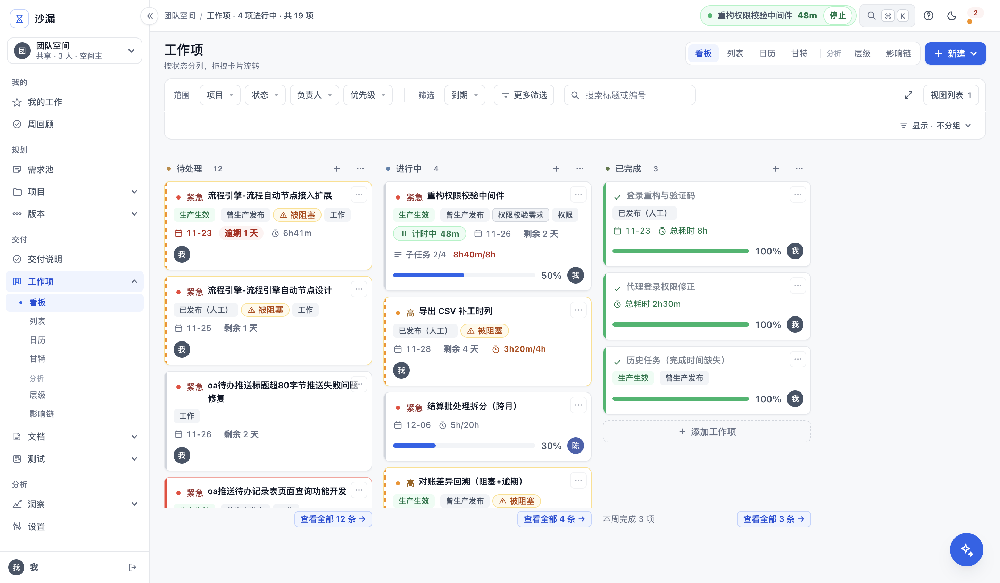

点击顶部栏的书本图标可在新标签页打开「帮助中心」：内置本手册与项目介绍、项目起源、产品说明、快速上手、常见问题、管理员指南七份文档，左侧可随时切换；右上角「下载 Markdown」可下载当前文档，便于离线保存或团队内分享。

### 2.3 创建第一个项目

1. 在左侧导航点击「项目」。
2. 点击右上角「新建项目」。
3. 填写项目名称、描述，选择状态（进行中 / 已暂停 / 已完成）。
4. 需要骨架时选一个模板；不选就是空白项目。
5. 点击保存，项目会出现在项目列表中。

内置模板共六种，只补齐当前空间缺少的看板列、示例文档、默认版本与测试分类，不改动已有配置：

| 模板 | 适合 | 会补什么 |
| --- | --- | --- |
| 空白 | 已有自己的流程 | 不补，保持最小项目 |
| 产品研发 | 常规产品迭代 | 联调 / 待验收列，需求文档、技术方案、测试验收三份文档，默认版本与常用测试分类 |
| 测试管理 | 以测试为主的项目 | 待复测列，测试方案、缺陷记录文档与测试分类 |
| 外包交付 | 按里程碑交付给客户 | 16 条示例工作项，交付版本与需求确认 / 技术方案 / 交付验收文档 |
| 内部信息化 | 内部系统上线推广 | 14 条示例工作项，上线版本与调研纪要 / 实施方案 / 操作手册 |
| 小团队敏捷 | 两周一个小版本 | 12 条示例工作项，迭代版本与产品愿景 / 迭代计划 / 技术方案 |

模板只是一次性初始化：建好后列、文档、版本都可以照常增删改；示例工作项用于演示排期，不需要可逐条删除。

### 2.4 创建第一个工作项

1. 从左侧「工作项」进入看板视图；项目与负责人可在筛选栏选择。
2. 点击看板列底部的「+ 添加工作项」，或顶部「新建」按钮。
3. 填写标题、类型、负责人、优先级、截止日期等。
4. 保存后，卡片会出现在看板首列。

### 2.5 拖拽流转与计时

- 在看板上，拖动卡片从一列移到另一列即可改变状态。
- 空间可配置「状态流转」矩阵：某些「来源 → 目标」可设为需填原因或禁止。需填原因时会弹窗，填写后写入活动记录；被禁止时看板、列表、批量与抽屉等入口都会给出同一提示，空间主 / 管理员确认后可强制移动。
- 拖入「进行中」列会自动开始计时。
- 拖入「已完成」列会自动停止计时，并触发「完成后接力」：如果原列还有其他任务，会自动接续计时第一个任务。
- 每张卡片右上角有计时按钮，也可手动开始 / 暂停。
- 忘开表、加班等情况可用「补记」手工补一条实际工时：可选择任意空间成员与日期（不晚于今天），补记不经过工作时段裁剪，直接计入任务与报表；补记记录可在工时记录列表中删除。
- 忘停表导致工时偏大时，点计时记录右侧的「作废」，再用「补记」按天录入实际工时；作废后所有统计与完成快照立即按实际工时重算（详见 18.7）。

---

## 3. 空间与成员

### 3.1 空间概念

空间是数据隔离单元。你可以属于多个空间（如个人空间、团队空间），不同空间的项目、工作项、成员完全隔离。

- **个人空间**：首次登录自动生成，适合个人待办。
- **共享空间**：由管理员创建，邀请团队成员加入。

切换空间：点击左侧边栏顶部的空间名称，在弹出菜单中选择目标空间。

### 3.2 成员管理

空间主或管理员可在「设置 > 成员与角色」中：

- 查看当前成员列表。
- 生成邀请链接，复制给新成员。生成时可勾选该成员加入后能访问的项目，并为每个项目选择「可参与 / 只读」；不勾选则加入后看不到任何项目，需要再加入后分配。
- 对成员角色使用「分配项目」，按项目批量调整「可参与 / 可测试 / 只读 / 不可见」。
- 修改成员角色或移除成员。
- 为成员标注公司：点姓名旁的公司标签即可编辑，留空表示未标注。公司是空间级展示标签，用于区分不同协作方，不改变项目可见范围或任何操作权限；空间主 / 管理员可改任意成员，成员也可在「个人设置 → 基本信息」修改自己的公司和岗位（查看者只读，个人空间不展示）。

### 3.3 角色说明

空间级角色共有四档：

| 角色 | 权限 |
| --- | --- |
| 空间主（Owner） | 拥有空间全部权限，包括空间改名与推送配置、成员管理、完整备份导入导出、删除空间。共享空间可有**多位空间主**，权限完全相同；任何时刻至少保留一位，最后一位空间主不能退出、被移除或降为其他角色。 |
| 管理员（Admin） | 可管理项目与成员、新增 / 编辑 / 排序看板列、维护项目分类（新增 / 改名 / 排序 / 删除）、配置项目可见范围；不能删除看板列、不能修改空间名称或执行完整备份。 |
| 成员（Member） | 可创建和编辑自己参与的项目与工作项，可新增 / 编辑 / 排序看板列；对参与的项目可新增 / 改名 / 排序分类；作为项目负责人还可删除该项目分类；不能删除看板列、不能管理成员或完整备份。 |
| 查看者（Viewer） | 全局只读，不能创建、编辑、删除任何数据。 |

> 项目级对每个「成员 × 项目」单独设置四档权限：**可参与**（可查看、可编辑）、**可测试**（可查看，并可使用测试链路：维护用例与测试计划、记录执行结果、推进待测试 / 测试中的工作项，但不能改工作项正文与项目资料）、**只读**（只能查看）、**不可见**（完全隐藏）。新成员加入时默认不参与任何项目；可在生成邀请时预分配，也可在加入后由空间主 / 管理员通过「分配项目」调整。邀请与新建项目初始成员只提供「可参与 / 只读」，**可测试**需在加入后通过「分配项目」设置。改造前已存在的成员保留原来的默认参与行为，直到被显式调整。

**公司、职能与项目角色是展示属性，不参与权限判断。**

- 空间主 / 管理员在「设置 → 成员」维护公司及默认岗位（如全栈工程师、产品经理），本空间各项目默认继承；成员也可在「个人设置 → 基本信息」修改自己的公司和岗位，只对当前空间生效。
- 项目「成员与角色」可覆盖主角色，并另设最多 5 个兼岗；选「沿用空间默认岗位」可恢复继承，项目覆盖不会被默认岗位更新改掉。
- 项目负责人或空间管理员可按公司 / 角色筛选、批量设置，或从另一可见项目复制；默认跳过已有覆盖与兼岗，也可明确选择覆盖。
- 公司显示在成员列表、花名册、负责人下拉和评论作者旁；有效角色 / 兼岗显示在花名册、负责人下拉及任务负责人悬浮提示中，成员负载与交付报表可按公司 / 角色筛选。
- 空间管理员还可维护公司与角色候选，支持自定义名称。上述标签不改变可见性与操作权限；空间查看者与项目不可见成员不进入负责人候选。

---

## 4. 项目

### 4.1 项目列表

进入「项目」视图，可看到当前空间下的所有项目，按项目集归组显示：

- 每个项目集有一个可折叠表头，显示项目数、工作项数、完成数、首版 / 迭代工时与进度，并带一条风险条：逾期 / 阻塞 / 停滞三个集内汇总数，点击直达「逾期与阻塞」明细；未归集的项目平铺在「未分组」下。折叠只影响当前列表的展示，不影响筛选与统计。
- 列表可切换到「表格」视图：项目集同样占一整行、与项目行共用列。集行显示集自身的状态、负责人与计划结束日，以及集内汇总的工作项数、完成数、文档数和按工作项数加权的进度；首版上线日取集内项目最早的一次，只是只读汇总，集本身不生成发布记录。
- 每个项目显示名称、状态、进度条、工作项数、逾期数；归入项目集的项目带「项目集」标签，拆分产生的公共容器另带「公共容器」标签。
- 项目集本身只做归组和只读汇总，不改变项目权限；集内项目仍按各自成员可见。
- 点击项目名称进入项目驾驶舱；驾驶舱里可看进度、工时、工作项分布、成员负载与交付资源，并可切「全部项目透视」。驾驶舱内嵌「需求 / 工作项」双页签明细区，各自支持搜索，按状态 / 优先级 / 类型 / 分类 / 版本筛选与分组，两个页签都分页展示（每页 10 / 20 / 50 / 100 条，默认 10 条，可翻页或跳页），点行直接打开详情；要推进工作项（拖状态、计时等），仍从左侧「工作项」进入并把项目选进筛选条件。

### 4.2 创建 / 编辑 / 删除项目

- **创建**：右上角「新建项目」，填写名称、描述、状态；可选「所属项目集」（未分组、流程引擎等）。创建者自动获得该项目的可参与权限；其他「按项目分配」的成员默认看不到这个新项目，需要另行分配。新建表单里可一并选择初始成员并授予「可参与 / 只读」，查看者即使勾选也锁只读；该选择仅新建时生效，之后走常规分配入口。
- **编辑**：项目卡片或项目详情中点击「编辑」，可改「所属项目集」；也可以直接拖动列表里的项目：拖到集内其他项目之间就地排序，拖到其他项目集表头或集内任意位置即换集。
- **拖动权限与项目集顺序**：拖动把手只对空间主 / 管理员显示；项目集表头右侧、编辑按钮旁的把手可调整项目集之间的先后，拖到列表底部「移出项目集」区域回到「未分组」。
- **删除**：先查看影响预览，再输入与项目名完全一致的确认文本；存在发布证据时保护阻止破坏性删除，不因输入确认文本而绕过。无发布证据时按接口级联规则处理，详见接口契约。
- **项目集**：项目集表头右侧提供「编辑 / 删除」，列表上方的「新建项目集」可创建。只有空间主或管理员能维护，普通成员点击会提示权限不足；删除项目集只把项目移回「未分组」，不删除项目与历史。

### 4.3 项目状态

| 状态 | 含义 |
| --- | --- |
| 进行中 | 团队正在投入的项目。 |
| 已暂停 | 暂时搁置，任务不再出现在活跃视图默认筛选中。 |
| 已完成 | 已关闭，可作为历史项目查阅。 |

### 4.4 首版标记

项目首次上线后，可在项目设置中标记「首版上线日」。该日期用于「版本」视图中自动区分「首版开发」与「迭代维护」两个阶段，且不会回写历史数据。

### 4.5 项目驾驶舱与全局健康度

- **全局健康度**：「项目」一级入口下的二级视图，一屏横向对比全部项目的健康度、逾期与本周投入，点项目名进入项目驾驶舱。
- **项目驾驶舱**：进入单个项目后的默认视图，包含周期、预估工时、实际工时、偏差、工作项分布、本周新增 / 完成、史诗汇总、项目内成员负载与「交付资源」聚合；交付资源按项目显示文档、测试用例 / 测试计划与版本数量（启用 Git 后还有分支数量），点卡片直接带着该项目进入对应视图；跳转后左下角会出现「返回 项目 …」，点一下回到原驾驶舱并保持当前项目。右上角可切换「单项目 / 全部项目透视」，左上角「← 项目列表」返回。停在驾驶舱时，二级导航会把「项目列表」标为所在分区，提示你从哪一层进来。
- **里程碑**：驾驶舱下方列出该项目的里程碑及未达成 / 已达成 / 已延期 / 已取消数量，可在此新建并打开详情确认、改期或取消。里程碑是项目级结果标记，不占工作项数量与预估，详见 1.3.3「项目里程碑」。
- **分类统计**：驾驶舱 KPI 卡下方按分类列出工作项数、进度、预估 / 实际 / 剩余工时、偏差与风险，口径与项目一致；没有分类归属的工作项单列为「未分类」，分类合计 + 未分类 = 项目合计。项目整体进度仍按全部工作项计算，不是各分类百分比的平均。点分类行可查看该分类的工作项。
- **驾驶舱内维护分类**：有权限时面板右上角可直接「+ 新增分类」，行尾垃圾桶就地删除；删除时选择迁移目标，其下工作项与需求一并迁过去，历史工时随工作项迁移。项目写成员可新增、改名与排序；删除仅空间主、空间管理员或项目负责人可操作，查看者只读。
- **单项目 / 全部项目透视**：驾驶舱右上角切换；单项目模式内嵌「需求 / 工作项」双页签明细区，各自支持搜索，按状态 / 优先级 / 类型 / 分类 / 版本筛选与分组，两个页签都分页展示（每页 10 / 20 / 50 / 100 条，默认 10 条，可翻页或跳页），点击行打开详情，推进操作仍去工作项视图；全部项目透视用于横向对比。
- **成员与角色**：驾驶舱的第四个页签，列出当前能看到该项目的成员、公司、本项目角色、项目权限与可见来源。空间查看者不在列表中；没有编辑权限时角色列只读展示。项目角色由项目负责人或空间管理员维护。

---

## 5. 工作项

工作项是 沙漏 的核心操作对象，包括任务、用户故事、缺陷、史诗四种类型。

### 5.1 创建与编辑

在看板、列表、日历、甘特等视图中均可新建工作项：

1. 点击「新建」或「+」按钮。
2. 在弹出的表单中填写：
   - 标题（必填）
   - 类型（任务 / 用户故事 / 缺陷 / 史诗）
   - 所属项目（必填）
   - 负责人
   - 测试负责人（可留空，表示待领取）
   - 优先级（P0 / P1 / P2 / P3）
   - 所属史诗
   - 当前计划交付版本（可多选，不是实际发布证据；保留 / 解绑与改关联规则见 11.2）
   - 开始日期 / 截止日期
   - 预估工时
   - 测试预估（只计入测试负责人的剩余负载，可不填）
   - 描述
3. 点击保存。

### 5.2 详情抽屉

点击任意工作项卡片或列表行，会从右侧滑出详情抽屉（桌面宽 1080px，双栏；窄屏为全屏单栏），包含：

- 顶部速览（编辑已有工作项时显示）：状态（点击可切换）、进度、实际 / 预估工时、截止（含逾期提示）与测试窗口
- 基本信息与编辑（标题、类型、优先级、所属项目 / 分类）
- 子任务（检查清单）
- 右栏：来源需求 → 关联（计划版本、关联需求常显；史诗 / 分支 / 文档在「更多关联」中展开）→ 生产发布事实（有正式发布记录时才显示）→ 评论，另有「关注与协作」卡：显示共享的关注人名单，项目写成员可添加 / 移除关注人（见 5.7）。分支可在字段旁点「新建分支」就地创建，按当前项目和任务负责人预填，建好自动选中，保存工作项后关联生效。
- 附件
- 工时记录
- 活动历史

工作项与需求页的「!」可查看内嵌的状态机图，支持点击缩放。

### 5.3 指派与负责人

- 一个工作项只能有一个负责人。
- 负责人下拉按公司分组，显示「姓名 · 有效主角色 / 兼岗 · 公司」，候选名旁标注与项目驾驶舱同源的负载（剩余预估 / 负载率，超载直接标出）；只列本项目可见的非查看者，加载失败可重试，不会退回空间全部成员。历史不可选负责人保留账号绑定，仅项目和负责人都未变时允许沿用。跨项目批量分配只列各项目共同可指派成员。
- 测试负责人与开发负责人分开：在详情抽屉的「测试负责人」中指定，候选与负责人相同，留空表示「待领取」。进入待测试 / 测试中后可点「开始测试并认领」，记录开始时间并把当前登录者设为测试负责人；只影响测试窗口与测试负责人筛选，不替代开发负责人。抽屉「计划」区的「测试预估」与测试窗口一起折算该负责人的测试剩余，并计入其在成员负载中的总负载。
- 指派给他人时，对方会收到站内通知（如果对方可见该项目）。
- 指派给自己会出现在「我的工作」中。

### 5.4 优先级

| 优先级 | 含义 | 颜色 |
| --- | --- | --- |
| P0 | 最高，必须今天处理 | 红 |
| P1 | 高 | 橙 |
| P2 | 中 | 蓝 |
| P3 | 低 | 灰 |

优先级会在看板卡片左侧以色条显示，便于快速识别。

### 5.5 标签与分类

- **分类**：项目级分类，用于筛选与统计（如前端、后端、测试、设计）。可在项目驾驶舱的「分类」面板直接新增与删除，改名与排序仍可在「设置 → 工作流 → 分类」或编辑项目时维护；未挂项目的工作项分类为「未分类」。项目写成员可新增、改名与排序；删除仅空间主、空间管理员或该项目负责人可操作。
- **标签**：自由文本标签，用于灵活标记（如「技术债」、「客户问题」）。
- 两者都可在筛选区快速过滤。

### 5.6 子任务（检查清单）

在详情抽屉「执行」页的「检查清单」区域：

- 添加子任务条目，新条目排在末尾。
- 勾选即表示完成。
- 调整顺序：拖动每行左侧的把手，或聚焦把手后按 ↑/↓。顺序会保存下来，概览里的清单跟着同序；排序失败会还原为原顺序并给出提示。
- 父任务会显示子任务完成进度。
- 删除父任务时，子任务会一并处理。
- 只读项目不显示把手，也不能添加或勾选。

### 5.7 评论

- 在详情抽屉底部评论框输入，按回车或点击发送，正文上限 2000 字。支持添加图片 / 附件，截图粘贴进输入框即可直接发出，图片在评论里内嵌缩略预览。
- 评论按时间正序排列，输入 `@` 可从候选成员中选择要提及的人（候选只包含能查看该项目的成员）。
- 评论作者姓名后会显示其公司标签（已标注时），便于识别外部协作方。
- 评论会触发通知给负责人、被@的人以及关注该任务的人。
- 详情抽屉标题旁的「关注」按钮可开启/取消关注，关注名单是共享的，在右栏「关注与协作」卡中可见：关注后，该任务的新评论、列流转（在看板列之间移动）、移入回收站与恢复都会通知你（字段编辑不单独通知，避免高频打扰）。
- 项目写成员可在「关注与协作」卡添加 / 移除他人为关注人（候选为能查看该项目的成员），本人可随时退出；关注人收到的通知与上条相同，不另增类型。

### 5.8 附件

工作项与需求均支持附件：

- 支持图片、PDF、文本、Markdown、HTML、ZIP、Excel 等常见格式。
- 可通过拖拽、复制粘贴、点击上传三种方式添加。
- 单文件大小限制 10MB。
- 点缩略图或文件名即在弹框内预览，不再跳新标签页：
  - **图片**：放大缩小（工具栏、滚轮或 `+` `-`）、旋转 90°（`R` 顺时针、`Shift+R` 逆时针）、放大后按住拖动查看细节、双击在「适配窗口」与「实际像素」间切换、`0` 复位、`Esc` 关闭；头部会显示图片原始尺寸。
  - **PDF**：用浏览器内置查看器打开，缩放与旋转用查看器自带控件。
  - **Markdown / txt / Word（doc、docx）**：Markdown 按排版渲染，Word 由服务端转 HTML 后在只读沙箱内显示。
  - **HTML（.html / .htm）**：在隔离沙箱内按原文件排版显示，可运行原型自身的脚本与点击交互；沙箱与应用页面隔离，不会读取登录态或操作本应用。仅支持单文件（CSS / JS / 图片需内嵌），相对路径资源不会加载，表单提交与顶层页面跳转仍被禁止。
  - **Excel（.xlsx / .xls）**：点文件名直接打开为在线表格。
  - zip、ppt 等无法在线渲染的类型，仍按原样下载。
- 图片与 PDF 若要放大细看，直接在弹框里操作即可；需要原图时用弹框右上角「下载」。
- **Excel（.xlsx）可在工作项详情内直接打开为可编辑表格**，修改后覆盖保存；样式、条件格式、图表、嵌入图片不保证保留，以数值与公式优先。
- 超大表格按 20000 行 × 200 列截断并提示。

### 5.9 回收站

删除的工作项会进入回收站，保留 30 天：

- 在「设置 > 数据与审计 > 回收站」中查看。
- 可选择「恢复」或「彻底删除」。
- 彻底删除史诗时，其下子工作项的史诗关联会被清空，不会形成孤儿引用。

### 5.10 史诗（Epic）

- 史诗是一种大粒度工作项，用于聚合故事、任务、缺陷。
- 在创建或编辑工作项时，可选择「所属史诗」。
- 史诗不能挂到另一个史诗下，系统会阻止循环归属。
- 项目驾驶舱中提供史诗汇总，展示其下子项的完成度。
- 当某工作项从史诗类型改为其他类型时，其下子工作项会自动解除史诗关联。

### 5.11 取消与恢复

不做了的工作项用「取消」进入系统终态「已取消」，它不占看板列，只在归档页可见：

- **取消**：任意非终态列的工作项都可取消，须选原因（不做 / 重复 / 延期 / 设计如此）并填说明；系统记录取消前所在列与取消时间。
- **恢复**：回到取消前所在列，该列已被删除时回到第一个开列；恢复会写入活动日志。
- **已完成须先重开**：已完成的工作项要先取消完成（重开）才能取消。
- **取消 ≠ 删除**：取消是可检索、可统计的终态归档；删除进回收站，是 30 天软删除（见 5.9）。
- 已取消的工作项不计逾期，退出完成率分母与需求完成分母，也不进发布候选、清单、日历、甘特与到期提醒（见 18.5）。

---

## 6. 执行视图

工作项有看板、列表、层级、影响链、日历、甘特六种执行视图，统一在标题下方的二级导航切换，不再在筛选栏另设开关。看板、列表、层级、日历、甘特共享同一套筛选；影响链回答依赖问题，按工作区内全部可见工作项展开，不沿用看板筛选。

### 6.1 看板

看板是最常用的视图：

- **列**：对应工作流状态（默认如：待处理 / 进行中 / 待测试 / 测试中 / 已完成）。
- **测试流程**：进行中 →「提测」进入待测试，开始测试后移入测试中；测试通过移入已完成，退回进行中或待处理需填写原因。进入测试中自动记录「开始测试」，转出时记录「结束测试」，详情抽屉的测试窗口可查看，需求池甘特图按这组时间绘制测试阶段。待测试 / 测试中还没有测试负责人时，详情测试卡显示「待领取」，可点「开始测试并认领」或先改派。看板「待测试」卡的等待时长与 3 天预警按本轮提测计算：重新提测即重新计时，测试中退回队列不算重新提测、等待延续本轮。
- **拖拽**：拖动卡片到目标列即可流转状态。
- **列头**：显示该列工作项数，支持折叠列；数字可点，进入该列的状态工作页。
- **长列**：每列先加载 20 条，列底「加载更多」继续取；列底「查看全部」进入状态工作页看完整列表，列内滚过一屏后列脚右侧出现「回到顶部」。
- **状态工作页形态**：进入状态工作页默认用列表呈现明细，工具条可切「卡片 / 列表」，选择按账号记在本机；手机端固定卡片形态，不横向溢出。
- **列内排序**：列头排序按钮可切换「手动 / 截止日期 / 优先级」；选自动排序后该列暂停拖动，切回手动即可继续拖动调整。
- **列内分组**：列仍是状态，列内可按负责人 / 优先级 / 分类归堆，再叠一个二级分组；组可折叠，切换分组不改变拖拽流转语义。分组偏好按「账号 + 空间」记住。
- **已完成列筛选**：已完成列头提供「全部 / 已发布 / 未发布」快捷筛选，只作用于该列；列计数、预览与进入状态工作页时沿用同一口径。进入已完成的状态工作页默认看全部历史（仍分页加载），需要时再收窄时间窗。
- **已取消入口**：看板工具条常显「已取消」计数（0 条也可见），点击进入归档页：可按原因筛选，列表带「取消前状态」列，可逐条恢复（见 5.11）。
- **快速新增**：点击列底「+ 添加工作项」直接在该列创建。
- **筛选**：项目、状态、负责人（含测试负责人）、优先级在筛选栏直接选，分类、标签、类型、版本等在「更多筛选」中（详见 6.7）。

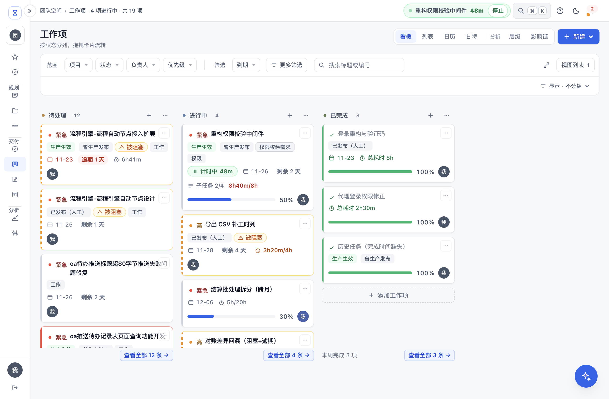

### 6.2 工作项列表

- 表格形式展示工作项。
- 支持列偏好记忆（选择显示哪些字段）。
- 支持行内快捷操作：编辑、删除、开始计时。
- **行内直改**：状态、优先级、负责人、截止可在列表行内直接修改，不必打开详情。读态与普通单元格一致，鼠标悬停或键盘聚焦才露出箭头，点开菜单选中即保存：改状态沿用流转规则（需原因或受限的会在菜单里标出），改优先级与负责人在同类候选里选（负责人只列本项目可指派成员），改截止沿用看板的快捷日期浮层。只读项目保持纯标签与文字，不提供入口。层级视图、列状态工作页与缺陷列表沿用同一口径；列状态工作页的状态就是当前页所在列，不在行内改。
- 沿用看板筛选条件。

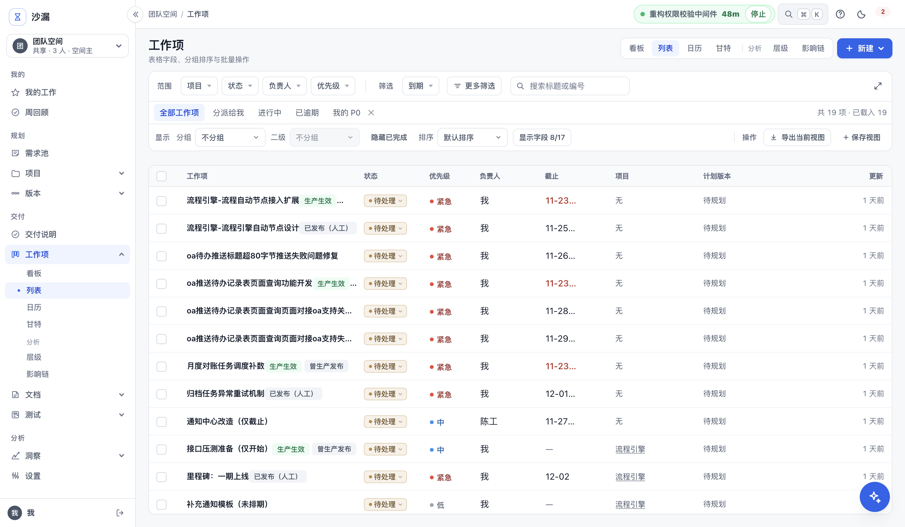

### 6.3 层级

层级视图把当前筛选下的工作项按「项目 / 计划版本 / 分类」三级缩进成树，回答「这批活怎么归类、哪一支最重」：

- **层级维度**：一级、二级、三级各选一个维度，默认「项目 → 版本 → 不分组」。只提供结构性维度；状态、优先级、负责人是流动属性，留给筛选、看板列内分组与列表分组，不放进树里，避免每次流转都把树抖散。
- **父级聚合**：父级行显示组内项数、平均进度、最早截止、子任务合计与工时合计；状态、优先级、分类、项目、版本等叶子自身属性在父级留空。
- **展开与折叠**：点节点前的三角收起 / 展开，顶部按钮在「全部折叠 / 全部展开」间切换；「隐藏已完成」只把已完成的工作项从树中收起。
- **列与操作**：显示字段沿用列表偏好；优先级、负责人与截止同样可以行内直接改；点叶行打开工作项抽屉；根级行在无分组时按工作项平铺。
- **手机端**：改为卡片式紧凑行，层级用左缩进表达，不横向溢出。

### 6.4 影响链

影响链回答「动它会牵动谁、它被谁卡住」，与层级视图互补：

- **选中心工作项**：默认选最近更新且有依赖的未完成项；也可用「选择中心工作项」搜索标题后替换，或直接点链上任意节点把它设为中心。
- **展开方向**：上游是前置（它卡在谁后面），下游是后继（它解锁了谁），可切「上游 / 双向 / 下游」。
- **依赖标注**：每条边显示依赖类型与滞后天数。FS 表示前驱完成后才能开始，SS 表示与前驱同时启动，FF 表示前驱完成时本项须完成，SF 表示本项开始是前驱完成的信号。
- **展开边界**：每条链最多展开 4 级，更深的后继在边上标注未展开数量；检测到环路时标注「检测到环路」并停止深入。
- **数据范围**：取工作区内全部可见工作项，因此可以跨项目、跨状态；最多加载 3000 条，达到上限会在工具条提示。依赖指向但不在已加载范围内的任务会按需补齐，上限 200 条；仍取不到时显示「未知工作项」。
- **操作**：点任意节点把它设为中心；点中心卡片打开详情抽屉；工具条显示已加载项数与依赖条数。

### 6.5 日历

- 工作项按 `[开始日期, 实际结束日]` 区间逐日铺开。
- **实际结束日 = min(完成日, 截止日)**：提前完成的任务不会在后续日期继续占格。
- 截止日高亮显示。
- 点击日期格可查看当天所有工作项。

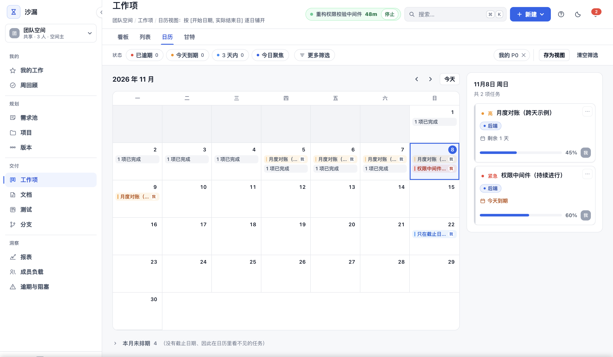

### 6.6 甘特图

甘特图是 沙漏 的强项，适用于排期与依赖管理：

- **时间刻度**：日 / 周 / 月，支持缩放。
- **依赖关系**：FS（完成-开始）、SS（开始-开始）、FF（完成-完成）、SF（开始-完成）+ 滞后量；通过拖拽任务条两端的圆点连线建立。
- **里程碑轨道**：甘特图顶部单独一行显示项目里程碑菱形，颜色区分未达成 / 已达成 / 已延期 / 已取消；点击打开里程碑详情。甘特筛选到单个项目时加载该项目里程碑；旧版工作项里程碑标记仍按工作项菱形显示。
- **基线偏差**：显示计划与实际日期的偏差。
- **关键路径**：自动计算并高亮。
- **分组**：按项目、负责人、史诗等两级分组。
- **字段开关**：自定义显示哪些列。
- **成员负载面板**：按人按周查看成员负载。
- **改期撤销**：支持多步撤销。
- **导出与打印**：可导出 CSV，支持 A3 打印。
- **只读分享**：可生成只读分享链接，供外部人员查看。
- **深色模式**：已支持。

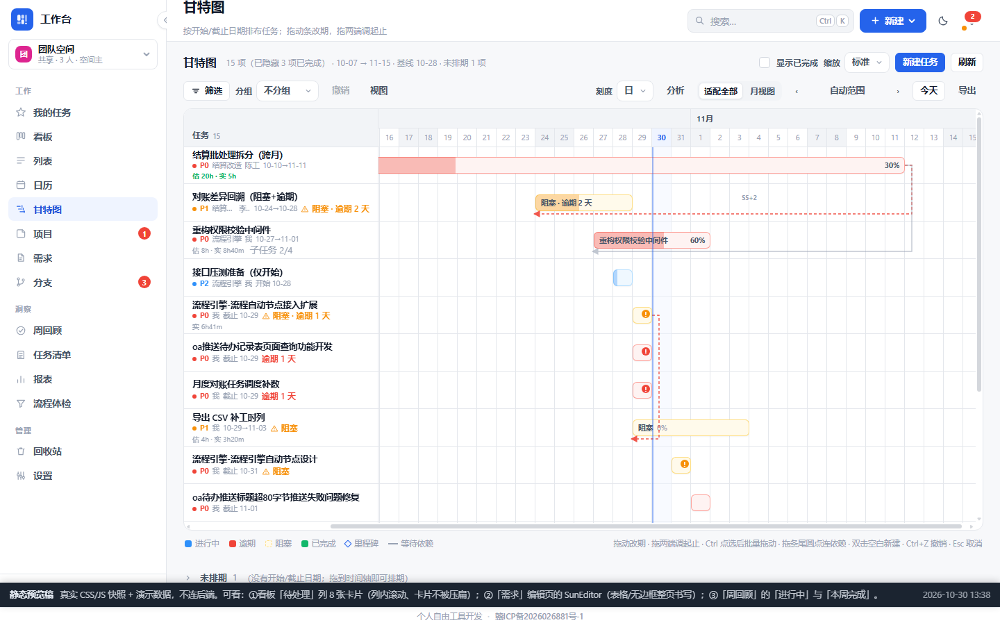

### 6.7 筛选

筛选条件在看板、列表、层级、日历、甘特之间共享，选完即时生效，不需要点「应用」；影响链不沿用这套筛选，按工作区内全部可见工作项展开。

- **平铺维度**：项目、状态、负责人、优先级直接放在筛选栏。每个都是多选下拉，选项后带数量，选中项以可删除的标签显示，再点一次即取消。负责人与测试负责人共用一个筛选入口：浮层内分「负责人」「测试负责人（含待领取）」两组，计数、已选标签与清空合并按钮处理，测试身份的候选带「（测试）」后缀；「待领取」对应尚未指派测试负责人的工作项。项目下拉全站统一按「项目集 → 项目」分组：集头可折叠、可整集勾选，未分组项目排最后，搜索命中项目集名时整集项目一起露出。
- **更多筛选**：分类、标签、类型、版本、完成情况、「仅看被阻塞」收在「更多筛选」里；分类、标签、类型、版本同样支持多选。
- **空值项**：无负责人、未归类、未分类会作为独立选项出现，用来找出还没填这些字段的工作项；没有对应数据时不显示。
- **日期区间**：截止日期、开始日期都可以填「从 / 到」，也可以一键选本周、本月、未来 7 天，或只看「无截止日期」。到期预设（今日聚焦 / 3 天内 / 已逾期）与自定义区间互斥，后选的覆盖先选的。
- **已选回显**：筛选栏下方按维度列出已选标签，可逐个点掉；「清空」一次去掉全部条件。
- **保存视图**：当前筛选（含日期区间）、分组与排序可以存成一个视图，之后一键恢复。
- **手机端**：条件收进「筛选」底部面板，面板里同样是这些维度。

---

## 7. 需求池

需求池用于收集和评审原始需求，通过后再拆成工作项执行。

### 7.1 提交需求

1. 在左侧导航点击「需求池」。
2. 点击「提需求」。
3. 填写：
   - 标题（必填）
   - 来源
   - 类型
   - 优先级
   - 期望时间
   - 验收标准
   - 排期可暂不指定目标版本；选定目标时须同项目且未发布
   - 计划开始 / 结束日期（与期望日期独立，不自动改任务日期）
   - 描述
   - 附件
4. 保存后进入「待评审」列。

### 7.2 需求状态机

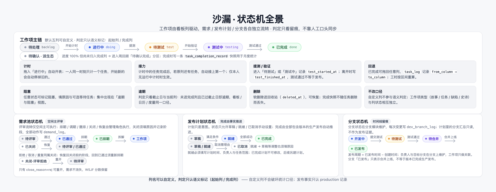

需求主状态与工作项状态是两条独立链路：

- **待评审（review）** → **已通过（pass）** → **已排期（plan）** → **已完成（done）**；排期可暂不指定目标版本；选定目标时须同项目且未发布。
- **已完成**由完成判定自动进出，不能手动拖入或直接改：至少 1 个未删除工作项全部完成，且关联用例最新一次执行全部通过（0 条用例视为通过），或存在成功生产发布 / 生效的人工交付判定。工作项重开、用例失败或生产发布被回滚会自动退回已排期，目标版本与计划日期不变。**完成不等于交付**，交付仍看发布证据。
- **已关闭（closed）**统一承载评审不通过、中途取消与重复需求，分别记录 `closeReason=rej/cancel/dup`，并用 `closeStage=review/pass/plan/done` 保留关闭前阶段。列表与卡片的「已关闭」徽标按原因细分为「评审不通过 / 中途取消 / 重复需求」，悬停显示关闭前阶段。已完成需求不能直接关闭；需先撤回完成证据（工作项重开、用例失败或发布回滚）让需求退回已排期。
- 评审不通过可从「重新打开」回到待评审；普通恢复按关闭前阶段处理：关闭前为待评审则回到待评审，其余回到已通过并清空目标版本与计划起止，需重新排期。撤排同样回到已通过并清目标与计划起止。
- 关闭保留需求、原目标版本、计划起止与历史，不连带关闭或删除任务；原目标引用仍会阻止版本删除。
- 通过、拒绝、撤回评审、重新打开需要项目写权限；管理者可排期、调期、撤排、关闭、恢复（管理者定义见 17.3）。计划写入口带当前 `revision`；清空目标仍属调期并保留已排期状态；拒绝、调期、撤排、关闭、恢复必须填原因，冲突时刷新后重试，全部留痕。
- 排期到版本不会自动改写已有工作项的版本：首次排期成功后弹窗确认，可把该需求名下尚未加入的工作项一并带入（默认勾选未完成项），调期不批量迁移；带入只新增版本关联，不改工作项计划日期。搜索只影响显示，已勾选项即使被筛掉也会一并加入，计数会提示筛选外数量。版本页「管理工作项」可按需求分组，已排需求行内可补录遗漏。
- 计划开始 / 结束日期与期望日期独立；调期、撤排、关闭或恢复**绝不自动修改已有任务的版本、日期、状态**。需要顺延任务时，逐项明确改版并填原因。
- 需求内容编辑的范围随状态收窄：待评审可整单编辑；已通过 / 已排期在详情「编辑」里只补录描述、验收标准、来源、分类与 WSJF，标题与需求类型保持评审时的结论，优先级和期望交付用列表行内改，计划日期用「调整排期」；已完成可继续改标题、描述、验收标准、来源、分类、优先级与 WSJF（只修正文与归档信息），但不能关闭、新增工作项或用例，也不能改所属项目、目标版本、期望交付与计划日期；已关闭需先恢复后再编辑。「所属项目」对待评审 / 已通过 / 已排期可在编辑弹窗直接更换，规则与列表行内切换一致：保存前先预览迁移范围并连续确认两道，确认后需求、名下全部工作项（含已开工与回收站）与主归口用例整单迁移，在目标项目各自重排编号；原排期撤销，版本绑定、原项目测试计划圈选、不属于目标项目的分类 / 用例目录 / Epic 归属 / 文档引用自动解除，工作项时间线逐项留痕；关联文档与历史发布记录留在原项目。仅当工作项已有发布记录或人工发布标记、仍绑定已关闭 / 已取消的版本，或 Epic 还有不随迁的子项时阻止迁移并给出具体原因。所有编辑都记录在流转时间线。

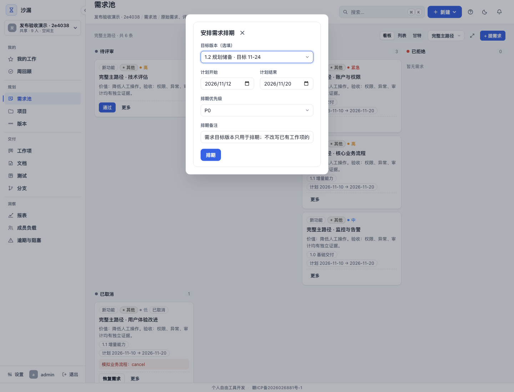

### 7.3 三种视图与五态看板

需求池有看板、列表、甘特三种视图，在页头「视图」分段切换，选择按用户保存，换浏览器也生效。地址栏的 `?view=board|table|gantt` 可直接打开某个视图，刷新与分享不会回到默认看板。

看板范围可选全部项目或单个项目；列表与甘特在「更多筛选」里可同时勾选多个项目。从看板切到列表 / 甘特会把当前项目带入项目筛选；从列表 / 甘特切回看板时，如果勾了多个项目，看板只能落在全部或单个项目，因此回到「全部项目」并提示，原筛选仍保留。

需求池最外层固定展示待评审、已通过、已排期、已完成、已关闭五列，便于同时看总览。点击任一列标题进入对应工作页：待评审核对评审内容，已通过准备排期，已完成核对完成与交付证据，已关闭按关闭原因与关闭前阶段归档筛选。

看板顶部可切换范围：默认「全部项目」，列内默认按需求类型分组展示；在「显示 · 分组」里可改为按项目分泳道（泳道顺序与项目列表排序一致），也可聚焦到单个项目只看该项目。搜索、筛选与「匹配 M / N」计数跟随当前范围；全部项目模式下「提需求」只要求空间内存在任一可写项目，弹窗内再选具体项目。

甘特按评审、排期、设计、开发、测试、完成、发布七个阶段绘制只读时间轴：条形来自真实记录，没有记录就留虚线缺口，不补 0 天；左侧「计划」列只是计划日期，不参与阶段计算。它回答「这个需求各阶段实际花了多久、卡在哪」，不提供依赖连线、基线或拖拽调期；需要排依赖与基线时用工作项甘特。时间范围默认适配已加载需求并包含今天，跨度超过 2 年自动切到按月查看。

已排期与已完成列各带只读派生胶囊（待开工 / 推进中、待发布 / 已交付），两列都有两段分布条可直达阶段。看板工具条提供一个阶段筛选，选项按「已排期」「已完成」分组，只作用于阶段所属的那一列：列头显示「匹配 M / 总数 N」，另一列计数不变；筛选落的列没有结果时可直接「显示全部阶段」。返回看板后保留筛选。工作页顶部先切换五个主状态，已排期页提供「全部阶段 / 待开工 / 推进中」，已完成页提供「全部阶段 / 待发布 / 已交付」二级页签，不会让其他主状态的空列干扰分析。

工作页以指标、筛选条件和版本 / 项目泳道卡片墙组织内容；搜索、优先级、版本、关闭条件和聚焦条件会收窄指标与卡片，主状态与阶段页签仍显示当前项目范围内的全局计数。版本按自然版本号倒序排列，例如 V1.10 在 V1.2 前。点击卡片仍打开原需求详情抽屉，有权限的动作在详情中执行；卡片与详情都显示「提交人」，缺失时显示「—」。

### 7.4 派生交付阶段（完成 ≠ 交付）

| 阶段 | 所属主状态 | 系统依据 | 不能替代的证据 |
| --- | --- | --- | --- |
| 待开工 | 已排期 | 尚无真实开工 | 计划开始日期不等于实际开工 |
| 推进中 | 已排期 | 已有真实开工 | 仅有关闭部分工作项不等于完成 |
| 待发布 | 已完成 | 已满足完成条件，但没有生效的生产发布；或人工判定为待发布 | 目标版本标记已发布但没有发布记录时，不自动算已交付 |
| 已交付 | 已完成 | 存在成功、全量覆盖的生产发布条目，且未被后续回滚撤销；或人工判定为已交付 | 测试 / 预发、失败记录、部分成功、回滚记录不能替代真实发布 |

真实开工取首次移出待处理、首次计时、直接创建在执行列的最早日期，不读取工作项计划开始日期；开工是历史事实，拖回待处理也不会退回。四个阶段都只读派生、不落库：已排期只出现待开工 / 推进中，已完成只出现待发布 / 已交付，其他主状态没有交付阶段。已交付的发布被回滚后回到待发布；之后重新部署成功会恢复已交付。

人工判定只补充**已完成**需求，可选「待发布」或「已交付」，必须填写生效日期与原因；生效日期不能晚于今天。判定绑定当时的目标版本，需求改到其他版本后旧判定自动失效。修改判定采用「撤销旧记录 + 新增记录」，历史全部保留；撤销后立即恢复自动派生结果。存在真实生产发布记录时，交付阶段和交付日期始终以真实记录为准，人工判定不会覆盖；卡片和详情会标注「人工」来源。

升级迁移按发布证据优先回填：有成功正式生产发布或生效人工判定的历史需求直接进入已完成；其余按「至少 1 个工作项全部完成 + 关联用例最新执行全部通过」判定，不满足的保持已排期。不根据目标日期或更新时间猜测完成或交付。

### 7.5 WSJF 评分

当需求填写「业务价值」、「紧迫度」、「风险缓解」、「工作量」四项后，系统会自动计算 WSJF（加权最短作业优先）得分并排序。得分公式不可手填，只由字段自动推导；任一项留空则不评分。

### 7.6 需求 → 工作项

- 已通过或已排期的需求可在详情中「拆分为任务」；已完成需求不能再新增工作项或用例。
- 拆分后生成的工作项会自动关联该需求。
- 需求详情抽屉可透视关联的工作项列表及其进度；看板与工作页返回的已排期条目还会展示交付阶段及证据摘要。人工判定区展示当前生效判定、判定人、原因和历史记录。概览的「工时」卡按该需求下的工作项实时汇总预计、实际与产品 / 设计、开发、测试三段，口径见 11.6。在「关联」页签打开关联文档、或跳到用例覆盖后，左下角会留下「返回 需求 …」，点一下回到该需求的抽屉并停在「关联」页签。

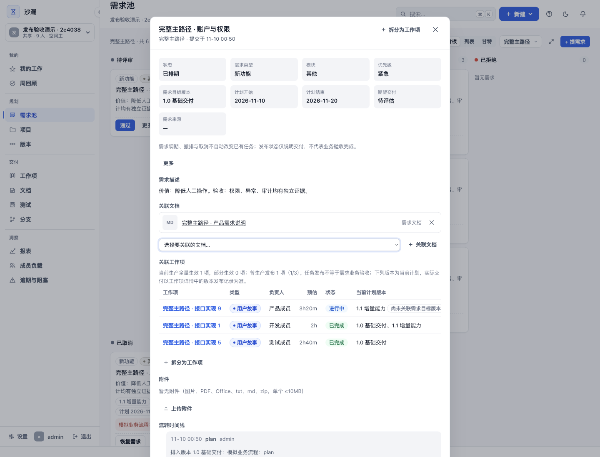

### 7.7 列表行内编辑

需求池切到「列表」视图后，可直接在表格行内修改以下字段，无需打开详情或编辑弹窗。读态就是普通文字或标签，不常显下拉框；鼠标悬停或键盘聚焦时才露出箭头，点击才弹出选项。

| 字段 | 可直接修改的条件 | 说明 |
| --- | --- | --- |
| 优先级 | 需求未关闭，且有项目写权限 | 点优先级标签选新值；不改变主状态，变更写入时间线 |
| 状态 | 需求未关闭，且当前角色有合法去向 | 点状态标签列出可执行动作；通过、撤回评审直接执行，评审不通过、排期、调整 / 撤销排期、关闭仍打开原弹窗补充原因或目标版本 |
| 所属项目 | 待评审 / 已通过 / 已排期，且有项目写权限，且至少有一个可切换项目 | 点项目名选择，提交前连续两道确认（确认后才落库）。整单级联：工作项（含已开工与回收站）与主归口用例一并迁移并在目标项目重新取号；版本绑定、原项目测试计划圈选、不属于目标项目的分类 / 用例目录 / Epic 归属 / 文档引用自动解除，原排期撤销，需求与工作项时间线分别记录旧号 → 新号。关联文档与历史发布记录留在原项目。存在发布记录、绑定已关闭 / 已取消的版本或 Epic 子项不能随迁时阻断，并就地列出具体原因 |
| 期望交付 | 需求未关闭，且有项目写权限 | 点日期打开自绘日历；可清空；与服务端 `expect_date` 同口径，选中的日期没变就不发请求 |
| 目标版本 | 已排期，且有排期管理权限 | 点版本名选择，候选只含所属项目的未发布版本；可改回「未指定」；换 / 清版本属于调期，必须填写原因 |
| 分类 | 需求未关闭，且有项目写权限 | 点分类名选择，候选只含所属项目的分类，可改回「未分类」；分类字典尚未加载时保留原值，不会被悄悄改掉 |
| 来源 | 需求未关闭，且有项目写权限 | 点单元格就地编辑：回车或失焦保存，Esc 取消；最长 40 字，可清空 |

关闭状态的需求不提供行内修改，需先恢复；所有行内修改都带当前 `revision`，遇到并发冲突会提示刷新后重试。行内修改后列表静默刷新，保留已加载的条数与滚动位置，不会跳回第一页。分类与来源走整单更新接口，在时间线里记为一次「编辑」；其余字段各有专用动作留痕。看板与卡片视图保持原有拖拽和行内动作，不受影响。需求详情概览里的来源、标题、描述、验收标准同样点开即改，交互与列表一致；需求类型与评审人点开弹层选择，只在待评审开放，进入流转后由状态动作决定。

### 7.8 需求评论

需求详情抽屉的「评论」页签用于围绕需求本身的讨论，页签上显示评论总数，与文档评论相互独立。

- **发表与回复**：评论正文最长 1000 字，Ctrl / ⌘+Enter 直接发送；支持添加图片 / 附件，截图粘贴进输入框即可直接发出，图片在评论里内嵌缩略预览。回复只支持一层，回复挂在该顶层评论下面，不能再对回复继续回复。
- **@提及**：输入 `@` 会弹出当前项目的可见成员候选，选中的人会收到通知；通知对象还包括需求创建人与被回复评论的作者，点击通知直达该需求。
- **解决与筛选**：顶层评论可由有写权限的成员标记「解决」，已解决评论仍保留在列表中并带徽标；勾选「只看未解决」可过滤掉已解决评论。
- **转工作项**：评论可一键转为工作项并自动关联该需求，转换后评论上显示入口直达新工作项；已关闭的需求不能转。
- **权限与删除**：查看评论跟随需求可见范围，发表、回复、解决、转项与删除需要需求所在项目的写权限；删除顶层评论会连同其回复一起删除。
- **与需求同生命周期**：删除需求时评论一并清除；删除转换出的工作项不会删评论，只会清掉工作项回链。

### 7.9 需求提醒人

需求详情抽屉顶部的「提醒人」按钮用来订阅这条需求的变动。名单是共享的：一条需求一份关注名单，不是每个人各看各的。

- **默认收件人**：提交人始终默认接收通知，不需要、也不能把自己加进名单；名单里只列额外关注的人。
- **提需求时就能选**：新建需求的表单里有「提醒人」（选填），候选取自所选项目的可见成员，可一次加多人、逐个移除；编辑需求时该字段不再出现，名单统一在详情抽屉的「提醒人」浮层维护。
- **谁可以加人**：关注自己——只要能看到这条需求就能点「关注」（提交人除外，已经默认接收通知）；添加或移除他人——需要需求所在项目的写权限。被添加的人可以自己取消关注。
- **通知什么**：状态流转（评审、排期、关闭、恢复等）、需求内容编辑、列表行内的优先级 / 期望交付调整、以及新评论和回复。提交人已经收到的通知不会向名单重复发一份；操作人本人不收自己触发的通知。
- **消息渠道**：站内通知加个人邮件，跟随「个人设置 → 通知偏好」里新增的「我关注的需求」开关，默认站内开、邮件关，与「需求与版本动态」互相独立。
- **生命周期**：需求被删除后提醒人名单随之清除；成员退出空间或账号被删除也会一并移除。任务备份不包含关注关系，导入或恢复后名单为空。

---

## 8. 需求文档

需求文档以树形结构组织项目下的方案文档，可派生工作项。

### 8.1 文档视图

1. 左侧导航进入「文档」。
2. 顶部二级导航切换「阅读 / 列表 / 看板 / 最近动态」，默认进入阅读：左侧是文档树，按项目分组并常驻「空间文档」组，组内是自定义分类层级；列表按分类与项目分组，看板按状态分列，最近动态记录变更。
3. 点击文档行进入编辑器；右侧「大纲」按正文标题自动生成，点击可跳转。
4. 支持新建、重命名、移动、删除文档与分类；有编辑权限时，拖动节点左侧的手柄可调整同级顺序与所属层级，右键分组头或分类可就地新建。
5. 文档跨项目移动时，旧项目的任务引用和需求池链接会被清理，子文档保留在原项目。
6. 阅读模式下点击文档头部的「历史版本」，无需进入编辑即可浏览历史快照：弹层左侧选择版本，右侧按 Git 方式左右对齐展示新旧正文；可切换「分栏 / 统一」视图，未改动内容默认折叠、按差异上下跳转，也能切换基准与对比版本或切到「阅读」逐版查看；有编辑权限时可一键恢复（恢复前当前内容会自动留档）。
7. 阅读模式支持划线评论：选中正文任意文字，在弹出气泡中点击「划线评论」即可针对该片段发表意见；也可点击头部「评论」打开评论面板。带引用的评论会在正文中高亮，点击高亮可定位到对应评论。发表评论需要项目编辑权限。
8. 阅读页头工具栏的次级操作以图标呈现：宽屏、重命名、评论、权限说明、历史版本、导出、Word 导出；悬停或键盘聚焦约 0.4 秒会显示名称，评论图标右上角的角标是评论条数。「编辑文档」保留图标加文字，是进入编辑的主入口。
9. 阅读模式的正文之后有只读关联区（排在「上一篇 / 下一篇」下方），依次列出「关联需求 / 关联工作项 / 附件」：点需求或工作项直接打开详情，附件可在线预览或下载；滚到文末才取数据，不影响打开速度。页头的「2/5 工作项」可点击直达工作项清单，「打印 / 导出 PDF」会把这三份清单一并附在正文后面。新建与改关联、上传或删除附件仍在编辑页操作。

「打印 / 导出 PDF」会剥掉正文里划线评论的黄色高亮（只保留文字），并做版式保护：标题不落在页尾、代码块与表格行不跨页截断、正文外链在文字后补完整网址。

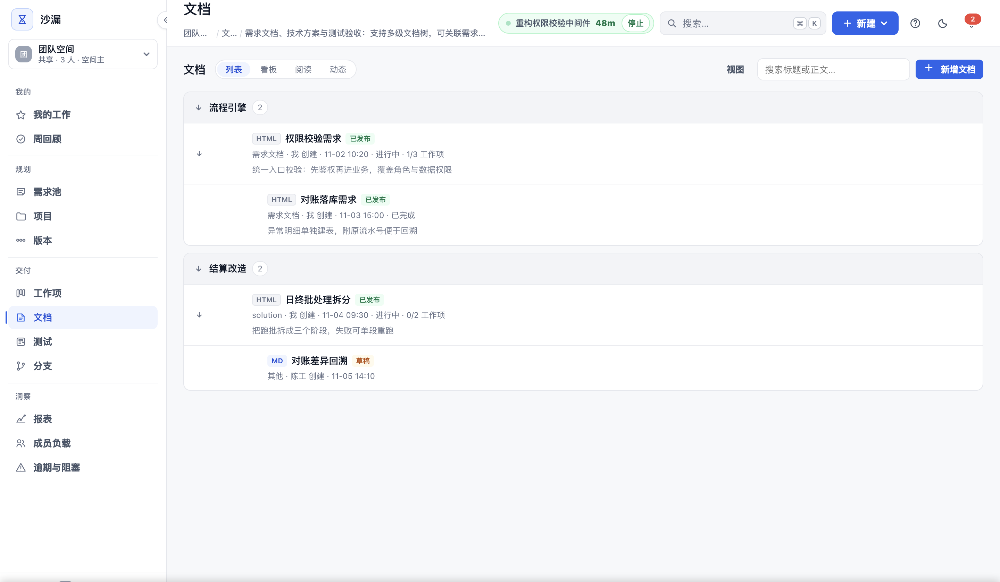

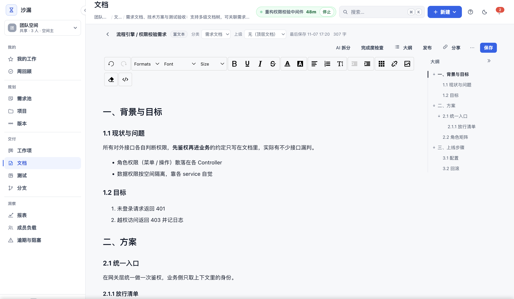

### 8.2 编辑与关联

- 文档正文支持 Markdown 与富文本编辑。
- 「新建文档」抽屉按「名称 → 存放位置 → 从哪里开始」三步组织：名称必填；位置里归属、分类、上级文档自上而下确定层级，分类只列当前归属下的目录；起点可选空白、套用模板或导入文件。Word（.docx / .doc）、Markdown、TXT、HTML 选好文件后先在抽屉里预览解析结果（含内嵌图片），确认无误再点「新建并编辑」；编辑器内再次导入会先弹「导入预览」，确认后才写入正文。旧版 .doc 只能保留文字，需要保留版式与图片时请另存为 .docx。HTML 文件会保留标题、列表、表格、图片与常用排版（字号、颜色、加粗 / 斜体、边框、对齐与间距），脚本与外链样式不执行；相对路径的图片无法解析，建议使用内嵌图片或完整网址。
- 导出支持两种：按当前格式导出 Markdown / HTML，或导出 Word（.docx）；Word 由服务端生成真实文档，保留标题层级、表格、列表与内嵌图片，Markdown 文档会先转成富文本再导出。
- 「从哪里开始」里的「使用模板」提供内置骨架（需求文档、技术方案、测试验收、决策记录、复盘），选中后类型与格式会自动带出；文档页工具栏的「模板」可预览骨架，空间主 / 管理员还能新建、删除自定义模板，新建后立即出现在下拉里。类型与可见范围收在「更多设置」，收起时摘要仍显示当前值。
- 正文支持插入图片：上传或直接粘贴截图。长边超过 1600px 的图会先等比压缩再上传（GIF 保留原图）；插入时超过编辑区宽度会按 100% 宽显示。插入后点一下图片出现手柄，拖四角可调整大小，尺寸随文档保存，首次插入会提示一次。阅读模式下点击站内附件图可打开大图浮层，已套链接的图片仍交给链接本身。
- 正文会自动过滤危险内容（XSS 防护）。
- 编辑页工具栏的「粘贴纯文本」开关（本机记忆）开启后，从网页 / 微信等粘贴只保留文字：换行保留、样式与标签剥掉，内容里的 HTML 也按纯文本处理；直接粘贴截图不受影响。
- Markdown 格式用 Ctrl / ⌘+B 加粗、Ctrl / ⌘+I 斜体：选中文字直接包上记号，没选中时插入一对记号并把光标留在中间。
- 编辑页 Ctrl / ⌘+F 打开查找替换：支持富文本与 Markdown，逐个跳转、替换当前与全部替换，Enter 下一处、Shift+Enter 上一处；只读文档只能查找。表格与 Univer 格式暂不支持。
- 编辑页工具栏「引用」把其它文档插入为站内链接：搜索选择后写入 `[标题](hgdoc://…)`（Markdown 与富文本，表格与 Univer 暂不支持），正文里的这类链接点击直接跳到目标文档。保存时服务端解析引用关系，阅读页底部新增「引用 / 被引用」两个列表，点击互通跳转；无权查看或已删除的目标只显示「另有 N 处引用不可见」，不泄露标题。
- 可将文档与需求池条目、工作项关联：关联动作在编辑页操作，阅读模式文末只读展示这些条目并可直接点开。
- 表格格式的文档支持在单元格内 @ 成员：输入 `@`（或全角 `＠`）弹出当前项目的可见成员候选，方向键选择、回车或点击插入；被提及的人在文档发布后收到站内通知与邮件，草稿阶段不会提醒。
- 支持乐观锁并发编辑：若他人同时保存，会提示冲突。

### 8.3 AI 拆成工作项与完成度检查

阅读模式和编辑页都能用：编辑页在顶栏的「AI」菜单，阅读模式在标题右侧工具条的 AI 图标（无正文改动，直接对已保存的版本调用）：

- **AI 拆成工作项**：按文档正文生成工作项草稿（标题、描述、优先级、依赖顺序），勾选确认后创建到文档所属项目的「待处理」列并关联本文档；标了依赖的两条都勾选时会自动连上依赖，本项目已有的同名工作项会跳过。这项要创建内容，只有对该项目可写的人看得到入口。
- **AI 检查完成度**：把正文拆成可验证的功能点，对照关联工作项标出未覆盖项；覆盖率与结论由程序按状态计算，模型不直接打分。只出报告不落库，能看到这篇文档的人都能用。
- **选区处理**：选中一段正文后，浮动工具条提供改写、缩写、扩写与解释。前三项给出可直接替换的建议，解释只说明这段在讲什么、哪里没写清。扩写只展开原文已经表达或直接隐含的意思，不新增原文没有的功能、数字和接口名；需要补充但原文没有依据的内容单列为「待确认假设」，只供核对，不随替换写回正文。建议不落库，点「替换」才写回并走正常保存，可在历史版本里恢复。这项要改写正文，目前只在编辑页提供。
- 编辑页发起时会先保存正文再调用 AI；通常需要 20–60 秒，页面会显示等待计时，可随时取消，失败时可直接重试。
- 生成结果不会自动创建，标题和优先级可在结果弹窗里直接修改，没勾选的条目不会创建；个别条目创建失败时提示里会给出原因。

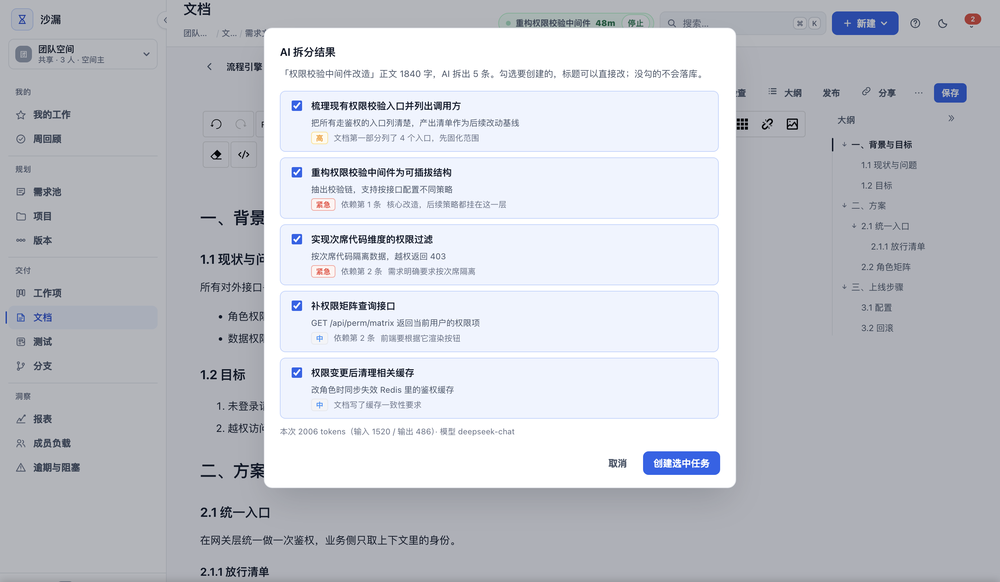

### 8.4 可见范围

每篇文档有独立的可见范围，与用例分组同口径三档：团队共享（默认，项目成员都能读）、指定成员（负责人 + 最多 50 位勾选成员）、仅自己（只有负责人）。可见 = 项目可见范围与文档可见范围的交集，空间管理员同样受约束；草稿不受影响，发布后才按可见范围生效。

保存和发布是两步：保存只更新正文，文档仍是草稿（只有负责人与空间管理员能看到），保存后的提示条旁直接给出「发布」；发布后工具栏显示绿色「已发布」，再保存即时生效，不需要重复发布。收回发布收进「更多」菜单，收回后回到草稿且原分享链接失效；关闭一份仍是草稿的文档时会问「留在草稿 / 发布并关闭」。

列表、阅读模式和「权限说明」会显示当前档位与名单人数。已发布文档在权限说明里点「调整」即可改档位；把团队共享收窄为指定成员或仅自己只能由文档负责人操作，确认后不在名单里的成员（含未列入名单的空间管理员）立即看不到，已有公开分享链接同步撤销。只有团队共享文档能生成公开只读分享链接。

分类还可以设置默认可见范围：在分类上右键「默认可见范围…」，选好档位与名单后，之后在该分类新建的文档会按此预填。默认值只影响新建，已有文档不受影响；新建弹窗里仍可逐篇调整，改分类默认也不会改动已建文档。

### 8.5 收藏、我的与复制

阅读页头工具条的星标可收藏 / 取消收藏当前文档，收藏按人幂等记录、跨设备同步；收藏口径与可见范围一致，文档被收回或收窄后不在名单里的成员会立即从收藏列表消失。

文档树二级导航的「我的」视图分「最近访问」和「我的收藏」两段：最近访问记录本机最近打开的文档（最多 20 篇，只存在当前浏览器），收藏来自服务端；点任一行直接进入阅读模式，收藏行内的 × 可就地取消。

复制文档可从阅读模式「更多」菜单、编辑页按钮或文档树右键发起。副本以草稿形式建在原文档同一归属下，负责人为操作者、标题自动加「 副本」后缀（已带后缀不叠加），指定成员档会一并复制名单；活动记录记「复制文档「X」创建了「Y」」。

全局搜索（Cmd/Ctrl+K）命中文档正文标题时按章节展示：主标题是命中的章节名，文档名并入副信息，点击直达阅读模式的对应小节并高亮该节。

---

## 9. 测试

「测试」把用例、缺陷、测试计划、覆盖矩阵与测试报告串成一条质量链路。五个模式统一在标题下方的二级导航切换；用例与测试计划支持「全部项目 / 单个项目」两种浏览范围，缺陷也有独立的全部 / 单项目范围；覆盖矩阵与测试报告始终按单个项目查看。

> 测试用例的「目录」就是项目的目录树（多级、单归属），与工作项、需求共用节点；在用例筛选条里改目录，工作项分类面板会看到同一棵树。

### 9.1 用例

- 按项目维护用例库：编号、标题、前置条件、测试数据、步骤、预期结果、优先级、分类目录与执行人。
- 每条用例带项目内稳定编号（如 `TC-007`），创建后不变，可直接写进外部表格与缺陷描述对照；换项目会在目标项目重新取号。列表序号是当前筛选结果的位置，不能当编号引用。
- 项目下拉可切「全部项目」：用例按项目分组展示，组内各自分页加载，不合并跨项目排序。左侧「项目导航」树按「项目集 → 项目 → 分组」浏览：项目集可折叠，集头给出项目数与用例合计，没有归集的项目单独归在「未归入项目集」；项目默认折叠，收窄到某项目或搜索时自动展开；搜索按项目集、项目或分组名命中，命中项临时展开。点项目或分组就地收窄查看；右键项目行或分组行可就地新建分组 / 子分组、改名、删除，按行所属项目校验写权限，只读项目的右键只剩查看与筛选。分类目录与拖拽归类仍要进入项目。
- 全部项目下新建用例会先让你选择目标项目，只列出你有写权限的项目；编辑、执行、转缺陷与删除按用例所属项目判断权限。Excel / CSV 导入导出在收窄到单个项目后即可用；AI 生成需要先切到单个项目。
- 查询条：排序字段（创建时间 / 更新时间 / 最近执行 / 用例编号 / 优先级 / 分类目录 / 执行结果）与升 / 降序、分组维度、每页 50 / 100 / 200 条；点「加载更多」继续翻页，不做页码。筛选条上的候选计数来自服务端全量统计，不受已加载条数影响。
- 执行结果统计与筛选合并成一条可点计数（全部 / 通过 / 失败 / 阻塞 / 跳过 / 未执行）：点计数即按该结果筛选，再点「全部」或「清空筛选」回到全量；计数始终是全项目口径，不随当前筛选变化。宽屏下可点计数与筛选控件排在同一张卡的同一行、筛选条不折行；窄屏收进「筛选」面板。覆盖矩阵、测试计划与测试报告模式不显示这两行。
- 搜索默认只搜标题、编号与分类目录；打开「含步骤与前置」后才搜前置条件、测试数据与步骤（大字段，较慢）。
- 筛选条上的「目录」打开项目目录弹层：分类目录是单归属的多级树，一条用例只挂一个目录节点，弹层底部的「显示子目录用例」开关决定筛选是否带上子目录，没挂目录的用例归在「未归类」；目录计数是项目内全量，不随当前筛选变化。目录的新建、重命名、删除与拖拽调层级都在弹层里完成，层级不限（与文档分类同口径，只禁止成环）。入口按钮只显示所选目录名，鼠标悬停可看全路径，长路径也不会把目录名截掉。
- 左侧面板只放自定义分组（搜索、新建、层级与可见范围），目录不再占左侧空间；要按目录查看用例，用筛选条的「目录」或下面「分组显示」里的「按目录分段」。
- 自定义分组（用例集）是多归属：一条用例可进多个分组，分组间计数可重叠、不能相加当总数。分组是引用不是复制，删除分组不删用例，也不影响已加入的测试计划。
- 分组可见范围三档：「团队共享」项目成员可见可用；「指定成员可见」只有创建人与名单内成员能看能筛（名单最多 50 人，创建人始终可见、不占名额）；「仅自己可见」只有创建人能看能改。把团队分组收窄成指定成员 / 个人，只能由创建人操作。
- 分组分手工与动态两种：手工分组成员靠勾选、批量加入或拖拽维护；动态分组按规则自动收录（执行结果、优先级、分类目录、主需求、执行人、未关闭缺陷、关键词，可含子目录与大字段搜索），保存前试算命中数，一次最多 2000 条。「一键回归集」把规则设成回归口径：最近失败 / 阻塞，或关联缺陷仍未关闭。动态分组成员在读取分组、分组段头与证据前自动自愈刷新，不能手工加入或移出，也不接受拖拽；规则按创建人的可见范围求值，不随查看者变化。
- 只有团队共享分组进交付报告与发布检查的证据：按分组汇总条数与通过 / 失败 / 阻塞 / 跳过 / 未执行分布（含动态分组），分组间成员可重叠、条数不能相加当总数。这份汇总只作呈现，不改变发布阻断判定；发布必测仍按测试计划判断。指定成员 / 仅自己可见的分组不进证据，要留证据先由创建人转为团队共享。
- 拖拽归类：按目录分组时把用例拖到段头＝移动归属（原目录移出，成功后可撤销）；拖到分组＝加入（原分组保留，撤销只退本次新增的成员）；按优先级分组时拖到段头＝改优先级。移动目录归属也可用勾选加「批量设置目录」。放置前一律先确认，并写明编号与执行历史不变、计划范围不变等影响。触屏没有拖拽，用勾选加批量操作代替。
- 分组显示：按分类目录 / 优先级 / 执行结果 / 执行人 / 主需求 / 自定义分组分段。段头带条数与通过 / 失败 / 未执行分布，可折叠、段内「加载更多」、整组全选；零用例的段保留，便于发现覆盖缺口。按执行人分组不提供拖拽动作。
- 勾选行即可批量维护：批量设置或清空目录、优先级，批量加入分组，批量删除；明确勾选单次最多 200 条。「全选筛选结果」按条件生效、含未加载的行，一次最多 2000 条，其中取消勾选最多 500 条；只读项目的用例不可勾选。「移出分组」只在按某个分组筛选或全选分组段时出现，移出只解除引用，用例本体保留。
- 「加入测试计划」支持按当前筛选圈选：弹框先写明范围（项目 + 筛选条件）并预览前 8 条，再试算「范围命中 / 已在计划中 / 本次新增」，已在计划内的自动跳过；可整批标记「发布必测」，或直接新建一个草稿计划。按筛选圈选时还可勾「同时保存为动态分组」，把当前筛选条件存成一个团队共享的动态分组（需填名称）；勾选模式、范围叠加了分组条件、取消勾选过个别用例、没有任何筛选条件或超出 2000 条时，这个选项置灰并写明原因。勾选模式下只带已勾选的行，不做筛选试算。
- 工具栏「导出」可选 Excel 与 CSV：Excel 带品牌色表头、按内容设定的列宽、长文本换行、冻结编号 / 标题列与表头、全表筛选与横向 A4 打印，并附最近结果、执行人、执行时间与最近备注；范围分当前筛选、所选与项目全部（都含未加载的行，一次最多 2000 条）。
- 「导入」支持 Excel（.xlsx / .xls）与 CSV：按表头识别列，兼容外部表格另存的 CSV（`用例名称`、`需求对应`、`测试步骤`、`期望结果` 等列名都能认出，列顺序不限）；「测试步骤 + 期望结果」两列按行号自动配对，某步没有预期可留空行，不会把后续预期错配到前一步。外部编号不保留，执行结果与截图列无法还原成执行记录，导入结果会明确列出被忽略的列；单次最多 1000 行。「导入」菜单里可下载 Excel / CSV 导入模板：带示例行、优先级下拉与「填写说明」页，示例行导入前请删除。
- 「AI 生成用例」可从需求文档或需求池条目生成用例草稿：勾选并调整标题、优先级、分类后才会创建；生成过程可取消与重试，已有同名用例会跳过。
- 可直接标记通过、失败、阻塞或跳过；跳过表示本次不执行 / 不适用，算已执行但不计入通过率，也不会转缺陷。失败用例可一键转成缺陷工作项，编号、前置条件、测试数据、步骤与备注会写入缺陷描述。
- 「视图」可保存当前项目范围、筛选与展示方式（含排序、分组维度与每页条数），供下次一键恢复。

### 9.2 缺陷

- 汇总缺陷工作项（工作项类型为「缺陷」）：默认看「全部项目」，也可在筛选条切换到单个项目；跨项目时每行标明所属项目。
- 默认只看未关闭，并按严重度从高到低排序；待修复、修复中、待回归都算未关闭，进入完成列且回归通过才计为已关闭。
- 回归状态由系统随缺陷所在状态自动维护：进入「待测试 / 测试中」即记为待回归（表示开发已提交修复），进入「已完成」自动记为回归通过，退回「待处理 / 进行中」自动记为回归失败；无需手工判断是否修好。
- 可按项目、严重度、修复状态、负责人、发现版本与关键词筛选；「关联用例」来自执行流水里失败转缺陷的记录。
- 点击行打开工作项抽屉查看详情；回归状态随状态自动更新，也可在抽屉内手工修正。
- 状态、优先级、负责人可在缺陷行内直接改，交互与工作项列表一致：点开菜单选中即保存，只读项目不提供入口。
- 「新建缺陷」直接以缺陷类型建在工作项看板。看全部项目时会先让你选择目标项目，只列出你有写权限的项目，避免建到错误项目。

### 9.3 测试计划

- 项目下拉同样支持「全部项目」：计划按项目分组浏览；新建计划需先选择目标项目，只列出有写权限的项目。
- 把一次版本回归或一轮测试圈成计划：在计划详情里「圈选用例」逐条勾选加入，或在用例页按勾选 / 当前筛选批量加入（见 9.1）；设置负责人、起止与版本。
- **执行人**：计划可单独指派一名执行人（须是空间成员，且对计划所属项目有「可参与」或「可测试」权限）。被指派后，计划进入对方的「我的工作 → 待我执行的测试计划」，并发送「测试计划指派」通知；改派时给新执行人发通知，未指派或未变化不打扰。新建计划时，项目「可测试」成员也可建计划，但执行人仍按计划单独指派。
- 按筛选圈选含未加载的行，一次最多 2000 条（单事务），已在计划内的自动跳过；加入时可整批标记「发布必测」，发布检查据此判断必测用例是否执行通过。
- 在计划内批量记录执行结果（通过 / 失败 / 阻塞 / 跳过），结果同时写回用例最近结果并追加执行流水；打开计划、批量执行、编辑与删除按计划所属项目校验权限。
- 进度按已执行条数计算，跳过算已执行；通过率分母排除跳过的用例，避免不适用项拉低通过率。
- 计划完成后锁定为快照，便于回溯某一轮测试的范围与结论。

### 9.4 覆盖矩阵

- 按需求统计用例覆盖：哪些需求已有用例、覆盖多少、通过率如何。
- 每行同时给出通过 / 失败 / 阻塞 / 跳过条数，通过率分母排除跳过。
- 按项目全量计算，不受用例列表分页与筛选影响；只提供单个项目，不汇总跨项目。

### 9.5 测试报告

- 汇总当前项目的通过率、失败 / 阻塞清单与需求覆盖；通过率分母排除跳过的用例，跳过单独计数。
- 只提供单个项目，不汇总跨项目。
- 支持导出 CSV、Word 与 PDF（PDF 走浏览器打印，目标选「另存为 PDF」），作为本轮测试的质量证据。

> 命名口径：菜单与页面统一称「测试」，其下五个模式为「用例 / 缺陷 / 测试计划 / 覆盖矩阵 / 测试报告」；不要再把「覆盖矩阵」「测试报告」当成独立一级菜单。

---

## 10. 分支

分支用来跟住一次开发从拉出到上线的流转，不替代版本：分支记录代码线，版本记录交付范围。分支状态是开发流转状态，不代表生产发布。

### 10.1 分支页

- 入口在项目驾驶舱的「分支」交付资源卡，或版本详情右上角「更多 → 本版本分支」，仅在空间启用 Git 仓库后显示；进入后默认按项目 / 版本筛选。默认按状态分「开发中 / 待测试 / 待合并 / 已发布」四列，可切换「按项目」分组或列表视图；顶部汇总可点击某一档直接筛选，并显示已发布分支的平均发布周期。
- 支持关键词搜索与项目筛选；不归属项目的分支显示为「空间级公共分支」。
- 顶部还可按生命周期筛选「进行中 / 已完成 / 已取消 / 已忽略 / 待确认 / 全部」，默认只看进行中；生命周期与开发状态正交，切生命周期不会改变看板列。
- 卡片或列表行可拖拽到其他状态列，也可点状态徽标选择目标状态；状态允许任意方向切换，包括打回。拖拽、状态菜单与编辑入口仅对分支所属项目可写者显示。

### 10.2 仓库绑定与只读同步

- 空间主在分支页「管理仓库」里为项目绑定 GitLab 仓库：GitLab 地址、项目标识（数字 ID 或 `group/project`）、仓库名、默认目标分支（只作默认值，不同步导入）、导入策略（近 90 天有提交 / 全部分支 / 只同步已跟踪分支）与访问令牌（PRIVATE-TOKEN）。令牌只保存密文，留空表示不修改。
- 沙漏只读拉取分支与已合并 MR，不向 GitLab 回写、不触发流水线。参与定时同步的仓库每 10 分钟拉取一次，可暂停；暂停后仍能手动「同步」。
- 已有同步分支的仓库不能更换所属项目、GitLab 地址或项目标识；当前没有解绑入口，只能暂停定时同步并保留绑定。
- 项目下会显示「本项目仓库」条，可按仓库筛选或按仓库分组；同名分支在不同仓库各算一条，手工创建的分支显示「未归属仓库」。
- 远程变化不会静默改本地结论：远程分支消失、关闭后又有新提交、分支名冲突等进入「待确认」队列，可逐条或批量标记完成 / 取消 / 忽略；忽略只影响呈现，不删除分支记录。
- 同步成功只说明拉到了远程事实，不等于测试通过或生产发布；发布证据仍按第 11 节。

### 10.3 新建与编辑

- 新建分支填写：分支名、目标分支（选填）、所属项目（留空为空间级公共分支）、负责人、初始状态、备注。分支名允许字母、数字、点、下划线、中划线与斜杠，最长 80 个字符；同一项目下不能重名。
- 创建、编辑、改状态与删除都按所属项目写权限判定；查看者只读，只读项目不会出现在新建分支的项目下拉中，任务抽屉也会隐藏就地新建入口。服务端仍会拦截无写权限的请求。
- 删除分支与修改同口径：空间主、管理员、项目负责人或对该项目可写的成员都能删除；只读项目与查看者不能删除，空间级公共分支由空间内非查看者维护。删除会解除关联工作项上的分支引用（工作项本身保留），并清除该分支的操作记录。

### 10.4 状态与时间

- 四个状态依次为开发中、待测试、待合并、已发布；每次进入状态会记录首次时间，抽屉中显示完整状态时间轴。
- 未发布分支显示当前状态已停留多久；已发布分支显示从创建到发布的周期。抽屉同时列出关联工作项、影响版本、归属项目与操作记录。
- 状态变更与删除都会写入操作记录；只看不改的成员不会产生记录。

### 10.5 与工作项、版本的关系

- 工作项详情「更多关联 → 所属分支」可选择已有分支；也可点「新建分支」就地创建，系统按当前项目和任务负责人预填，创建成功后自动选中，保存工作项后关联生效。
- 分支可关联版本，但版本内容、发布计划与生产发布事实仍以版本页为准；分支的「已发布」只表示开发流转到上线，不等于生产发布证据。

---

## 11. 版本与发布

### 11.1 版本管理

从「规划 > 版本」按项目建版本。版本状态为计划中 / 进行中 / 已发布 / 已关闭 / 已取消，与发布计划、实际发布事件、任务工作状态分开记录。关闭表示这一轮交付结束但未发布，取消表示这一轮作废；两者都必须填写原因，历史与工作项关联保留，但不计入发布节奏，也不能再加入发布计划或新增工作项。已发布版本不能关闭或取消。关闭需要项目写权限。发布计划与发布记录默认由空间主、管理员或项目负责人维护（均需对该项目可写）；空间可在「设置 → 工作流 → 发布权限」勾选「项目可写成员」，放开给所有对该项目可写的成员，查看者始终无权。该配置只影响发布计划与发布记录，新建 / 编辑版本、调整版本内容仍按项目写权限。

进入「进行中」时记录承诺基线：当时关联的工作项与预估写入快照，之后增删工作项或改预估，版本卡会显示基线、新增、移除与完成情况；基线不回写，旧版本没有快照时展示为空。

一个版本生产只成功部署一次，后续改动应新建 hotfix 版本；同一制品可重新部署（redeploy）或回滚（rollback），替换制品须新建版本。同一发布计划下，用同样的制品重复「部署」到同样的目标会被拒绝（提示原记录编号），确属重新部署请用「重部署」。约定一个交付批次一个版本：hotfix、跨迭代发布都单独建版本，并在名称上体现（例如 `2.4.0`、`2.4.1-hotfix`）。发布计划可跨版本、跨项目，只有计划包含的全部版本都完成成功的生产部署 / 重部署，计划才会完成；test/staging、回滚与部分成功不完成计划。已取消的计划不会因为发布被改回完成：状态保持取消，发布事实照常记录，并给关注者与计划负责人发一条提醒。版本卡同时显示该项目的里程碑与生产成功次数，点里程碑可确认、改期或取消。

版本页默认「按版本」，单项目还可切「首版 / 迭代分析」；「跨项目视图」里提供「全部版本」「发布日程」「全部项目」三种跨项目口径。「全部版本」跨项目列出全部可见项目的版本、目标就绪日、工作项数与最近一次成功的生产发布；在可管理的版本前勾选（无发布计划权限的项目不可勾选），可把所选版本预填进一个新的发布计划，主版本取第一个勾选版本。「发布日程」跨项目汇总发布计划，默认按计划时间升序、只看未完成（草稿 + 就绪），可按项目、环境、状态与时间范围（未来 30 天 / 90 天 / 前后 3 个月 / 全部时间）筛选；点任意一行打开该计划的发布工作区，可查看计划覆盖的全部版本，并切到某个版本记录实际、查看历史与内容。日程只是计划汇总，不代表实际发布，归档项目不进入日程。

- 版本内容关联在成功事实形成后冻结，不得用撤徽标或回滚解锁、改写已交付内容；需要新增内容时另建版本。冻结的是内容关联，**不是任务完成、回退或计时**，这些工作动作仍按原有权限与流转规则执行。
- 需求仍只有一个可空目标 `versionId`，测试计划也仍是单目标 `versionId`；只有工作项与计划交付版本改为多对多。需求调期、关闭、恢复不会自动修改旧任务。
- 删除版本不会自动解绑：已发布或有实际尝试记录（含失败）的版本不可删除；工作项绑定（含回收站）或需求目标引用（含已关闭）也阻止删除。无证据版本的引用须按权限有因解除 / 调整，回收站任务先恢复，已关闭需求有因恢复，回到已通过时会清目标。不得删除历史证据或通过人工撤标绕过保护。

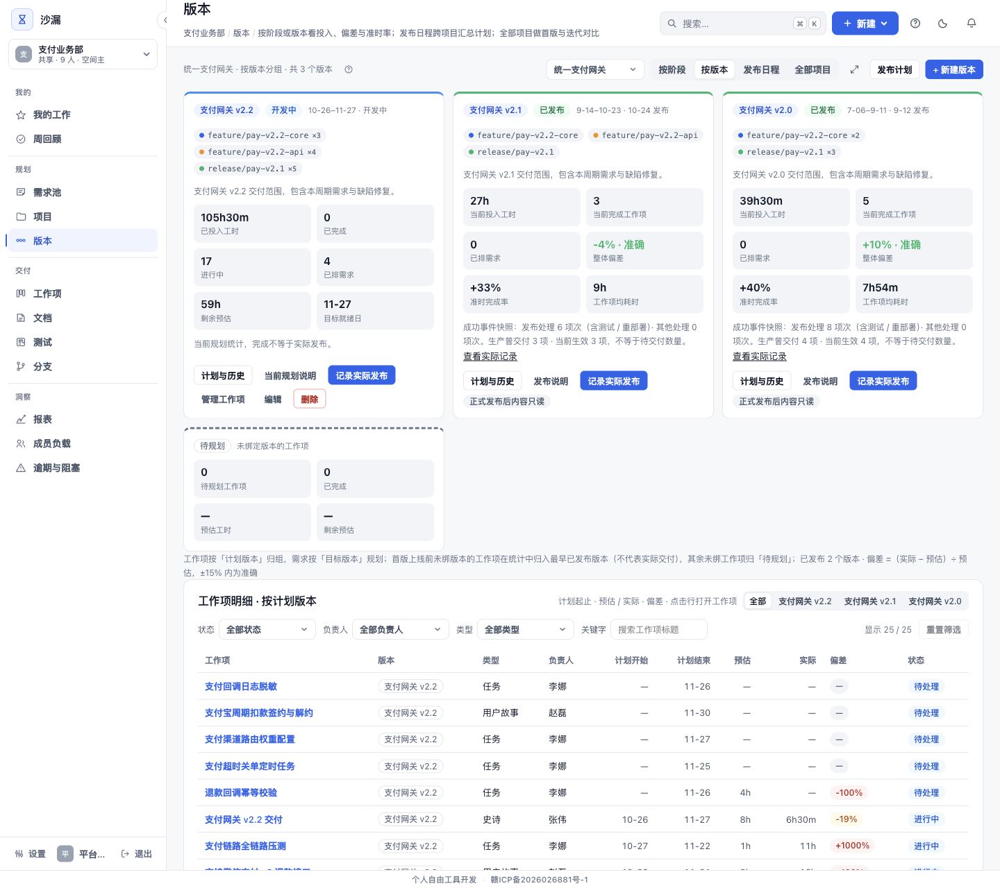

### 11.2 当前计划交付版本（原「影响版本」）

- 一个工作项可关联多个同项目计划交付版本；它们**不是实际发布证据**，也不要求等于需求目标。
- 保存时未提交或提交 null 保留原关联，空数组表示解绑；改变关联须填写原因，由管理者或该任务负责人操作，已冻结的内容关联不能借改关联绕过。
- 版本内容、计划范围与实际交付范围是三个独立口径：关联版本不等于入选计划，入选计划也不等于实际交付。

### 11.3 已完成与生产发布事实

「已发布」是完成列旁的**只读徽标，看板不新增列**；完成不等于发布，发布也不锁住任务工作状态。工作项列表提供可关闭的「发布态」列，逐行显示已发布 / 已发布（人工）/ 未发布。

- 徽标优先从成功的生产发布记录推导，test / staging 成功不算生产发布，正式字段也不接受人工写入或直接撤标。
- 只有从其他系统迁移、没有发布记录的历史工作项，才允许人工补录「已发布（人工）」，必须填写生效日期与原因；谁能标记由空间在「设置 → 工作流 → 发布权限 → 人工标记工作项发布」配置，默认空间主、管理员、项目负责人，可加选项目可写成员，查看者始终无权。标记可在工作项详情逐条操作，也可在列表勾选批量标记 / 撤销，单次最多 100 条。人工标记只影响徽标、「发布态」列与筛选，不写入版本发布记录、不改交付状态，也不参与需求交付阶段派生、交付报告与版本统计；撤销后保留历史并回落为「未发布」。
- 「发布态」列可在工作项列表的「显示字段」里关闭；列表、看板、甘特、我的工作与列状态工作页可按「发布态」筛选（已发布 / 未发布）；已发布包含成功生产发布记录与生效的人工标记，回滚过也算发布过。
- 状态分为未发布、当前有效、部分有效、已回滚、证据未知；按目标查看实际覆盖，不把未知范围当作全量发布。
- 回滚是一次新的实际事件，按目标撤销引用范围，保留原记录和全部历史；同一任务可有多个版本、多次事件，不能只看最新一条判断全部目标。

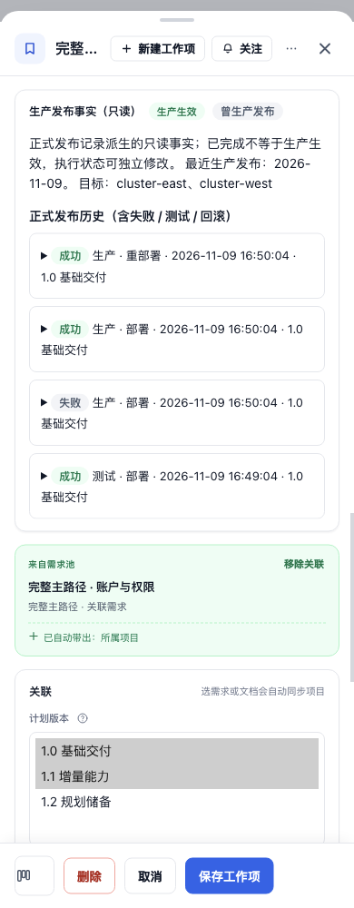

### 11.4 发布计划、预览与确认

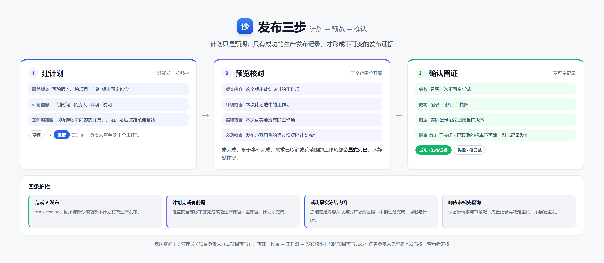

1. **建计划**：选择覆盖版本（可跨版本、跨项目，当前版本固定包含）、计划时间、负责人、环境和工作项范围。状态为草稿 / 就绪 / 取消；就绪需计划时间、负责人和至少一个工作项，完成后只读，后续另建计划。
2. **预览**：按同一发布上下文分别核对版本内容、计划范围与实际范围。未完成、晚于事件完成、需求已关闭或跨范围的工作项都会显式列出，不静默排除。
3. **确认**：选择成功或失败。失败只留尝试；成功保存不可变记录、条目与快照。实际记录归属当前版本，计划须覆盖的全部版本都完成成功生产部署 / 重部署才算完成，test / staging、回滚与部分成功不计。
4. **异常与冲突**：范围、计划或权限变化后重新预览；响应未知时保留原请求与幂等键，先查询再决定重试，不刷新即清理或换键重发。
5. **入口与表单**：版本卡「计划与历史」进入计划范围，「记录实际发布」直达实际发布；工作区按「计划范围 / 实际发布 / 历史与内容」三步组织，历史与内容合并了发布记录、操作记录与版本内容。计划范围页显示就绪条件与「计划涉及分支」区块（只实时汇总，不落库、不作发布证据）；实际表单常显常规字段，覆盖、操作、关联事件、实际说明与失败原因收在「高级与异常字段」，遇到重部署 / 回滚、非全量覆盖或失败时自动展开。「未按计划发布的原因」始终显示在预览按钮上方，预览被拦时会自动滚动并定位到该输入框。
6. **看清计划与阻断**：实际页顶部「计划带入」会列出所选计划绑定的每个版本（项目 · 版本名、版本状态、是否已发布、是否为本次登记版本），并可直接「查看 / 调整计划」回到第 1 步。右侧「就绪条件」卡在不能记录时直接写出原因与下一步（补齐字段 / 去预览 / 填写原因 / 去保存计划），不再只靠按钮悬停提示；版本已关闭或取消时顶部直接说明原因，不再归因于权限。
7. **权限**：默认由空间主、管理员或项目负责人（且对该项目可写）维护计划与记录发布；空间可在「设置 → 工作流 → 发布权限」勾选「项目可写成员」，放开给所有对该项目可写的成员。查看者与只读成员不能操作；任务负责人身份与计划负责人字段都不赋权，发布人固定为当前登录者。

计划时间按本地墙钟记录，实际发生时间才带时区偏移；手机端为全屏弹窗。字段级规则见《接口契约》（仓库 docs）。

#### 发布准备、计划关注与企业微信群提醒

计划页的「发布准备」卡只做**发布前提醒与核对**，不改变工作项状态，也不参与发布检查或阻断发布。

- **准备概览**：按计划内工作项汇总已确认 / 有风险 / 未确认 / 未指派，显示关注人数与最近一次推送；工作项负责人可逐项「确认」或「标记风险」，也可撤销确认回到待确认。计划范围变更或发布时间提前时，会要求重新确认。
- **通知成员**：推送范围可选「全部项目成员 / 仅负责人 / 指定成员」，并可只发给尚未确认的人；渠道为站内、邮件、企业微信群（统计里的「邮件入队」指已写入发送队列，不代表已送达），可附 200 字以内的补充说明。同一人负责多项时只收一条汇总；同一发送人、同一范围与渠道在 30 秒内重复点击不会重复发送。只读成员可以收到并查看，但不能确认。发送提醒要求空间主、管理员或计划涉及各项目的负责人都可管理；企业微信群只发到空间配置的群，不能按人送达，推送记录会写明群发送结果或失败原因。
- **自动里程碑**：每天 09:05 扫描就绪计划，T-7 / T-3 / T-1 提醒尚未确认且未回执的工作项负责人，T-0 提醒计划负责人与关注者。同一人同一里程碑只发一次；计划改期后按新日期重新计算。
- **关注计划**：计划页可「关注此计划」，接收改期、范围或版本变化、进入就绪与发布日提醒；关注不代表负责，可随时取消。「我的工作 → 我关注的」会汇总关注的发布计划。

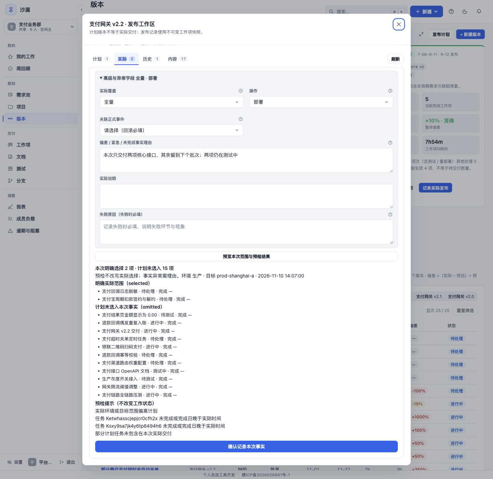

### 11.5 发布说明、历史与统计

- 版本、计划与实际快照分开保存，记录、发布说明与「导出快照 CSV」不随后续改名、调期、需求取消或回滚漂移；成功、失败、重部署与回滚事件都保留，历史只读。
- 当前工时 / 完成数与每次实际范围、计划偏差、覆盖及当前生效目标分开展示；单次未选不等于当前剩余，多版本关联与多次发布不放大全局工时，也不推断待交付数量。
- 需求展示部分交付、目标偏差与任务当前版本数组；取消不抹实际快照。发布不等于业务验收，零关联任务不能显示 100% 验收。
- 首版 / 迭代阶段只用于统计，不写任务绑定、徽标或正式记录；旧版本缺正式记录显示证据未知，不补造历史。
- JSON 只搬运任务版本数组、`version.startDate`、需求日期与取消标记，不转移正式证据；正式证据需完整数据库备份（六张发布表及计划任务范围），附件另随运维备份恢复。

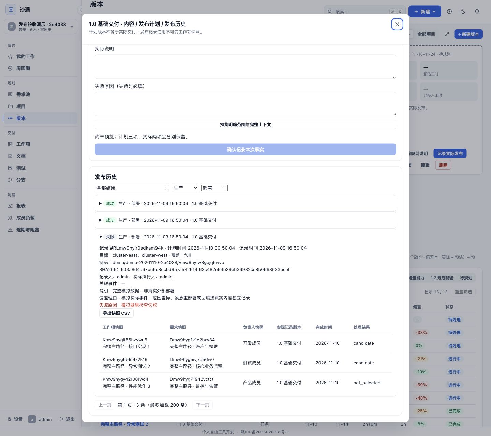

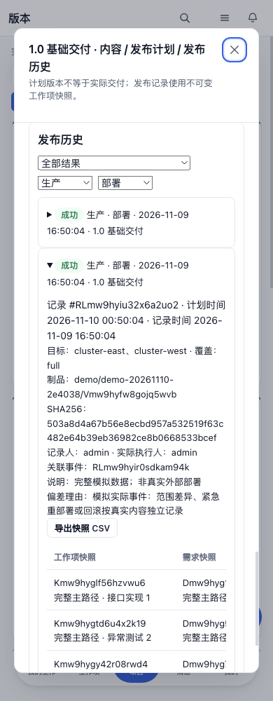

### 11.6 阶段工时拆分与版本汇总

- **拆分口径**：先认测试窗口（开始测试 → 测试结束，按自然日），窗口内的计时归「测试」；剩下的计时按工作项类型拆，需求类工作项归「产品 / 设计」，任务 / 缺陷归「开发」。史诗只做分组，不计工时。三段的实际互不重叠，合计等于实际工时。
- **产品 / 设计是近似口径**：它统计需求类工作项上的全部非测试计时，评审、分析和跟进都应记在这条工作项上；没有产品参与的需求类工作项计 0，不做摊派。测试窗口按自然日判断，提测当天、测试结束当天的计时可能被整段划入窗口。
- **预估拆分**：产品 / 设计取需求类的「预计耗时」，开发取任务 / 缺陷的「预计耗时」，测试取「测试预估」；没填预估的工作项不会按 0 计入偏差。
- **需求详情工时卡**：需求概览的「工时」卡显示预计、实际、偏差与三段拆分，按该需求下未删除的工作项实时汇总；史诗不计入。
- **版本页汇总**：版本页「首版 / 迭代分析」的阶段工时汇总先选一个版本，再按阶段 / 分类 / 负责人 / 需求四个维度看条目、预估、实际与占比。阶段维度列出产品 / 设计、开发、测试三段和完成 / 未开始计数；分类、负责人、需求维度保留窗口外 / 窗口内两列。切到「跨项目视图 → 全部版本」是跨版本总量对比，同一工作项绑定多个版本会重复计入，卡片会注明。
- **行与下钻**：阶段表里完成 / 未开始只计条目，不与工时相加；点任意分组行下钻到工作项明细，再点行打开详情。项目驾驶舱的分类表仍按窗口外 / 窗口内展示。要按岗位看投入，用「投入结构」的「职能」维度。
- **边界**：评审 / 排期属于需求池阶段，不产生工作项工时，不重复统计；发布仍以版本发布证据为准。

### 11.7 一页式交付报告

版本卡与发布历史都提供「交付报告」入口，也可以直接进入交付报告视图选版本，版本选取器按「项目集 → 项目 → 版本」三层分组。它把承诺范围、实际发布、回归结果、遗留缺陷、投入与验收补充收成一页，供对外提交或内部复盘：

- **只读事实**：数字与清单实时来自版本、发布、测试、工时记录，只读且可点回原始记录；文字由系统按语气与粒度草拟。
- **测试证据**：「质量与验证」段列出本项目团队共享分组的条数与通过 / 失败 / 阻塞 / 跳过 / 未执行分布（标明动态收录或手工挑选），发布检查的证据里带同一份汇总；分组间成员可重叠，条数不能相加当总数，这份汇总只作呈现，不改变发布阻断判定。质量数字按该版本关联的全部测试计划汇总，同一缺陷被多个计划转出只计一次。
- **人工层**：交付对象、支持联系方式、验收补充、逐段改写与确认状态自动保存（带 revision，冲突时提示），全部「对外表述」确认后才能导出。
- **前提**：必须选定一条成功的生产发布记录；测试环境、失败与回滚不构成对外交付依据，没有成功生产发布时不能导出客户版。
- **语气**：客户版隐去成员与内部信息；管理版带负责人与执行细节；内部复盘版含内部备注，永不提供分享链接。
- **导出即锁定**：PDF（A4，经浏览器打印）、Markdown、独立 HTML 三种格式导出前，先落一条带正式编号的不可变快照，再用冻结载荷产出文件；之后系统记录变化不影响已导出的这一份。快照记录里可查看、再次下载或分享。
- **分享**：链接挂在快照上，接收人无需登录；可设置是否允许下载与有效期；撤销分享不影响快照本身。
- **权限**：项目查看权限可阅读；项目写权限可编辑、导出与分享；只有查看权限时不能改写或导出。

---

## 12. 洞察

### 12.1 成员负载

在「洞察 > 成员负载」中：

- **按人名册**：每张卡片显示公司、岗位、有效角色、总负载、进行中 / 待处理 / 逾期 / 阻塞数量、参与项目各自剩余，以及所选工时区间的已计工时；总负载 =（开发剩余 + 测试剩余）÷（容量窗口工作日 × 每日容量）：开发剩余是本人负责的未完成工作项剩余预估之和；测试剩余是本人作为测试负责人的待测试 / 测试中工作项按「测试预估 − 测试窗口内已计工时」折算之和；每日容量取成员自己的计时设置（每人每天最多计入几小时），未设置按 8h/日；容量窗口从今天数到该成员未完成工作项（含在手测试项）的最晚截止日、只数工作日，没有截止日按 5 天、最少 1 天、最多 22 个工作日（约一个月，可用配置项 app.workload.max-workdays 调整），窗口只折算容量，与截止日分开看；名册展示空间内除系统管理员外的全部成员，没有在途项时也保留一行。顶部「合计剩余」只累加开发剩余，避免同一工作项的工时在开发和测试两侧重复计数。
- **筛选与分组**：按项目、公司、角色筛选；支持搜索、按公司 / 角色 / 项目 / 状态分组，并按负载、剩余工时、逾期数或姓名排序。
- **工时区间**：本周 / 上周 / 近 30 天 / 本月四档，只改变「已计工时」；负载与容量始终按剩余预估和截止日计算。选择记在本机，换浏览器或清缓存会回到「本周」。
- **成员工作台**：点击成员进入子页面（地址保留成员参数，刷新后仍停在同一个人），上方是未完成工作项、剩余预估（开发 + 测试，按 N 个工作日容量计，测试部分会注明「含测试」）、区间已计与负载，并列「当前状态」和「参与项目」；测试行展示待测试 / 测试中 / 测试剩余 / 本周测试，参与项目表在未完成项旁标出测试项数；点项目行筛选下方工作项，工作项行可打开详情，工作项清单会标出未填预估的项数；底部按本周 / 上周、按天查看计时明细，计时记录的「项目」列可跳转，未归类记录显示纯文本。
- **按周视图**：周一至周日逐日列出每人工时，并与上周同口径对比。
- **导出**：工具栏「导出当前范围 CSV」按当前筛选与分组导出成员、项目、工作项与计时明细，表头带统计日期与工时区间；成员工作台内可单独导出该成员。

### 12.2 逾期与阻塞

「洞察 > 逾期与阻塞」集中展示跨项目的风险：

- **逾期任务**：超过截止日未完成的工作项。
- **被阻塞任务**：标记为 blocked 的工作项，显示阻塞原因与等待对象。
- **停滞任务**：连续多日无进展的任务。
- **超载提示**：成员负载超过容量。
- 支持站内催办。

---

## 13. 报表

「报表」一级入口下用二级导航切换五个视图：**趋势与分布**、**完成记录**、**流程体检**、**交付图表**、**投入结构**。

### 13.1 趋势与分布

- 近 8 周（可调整周期）的新增与完成趋势；点任一周的新增 / 完成柱，打开该周的工作项明细。
- 工时统计：累计工时、本周工时、平均每项，可切「仅我 / 全空间」；点累计工时或本周工时卡查看对应计时记录（全空间视图带成员列）。
- 按分类与负责人看工作项分布；点任一行打开该分类 / 负责人在统计窗口内完成的工作项。
- 下钻明细与其它工作项列表一致：行内显示发布徽标，可在搜索栏按「全部 / 已发布 / 未发布」再筛。

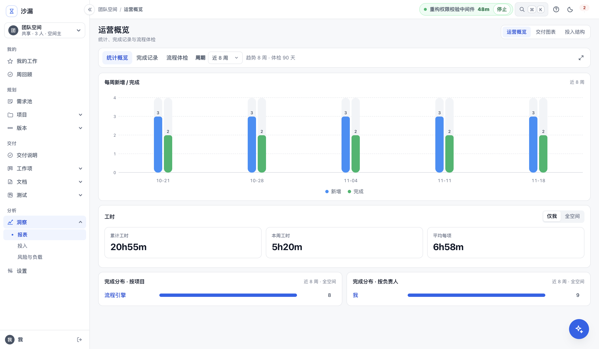

### 13.2 完成记录

- 按月列出已完成工作项，显示负责人、分类、起止时间与总耗时。
- 标题旁显示发布徽标；顶部可按「全部 / 已发布 / 未发布」筛选，月统计与明细同步过滤，筛选后为空会说明当前发布状态。
- 支持导出 CSV（含发布状态列），用来核对某个月的交付清单。

### 13.3 流程体检

「流程体检」不做预测，只检查已有操作记录：一次通过率、需求从通过到开工的延迟、估时与实际耗时的偏差，用来定位流程卡点。瓶颈列、各列停留条、优先级分布和估时偏差清单都可点开对应工作项；比例指标本身不提供明细。

### 13.4 交付图表

交付图表面向管理者，提供五张交付读图：

图表工具栏可按项目、版本、项目角色与公司筛选；选版本后燃尽、速度、累积流、交付周期与缺陷趋势只统计该版本关联的工作项，下钻明细与图表使用同一范围。清空筛选即回到当前可见范围。下钻明细行内带发布徽标，并可按发布状态再筛。

#### 燃尽图

- 横轴：时间（日 / 周）。
- 纵轴：剩余预估工时。
- 剩余 = 总预估 − 已完成实际工时。
- 用于观察项目或所选范围是否按计划收敛。

#### 速度图（Velocity）

- 展示近 4 个自然周的完成工时 / 完成工作项数，按完成时间归周。
- 用于估算团队每周可承受的完成量。

#### 累积流图（CFD）

- 展示近 8 周三个状态（待处理 / 进行中 / 已完成）的累计数量。
- 用于识别流程瓶颈。

#### 交付周期分布

- 统计工作项从创建到完成的周期。
- 展示 P50 / P85 分位数，帮助回答「大部分需求多久能交付」。

#### 缺陷趋势

- 按周展示缺陷新增、关闭与周末存量。
- 用于判断质量问题在收敛还是累积。

> 所有报表支持导出 CSV / PNG。除理想线外，燃尽实际点、速度柱、累积流分层、交付周期分桶与缺陷新增 / 关闭 / 存量都可点开对应工作项明细；明细列表与图表使用同一筛选范围并分页加载。

### 13.5 投入结构

按季度或年度盘点人力、工时与资源投入，回答「这一期投了谁、投了多少」。

- 周期默认当前季度，可切年度；项目、公司、角色、成员筛选只缩小统计范围，不改变口径。
- 六项指标：去重人力、实际工时、测试窗口外、测试窗口内、预估工时与投入人天。实际按计时发生日归期，预估按工作项计划开始日整条归入。测试窗口内取「提测 → 测试结束」窗口内的计时；窗口外是其余全部计时，包含需求评审、方案与设计、开发、联调、验收、运维等，并不等于「开发工时」。
- 可按项目 / 成员 / 公司 / 角色 / 职能切换拆分维度，按实际或预估排序；点任一行下钻到同一周期、同一筛选下的工作项明细，明细行内带发布徽标并可按发布状态再筛。「职能」取空间成员的岗位（如产品经理、设计、运营、运维），没填岗位时回落到项目角色，同一人只归一处，用来观察非研发岗位的投入。
- 指标旁的「?」解释计算口径，「!」提示例外情况，例如跨期计时的归属、未指派负责人只计工时不计人力、当月为不完整数据。
- 去重人力卡片与趋势柱也可下钻：前者先列人再点人，后者把区间夹到该自然月。
- 版本不作为拆分维度：一个工作项可绑定多个版本，按版本汇总会重复计数；单版本投入请看版本详情。
- 支持导出 CSV。

---

## 14. 我的工作

### 14.1 我的工作

「我的」→「我的工作」是角色工作台（手机端为底部「我的工作」tab），也是登录后的默认页面。页签分「待我处理 / 我发起的 / 我关注的」，空间主与管理员另有「团队」。

- **待我处理**：按角色分块汇总「我负责的开发」「我带的测试」「待我执行的测试计划」「待我评审的需求」。测试计划只列执行人是我、尚未完成的计划；待评审需求优先列指派给我的，未指派的按项目写权限进入公共队列，且不含我本人提交的需求。
- 分区标题可点击收起 / 展开；收起后只留标题与数量，「查看全部」一并隐藏，状态按浏览器记住。
- **我发起的**：我提交的需求与我创建的工作项。需求按最近更新排序，状态含评审、排期与完成；工作项按看板状态与截止日期跟踪，含已完成与已取消。可按「需求 / 工作项」筛选。
- **我关注的**：工作项、缺陷、需求与发布计划，只接收提醒，不代表我负责，可随时取消关注。
- **团队**（仅空间主 / 管理员）：本周团队交付概览，可按本周 / 本月 / 近 30 天切换。
- 页签计数来自服务端；待我处理的工作项、我发起的工作项与待我执行的测试计划可跨空间汇总，我发起的需求与待评审需求限定当前空间。逾期、今天到期与阻塞按已加载明细统计，继续加载会更新结论。
- 每个页签默认按最近更新倒序；「显示」菜单可改排序（待我处理：最近更新 / 截止时间 / 优先级；我发起的：最近更新 / 优先级 / 「期望 / 截止」；我关注的：最近更新 / 优先级）。
- 「显示 → 分组」可按项目 / 类型 / 状态 / 优先级分组（待我处理在四个分区内部再分组，因分区已按类型拆分，不提供按类型），分组头显示组名与条数、点击可折叠；分组顺序为优先级 P0→P3、状态按流转顺序、其余按组内最新更新。分组选择按页签记在本机，折叠状态一并记住；分组只作用于已载入的行，页签计数仍来自服务端。
- 统计条按个人未完成剩余口径：「个人剩余」只算未完成项（已完成 / 已取消 / 执行结束不计）的剩余预估并给出负载百分比，未填预估的项单列「未估时」、不进剩余。
- 切换空间时，空间无关的筛选与分组偏好会带到目标空间，不用重选。
- 工具栏「发布」可按发布态筛选（已发布 / 未发布）；它与看板、列表属同一维度，切换后其它视图同步生效。
- 点击任务直接进入详情抽屉。
- 桌面端列表可直接改**优先级、状态、截止日期**：三个字段在只读行与可编辑行长得一样，都是「图标 + 文字」——状态用进度环（空心=待处理/等待接续、半环=正常计时、圆点=已结束计时、实心勾=已完成，颜色取列定义），优先级用色条。可编辑时状态与优先级右侧有浅色小箭头，截止日期在鼠标移到该行时出现日历入口，点击即弹出菜单或改期浮层；优先级与截止日期即时保存，状态沿用流转矩阵，需要原因或越权时仍会弹出确认/原因框，完成后计时与看板同步刷新。跨空间任务需先切换空间再改状态；只读项目只显示文字，没有这些入口。

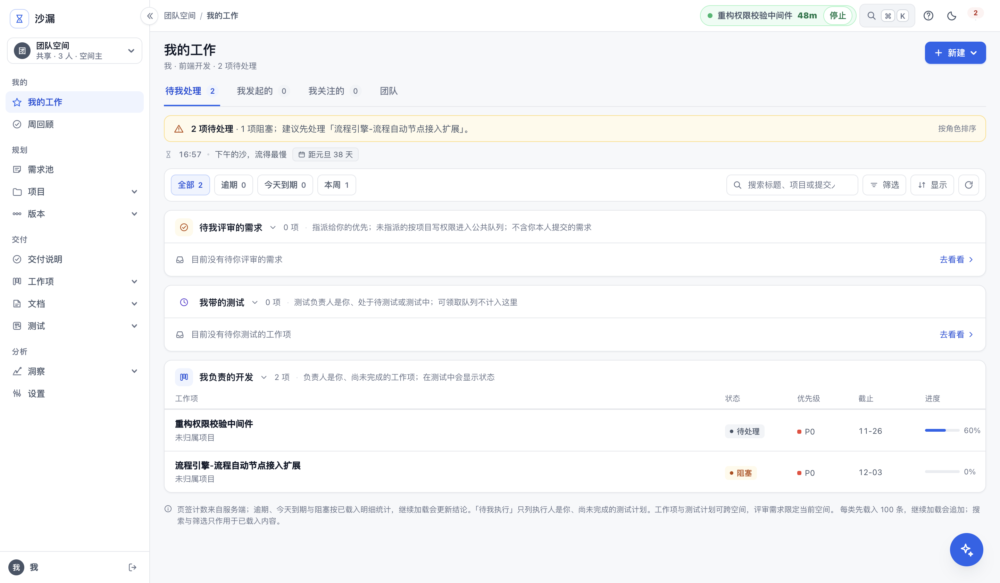

### 14.2 周回顾

「我的」→「周回顾」按周回看工作，范围分「我」与「团队」两段。

- **我**（所有人可见，默认）：只统计我负责的工作项，负责人口径与「我的工作」一致。本周完成、待确认完成、进行中三个分区互斥，同一件事只出现一次；工时只展示我的本周计时。可复制纯文本总结，也可一键生成 AI 周报，人工确认后复制使用。
- **团队**（仅空间主 / 管理员）：同一周看团队交付。顶部是结论条与统计矩阵，下方分为完成 · 发布、质量、文档、成员、项目 · 风险。新增、推进、完成是本周事件，在手、负载、逾期、阻塞是当前快照；负载为剩余预估工时 ÷ 到最晚截止日的容量，0h 且本周有完成标为「未登记」，不等于空闲。
- **角色筛选**只在团队视图出现（开发 / 测试 / 产品 / 设计 / 负责人），只收窄成员明细，不改变团队汇总；按角色筛选时不汇总负载，因为容量按全团队计算。
- 团队视图点统计矩阵里的数字，会从右侧打开统计明细抽屉，列出该数字对应的需求、工作项、用例或文档事件，点条目直接进详情；抽屉不改变当前周与筛选。
- 两种范围都支持按项目收窄、上一周 / 下一周回看；团队视图的周界按空间时区。
- 历史周期按操作记录近似还原，越早的周细节越少。
- 普通成员看不到「团队」分段，团队整体进展仍可去「报表」与「项目」查看。

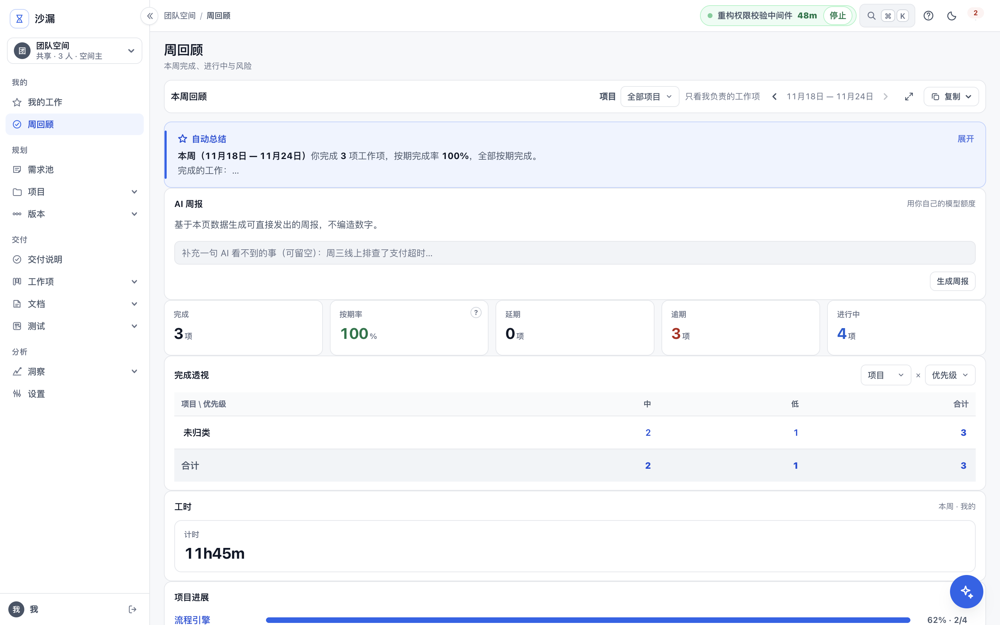

### 14.3 周五补记

「我的工作」里的补记卡片（不占左侧入口）把本周散落的痕迹整理成一份草稿，逐条确认即可，不必周末再回忆。本周有痕迹或已开始补记时会显示，不必等到周五当天。

- 五步：本周概览（约 30 秒）→ 工作项（约 4 分钟）→ 工时（约 2 分钟）→ 风险与变化（约 1.5 分钟）→ 确认（约 1 分钟）。
- 工作项逐条给出证据（创建、状态变化、计时、阻塞、延期、顺延等）与置信度，可选完成 / 进行中 / 阻塞 / 不是工作项，也可以把重复条目合并或跳过。
- 工时按天补记或调整归属，只写工时记录，不改工作项状态；唯一会改工作项的是风险卡片的「解除阻塞」。
- 提交后 5 分钟内可撤销；「今天不补」只跳过本周入口，想补时随时可以再进来，不影响下周。
- 补记写入的是确认记录与工时，不代替看板状态流转；页面不可用时，看板、工作项详情与手动补记工时照常可用。

---

## 15. AI 能力

### 15.1 配置

AI 来源分两层：平台管理员可在「设置 → 通知与集成 → 团队 AI 服务」统一配置额度，成员默认使用团队 AI；成员也可以在「个人设置 → AI 设置」改用自己买的 API Key。

- **团队 AI**：管理员配一次厂商、接口地址、模型与 Key，成员打开 AI 总开关即可使用，不需要各自填 Key。Key 加密保存，界面只显示掩码。
- **我的 API Key**：选择后填写自己的 Key，费用从个人额度扣除；随时可以切回团队 AI。管理员可以关闭个人 Key 选项，此时成员只能使用团队 AI；已保存的 Key 会保留，重新打开后仍可用。
- 页面会标明当前实际使用的是「团队 AI」还是「我的 API Key」；切换来源后需点保存生效。
- 可单独关闭 AI；也可发一次极小请求验证当前来源的地址、模型与密钥是否可用。
- 团队 AI 失效或配置不完整时不会静默改用个人 Key，会提示联系平台管理员；个人 Key 同理，不会借用他人额度。

### 15.2 使用场景

- **AI 拆成工作项**（文档页）：把文档正文拆成工作项草稿，见 8.3。
- **AI 选区处理**（文档页）：选中正文后改写、缩写、扩写或解释这段文字，替换前先看建议，见 8.3。
- **AI 检查完成度**（文档页）：检查文档的功能点是否都有工作项覆盖，见 8.3。
- **AI 生成测试用例**（测试页）：从文档或需求池条目生成用例与执行步骤草稿。
- **AI 周报**（周回顾）：根据本周回顾数据生成周报文本，可复制使用。
- **AI 助手**（右下角悬浮入口）：问答、查我的待办，以及用一句话建工作项、提需求、推进状态，见 15.3。
- **长请求反馈**：拆分、完成度检查、生成用例通常需要 20–60 秒，界面会显示计时与等待提示，可取消；失败时可直接重试。
- **AI 只出草稿，不会直接修改数据**：所有结果都需要人工确认后才会创建或执行。

### 15.3 AI 助手（右下角悬浮入口）

登录后右下角显示助手入口，可问答、找入口、查自己的待办，也可用自然语言完成原先要在页面上点的常用操作。

- **查我的工作**：如「我有哪些逾期的工作项？」「今天有什么到期的工作项？」「三天内要到期的有哪些」「我有被阻塞的任务吗」「我手上还有哪些没完成的活」。只查当前空间里你负责的未完成工作项，最多列 20 条，点开直接进入详情；这类问题不调用模型、不消耗额度。问团队或别人的情况请到「逾期与阻塞」「成员负载」。
- **页面内提问**：版本、需求、文档、工作项等页面提供「问助手」入口，打开后会带上当前页面；问「这个版本」「这条需求」时按当前页面理解，但项目是否可见仍由服务端校验。
- **建工作项**：先生成草稿，缺项目、标题或缺陷严重度时会追问；确认后写入「待处理」列，负责人、版本等可进入工作项继续补充。
- **从需求拆分**：如「把对账需求拆一个开发任务」。只能拆你可写项目里未关闭的需求，项目固定为需求所在项目，分类与计划日期按需求补齐，已排期需求的版本自动继承；匹配到多条需求时让你选。
- **提需求**：确认后进入需求池「待评审」，评审与排期仍按项目权限进行。
- **需求流转**：通过、拒绝、撤回评审、重新打开需要项目写权限；排期、调期、撤排、关闭、恢复需要空间主、管理员或项目负责人。拒绝、调期、撤排、关闭、恢复必须填写原因。卡片只列出你在需求当前状态下能做的动作。
- **工作项移列**：如「把登录页任务移到进行中」。按看板流转规则执行，不会强制越过规则；触发自动计时时会在结果里提示。
- **流式回答与重试**：回答边生成边显示；失败时气泡下方提供「重试」，右上角「重置」会同时取消进行中的请求。
- **来源与时间**：回答底部标注「数据截至 时间 · 来源」，只读查询与 AI 归纳分开标注，便于核对数据口径。
- 所有修改都要在卡片上点确认才执行；确认时按你当前的权限与目标最新状态重新校验，并写入需求或工作项的操作记录，与页面点击留痕一致。
- 助手只读取当前空间里你有权看到的项目名称，不发送任务正文、文档正文或成员联系方式；项目下拉只列出你可写的项目。
- 回答里的链接只允许站内页面与帮助中心；模型声称已执行时不作数，以确认卡片和服务端结果为准。
- **会话与反馈**：同一标签页刷新后保留本轮对话，关闭标签页即清空；每条回答可点赞或点踩，查询类回答只留在本机，不进入后续发给模型的历史。
- 可在「个人设置 > AI 设置」关闭悬浮入口；关闭后不影响拆成工作项、完成度检查、生成测试用例与 AI 周报。

---

## 16. 通知与设置

### 16.1 通知中心与消息页

- 顶部铃铛图标显示未读通知数量。
- 点击打开通知面板，查看站内消息；需要长期跟进时，点面板底部「查看全部」（或快捷键 `g n`）进入完整消息页，它与通知面板是同一份数据。
- 消息页支持收藏与深链（`#/messages`），刷新或分享后仍能直达。
- 通知类型包括：任务指派、评论与 @提及、关注任务的评论与回收站操作、流转、需求/文档/分支/版本变动、测试计划指派、发布准备提醒、关注的发布计划变化、每日汇总、逾期提醒、今日到期提醒。
- 同一任务的同类连续通知会折叠为一条（显示 ×N），点击后整组标为已读。
- 消息页右上角提供「一键全部已读」，通知面板底部也有同样入口（有未读时显示）。
- 通知通过 SSE 实时推送。

### 16.2 通知偏好

在「个人设置 > 消息通知」中可配置（列表按「工作项 / 需求与版本 / 测试 / 每日汇总」分组）：

- 站内通知开关。
- 邮件通知开关（需配置 SMTP 与站点地址）。
- 「文档@提及」：需求文档（含表格）正文里被 @ 时提醒，默认站内与邮件都开启（其余事件邮件默认关闭）。
- Webhook 通知开关。
- 各类事件是否投递：工作项指派、评论与 @、我关注的工作项、工作项变更与提醒、需求与版本动态、我关注的需求、测试计划指派、发布准备提醒、我关注的发布计划、每日汇总。
- 「每日任务汇总」可单独关闭：只影响每天 09:00 的汇总，不影响任务级的到期提醒。
- 可用「仅重要事件」预设一键套用：保留指派、评论 @、关注、测试计划指派、发布准备与关注提醒，关闭其余广播类站内通知与全部邮件，点保存后生效。

> 若接收人看不到目标项目（被设为不可见），则不会投递通知；项目事后被设为不可见时，需求、文档等关联该项目的通知也不再出现在列表中，避免信息泄露。「项目可见范围已调整」这类权限告知仍会保留，用来说明为什么看不到该项目。

### 16.3 空间设置

设置页对所有空间角色可见，但各页签的维护权限不同：

- **空间**：查看空间类型、成员数与创建时间；仅空间主可修改空间名称和推送配置，删除空间也仅空间主可执行。
- **成员与角色**：空间主 / 管理员可生成或撤销邀请链接、调整成员角色、移出成员；空间主之间可互相设为空间主或降为其他角色（至少保留一位），管理员只能处理成员 / 查看者，不能授予管理员或空间主。生成邀请时可预设新成员的项目权限；加入后也可在成员行点「分配项目」批量调整，或在「项目可见范围」矩阵中逐格修改。新成员默认不参与任何项目。
- **工作流**：新增 / 编辑 / 排序看板列（成员也可）；删除看板列仅空间主。分类由项目写成员新增 / 改名 / 排序，删除仅空间主、管理员或项目负责人可操作，查看者只读。发布权限由空间主 / 管理员勾选可维护发布计划与发布记录的身份，默认「空间主、管理员、项目负责人」，可加选「项目可写成员」；该配置不影响版本新建 / 编辑与版本内容调整。系统列固定为待处理、进行中、待测试、测试中、已完成，均不可删除；前四个可改名，「已完成」不可改名。处理规则（正常计时 / 暂停计时 / 结束计时）控制计时与逾期：待处理、进行中、已完成固定，待测试、测试中与自定义列可调整；规则变更只影响之后的手动开始和移列，不会自动停止已经运行的计时。状态流转矩阵由空间主 / 管理员维护，只收紧允许的列间移动；「已取消」是系统保留终态，不在列配置与流转矩阵内。
- **通知与集成**：空间主配置该空间的推送地址与开关；SMTP 邮件配置仅平台管理员可见。
- **自动化与定时报告**（同一页签下半部）：空间主 / 管理员可开关三条内置规则——逾期提醒（默认逾期 3 天，每天 10:00 按人汇总提醒，可改 1–30 天）、发布通知（成功生产发布后通知随发工作项负责人）、状态同步（版本内首个工作项开始处理时把「计划中」版本置为「进行中」）。规则关闭只停止打扰，不改变发布事实与状态。每位成员可订阅个人周报（选星期与小时）和版本报告（成功生产发布后发送），渠道可选站内、邮件或两者，并可用「立即发送」先看一份；订阅独立于「消息通知」的事件开关。站内报告在消息中心「报告」分组，周报进入「我的工作」，版本报告进入对应版本。
- **数据与审计**：导出任务备份、导入覆盖、清空任务数据仅空间主；迁移导入按目标项目的写权限逐行校验；工作项 CSV 所有角色可导出；回收站与空间活动记录在此查看；操作审计与系统信息仅平台管理员，可按操作人、动作、结果与日期筛选并导出 CSV。迁移导入见 16.5。
- **平台**（仅平台管理员可见）：账号管理、系统信息与操作审计。

版本在左侧导航独立维护，分支在项目驾驶舱 / 版本详情按上下文进入；标签在工作项中直接输入；分类也可在项目驾驶舱的「分类」面板维护。导航使用记录只存在当前浏览器（localStorage），记录各视图的进入次数与停留时长，可导出 CSV，不会上传服务端。

### 16.4 个人设置与偏好

点左下角头像进入个人设置，分区包括：

- **基本信息**：显示名与通知邮箱。改名会同步你名下工作项的负责人文本，历史时间线保留旧记录。
- **计时设置**：只影响之后的自动计时，不改已记录的工时；成员负载的每日容量也按这里的「每天最多计入」小时数折算（未设置按 8h）。
- **消息通知**：站内、邮件、Webhook 与事件开关，详见 16.2。
- **外观**：左侧导航底部的沙漏摆件默认关闭，需要时可在「经典流淌」和 6 个形态里选一只打开；开关与选择只存在当前浏览器，换设备或清缓存后回到默认（关闭）。导航需要滚动、窗口过矮或移动端时自动隐藏。「沙漏说」在「我的工作」页头和摆件悬停气泡里按本机时间给一句话，可关、可设下班时间与「常驻显示 / 只在悬停」（选「只在悬停」而摆件关着时没有显示位置，设置里会就地提示），偏好同样只存本机；节假日按年维护，没有当年数据时只说「距周末」，周末与调休按本地日历算。
- **AI 设置**：选择团队 AI 或个人 Key，详见 15.1。
- **修改密码**。
- **主题**：顶部栏切换浅色 / 深色。
- **视图偏好**：列表显示列与视图模式按账号保存；看板列内分组、列内排序与折叠状态按「账号 + 空间」记在当前浏览器。

### 16.5 迁移导入

「设置 → 数据与审计 → 迁移导入」支持把外部表格新建成沙漏记录，四类对象：工作项（含缺陷）、需求、测试用例、工时。

- **流程**：下载模板 → 选文件并做字段映射 → 预检 → 写入 → 失败行回执。预检只读不写库；写入逐行独立，单行失败不影响其余行，失败行可下载 CSV 修改后重传。
- **文件**：`.csv / .xlsx / .xls`，单次最多 1000 行、8MB；CSV 优先按 UTF-8 解码，失败再按 GB18030。表头按中英文别名自动匹配，也可手动改映射或忽略某列。
- **字段**：工作项、需求、用例的必填项是标题与项目；工时必填工作项与日期，工作项可填编号、`WI-xxx` 或标题，日期不能晚于今天，时长（分钟或小时二选一）与备注可选。状态填看板列名称，负责人、评审人、成员填空间内成员姓名。
- **权限与留痕**：每行按目标项目的写权限校验，没有权限的行会失败并给出原因；写入走与页面相同的领域服务，编号、通知与操作审计照常产生。
- **边界**：只新建，不按原编号更新已有数据；不导入评论、附件、发布证据与原平台的工作流配置。需要保留发布证据或覆盖恢复，用数据库备份，不要用迁移导入。

---

## 17. 权限与可见性

### 17.1 空间级角色权限矩阵

| 功能 | Owner | Admin | Member | Viewer |
| --- | :---: | :---: | :---: | :---: |
| 查看项目与工作项 | ✓ | ✓ | ✓ | ✓ |
| 创建 / 编辑工作项 | ✓ | ✓ | 可见且可写 | ✗ |
| 维护用例、测试计划与执行结果 | ✓ | ✓ | 项目可写或可测试 | ✗ |
| 创建 / 编辑项目 | ✓ | ✓ | 部分 | ✗ |
| 生成 / 撤销邀请、调整角色、移出成员 | ✓ | ✓ | ✗ | ✗ |
| 配置项目可见范围 | ✓ | ✓ | ✗ | ✗ |
| 新增 / 编辑 / 排序看板列 | ✓ | ✓ | ✓ | ✗ |
| 删除看板列 | ✓ | ✗ | ✗ | ✗ |
| 维护项目分类（新增 / 改名 / 排序） | ✓ | ✓ | 项目可写 | ✗ |
| 删除项目分类 | ✓ | ✓ | 仅项目负责人 | ✗ |
| 分支创建 / 编辑 / 改状态 / 删除 | ✓ | ✓ | 项目可写 | ✗ |
| 完整备份导出 / 导入覆盖 / 清空任务数据 | ✓ | ✗ | ✗ | ✗ |
| 导出工作项 CSV | ✓ | ✓ | ✓ | ✓ |
| 空间改名 / 推送配置 | ✓ | ✗ | ✗ | ✗ |
| 删除空间 | ✓ | ✗ | ✗ | ✗ |
| 需求评审流转（通过 / 拒绝 / 重开） | ✓ | 项目可写 | 项目可写 | ✗ |

> 评审人由项目可写成员担任。待评审且未指派的需求进入公共队列，项目可写成员可认领；不能认领自己提交的需求。

### 17.2 项目级可见性

空间主 / 管理员可为每个「成员 × 项目」设置四档权限：

- **可参与**：按成员角色正常参与该项目，可查看、可编辑。
- **可测试**：可查看该项目，并使用测试链路——维护用例与测试计划、记录执行结果、推进「待测试 / 测试中」的工作项；不能修改工作项正文、分类或项目资料。
- **只读**：只能查看该项目，不能修改。
- **不可见**：该项目对该成员完全隐藏，不会出现在任何列表、搜索、通知中。

新成员加入时默认**不参与任何项目**（所有项目不可见）。项目权限有四个配置入口：生成邀请链接时预分配、成员行「分配项目」批量调整、空间设置里的项目可见范围矩阵逐格修改、新建项目时选择初始成员。四者写入同一份授权数据，后续可随时调整；已存在的成员保留改动前的默认参与，直到被显式调整。

- 邀请列表与邀请页面会显示该邀请预分配了几个「可参与 / 只读」项目；已是成员的人打开邀请链接，会看到「进入空间」而不是重复加入。「可测试」不在邀请里预分配，需加入后在「分配项目」中设置。
- 成员升为管理员再改回成员时，沿用此前分配的项目权限，不会因角色往返而变成「全部可见」。
- 新成员登录后项目列表为空时，页面会提示「暂无可见项目」，请联系空间主或管理员分配。

> 项目负责人、任务负责人等身份不改变项目权限：不可见仍然看不到，只读仍然不能写。

---

### 17.3 排期与发布的权限边界

以下操作都要求项目可写；viewer、项目 read / none 均无权。身份使用账号 ID，不通过 `displayName` / 负责人文本认定。

| 操作 | 可操作人 |
| --- | --- |
| 需求评审（通过 / 拒绝 / 撤回评审 / 重开） | 项目可写；未指派时可认领，但不能认领自己提交的需求 |
| 排期 / 调期 / 撤排 / 取消 / 恢复 | 管理者：workspace owner/admin，或项目 `ownerUserId` 对应账号且项目可写 |
| 发布计划维护、发布预览与确认（含 redeploy / rollback） | 按空间配置（设置 → 工作流 → 发布权限）：默认空间主、管理员、项目负责人；可加选项目可写成员。查看者始终无权；任务负责人无整版本发布权，计划负责人元数据不赋权，提交时服务器重新检查 |
| 版本关闭 / 取消 | 项目可写即可；已发布版本不能关闭或取消 |
| 里程碑新建 / 编辑 / 改期 / 取消 / 人工确认 | 项目可写；写操作带版本号，冲突需刷新后重试 |
| 任务显式改计划版本 | 管理者，或该任务 `ownerUserId` 对应账号且项目可写；成功事实冻结的关联不可改 |
| 任务发布徽标 | 只读，优先由成功生产实际记录推导；仅历史迁移、无发布记录的工作项可由空间主、管理员或项目负责人人工补录 / 撤销，须填日期与原因，不影响交付派生与统计 |

`releasedBy` 为服务器当前登录者；`executorUserId` 仅记录实际执行人，不能冒充提交者。发布事实不锁任务完成、回退或计时。

## 18. 统一口径解释

沙漏复用工时、流转与快照记录，减少口径漂移。不同筛选、日期范围和当前 / 历史视图不应强行对齐为同一个数字。

### 18.1 自动计时的有效工时

- 按个人工作时段裁剪，默认 09:00–18:00；跳过周末。
- 每人每天自动计时额度默认 8 小时，可在个人设置调整；跨任务、跨空间共享，扣减当天已记工时。
- 手工补记不受工作时段、周末与每日额度裁剪，仍会占用当天后续自动计时的额度，详见 18.7。
- 这些规则解释系统怎样计算投入，不证明专注程度，也不自动等于可收费工时或劳动考核结果。

### 18.2 计时归属

- 计时是「人」的属性，不是「任务」的属性。
- 一个人同一时刻只计一个任务。
- 开始任务 B 会自动停掉任务 A，界面会明确提示"已停止对 A 的计时"。

### 18.3 停表后接力

- 计时中的任务被完成、从「进行中」移到不可计时列（待测试/等待接续/执行结束），或手动停止计时后，如果「进行中」列还有属于你、可写且未阻塞的任务，会自动接上第一个。
- 仅在你当前没有运行中计时时才接力，不会抢掉别的空间正在计的任务。
- 接力只接当前账号自己的任务，绝不会把计时开到别人的任务上。
- 请核对接力对象是否就是实际正在做的工作；否则停止或切换，必要时作废误计并补记。

### 18.4 实际结束日

```
实际结束日 = min(完成日, 截止日)
```

提前完成的任务不会在后续日历日期中继续出现。

### 18.5 逾期判定

- 超过截止日期且未完成即视为逾期。
- 逾期判定与看板、日历、报表使用同一套规则。
- 已取消的工作项不计逾期，退出完成率分母与需求完成分母，也不进发布候选、清单、日历、甘特与到期提醒。

### 18.6 完成记录快照

工作项完成时会落一条快照，记录项目名、负责人、分类、起止时间、总耗时。历史月度统计基于快照，不受后续改名或删除影响。

### 18.7 手工补记与工时修正

- 实际工时默认全部来自计时器。忘开表、加班等场景可用工作项抽屉里的「补记」手工补一条记录。
- 补记不经过「工作时段、每日上限」的裁剪，填多少算多少（单条 1 分钟 ~ 24 小时，日期不晚于今天）；但仍占用当天该成员的计时日额度。
- 可为自己或任意空间成员补记；项目可写者均可操作。
- 补记弹窗的「计入项目」跟随工作项所属项目，只展示与跳转、不能在此修改；如需调整请修改工作项的项目。未归属项目的工作项计入「未归类」。
- **记错了怎么办**：忘停表导致工时偏大时，在工时记录里点这条计时记录右侧的「作废」，再用「补记」按天录入实际工时（例如跨两天的 16 小时，作废后分别补 6 小时和 4 小时）。
- 作废是物理删除但会在工作项时间线留一条记录；作废和补记后，卡片、列表、报表、周回顾、甘特负载等统计立即按实际工时重算，已完成工作项的完成快照也会同步刷新。
- 正在计时的记录不能作废，先点「停止计时」。

---

## 19. 常见问题

### Q1：为什么我把工作项拖到「已完成」后，另一个工作项自动开始计时？

这是「完成后接力」机制。你当前没有其他运行中计时且原列有可接续任务时，系统接续下一个任务；不会抢占其他空间的运行中计时。请确认接续任务符合实际工作，减少空档不应以错误归属为代价。

### Q2：为什么我某天的工时没有满 8 小时，但系统显示只计了一部分？

自动计时只计算个人工作时段内的工作日时间，并扣减当天已记工时；每日额度默认 8 小时，可配置，跨任务与空间共享。每人同一时刻只运行一个计时器，不是多个任务同时计时后均摊。请先检查工作时段、当天其他记录及补记，再比较时长；补记本身不受上述裁剪。

### Q3：查看者能看到哪些内容？

查看者全局只读，不能创建、编辑、删除任何数据。只能看到对其可见的项目和工作项。「我的工作」只汇总分派给自己的待办，没有分派时为空，可从左侧「项目」进入只读浏览。

### Q4：项目删除时会删掉什么？

先看影响预览并填写项目名确认；存在发布证据时禁止破坏性删除。无证据时任务保留并解绑，文档、版本、需求池、用例与计划按级联规则清理；空间删除同样保护发布证据。

### Q5：Excel 在线编辑会丢失格式吗？

会。在线表格定位是「附件查看与快速修改」，侧重数值与公式。单元格样式、条件格式、图表、嵌入图片不保证保留。重要格式请下载后用桌面 Excel 处理。

### Q6：甘特图的只读分享链接有效期多久？

只读分享链接默认有效期为 30 天。空间主可在桌面甘特图的「分享只读链接」弹窗中停止分享，旧链接立即失效；重新生成链接后旧链接也会失效。有效链接的接收者无需登录即可查看经筛选的只读内容，分享前应核对暴露范围。

### Q7：为什么有的需求不能流转到「已通过」？

评审类流转（通过、拒绝、撤回评审、重新打开）需要该项目的写权限，只读成员与空间查看者不能操作；排期、调期、撤排、关闭、恢复需要空间主、管理员或项目负责人。另外只有「待评审」的需求才能被通过，状态已被别人改过时请刷新后再操作。

### Q8：AI 助手会不会自动修改我的任务？

不会。AI 只生成草稿，所有修改（建工作项、提需求、需求流转、工作项移列）都需要你在卡片上点确认才会执行；确认时按你当前的权限与目标最新状态重新校验，并写入操作记录。只读查询（如「我有哪些逾期的工作项」）不修改任何数据，回答只留在当前标签页，底部会标注数据时间与来源。

### Q9：如何备份我的数据？

按空间导出 JSON 工作数据，保留任务 versionIds 数组、version.startDate、需求日期及主状态 / 关闭原因 / 关闭前阶段；覆盖导入按接口权限执行。JSON 不转移正式发布证据，也不提供发布历史 JSON 导出。空间存在发布计划（包括空草稿）、任何发布尝试（包括失败）、版本日志、条目或已发布任务时，禁止覆盖导入、清空和删除，应导入新空间；已有成功发布及历史证据不会因备份兼容而放开覆盖。正式发布记录 / 条目 / 日志与附件须由运维备份 MySQL 和附件目录恢复，不从旧任务状态补造证据。

需求池备份的 `plannedStart` / `plannedEnd` 是可空的 `yyyy-MM-dd` 字符串，与期望日期独立；导出保留实际值，旧备份缺字段 / null / 空白为空，可只填一端，不从任务或版本日期推导。主状态导出为 review / pass / plan / done / closed，关闭条目同时保留 closeReason 与 closeStage；旧备份的 rej / canceled 导入时归一为 closed，并保留可确定的关闭原因与关闭前阶段。原始无目标的 plan 保留 plan 状态与计划起止，done 也按备份原样保留、不重新判定；显式非空目标 ID 重映射后须有效且属于需求项目，映射失效会返回 400 并回滚，不静默恢复或改排需求，也不重排任务。所有非空计划日期与起止顺序在任何覆盖删除前校验；非法日期或开始晚于结束返回 400，原数据不被删除，目标映射失败也不能跳过日期校验。

### Q10：回收站里的数据保留多久？

删除的工作项在回收站保留 30 天，之后自动清理。30 天内可随时恢复或彻底删除。

---

## 附录：快捷键

| 快捷键 | 作用 |
| --- | --- |
| `N` | 快速新建工作项 |
| `/` 或 `Ctrl + K` | 聚焦全局搜索 |
| `Esc` | 关闭抽屉 / 弹窗 |
| `← / →` | 在甘特图周 / 月视图间切换 |

> 更多快捷键可在界面「?」帮助入口查看。

---

## 附录：相关文档

除本手册外，帮助中心还提供以下文档（在帮助中心内点击可页内切换；在代码仓库中阅读时为相对链接）：

| 文档 | 内容 | 适用人群 |
| --- | --- | --- |
| [快速上手指南](快速上手指南.md) | 30 分钟跑通「提需求 → 拆工作项 → 拖拽计时 → 周回顾」全链路 | 新成员 |
| [常见问题](常见问题.md) | 数据口径、计时规则、权限等高频疑问的解答 | 所有用户 |
| [产品说明](产品说明.md) | 产品定位、信息模型、用户旅程与技术架构总览 | 想全面了解产品的人 |
| [管理员指南](管理员指南.md) | 部署、账号管理、备份与升级 | 空间主 / 运维 |
| [项目介绍](项目介绍.md) | 产品背景、信息模型与机制取舍 | 想了解设计边界的人 |
| [项目起源](项目起源.md) | 从个人看板 wokstudio 到团队工作台的来历与时间线 | 想了解项目来龙去脉的人 |

---

## 附录：联系与支持

使用中遇到文档未覆盖的问题，或发现文档错误，请联系维护者 **kongxiangjin**：

| 渠道 | 地址 |
| --- | --- |
| 维护者 | kongxiangjin |
| 邮箱 | [1351882069@qq.com](mailto:1351882069@qq.com) |
| GitHub | [@kong0827](https://github.com/kong0827) |
| 项目仓库 | [kong0827/hourglass](https://github.com/kong0827/hourglass) |
| 问题反馈与建议 | [GitHub Issues](https://github.com/kong0827/hourglass/issues) |
