# 沙漏 用户使用手册

> 适用版本：沙漏 1.0.0（管理端一期）  
> 阅读对象：最终用户（项目经理、开发、测试、管理者等）  
> 更新日期：2026-11-07

---

## 0. 产品定位与命名由来

### 0.1 一个不一样的小型项目管理工具

沙漏面向研发团队，不追求成为功能无所不包的平台，而是专注于把小型团队最常用的协作链路做完整：从需求提出、任务拆解和排期，到执行计时、版本交付与周回顾。

沙漏把任务进度、工时投入和交付成果贯通在同一条工作链路中：管理者可以及时掌握项目健康度、版本进展、成员负载与逾期风险，团队成员可以清晰安排当前工作，项目完成后自动形成周回顾和月度清单。**进度可追踪、投入可衡量、成果可复盘**，是沙漏最核心的特色。

### 0.2 小而美，美而精

- **小**，是范围克制。围绕真实工作保留必要能力，不堆砌复杂层级、无关字段和繁重配置，也不因为其他产品具备某项功能就盲目加入。
- **美**，是清晰顺手。页面突出重点，常用操作直接可见，信息容易理解；团队不需要先学习一套复杂方法，才能开始管理日常协作。
- **精**，是细节可靠。同一指标在各页面保持同一口径，操作结果有明确反馈，异常状态有清楚说明，常用流程在反复使用后依然稳定、顺畅。

因此，“简单”不意味着功能简陋，而是把复杂留给系统，把清晰留给用户；“精致”也不只是视觉好看，而是每一次点击、每一条数据和每一个细节都经得起实际使用。

### 0.3 为什么叫「沙漏」

**沙漏是产品名，也是对时间与交付关系的提醒：计划只有持续流转，才会沉淀为成果。**

- **上半部**象征计划、待办与需求池——尚未落地的任务；
- **下半部**象征交付、完成与价值沉淀——已经产出的成果；
- **中间细腰**象征关键路径与瓶颈，提醒团队关注流转效率，而不只是增加并行工作；
- **沙粒流动**象征真实的时间投入，以及从计划到交付的持续转化。

这个名字与沙漏的计时、甘特排期、迭代节奏和周回顾能力相呼应，也表达了产品的态度：尊重每一份时间投入，让团队看见工作如何一步步变成结果。

---

## 1. 产品简介

沙漏是一个面向研发团队的自托管协作工作台。它以「工作项」为执行主线，把需求提出、评审排期、文档沉淀、任务执行、版本发布串在同一套数据里，让进度、工时、负载与项目健康度从日常协作中自然产生。

第一次使用时，建议先阅读本章与第 2 章完成基本设置，再按需要查阅工作项、执行视图、需求池、文档、测试、版本和报表等章节；遇到统计疑问时，可直接查看第 17 章「统一口径解释」。

### 1.1 核心能力

- **执行与记录相连**：移动任务可以驱动计时，计时沉淀为周回顾与月度清单，减少重复整理。
- **指标口径统一**：逾期、工时、完成数等关键指标由一套规则计算，各页面数字保持一致。
- **全局进展可见**：项目健康度、成员负载、逾期与阻塞、报表均基于日常协作数据生成，无需二次录入。
- **数据由团队掌握**：系统部署在自己的服务器上，不经过第三方云服务，也不依赖 Redis、MQ 等额外中间件。

### 1.2 数据层级

```
空间（Workspace）
 └─ 项目（Project）
     └─ 工作项（Item）：任务 / 用户故事 / 缺陷 / 史诗
```

- **空间**：团队协作边界。成员、看板列、分类、标签、版本、分支等公共配置都在空间层维护。
- **项目**：交付单元，工作项归属项目。
- **工作项**：执行与计时的最小单位，状态由看板列驱动。

| 工作项类型 | 说明 |
| --- | --- |
| 任务 | 具体工作单元，通常由需求或故事拆解而来，粒度约 1–2 天，面向执行。 |
| 用户故事 | 从用户视角描述的功能需求（"作为谁，我希望什么，以便什么"），一个迭代内可交付。 |
| 缺陷 | 已交付功能与预期行为不符的问题，来自测试或使用反馈。 |
| 史诗 | 大粒度需求集合，一个迭代做不完；任务、故事、缺陷都可挂到某个史诗下。 |

> 工作项类型与史诗字段旁有「!」图标，点击可查看类型说明。

---

## 2. 快速入门

### 2.1 登录与首次使用

1. 打开浏览器，访问 沙漏 地址（如 `http://127.0.0.1:8080/hourglass/`）。
2. 使用管理员账号登录（首次启动时由运维人员通过环境变量 `AUTH_USER` / `AUTH_PASSWORD` 创建）。
3. 首次登录会自动生成你的个人空间。

> 首次登录且未带页面链接时，系统按角色选择落点：成员进「我的工作」，空间主 / 管理员进「全局健康度」，查看者进「项目」。之后刷新、收藏或分享链接会保留当前页面，不再改落点。

### 2.2 界面总览

登录后进入主界面，分为三个区域：

- **左侧边栏**：空间切换与导航菜单，分「我的（我的工作、周回顾）／规划（需求池、项目、版本）／交付（工作项、文档、测试、分支）／洞察（报表、成员负载、逾期与阻塞）」四组，设置与个人设置在页脚。
- **顶部栏**：全局搜索、新建入口、帮助菜单（快捷键帮助 / 帮助中心 / GitHub）、主题切换和通知中心；同一业务域的多个视图在标题下方用二级导航切换（工作项四视图、项目列表与全局健康度、测试四模式、报表四个页签）。
- **内容区**：当前选中视图的主体内容。

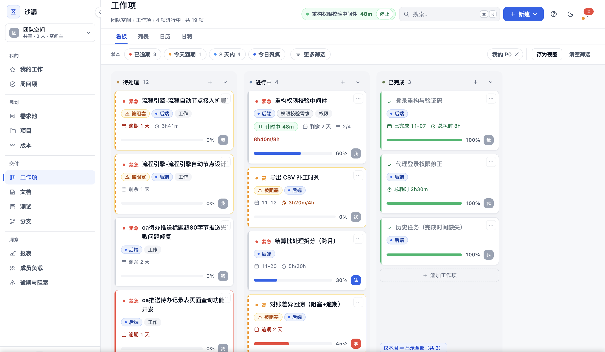

点击顶部栏的书本图标可在新标签页打开「帮助中心」：内置本手册与快速上手、常见问题、产品说明、管理员指南五份文档，左侧可随时切换；右上角「下载 Markdown」可下载当前文档，便于离线保存或团队内分享。

### 2.3 创建第一个项目

1. 在左侧导航点击「项目」。
2. 点击右上角「新建项目」。
3. 填写项目名称、描述，选择状态（进行中 / 已暂停 / 已完成）。
4. 点击保存，项目会出现在项目列表中。

### 2.4 创建第一个工作项

1. 从左侧「工作项」进入看板视图；项目与负责人可在筛选栏选择。
2. 点击看板列底部的「+ 添加工作项」，或顶部「新建」按钮。
3. 填写标题、类型、负责人、优先级、截止日期等。
4. 保存后，卡片会出现在看板首列。

### 2.5 拖拽流转与计时

- 在看板上，拖动卡片从一列移到另一列即可改变状态。
- 拖入「进行中」列会自动开始计时。
- 拖入「已完成」列会自动停止计时，并触发「完成后接力」：如果原列还有其他任务，会自动接续计时第一个任务。
- 每张卡片右上角有计时按钮，也可手动开始 / 暂停。
- 忘开表、加班等情况可用「补记」手工补一条实际工时：可选择任意空间成员与日期（不晚于今天），补记不经过工作时段裁剪，直接计入任务与报表；补记记录可在工时记录列表中删除。
- 忘停表导致工时偏大时，点计时记录右侧的「作废」，再用「补记」按天录入实际工时；作废后所有统计与完成快照立即按实际工时重算（详见 17.7）。

---

## 3. 空间与成员

### 3.1 空间概念

空间是数据隔离单元。你可以属于多个空间（如个人空间、团队空间），不同空间的项目、工作项、成员完全隔离。

- **个人空间**：首次登录自动生成，适合个人待办。
- **共享空间**：由管理员创建，邀请团队成员加入。

切换空间：点击左侧边栏顶部的空间名称，在弹出菜单中选择目标空间。

### 3.2 成员管理

空间主或管理员可在「设置 > 成员与权限」中：

- 查看当前成员列表。
- 生成邀请链接，复制给新成员。
- 修改成员角色或移除成员。

### 3.3 角色说明

空间级角色共有四档：

| 角色 | 权限 |
| --- | --- |
| 空间主（Owner） | 拥有空间全部权限，包括成员管理、数据导入导出、删除空间。 |
| 管理员（Admin） | 可管理项目、成员、公共配置（看板列、分类、标签等）。 |
| 成员（Member） | 可创建和编辑自己参与的项目与工作项，不能修改空间级配置。 |
| 查看者（Viewer） | 全局只读，不能创建、编辑、删除任何数据。 |

> 项目级还可单独设置某成员对某个项目的可见性：默认参与、只读、不可见。

---

## 4. 项目

### 4.1 项目列表

进入「项目」视图，可看到当前空间下的所有项目卡片 / 列表：

- 每个项目显示名称、状态、进度条、任务数、逾期数。
- 点击项目名称进入项目驾驶舱；驾驶舱里可看进度、工时、工作项分布与成员负载，并可切「全部项目透视」。要推进该项目的工作项，从左侧「工作项」进入并把项目选进筛选条件。

### 4.2 创建 / 编辑 / 删除项目

- **创建**：右上角「新建项目」，填写名称、描述、状态。
- **编辑**：项目卡片或项目详情中点击「编辑」。
- **删除**：项目卡片点击「删除」。若项目下还有文档、版本、需求池条目，确认框会逐项提示数量，确认后才执行。

### 4.3 项目状态

| 状态 | 含义 |
| --- | --- |
| 进行中 | 团队正在投入的项目。 |
| 已暂停 | 暂时搁置，任务不再出现在活跃视图默认筛选中。 |
| 已完成 | 已关闭，可作为历史项目查阅。 |

### 4.4 首版标记

项目首次上线后，可在项目设置中标记「首版上线日」。该日期用于「版本」视图中自动区分「首版开发」与「迭代维护」两个阶段，且不会回写历史数据。

### 4.5 项目驾驶舱与全局健康度

- **全局健康度**：「项目」一级入口下的二级视图，一屏横向对比全部项目的健康度、逾期与本周投入，点项目名进入项目驾驶舱。
- **项目驾驶舱**：进入单个项目后的默认视图，包含周期、预估工时、实际工时、偏差、工作项分布、本周新增 / 完成、史诗汇总、项目内成员负载；右上角可切换「单项目 / 全部项目透视」，左上角「← 项目列表」返回。停在驾驶舱时，二级导航会把「项目列表」标为所在分区，提示你从哪一层进来。
- **单项目 / 全部项目透视**：驾驶舱右上角切换；单项目模式看该项目的工作项表，点击行打开工作项详情，全部项目透视用于横向对比。

---

## 5. 工作项

工作项是 沙漏 的核心操作对象，包括任务、用户故事、缺陷、史诗四种类型。

### 5.1 创建与编辑

在看板、列表、日历、甘特等视图中均可新建工作项：

1. 点击「新建」或「+」按钮。
2. 在弹出的表单中填写：
   - 标题（必填）
   - 类型（任务 / 用户故事 / 缺陷 / 史诗）
   - 所属项目（必填）
   - 负责人
   - 优先级（P0 / P1 / P2 / P3）
   - 所属史诗
   - 影响版本
   - 开始日期 / 截止日期
   - 预估工时
   - 描述
3. 点击保存。

### 5.2 详情抽屉

点击任意工作项卡片或列表行，会从右侧滑出详情抽屉（宽 680px），包含：

- 基本信息与编辑
- 子任务（检查清单）
- 评论
- 附件
- 工时记录
- 活动历史
- 关联需求 / 文档

### 5.3 指派与负责人

- 一个工作项只能有一个负责人。
- 指派给他人时，对方会收到站内通知（如果对方可见该项目）。
- 指派给自己会出现在「我的工作」中。

### 5.4 优先级

| 优先级 | 含义 | 颜色 |
| --- | --- | --- |
| P0 | 最高，必须今天处理 | 红 |
| P1 | 高 | 橙 |
| P2 | 中 | 蓝 |
| P3 | 低 | 灰 |

优先级会在看板卡片左侧以色条显示，便于快速识别。

### 5.5 标签与分类

- **分类**：空间级预设，用于统计维度（如前端、后端、测试、设计）。
- **标签**：自由文本标签，用于灵活标记（如「技术债」、「客户问题」）。
- 两者都可在筛选区快速过滤。

### 5.6 子任务（检查清单）

在详情抽屉的「子任务」区域：

- 添加子任务条目。
- 勾选即表示完成。
- 父任务会显示子任务完成进度。
- 删除父任务时，子任务会一并处理。

### 5.7 评论

- 在详情抽屉底部评论框输入，按回车或点击发送。
- 评论按时间正序排列，输入 `@` 可从候选成员中选择要提及的人（候选只包含能查看该项目的成员）。
- 评论会触发通知给负责人、被@的人以及关注该任务的人。
- 详情抽屉标题旁的「关注」按钮可开启/取消关注：关注后，该任务的新评论、列流转（在看板列之间移动）、移入回收站与恢复都会通知你（字段编辑不单独通知，避免高频打扰）。

### 5.8 附件

工作项与需求均支持附件：

- 支持图片、PDF、文本、Markdown、ZIP、Excel 等常见格式。
- 可通过拖拽、复制粘贴、点击上传三种方式添加。
- 单文件大小限制 10MB。
- 图片与 PDF 可直接在新标签页预览。
- **Excel（.xlsx）可在工作项详情内直接打开为可编辑表格**，修改后覆盖保存；样式、条件格式、图表、嵌入图片不保证保留，以数值与公式优先。
- 超大表格按 20000 行 × 200 列截断并提示。

### 5.9 回收站

删除的工作项会进入回收站，保留 30 天：

- 在「设置 > 数据与审计 > 回收站」中查看。
- 可选择「恢复」或「彻底删除」。
- 彻底删除史诗时，其下子工作项的史诗关联会被清空，不会形成孤儿引用。

### 5.10 史诗（Epic）

- 史诗是一种大粒度工作项，用于聚合故事、任务、缺陷。
- 在创建或编辑工作项时，可选择「所属史诗」。
- 史诗不能挂到另一个史诗下，系统会阻止循环归属。
- 项目驾驶舱中提供史诗汇总，展示其下子项的完成度。
- 当某工作项从史诗类型改为其他类型时，其下子工作项会自动解除史诗关联。

---

## 6. 执行视图

工作项有看板、列表、日历、甘特四种执行视图，筛选条件在视图间共享。四种视图统一在标题下方的二级导航切换，不再在筛选栏另设开关。

### 6.1 看板

看板是最常用的视图：

- **列**：对应工作流状态（默认如：待处理 / 进行中 / 已完成）。
- **拖拽**：拖动卡片到目标列即可流转状态。
- **列头**：显示该列任务数，支持折叠列。
- **列内排序**：拖动卡片上下调整优先级顺序。
- **快速新增**：点击列底「+ 添加工作项」直接在该列创建。
- **筛选**：顶部筛选区支持负责人、优先级、分类、项目、标签、到期日、被阻塞等条件。

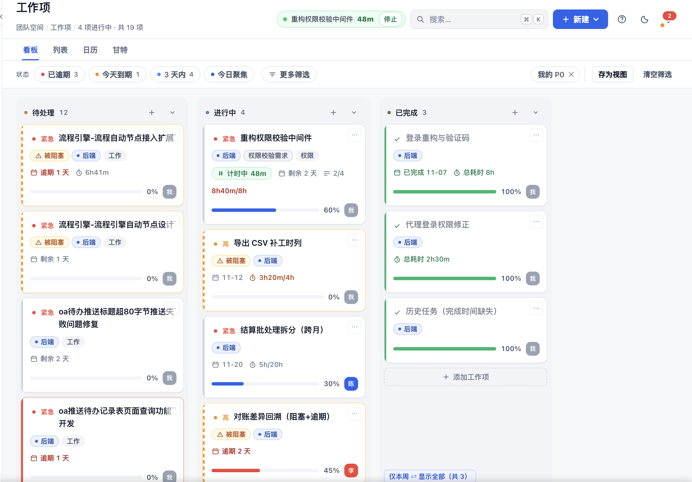

### 6.2 工作项列表

- 表格形式展示工作项。
- 支持列偏好记忆（选择显示哪些字段）。
- 支持行内快捷操作：编辑、删除、开始计时。
- 沿用看板筛选条件。

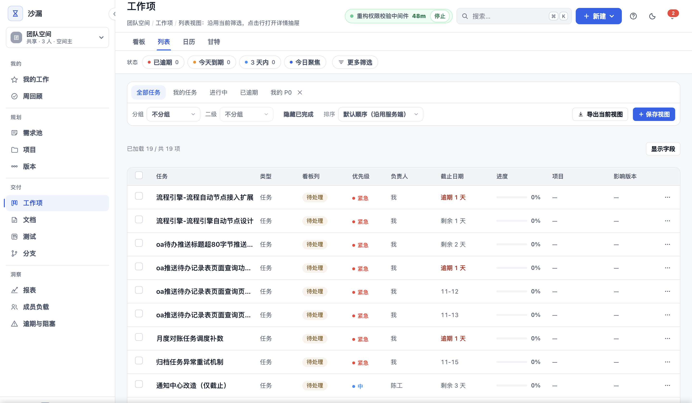

### 6.3 日历

- 工作项按 `[开始日期, 实际结束日]` 区间逐日铺开。
- **实际结束日 = min(完成日, 截止日)**：提前完成的任务不会在后续日期继续占格。
- 截止日高亮显示。
- 点击日期格可查看当天所有工作项。

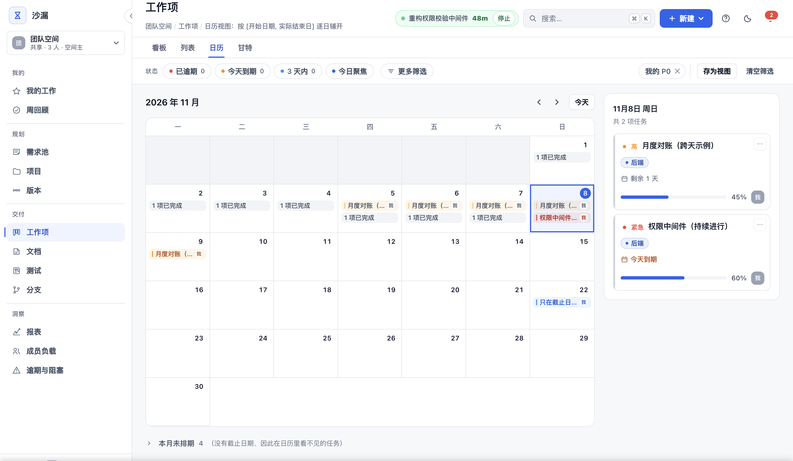

### 6.4 甘特图

甘特图是 沙漏 的强项，适用于排期与依赖管理：

- **时间刻度**：日 / 周 / 月，支持缩放。
- **依赖关系**：FS（完成-开始）、SS（开始-开始）、FF（完成-完成）、SF（开始-完成）+ 滞后量；通过拖拽任务条两端的圆点连线建立。
- **里程碑**：可标记零工期里程碑。
- **基线偏差**：显示计划与实际日期的偏差。
- **关键路径**：自动计算并高亮。
- **分组**：按项目、负责人、史诗等两级分组。
- **字段开关**：自定义显示哪些列。
- **成员负载面板**：按人按周查看成员负载。
- **改期撤销**：支持多步撤销。
- **导出与打印**：可导出 CSV，支持 A3 打印。
- **只读分享**：可生成只读分享链接，供外部人员查看。
- **深色模式**：已支持。

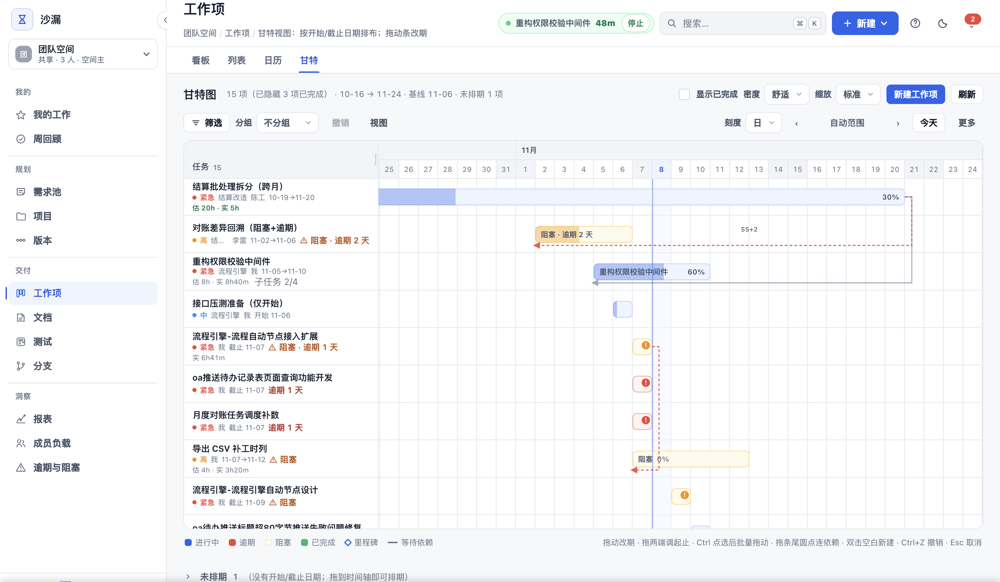

---

## 7. 需求池

需求池用于收集和评审原始需求，通过后再拆成工作项执行。

### 7.1 提交需求

1. 在左侧导航点击「需求池」。
2. 点击「提需求」。
3. 填写：
   - 标题（必填）
   - 来源
   - 类型
   - 优先级
   - 期望时间
   - 验收标准
   - 目标版本
   - 描述
   - 附件
4. 保存后进入「待评审」列。

### 7.2 需求状态机

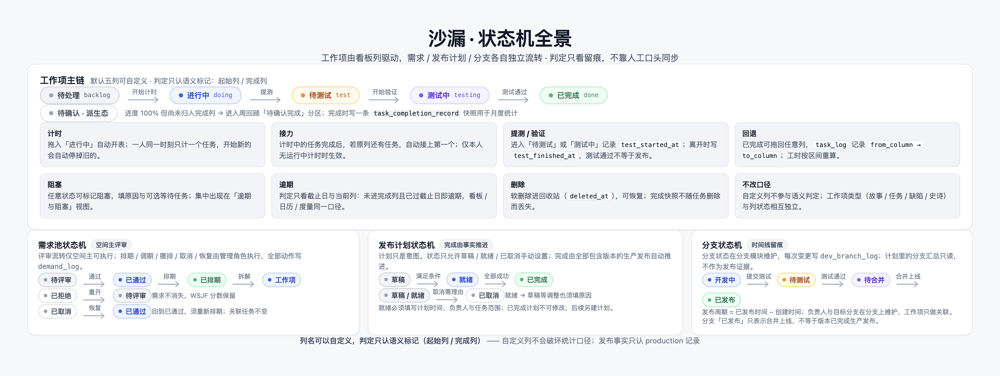

需求在池中按以下状态流转：

```
待评审 → 已通过 → 已排期 → 进入迭代 / 创建任务
   ↓       ↓
 已拒绝 ←──┘（可重开）
```

- **待评审**：刚提交，等待评审。
- **已通过**：评审通过，可进入排期或拆分为工作项。
- **已排期**：已规划到目标版本或 Sprint。
- **已拒绝**：暂不做；可重开回到待评审。

> 评审流转（通过 / 拒绝 / 排期 / 重开）通常由空间主或管理员执行，全部动作留痕。

### 7.3 WSJF 评分

当需求填写「业务价值」、「紧迫度」、「工作量」三项后，系统会自动计算 WSJF（加权最短作业优先）得分并排序。得分公式不可手填，只由字段自动推导。

### 7.4 需求 → 工作项

- 已通过或已排期的需求可在详情中「拆分为任务」。
- 拆分后生成的工作项会自动关联该需求。
- 需求详情抽屉可透视关联的工作项列表及其进度。

---

## 8. 需求文档

需求文档以树形结构组织项目下的方案文档，可派生工作项。

### 8.1 文档视图

1. 左侧导航进入「文档」。
2. 顶部二级导航切换「列表 / 看板 / 阅读 / 动态」：列表按项目分组，看板按状态分列，阅读用于连续浏览，动态记录最近变更。
3. 点击文档行进入编辑器；右侧「大纲」按正文标题自动生成，点击可跳转。
4. 支持新建、重命名、移动、删除文档节点；有编辑权限时，拖动节点左侧的手柄可调整同级顺序。
5. 文档跨项目移动时，旧项目的任务引用和需求池链接会被清理，子文档保留在原项目。
6. 阅读模式下点击文档头部的「历史版本」，无需进入编辑即可浏览历史快照：打开自动预览最新一版，可切换版本、与当前对比、查看文本差异；有编辑权限时可一键恢复（恢复前当前内容会自动留档）。
7. 阅读模式支持划线评论：选中正文任意文字，在弹出气泡中点击「划线评论」即可针对该片段发表意见；也可点击头部「评论」打开评论面板。带引用的评论会在正文中高亮，点击高亮可定位到对应评论。发表评论需要项目编辑权限。

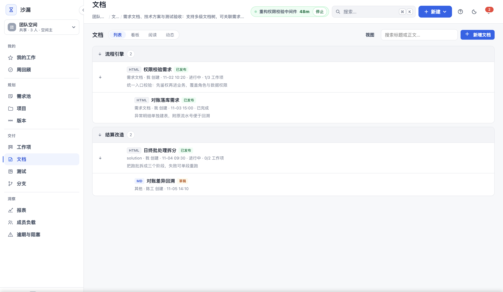

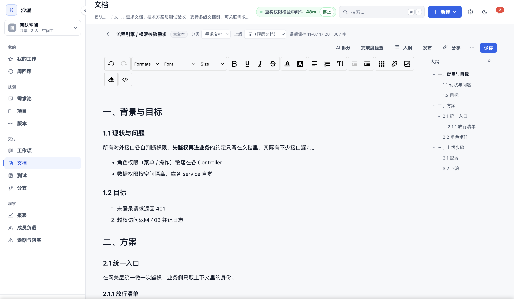

### 8.2 编辑与关联

- 文档正文支持 Markdown 与富文本编辑。
- 「新增文档」支持空白新建，也支持上传 Word（.docx / .doc）、Markdown、TXT、HTML 文件；导入后转换为可继续在线编辑的正文，编辑器内也可随时再次导入。
- 正文会自动过滤危险内容（XSS 防护）。
- 可将文档与需求池条目、工作项关联。
- 支持乐观锁并发编辑：若他人同时保存，会提示冲突。

### 8.3 AI 拆任务

在文档视图中可使用 AI 助手：

- **拆任务**：AI 根据文档内容生成任务草稿，需人工确认后才会落库。
- **完成度体检**：AI 扫描文档结构，提示缺失章节或检查项。

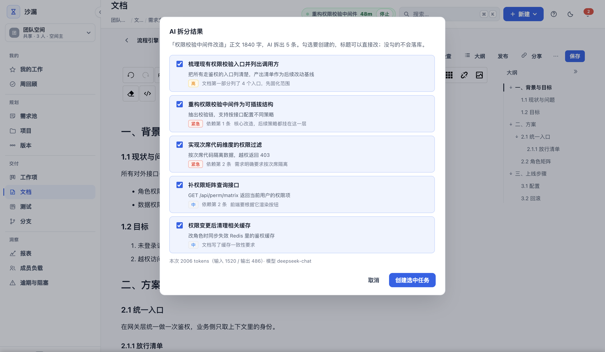

---

## 9. 测试

「测试」把用例、测试计划、覆盖矩阵与测试报告串成一条质量链路。四个模式统一在标题下方的二级导航切换，当前项目在页内选择。

### 9.1 用例

- 按项目维护用例库：标题、前置条件、步骤、预期结果、优先级、功能模块与负责人。
- 支持搜索、筛选、分页加载与 CSV 导入 / 导出。
- 可直接标记通过、失败或阻塞；失败用例可一键转成缺陷工作项，步骤与备注会写入缺陷描述。
- 「视图」可保存当前项目、筛选与展示方式，供下次一键恢复。

### 9.2 测试计划

- 把一次版本回归或一轮测试圈成计划：从项目用例库挑选用例（单次最多 500 条），设置负责人、起止与版本。
- 在计划内批量记录执行结果，结果同时写回用例最近结果并追加执行流水。
- 计划完成后锁定为快照，便于回溯某一轮测试的范围与结论。

### 9.3 覆盖矩阵

- 按需求统计用例覆盖：哪些需求已有用例、覆盖多少、通过率如何。
- 按项目全量计算，不受用例列表分页与筛选影响。

### 9.4 测试报告

- 汇总当前项目的通过率、失败 / 阻塞清单与需求覆盖。
- 支持导出 CSV，作为本轮测试的质量证据。

> 命名口径：菜单与页面统一称「测试」，其下四个模式为「用例 / 测试计划 / 覆盖矩阵 / 测试报告」；不要再把「覆盖矩阵」「测试报告」当成独立一级菜单。

---

## 10. 版本与发布

### 10.1 版本管理

1. 从左侧「规划 > 版本」进入；顶部可切换单个项目或全部项目。
2. 点击「新建版本」，填写版本号、状态、计划发布日。
3. 版本状态包括：
   - **待规划**：尚未开始。
   - **开发中**：正在投入开发。
   - **已发布**：已上线，状态锁定。

### 10.2 影响版本

- 在工作项表单中选择「影响版本」，可将工作项绑定到某个版本。
- 一个工作项只能绑定一个版本；未绑定视为「待规划」。
- 需求池中的需求也可选择「目标版本」。

### 10.3 发布说明

版本发布时，系统会自动汇总该版本下绑定的工作项与需求，生成发布说明（Release Note），可导出为文本或 Markdown。

### 10.4 版本视图

在「规划 > 版本」中可按两种模式查看：

- **按阶段**：自动按「首版上线日」分为「首版开发」和「迭代维护」两个阶段，显示阶段时间轴、按成员的阶段工时、新增需求 / 缺陷维护拆分。
- **按版本**：以版本卡形式展示各版本的指标（工时、工作项数、关联需求数、偏差、剩余预估），支持下钻到工作项明细。

> 首版上线前未绑定版本的任务会自动归入 V1.0；未绑定版本的任务显示为「待规划」。

---

## 11. 洞察

### 11.1 成员负载

在「洞察 > 成员负载」中：

- 按人或按周查看每个成员的在办工作项与投入工时。
- 同时显示任务数量与预估工时，避免"任务数多但耗时少"的误判。
- 超载判定：当成员剩余预估 > 剩余工作日 × 团队容量常量（默认 8h/日，与 WorkTime 每日上限一致）时标记超载。
- 点击成员或单元格可下钻到具体工作项。

### 11.2 逾期与阻塞

「洞察 > 逾期与阻塞」集中展示跨项目的风险：

- **逾期任务**：超过截止日未完成的工作项。
- **被阻塞任务**：标记为 blocked 的工作项，显示阻塞原因与等待对象。
- **停滞任务**：连续多日无进展的任务。
- **超载提示**：成员负载超过容量。
- 支持站内催办。

---

## 12. 报表

「报表」一级入口下用二级导航切换四个视图：**趋势与分布**、**完成记录**、**流程体检**、**交付图表**。

### 12.1 趋势与分布

- 近 8 周（可调整周期）的新增与完成趋势。
- 工时统计：累计工时、本周工时、平均每项，可切「仅我 / 全空间」。
- 按分类与负责人看工作项分布。

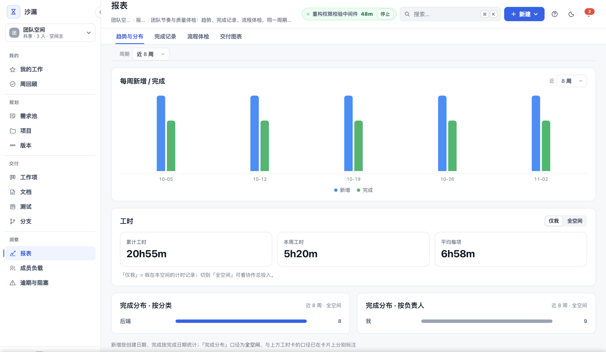

### 12.2 完成记录

- 按月列出已完成工作项，显示负责人、分类、起止时间与总耗时。
- 支持导出 CSV，用来核对某个月的交付清单。

### 12.3 流程体检

「流程体检」不做预测，只把已有的工作项操作记录做一次一致性检查——一次通过率、需求从通过到开工的延迟、估时与实际耗时的偏差。每个数字都能回溯到具体工作项，用来回答「我们这个流程卡在哪一步」，而不是「下个迭代能做完多少」。

### 12.4 交付图表

交付图表面向管理者，提供四张敏捷读图：

#### 燃尽图

- 横轴：时间（日 / 周）。
- 纵轴：剩余预估工时。
- 剩余 = 总预估 − 已完成实际工时。
- 用于观察迭代或项目是否按计划收敛。

#### 速度图（Velocity）

- 展示近 4 周（或近 4 个迭代）的完成工时 / 完成工作项数。
- 用于预测团队未来可承受的迭代容量。

#### 累积流图（CFD）

- 展示近 8 周三个状态（待处理 / 进行中 / 已完成）的累计数量。
- 用于识别流程瓶颈。

#### 交付周期分布

- 统计工作项从创建到完成的周期。
- 展示 P50 / P85 分位数，帮助回答「大部分需求多久能交付」。

> 所有报表支持导出 CSV / PNG。

---

## 13. 我的工作

### 13.1 我的工作

「我的」→「我的工作」汇总当前空间中所有分派给自己的待办（手机端为底部「待办」tab）。成员首次登录默认落在这里；空间主 / 管理员与查看者的默认落点见 2.1。

- 默认按逾期 / 今天 / 未来分组。
- 支持分组、行内操作、分页加载。
- 点击任务直接进入详情抽屉。

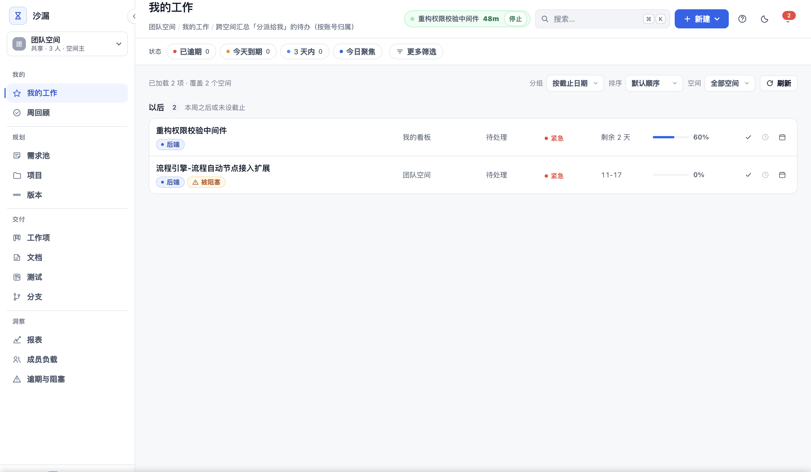

### 13.2 周回顾

「我的」→「周回顾」自动生成一周的总结：

- **已完成**：本周已完成并已归档的工作项。
- **待确认完成**：进度 100% 但尚未归档的工作项。
- **进行中**：本周仍在进行的工作项。
- 三个分区互斥，同一件事只出现一次。
- 历史周期按操作记录近似还原。
- 可一键生成 AI 周报草稿，人工确认后复制使用。

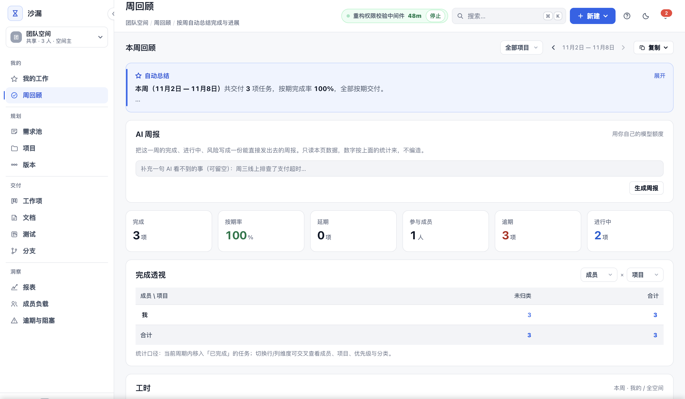

---

## 14. AI 助手

### 14.1 配置

在个人设置中可配置自己的 AI 模型与额度：

- 模型选择（取决于后端接入）。
- 个人每日 / 每月调用额度。
- API 密钥加密保存。

### 14.2 使用场景

- **需求拆解**：把需求描述拆成任务草稿。
- **文档体检**：检查需求文档是否完整。
- **周报草稿**：根据周回顾数据生成周报文本。
- **AI 只出草稿，不会直接修改数据**：所有结果都需要人工确认后才会落库。

---

## 15. 通知与设置

### 15.1 通知中心与消息页

- 顶部铃铛图标显示未读通知数量。
- 点击打开通知面板，查看站内消息；需要长期跟进时，从左侧「消息」（手机端底部「消息」tab）进入完整消息页，它与通知面板是同一份数据。
- 消息页支持收藏与深链（`#/messages`），刷新或分享后仍能直达。
- 通知类型包括：任务指派、评论与 @提及、关注任务的评论与回收站操作、流转、需求/文档/分支/版本变动、每日汇总、逾期提醒、今日到期提醒。
- 同一任务的同类连续通知会折叠为一条（显示 ×N），点击后整组标为已读。
- 通知通过 SSE 实时推送。

### 15.2 通知偏好

在「个人设置 > 消息通知」中可配置（列表按「任务 / 需求与版本 / 每日汇总」分组）：

- 站内通知开关。
- 邮件通知开关（需配置 SMTP 与站点地址）。
- Webhook 通知开关。
- 各类事件是否投递。
- 「每日任务汇总」可单独关闭：只影响每天 09:00 的汇总，不影响任务级的到期提醒。

> 若接收人看不到目标项目（被设为不可见），则不会投递通知，避免信息泄露。

### 15.3 空间设置

空间主或管理员可在「设置」中管理：

- 空间名称。
- 成员与邀请链接。
- 看板列：增删改列、调整顺序、设置是否为完成列。
- 分类与标签。
- 版本与分支。
- 邮件配置。
- 数据导入导出。
- 回收站。

### 15.4 个人偏好

- 主题：浅色 / 深色。
- 默认视图：看板 / 列表 / 日历 / 甘特。
- 列表列显示偏好。
- 每页数量。

---

## 16. 权限与可见性

### 16.1 空间级角色权限矩阵

| 功能 | Owner | Admin | Member | Viewer |
| --- | :---: | :---: | :---: | :---: |
| 查看项目与工作项 | ✓ | ✓ | ✓ | ✓ |
| 创建 / 编辑工作项 | ✓ | ✓ | ✓ | ✗ |
| 创建 / 编辑项目 | ✓ | ✓ | 部分 | ✗ |
| 管理空间成员 | ✓ | ✓ | ✗ | ✗ |
| 修改看板列 / 分类 / 标签 | ✓ | ✓ | ✗ | ✗ |
| 数据导入导出 | ✓ | ✓ | ✗ | ✗ |
| 删除空间 | ✓ | ✗ | ✗ | ✗ |
| 需求评审流转 | ✓ | ✓ | ✗ | ✗ |

### 16.2 项目级可见性

每个项目可单独设置某成员的可视级别：

- **默认参与**：按空间角色正常参与。
- **只读**：只能查看该项目，不能修改。
- **不可见**：该项目对该成员完全隐藏，不会出现在任何列表、搜索、通知中。

---

## 17. 统一口径解释

沙漏 中多处统计使用同一套口径，避免各页面数字不一致。

### 17.1 有效工时

- 跳过周末。
- 每人每天合计封顶 8 小时。
- 同一天多个任务共用这 8 小时额度，跨空间也一起算。

### 17.2 计时归属

- 计时是「人」的属性，不是「任务」的属性。
- 一个人同一时刻只计一个任务。
- 开始任务 B 会自动停掉任务 A，界面会明确提示"已停止对 A 的计时"。

### 17.3 完成后接力

- 计时中的任务被完成后，如果原列还有任务，会自动接上第一个。
- 仅在你当前没有运行中计时时才接力，不会抢掉别的空间正在计的任务。

### 17.4 实际结束日

```
实际结束日 = min(完成日, 截止日)
```

提前完成的任务不会在后续日历日期中继续出现。

### 17.5 逾期判定

- 超过截止日期且未完成即视为逾期。
- 逾期判定与看板、日历、报表使用同一套规则。

### 17.6 任务清单快照

工作项完成时会落一条快照，记录项目名、负责人、分类、起止时间、总耗时。历史月度统计基于快照，不受后续改名或删除影响。

### 17.7 手工补记与工时修正

- 实际工时默认全部来自计时器。忘开表、加班等场景可用工作项抽屉里的「补记」手工补一条记录。
- 补记不经过「工作时段、每日上限」的裁剪，填多少算多少（单条 1 分钟 ~ 24 小时，日期不晚于今天）；但仍占用当天该成员的计时日额度。
- 可为自己或任意空间成员补记；项目可写者均可操作。
- **记错了怎么办**：忘停表导致工时偏大时，在工时记录里点这条计时记录右侧的「作废」，再用「补记」按天录入实际工时（例如跨两天的 16 小时，作废后分别补 6 小时和 4 小时）。
- 作废是物理删除但会在任务时间线留一条记录；作废和补记后，卡片、列表、周回顾、甘特负载等统计立即按实际工时重算，已完成任务的完成快照也会同步刷新。
- 正在计时的记录不能作废，先点「停止计时」。

---

## 18. 常见问题

### Q1：为什么我把任务拖到「已完成」后，另一个任务自动开始计时？

这是「完成后接力」机制。只要你在当前空间没有正在计时的其他任务，系统会自动接续原列的下一个任务，避免时间记录空档。

### Q2：为什么我某天的工时没有满 8 小时，但系统显示只计了一部分？

有效工每人每天合计封顶 8 小时，且跨任务、跨空间共享额度。如果你当天同时在多个任务上计时，或属于多个空间，总工时被均摊后可能看起来每个任务都只有一部分。

### Q3：查看者能看到哪些内容？

查看者全局只读，不能创建、编辑、删除任何数据。只能看到对其可见的项目和工作项。首次登录默认落在「项目」列表，而不是多半为空的「我的工作」。

### Q4：项目删除时会删掉什么？

删除项目时，确认框会提示该项目下的文档数量、版本数量、需求池条目数量。确认后，项目及其下的工作项、文档、版本、需求等会按级联规则处理（工作项进入回收站或级联删除，视配置而定）。

### Q5：Excel 在线编辑会丢失格式吗？

会。在线表格定位是「附件查看与快速修改」，侧重数值与公式。单元格样式、条件格式、图表、嵌入图片不保证保留。重要格式请下载后用桌面 Excel 处理。

### Q6：甘特图的只读分享链接有效期多久？

只读分享链接默认长期有效，除非在空间设置中手动撤销。分享出去后，对方无需登录即可查看。

### Q7：为什么有的需求不能流转到「已通过」？

需求评审流转通常只有空间主或管理员有权限。此外，若需求缺少必填字段（如优先级、验收标准），也可能被阻止。

### Q8：AI 助手会不会自动修改我的任务？

不会。AI 只生成草稿，所有修改都需要你在界面中确认后才会落库。

### Q9：如何备份我的数据？

空间主或管理员可在「设置 > 数据与审计」中导出全量数据（按用户隔离）。运维人员也可直接备份 MySQL 数据库和附件目录。

### Q10：回收站里的数据保留多久？

删除的工作项在回收站保留 30 天，之后自动清理。30 天内可随时恢复或彻底删除。

---

## 附录：快捷键

| 快捷键 | 作用 |
| --- | --- |
| `N` | 快速新建工作项 |
| `/` 或 `Ctrl + K` | 聚焦全局搜索 |
| `Esc` | 关闭抽屉 / 弹窗 |
| `← / →` | 在甘特图周 / 月视图间切换 |

> 更多快捷键可在界面「?」帮助入口查看。

---

## 附录：相关文档

除本手册外，帮助中心还提供以下文档（在帮助中心内点击可页内切换；在代码仓库中阅读时为相对链接）：

| 文档 | 内容 | 适用人群 |
| --- | --- | --- |
| [快速上手指南](快速上手指南.md) | 30 分钟跑通「提需求 → 拆工作项 → 拖拽计时 → 周回顾」全链路 | 新成员 |
| [常见问题](常见问题.md) | 数据口径、计时规则、权限等高频疑问的解答 | 所有用户 |
| [产品说明](产品说明.md) | 产品定位、信息模型、用户旅程与技术架构总览 | 想全面了解产品的人 |
| [管理员指南](管理员指南.md) | 部署、账号管理、备份与升级 | 空间主 / 运维 |
| [项目介绍](项目介绍.md) | 产品背景、信息模型与机制取舍 | 想了解设计边界的人 |
