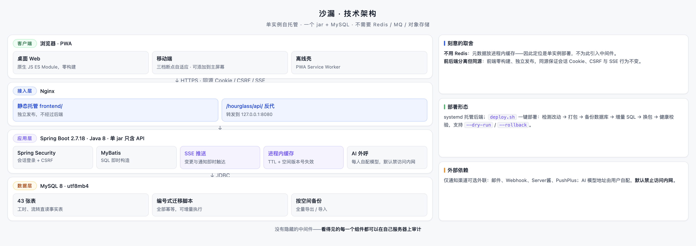
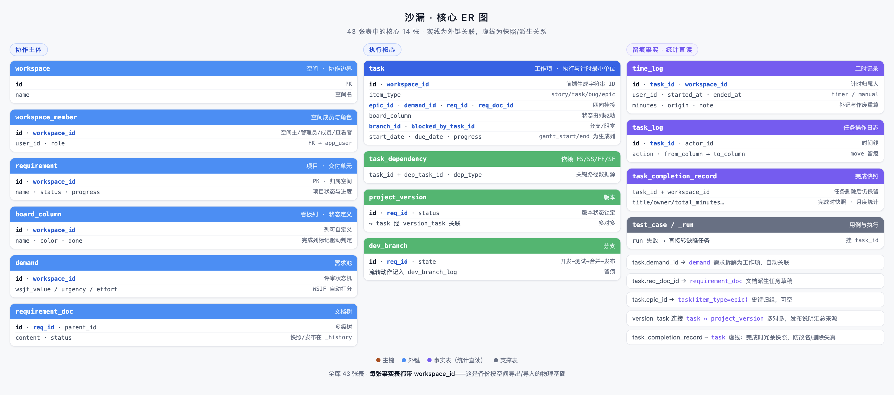
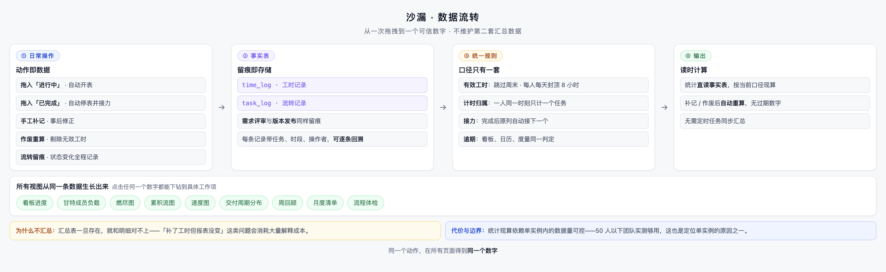

# 沙漏 · 管理员指南

> 目标读者：负责部署与运维沙漏的 IT / 管理员。本文讲**为什么这么部署、日常管什么**；逐步命令见 [`deploy/README.md`](../deploy/README.md)。

---

## 1. 你将运维的系统长什么样

沙漏是一个刻意做减法的单实例系统：

- **一个 jar + MySQL 8**，没有 Redis、MQ、对象存储——少一个组件就少一类故障。
- **前后端分离但同源**：前端零构建，Nginx 直接托管 `frontend/`；后端只提供 `/hourglass/api/**`。同源保证会话 Cookie、CSRF 与 SSE 行为不变。
- **进程内缓存**（成员关系 60 秒 TTL、空间 meta 版本号失效）是「不用 Redis」的代价——因此**定位单实例**，多副本部署需改造缓存层，不要直接横向扩。

## 2. 部署速览

完整命令（含建库、systemd、Nginx、备份 crontab、验收清单）见 [`deploy/README.md`](../deploy/README.md)。这里只列骨架：

| 步骤 | 动作 | 关键点 |
| --- | --- | --- |
| 1 | `01_schema_full.sql` 一次性建库建表 | 幂等可重跑；**改默认密码** |
| 2 | 配 `/etc/hourglass.env`（600 权限） | 密码不进代码库；`AUTH_*` 仅首启引导用 |
| 3 | systemd 起服务 | `curl /hourglass/api/health` 应返回 `"db":"up"` |
| 4 | Nginx 托管前端 + 反代 API | 同源部署，不要拆域名 |
| 5 | `ss -tlnp` 检查 8080/3306 只听内网 | 公网只放行 22/80/443 |

有域名后配 HTTPS（certbot）——HTTPS 同时是移动端 PWA「添加到主屏幕」的前提。

## 3. 数据模型：备份与恢复的物理基础

全库 47 张表，核心结构如下——**每张事实表都带 `workspace_id`**，这是「按空间全量备份导出 / 导入」的物理基础：

运维要点：

- **每日备份**：`deploy/backup.sh` + crontab（03:00）。只按行读取 env 文件的 `DB_NAME`/`ATTACH_DIR`，不会执行其中的值；附件目录打包失败会**非零退出**（cron 日志可见），不会假成功。
- **恢复演练**：上线后至少做一次——备份文件恢复到空库，比对条数。没验证过的备份不算备份。
- **升级**：数据库结构变化先跑 `sql/` 里的编号增量脚本（全部幂等）；不要在已有库上重跑完整基线（会重建表）。日常升级直接 `bash deploy/deploy.sh`：自动判断改动范围 → 备份 → 增量 SQL → 换包 → 健康校验，支持 `--dry-run` / `--rollback`。

## 4. 为什么这个系统几乎不用调优

统计数字的产生方式决定了运维负担：

- 工时、燃尽、负载**直读事实表**（`time_log` / `task_log`），没有汇总任务、没有定时批处理——不存在"汇总和明细对不上"这类需要运维介入的经典问题。
- 补记、作废后按当前口径**现算**，无过期数字需要清理。
- 代价是统计读放大依赖数据量可控——50 人以下团队实测够用。这也是定位单实例的原因之一。

日常巡检只需关心三件事：**磁盘（附件目录 + 备份目录增长）、MySQL 连接、SSE 长连接数**。

## 5. 通知与 AI 配置

**提醒推送**（可选）按空间配置：环境变量只保留渠道与开关（`NOTIFY_TYPE=webhook|serverchan|pushplus`、`NOTIFY_CRON`），具体地址由空间主在「空间设置」里维护。安全边界：地址校验仅 http/https 且拒绝内网；pushplus 渠道下 token 只发往官方端点。

**AI 助手**（可选）：每个用户在个人设置里自配模型地址、密钥与额度，密钥加密保存。管理员要注意的默认项：**AI 地址默认禁止访问内网**——防止把内网信息带出到外部模型。

## 6. 常见故障速查

| 症状 | 先查 |
| --- | --- |
| 登录后空白 / 接口 404 | Nginx 反代前缀是否 `/hourglass/api/`；前端与 API 是否同源 |
| 权限变更不生效 | 进程内缓存 TTL（最长 60 秒 + meta 300 秒兜底）；**重启即清** |
| 推送收不到 | `/api/notify/test`；空间 webhook 是否已填；渠道环境变量 |
| 定时推送时间不对 | 服务器时区（`timedatectl`，日期判定/周回顾都依赖它） |
| 备份失败 | `/var/log/hourglass-backup.log`；附件目录存在且可写 |
| 升级后接口报错 | 对应增量 SQL 是否已执行（按发布说明） |

## 7. 相关联接

- 部署全量命令与验收清单：[`deploy/README.md`](../deploy/README.md)
- 数据口径与机制取舍：[项目介绍](项目介绍.md)
- 功能与使用：[用户使用手册](用户使用手册.md)
