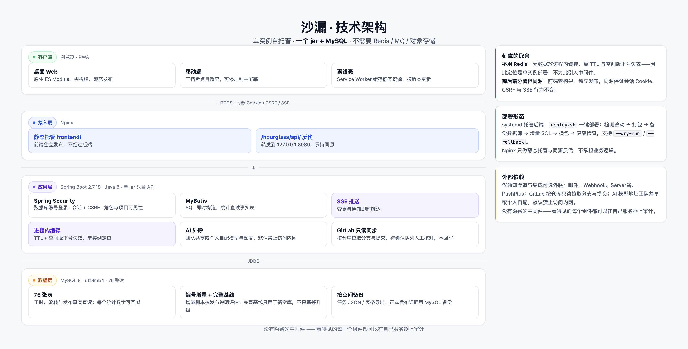
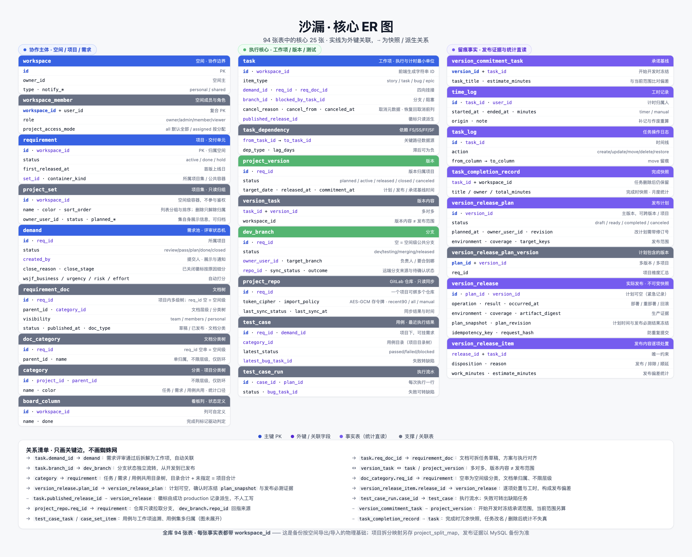
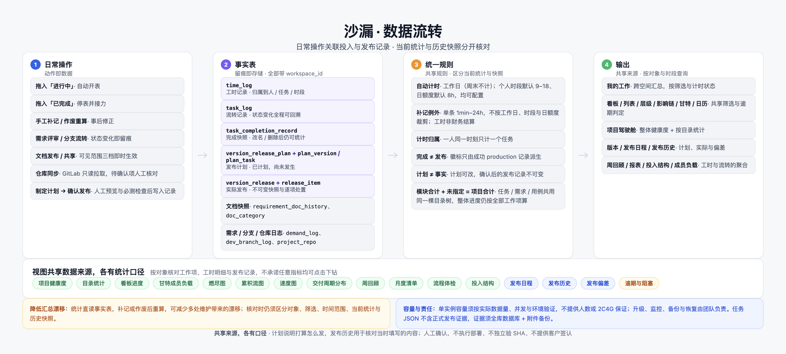

# 沙漏 · 管理员指南

> 目标读者：负责部署与运维沙漏的 IT / 管理员。本文讲**为什么这么部署、日常管什么**；逐步命令见 [`deploy/README.md`](../deploy/README.md)。

> 维护与升级支持：kongxiangjin（[1351882069@qq.com](mailto:1351882069@qq.com) · [@kong0827](https://github.com/kong0827)）

---

## 1. 你将运维的系统长什么样

沙漏是面向中小研发团队的自托管轻量项目管理工具，当前采用单实例部署。减少运行组件有助于控制复杂度，不代表免维护或自动满足合规要求：

- **一个 jar + MySQL 8**，没有 Redis、MQ、对象存储——少一个组件就少一类故障。
- **前后端分离但同源**：前端零构建，Nginx 直接托管 `frontend/`；后端只提供 `/hourglass/api/**`。同源保证会话 Cookie、CSRF 与 SSE 行为不变。
- **进程内缓存**（成员关系 60 秒 TTL、空间 meta 版本号失效）是「不用 Redis」的代价——因此**定位单实例**，多副本部署需改造缓存层，不要直接横向扩。

## 2. 部署速览

完整命令（含建库、systemd、Nginx、备份 crontab、验收清单）见 [`deploy/README.md`](../deploy/README.md)。这里只列骨架：

| 步骤 | 动作 | 关键点 |
| --- | --- | --- |
| 1 | `01_schema_full.sql` 一次性建库建表 | 仅用于新空库；重跑会删表，不得用于现有库 |
| 2 | 配 `/etc/hourglass.env`（600 权限） | 必须显式设置经核实的 `DB_NAME`；本次认证 JDBC 与 `DB_NAME=hourglass`；密码不进代码库，既有 AUTH / DB 密码与 AI key 未改；`AUTH_*` 仅首启引导用 |
| 3 | systemd 起服务 | `curl /hourglass/api/health` 应返回 `"db":"up"` |
| 4 | Nginx 托管前端 + 反代 API | 同源部署，不要拆域名 |
| 5 | `ss -tlnp` 检查 8080/3306 只听内网 | 公网只放行 22/80/443 |

有域名后配 HTTPS（certbot）——HTTPS 同时是移动端 PWA「添加到主屏幕」的前提。

## 3. 数据模型：备份与恢复的物理基础

全库 99 张表（执行完整基线后，增量已含 `sql/109`–`sql/137`；线上实际执行到哪一号脚本以部署记录为准，新增 `project_member_role` 见 3.3、需求人工交付判定见 3.4、团队 AI 见 3.5、角色视角与发布准备见 3.6、分享补强与自动化报告见 3.7、工作项创建人见 3.8），含交付闭环、跨版本计划关联、邀请项目预分配、成员公司/项目角色标注、成员职能标签选项、需求人工交付判定、需求池评论与需求提醒人、版本承诺基线、项目里程碑、交付报告、用例-工作项追溯、用例自定义分组（含动态收录与指定成员可见）、文档分类树（含分类默认可见范围）、团队 AI 配置与文档可见范围、项目仓库与分支别名（GitLab 只读同步）、工作项历史发布人工标记、项目集与项目拆分映射、需求评审人、测试计划执行人、发布准备与计划关注、交付报告分享访问明细、周五补记与未处理项承接、轻量自动化与定时报告订阅、发布维护权限范围（`workspace.release_access_scope`）、文档收藏、AI 用量日聚合、交付说明计划草稿、文档引用、发布计划分享，表结构以完整基线为准（`sql/baseline/01_schema_full.sql`，头注释 01-137）。任务备份按空间隔离；正式发布凭证另由不可变记录与快照保存，不能把 JSON 任务备份等同于完整数据库恢复：

运维要点：

- **每日备份建议**：`deploy/backup.sh` + crontab（03:00）；生产每日 cron 尚未确认安装，不称已配置。只按行读取 env 文件的 `DB_NAME`/`ATTACH_DIR`，不会执行其中的值；附件目录打包失败会**非零退出**（cron 日志可见），不会假成功。
- **恢复演练**：原 46 表历史及完整生产 52 表 SQL 已由主代理恢复到独占空库验证，比较边界见下节；之后仍需定期演练。
- **升级**：既有已发布结构按发布说明评估所需编号增量，可重复执行不等于无损；完整基线会重建表，不是幂等无损脚本，不得作为普通升级在已有库重跑。正常脚本仍只支持新空库；本轮原库重建属单独明确授权，不回放 61/62、不迁移旧历史。日常部署与软件 `--rollback` 见 `deploy/README.md`；原库重建后的完整回退另须匹配 SQL 恢复并单独授权。
- **升级到「新成员默认不参与项目」版本**：先全库备份，执行 `sql/66_project_access_assigned.sql`，**再**替换 jar（新 jar 依赖 `workspace_member.project_access_mode` 与 `invite_project_grant`，顺序反了会让成员列表、邀请与加入接口报错）。66 只增列、建表、为 `assigned` 成员补 `none` 种子行，存量成员默认 `all`，升级后各成员可见范围不变。
- **升级到「成员公司与项目角色标注」版本**：先全库备份，执行 `sql/68_member_company_project_role.sql`，**再**替换 jar（新 jar 会读取 `workspace_member.company_name` 与 `project_member_role` 表，缺结构会让成员列表和项目花名册报错）。68 幂等、只增列建表，不回填、不改权限；执行后全库 55 张表，备份与恢复范围需包含新表。
- **升级到「成员职能与项目兼岗」版本**：先全库备份，执行 `sql/69_member_job_title_role_options.sql`，**再**替换 jar。69 幂等、只增列建表，不回填、不改权限；执行后全库 56 张表，备份与恢复范围需包含新表。
- **升级到「版本终态、承诺基线、项目里程碑」版本**：先全库备份，按 `sql/78_version_end_state.sql`、`sql/79_version_commitment.sql`、`sql/80_project_milestone.sql` 顺序执行，**再**替换 jar。78 只增列；79 新增承诺基线表；80 新增三张里程碑表，并把存量 `task.is_milestone=1` 一次性映射为人工确认型里程碑（保留旧列兼容）。执行后全库 61 张表；执行 `sql/81_delivery_note.sql` 后为 64 张表，执行 `sql/87_number_seq.sql` 与 `sql/88_case_task_traceability.sql` 后为 67 张表。备份与恢复范围需包含这七张新表；JSON 任务备份不含里程碑与交付报告，迁移后需重建。
- **升级到「用例目录层级与自定义分组」版本**：先全库备份，执行 `sql/93_case_directory_sets.sql`，**再**替换 jar（新 jar 读取 `test_module.parent_id`、`test_case.module_id` 与 `case_set` / `case_set_item`）。93 幂等、只增列建表，并按模块文本回填 `module_id`（只补空值，不改模块文本、编号与执行历史）；执行后全库 69 张表，备份与恢复范围需包含两张新表。
- **升级到「文档分类树与空间级文档」版本**：先全库备份，执行 `sql/94_doc_category.sql`，**再**替换 jar（新 jar 读取 `doc_category`、`requirement_doc.category_id`，并要求 `requirement_doc.req_id` 可空）。94 幂等、只增表并放宽 `req_id` 可空，**无回填**：存量文档仍按原项目与父子层级展示，不会自动分类；执行后全库 70 张表。旧 jar 不读取新结构，软件回退可保留。
- **升级到「团队共享 AI」版本**：先全库备份，执行 `sql/95_ai_shared_setting.sql`，**再**替换 jar（新 jar 读取 `ai_shared_setting` 与 `app_user.ai_prefer`）。95 幂等，只建表、增列并做一次性来源回填；执行后全库 71 张表，备份与恢复范围需包含新表。旧 jar 不读取新结构，软件回退可保留。
- **升级到「动态分组与指定成员可见」版本**：先全库备份，执行 `sql/96_case_set_dynamic_members.sql`，**再**替换 jar（新 jar 读取 `case_set.kind` / `rule_json` 与 `case_set_member`）。96 幂等、只增列建表，**无回填**：存量分组仍是手工挑选、可见范围不变；执行后全库 72 张表，备份与恢复范围需包含 `case_set_member`。动态分组成员在读取时自愈刷新，不需要定时任务；旧 jar 不读取新结构，软件回退可保留。
- **升级到「检查项排序」版本**：先全库备份，执行 `sql/97_subtask_sort_order.sql`，**再**替换 jar（新 jar 读取 `subtask.sort_order` 并提供检查项重排接口）。97 幂等、只增列，并按各任务现有 id 序一次性回填 `sort_order`，存量清单顺序不变；表数不变（72 张）。旧 jar 不读取新列，软件回退可保留。
- **升级到「项目仓库只读同步」版本**：先全库备份，执行 `sql/98_git_repo_sync.sql`，**再**替换 jar（新 jar 读取 `project_repo`、`dev_branch_alias` 与 `dev_branch` 的远程事实 / 判定列）。98 幂等、只增表增列，**无回填**：存量分支保持手工来源、不自动绑定仓库；执行后全库 74 张表。旧 jar 不读取新结构，软件回退可保留。
- **升级到「文档可见范围」版本**：先全库备份，执行 `sql/99_doc_visibility.sql`，**再**替换 jar（新 jar 读取 `requirement_doc.visibility` 与 `doc_visibility_member`）。99 幂等、只增列建表，**无回填**：存量文档都是团队共享，可见性与升级前一致；执行后全库 75 张表（其中 98 建了 `project_repo` 与 `dev_branch_alias`），备份与恢复范围需包含 `doc_visibility_member`。旧 jar 不读取新结构，软件回退可保留。
- **升级到「用例目录并入项目目录树」版本**：先全库备份，执行 `sql/100_case_category_tree.sql`，**再**替换 jar。100 给 `category` 增 `parent_id`，把 `test_module` 节点按原 id 迁入 `category`，并改写 `test_case.module_id` 与动态分组规则里的 `moduleId`；同时给用例分组加 `parent_id` / `sort_order`、给用例加 `sort_order`（支持分组嵌套与手动排序）；顶层同名节点会合并到已有 `category`。脚本幂等但涉及 ID 迁移，执行前必须确认备份可用，执行后核对用例目录计数与动态分组成员；表数不变（75 张），`test_module` 保留不删，仅作回滚依据。旧 jar 仍读 `test_module`，软件回退会看不到迁移后的目录结构，需匹配 SQL 恢复。
- **升级到「文档分类默认可见范围」版本**：先全库备份，执行 `sql/101_doc_category_default_visibility.sql`，**再**替换 jar（新 jar 读取 `doc_category.visibility` 与 `member_ids`）。101 幂等、只增列，**无回填**：存量分类默认团队共享，新建行为与升级前一致；表数不变（75 张）。旧 jar 不读取新列，软件回退可保留。
- **升级到「需求已完成状态」版本**：先全库备份，执行 `sql/105_demand_done_status.sql`，**再**替换 jar（新 jar 认识 `demand.status='done'`，并按主状态派生交付阶段）。105 幂等、不建表不改列，只回填存量 `plan` 需求：有成功正式生产发布或生效人工判定直接置 `done`，其余按「至少 1 个工作项全部完成 + 关联用例最新执行全部通过」判定；不满足的保持 `plan`。回填会递增 `revision` 并写 `complete` 日志，表数不变（78 张）。旧 jar 不认识 `done`，会把它当未知状态，软件回退需先恢复备份。
- **升级到「项目集与分类」版本（78 → 80 张表）**：先全库备份，按 `sql/105_demand_done_status.sql` → `sql/106_project_set.sql` → `sql/107_project_set_followup.sql` → `sql/108_demand_done_backfill.sql` 顺序执行，**再**替换 jar 与前端。106 新建 `project_set`、`project_split_map`，给 `requirement` 加 `set_id` / `origin_category_id` / `container_kind`，并把流程引擎的一级分类拆成子项目；107 清理拆分继承的首版上线日并补「其他项目」项目集；108 按拆分后的证据重算需求完成状态。三个脚本幂等，但 **106 的数据迁移有闸门**：仅当 `Xkp02` 下恰好 7 个一级分类、且 `Xkp02S1`–`Xkp02S7` 未被占用时才执行拆分，否则返回 `run_migration=0` 并跳过数据部分。执行顺序不可调整，108 必须在 106 之后；执行后核对表数为 80、`project_set` 至少 1 行、拆分子项目与映射齐全。升级后软件回退需先恢复备份（106 已改结构与数据）。逐步命令、校验 SQL 与回滚边界见 [变更上线清单](变更上线清单-2026-11-18.md)。
- **升级到「工作项终态已取消」版本**：先全库备份，执行 `sql/109_task_canceled.sql`，**再**替换 jar（新 jar 读取 `task.cancel_reason` / `cancel_from` / `canceled_at` 三列，缺结构会让取消 / 恢复工作项接口报错，先 SQL 后换 jar）。109 幂等、走 MySQL 8 INSTANT 加列不重写表、不回填、表数不变（仍 80 张）；只加三个可空列承载取消元数据，不新增状态字段与看板列配置。旧 jar 不读取新列，软件回退可保留；回退后已取消的工作项会停留在 `board_column=canceled` 而无人认识，需匹配数据恢复。
- **升级到「工作项评论正文放宽」版本**：先全库备份，执行 `sql/110_task_comment_content_length.sql`，**再**替换 jar（新 jar 允许评论正文至 2000 字）。110 幂等、只把 `task_comment.content` 由 500 放宽到 2000 字，不新增字段、不改表结构语义、不回填数据、表数不变（仍 80 张）。旧 jar 仍按 500 字校验，软件回退可保留列长度。

### 3.1 交付闭环升级与证据保护（已部署）

> 本节 A–E 的提交号、SW 版本、表数与断言数是 2026-11-07 / 08 交付时点的记录，不代表当前 HEAD 或当前线上 payload；当前发布状态以 [更新日志](../CHANGELOG.md) 中最近一次实际发布记录为准。

- 本轮原 `hourglass` 46 表经用户单独授权、受限备份与恢复验证后重建为 52 表，原历史仅在备份中保留，不回放 61/62、不迁移旧历史。`sql/63_delivery_release.sql` 仅增列与创建 `version_release_plan`、`version_release_plan_task`、`version_release`、`version_release_item`、`version_log` 五张表，计划任务范围也须随全库备份恢复；不回填、不清空、不造旧发布证据，不作为本轮旧库迁移入口。61/62 删除旧空间模块 / 清空任务与需求模块引用的破坏性说明仍有效（见 `sql/README.md`）。`sql/65_release_plan_versions.sql` 仅新增 `version_release_plan_version` 关联表并回填现有计划，使一个计划可跨版本 / 跨项目；不改写实际发布证据。
- A–E 本地正确性门禁通过：Java、真实 API / MySQL 14 mandatory（含故障、并发、权限撤销、JSON 原子回滚、完整 mysqldump + 空库五表恢复）、full 模拟回读、真实 headless Chrome 1440/390px 仿真及未知请求恢复；七对 delivery PNG 已重拍、SHA256 配对一致并视觉查看，部署安全隔离 212 项（含脚本语法 73）通过。独立统计见 [更新日志](../CHANGELOG.md)，不称物理手机测试；1 个自建浏览器 fixture 空间留作本地正式证据，最终复跑未建新空间，不称所有本地数据已清理。
- A–E 首次交付时点部署并正常提交 / 推送 `124ce05`，jar SHA256=`bd930b8caf43914d4af929ced29a9cb526170f35542f378c3b7ba638c2b46df5`；169 个前端文件 HTTP 200、字节 / SHA 与 `124ce05` archive 一致，SW v120。首次 deploy.sh 因 umask 077 导致前端目录 700 / 文件 600，403 / 500 中止；实际发布已修为目录 755 / 文件 644，AppleDouble 元数据移入受限备份，独立完整回读通过，不能称首次 deploy.sh exit 0。其后六份帮助正文按 `b5de0ea`、`help.html` 按 `eadae98` 单独同步（各自先受限备份再原子替换并全量 HTTP / SHA 回读），因此 `help.html` 有意偏离 `124ce05` archive，其余 168 文件仍按当时基线匹配；两次都未重部署 jar、未改数据库。当前线上 payload 以更新日志中最近一次实际发布记录为准。
- 用户最新单独授权原 `hourglass` 46 表先受限备份并验证恢复，再 DROP / CREATE 为 52 表；认证 JDBC 与 `DB_NAME=hourglass`，`hourglass_20261110` 保留额外回退点。原历史数据仅在备份中，不再原表在线保留。保护目录 `/opt/hourglass/backup/original-rebuild-20261109T224234-d2f13f0fc2d36d2b` 含 `original-hourglass.sql.gz`（原 46 表历史）与 `production-complete.sql.gz`（完整 52 表模拟）。完整生产 SQL 已恢复到主代理独占空库：INSERT 快照逐字节一致，52 表 / 536 列 / 328 索引 / 119 键元数据及捕获的 DDL 自增快照一致；原始 DDL dump 文本因 MySQL 字符集规范化不逐字节相同。软件-only 回退不足，须恢复匹配 SQL 且单独授权；manifest 与凭据仅服务器 600，env / backup.cnf 600，既有 AUTH / DB 密码与 AI key 未改。
- 完整生产模拟已完成，生产只读验收 1747 GET / 3 login，7463 有效断言 0 失败 / 0 API 错误（不与本地 suite 加总）；生产 Chrome 1440/390px、24 次入口导航、93 项有效断言通过，0 runtime/console/HTTP 错误，每日 cron 未确认安装。详见 [更新日志](../CHANGELOG.md)。
- 正式发布记录、条目快照与日志应随 MySQL 全库备份保留；JSON 任务备份不是正式发布凭证，不能从 released 状态、首版统计折算或 done 任务补造旧记录。项目删除保护所有发布尝试与已发布任务（含回收站）；空间删除、清空和覆盖导入还保护发布计划（含空草稿）、失败记录、条目与版本日志。需要导入任务备份时使用新空间，不绕过保护。
- 发布管理、计划维护、预览与确认默认限空间主、管理员或项目负责人（且对该项目可写），提交时重新检查；空间可在「设置 → 工作流 → 发布权限」勾选「项目可写成员」，放开给所有对该项目可写的成员。该配置只影响发布计划与发布记录，新建 / 编辑版本、调整版本内容仍按项目写权限；排期 / 调期、模块维护与人工交付判定仍限空间主、管理员或项目负责人；补录「已发布」由同一页面的「人工标记工作项发布」单独配置（默认空间主、管理员、项目负责人，可加选项目可写成员），查看者始终无权。任务负责人无整版本权、计划负责人元数据不赋权。releasedBy 固定为服务器登录者，executorUserId 不可冒充提交者；需求评审通过 / 拒绝 / 重开需要项目写权限，未指派时可被项目可写成员认领。viewer/read/none 无权。
- 仅 Task 与版本为 M:N，保存 / 读取 versionIds/versionNames 数组，省略 / null 保留、[] 解绑；Demand / TestPlan 仍为单目标 versionId。发布计划可跨版本 / 跨项目；一个版本生产只成功部署一次，改动走新 hotfix 版本，同一制品可 redeploy / rollback，替换制品须新建版本；计划须全部包含版本都完成成功生产部署 / 重部署才完成。版本内容 / plannedTaskIds / actualTaskIds 三范围分开，实际范围只属当前版本。更新选定计划需 id+revision，completed 不可改，后续新计划或有 deviationReason 的紧急无计划事实。
- 实际 context 明确带 UTC offset 的 occurredAt（与 server recordedAt 分开）、production/staging/test、targetKeys 数组、full/partial/unknown、制品引用（必填）与 64hex SHA256（选填，填了必须完整）、deploy/redeploy/rollback、关联事件 / 执行人、唯一 ≤500 项 actualTaskIds；预览显示 not_selected、候选与警告，不静默排除实际事实，未完成事实需发布维护权限与未按计划发布的原因。确认另带 result/notes/failureReason/scopeToken/planRevision/idempotencyKey；未知结果 sessionStorage 保留同 body/key，先查 release-records?key=... 再同请求重试，确定结果后决定新键，不刷新清理。
- 徽标优先由成功 production 记录推导，publishSource=record，展示 publishedAt/publishedReleaseId/everPublished/publicationState/publicationTargets（unpublished/effective/partial/rolled_back/unknown）；正式字段只读，历史迁移中无发布记录的工作项可由具备「人工标记工作项发布」权限的成员（默认空间主、管理员或项目负责人，可在「设置 → 工作流 → 发布权限」加选项目可写成员）人工补录「已发布（人工）」，须填日期与原因，仅用于徽标、「发布态」列与筛选，不写入发布记录、不改交付派生与统计；test/staging 或失败不代表生产发布。rollback 追加新事件、按目标撤销关联引用，保留 ever 历史及后续不同成功，不解锁内容。成功事实冻结内容关联，不锁任务完成 / 回退 / 计时；这里记录发布事实，不执行 `deploy.sh --rollback` 或任何部署。
- 版本 / 计划 / 实际快照与当前工时分开，M:N 和多事件不放大全局工时；需求取消不抹历史，零任务不能 100% 验收。不新增迭代模块，不迁移或补造历史。
- 删除版本不会自动解绑：已发布或有发布尝试记录的版本不可删；仍有任务绑定（含回收站）或需求目标引用（含已取消）也拒绝删除。用户须按权限填写原因解除 / 调整任务版本，撤排 / 调整需求目标；回收站任务先恢复，已取消需求有因恢复以清目标。未发布、无发布尝试且无这些引用的版本仍可删除，并清理其发布计划。

### 3.2 JSON 任务备份的需求排期兼容

- JSON 只搬运工作数据，保留任务 versionIds 数组、version.startDate、需求日期与 canceled；版本 / 任务引用按目标项目重新映射，不转移正式发布证据。demands[].plannedStart / plannedEnd 是可空的 yyyy-MM-dd 字符串，旧备份缺字段 / null / 空白为空，允许单边日期，不从任务或版本日期推导。
- 导入区分两种情况：原始无目标的 `plan` 需求保留 `plan` 状态与计划起止；原始显式非空目标 ID 重映射后必须有效且属于需求所在项目，目标丢失 / 映射无效时置空，仅此类 `plan` 需求按原规则回到 `pass` 并清计划起止。`canceled` 状态保持，不自动恢复已取消需求或重排关联任务。
- 所有非空计划日期的格式与起止顺序在任何覆盖删除前校验，非法日期或开始晚于结束返回 400，原数据不被删除；即使目标映射失败也不能跳过日期校验。
- 发布记录页面可导出不可变条目快照 CSV；发布历史日志可查询，但没有发布历史 JSON 导出。任务 JSON 不能覆盖已有成功发布或其他计划 / 历史证据，仍应导入新空间；正式证据恢复使用 MySQL 全库备份。

### 3.3 成员公司与项目角色标注（SQL 68）

- `sql/68_member_company_project_role.sql` 为 `workspace_member` 增 `company_name varchar(64) NULL`，并创建 `project_member_role`（主键 `workspace_id + project_id + user_id`，`role_title` ≤32 字）。脚本可重复执行，只增结构，不回填历史；执行后全库 55 张表。
- 公司是空间级自由文本，项目角色是「成员 × 项目」的唯一主角色。两者只用于展示、筛选与负责人分组，**不进入任何鉴权 SQL/Java**，不改变既有可见范围、任务与工时权限。
- 成员移出空间或项目、项目删除、空间删除时，同事务清理对应角色行；全库备份须包含 `project_member_role`。JSON 任务备份不搬运公司与项目角色，迁移后需重新标注。
- `sql/69_member_job_title_role_options.sql` 为 `workspace_member` 增 `job_title`、为 `project_member_role` 增 `secondary_role_titles`，并创建 `workspace_member_label_option` 标签字典；只增结构、不回填历史，执行后全库 56 张表。
- 旧 jar 不读取新增列与表，软件回退可保留结构；但新 jar 不能在未执行 68 / 69 的库上运行。

### 3.4 需求人工交付判定（SQL 76）

- `sql/76_demand_delivery_judgement.sql` 幂等创建 `demand_delivery_judgement`，只增表、不回填、不修改 `demand` 派生字段；执行后全库 57 张表；随后的 `sql/79_version_commitment.sql` 与 `sql/80_project_milestone.sql` 分别创建承诺基线表与三张里程碑表，`sql/81_delivery_note.sql` 再创建三张交付报告表，`sql/87_number_seq.sql` 创建编号序列表，`sql/88_case_task_traceability.sql` 创建用例-工作项关联表，`sql/93_case_directory_sets.sql` 再创建用例集与用例集成员表（并给目录加层级、给用例加归属节点），执行后全库 69 张表；后续脚本见 3.5 与升级清单，完整基线以 `sql/101` 后的 75 张为准。
- 判定为追加式记录：每条含生效阶段（`donePending` / `delivered`）、生效日期、原因、判定人、判定时间与目标版本快照；每需求最多一条生效记录，由生成列 `active_demand_id` 与唯一索引保证。修改判定先撤销旧记录再追加新记录，撤销字段与原因完整保留。
- 真实生产发布证据始终优先；仅在没有真实发布时才采用人工「已交付」的生效日期。判定绑定当时的目标版本，需求换版本后旧判定不参与派生；撤销后立即恢复自动派生。
- 只有空间主、管理员或项目负责人可以写入，写操作使用项目锁、需求当前读与 `revision` CAS；普通成员只读。接口见《接口契约》需求池端点。
- 需求删除、项目删除、空间清空与备份覆盖导入会在同一事务清理该表；JSON 备份不包含人工判定，导入后不会复活旧判定。
- 升级顺序：先全库备份，执行 `sql/76_demand_delivery_judgement.sql`，再替换 jar。历史交付证据仍优先用 `sql/73` 按真实发布时间补录，不批量制造人工判定；没有 `released_at` 的条目由管理者核对后在详情中人工判定。

### 3.5 团队 AI 配置（SQL 95）

- `sql/95_ai_shared_setting.sql` 幂等创建 `ai_shared_setting`（`scope + scope_id` 唯一；P0 只用 `platform / 0`，`workspace` 留给后续空间级配置），并为 `app_user` 增 `ai_prefer`；执行后全库 71 张表。
- 脚本仅在新增 `ai_prefer` 列时做一次性回填：已启用 AI 且已配置个人 Key（或 Ollama）的账号标记为 `personal`，避免升级后被团队 AI 覆盖；重复执行不会再改后来的选择。
- 平台管理员在「设置 → 通知与集成 → 团队 AI 服务」配置厂商、接口地址、模型与 Key，可关闭「允许成员改用个人 API Key」。Key 加密保存，接口只回掩码；审计只记改动项，不写 Key 明文或密文。
- 解析顺序：空间共享 AI（P1 预留）→ 平台团队 AI → 个人 Key；成员显式选择「我的 API Key」时优先个人。团队 AI 已启用但配置不完整或 Key 解不开时，成员会收到「联系平台管理员」的提示，**不会静默回落到个人 Key**。
- 团队 Key 失效 / 额度耗尽时，成员侧错误提示同样指向管理员；个人 Key 的提示才指向「个人设置 → AI 设置」。
- 升级顺序：先全库备份，执行 `sql/95_ai_shared_setting.sql`，再替换 jar。回退软件可保留新表与列。

### 3.6 角色视角、测试执行人与发布准备（SQL 113–117）

本节覆盖 2026-11-20 前后上线的角色视角与发布准备结构。`sql/109`（工作项终态「已取消」）、`sql/110`（评论正文放宽）、`sql/112`（测试预估）只增列或放宽列，接口口径见《接口契约》；本节重点是 113–117，118–122 见 3.7。

- **113 需求评审人**：`sql/113_demand_reviewer.sql` 为 `demand` 增可空列 `reviewer_user_id` 与索引，不回填历史；评审人只是指派提示，评审动作仍要求项目写权限，未指派时由项目可写成员认领，不能认领自己提交的需求。表数不变（80）。
- **114 测试计划执行人**：`sql/114_test_plan_executor.sql` 为 `test_plan` 增可空列 `executor_user_id` 与索引，不回填；执行人须是空间成员且对计划所属项目有 `write` 或 `test` 权限，被指派后进入「我的工作 → 待我执行的测试计划」并发 `test_plan_assigned` 通知。表数不变（80）。
- **115 发布准备**：`sql/115_release_prep.sql` 新建五张表：`version_release_plan_watch`（计划关注）、`version_release_plan_push`（推送批次）、`version_release_plan_push_recipient`（收件人与回执）、`version_release_plan_task_check`（逐项确认 / 风险）、`version_release_plan_milestone`（T-7/T-3/T-1/T-0 去重标记）。只增表、不写业务数据；执行后全库 85 张表（119–123 依次增至 94）。
- **116 推送补充说明**：`sql/116_release_prep_note.sql` 为 `version_release_plan_push` 增 `note`，表数不变。
- **117 企业微信群结果**：`sql/117_release_prep_push_group_result.sql` 为同一表增 `group_sent` / `group_error`，记录企业微信群是否发送及失败原因；表数不变。企业微信群只发到空间配置的群，不能按人送达。
- **行为边界**：发布准备只做提醒与核对，推送、回执、逐项确认都不改变工作项状态，也不参与发布检查或阻断发布；发送提醒要求空间主、管理员或计划涉及项目的负责人都可管理。每日 09:05 扫描就绪计划发送里程碑提醒，依赖应用进程运行；同一人同一里程碑只发一次，改期按新日期重算。
- **升级顺序**：先全库备份，按编号执行 `sql/113` → `114` → `115` → `116` → `117`（116/117 依赖 115 的推送表），**再**替换 jar；113–117 均幂等、只增结构，不回填、不清数据。新 jar 依赖这些列与表，未执行前直接替换会启动或调用失败。
- **回退**：旧 jar 不读取新列与新表，软件回退可保留结构；但 115–117 产生的关注、推送、确认与里程碑记录只随 MySQL 全库备份恢复，JSON 任务备份不搬运，恢复后为空。
- 完整基线以 `sql/baseline/01_schema_full.sql` 为准（头注释 01-137，99 张表）；线上实际执行到哪一号以部署记录为准。

### 3.7 分享补强、周五补记与承接、轻量自动化与定时报告（SQL 118–123）

本节覆盖 2026-11-21 的试点增强。`sql/118`（保存视图参数放宽）与 `sql/122`（站内通知项目列）只改列，表数不变。

- **119 交付报告分享补强**：`sql/119_delivery_share_hardening.sql` 给 `delivery_note_share` 增 `password_hash`（BCrypt 访问密码，6–32 位）、`allowed_domains`（来源域名提示，逗号分隔，空=不限）、`watermark_text`（接收页与打印水印）；另建 `delivery_note_share_visit` 记录每次打开、密码通过与密码错误、下载的时间、IP、来源域名与 UA。分享链接仍是只读快照，密码在服务端校验，同一链接 15 分钟内连续 5 次密码错误会暂时锁定；来源域名可被伪造，只作提示、不能单独作为访问控制，设置域名时必须同时设置密码。撤销分享立即失效；执行后 86 张表。
- **120 周五补记**：`sql/120_catchup.sql` 新建 `catchup_session`、`catchup_decision`、`catchup_time_alloc`、`catchup_write` 四张表，保存按人按周的补记会话、逐条决策、工时归属与可撤销写入。补记只追加确认记录与工时，不自动改工作项状态；提交后 5 分钟内可撤销；执行后 90 张表。
- **121 轻量自动化与定时报告**：`sql/121_automation_reports.sql` 新建 `workspace_automation`（三条内置规则的空间级开关与参数）、`automation_run`（同一空间 + 规则 + 对象 + 自然日去重并留最近结果）、`report_subscription`（个人周报 / 版本报告订阅的渠道、星期、小时与最近发送时间）。三条规则分别是逾期提醒（默认逾期 3 天，每日 10:00 汇总提醒负责人）、发布通知（成功生产发布后通知随发工作项负责人）、状态同步（版本内首个工作项开始处理时把「计划中」版本置为「进行中」）；规则关闭只停止打扰，不改变发布事实与状态。周报按订阅人所在空间的成员身份发送，版本报告在成功生产发布后发送；订阅是个人设置，渠道可选站内、邮件或两者，不受「通知偏好」开关影响。执行后 93 张表。
- **123 周五补记承接**：`sql/123_catchup_carry.sql` 新建 `catchup_carry`，提交补记时把「未处理 / 跳过」的工作项快照到下周，下周草稿继续列出；撤销提交按会话删除，不复制工时、不改工作项状态。只建表、不回填；执行后 94 张表。
- **升级顺序**：先全库备份，按编号执行 `sql/118` → `119` → `120` → `121` → `122` → `123`，再替换 jar。均幂等、只增结构或放宽列，不回填、不清数据；122 会按 `ref_kind` 回填历史通知的项目归属。
- **回退**：旧 jar 不读取新列与新表，软件回退可保留结构；补记会话与承接、自动化执行记录与报告订阅只随 MySQL 全库备份恢复，JSON 任务备份不搬运。
- **运行依赖**：逾期提醒、周报与版本报告依赖应用进程运行与系统定时任务；SMTP 未配置时邮件渠道自动降级为不发送，站内渠道仍需空间「站内通知」开关开启。

### 3.8 工作项创建人（SQL 124）

本节覆盖 2026-11-24 的个人工作台增强，只改 `task` 一列，表数不变。

- **124 工作项创建人**：`sql/124_task_creator.sql` 给 `task` 增可空列 `created_by_user_id` 与索引 `idx_creator`。新建工作项时写入当前账号，之后编辑、转派与列流转都不改；循环派生的下一项沿用原创建人的记录值。历史数据按 `task_log` 中每个任务首条 `action='create'` 的 `actor_id` 回填；没有创建日志的历史任务留空、不做推断，旧数据可能不出现在「我发起的」里。备份导入（`insertBatch`）不写该列，导入项不进任何人的「我发起的」。
- **接口**：`GET /api/my-tasks?view=created` 取创建人是我，跨空间，含已完成与已取消；`GET /api/my-work/counts` 的 `createdTasks` 与它同口径。
- **升级顺序**：先全库备份，执行 `sql/124`，再替换 jar。脚本幂等，只增列与索引、按日志回填，不清数据；未执行前新 jar 查询该列会失败。
- **回退**：旧 jar 不读取新列，软件回退可保留结构；回填出的创建人只随 MySQL 全库备份恢复，JSON 任务备份不搬运。

## 4. 统计方式与日常运维责任

统计数字的产生方式决定了运维负担：

- 工时、燃尽、负载**直读事实表**（`time_log` / `task_log`），减少第二套汇总数据的同步漂移；仍应检查筛选、日期范围和当前指标 / 历史快照的差异，不能保证永不出现统计缺陷。
- 补记、作废后按规则重算，完成快照按实现同步刷新；已确认发布快照不随当前任务变化而改写。
- 查询开销随记录规模、并发与时间范围变化。2C4G 是低负载部署参考，本轮未重新压测，实际容量要用自己的数据验证。

巡检至少包括：**磁盘与附件增长、备份成功及恢复可用性、数据库连接和慢查询、SSE 连接、服务错误、证书到期、依赖漏洞与账户权限**。软件回滚不等于数据库回滚，升级前需检查结构兼容与完整恢复方案。

系统已有最小安全审计：管理员可检索登录、权限变更、导出 / 恢复及删除等事件并导出 CSV；默认保留 90 天，可配置。审计写入失败记录错误但不阻断业务，不是外部防篡改或完整合规保证。应核对事件覆盖、保存期限与备份策略；不要把工作项时间线当作系统安全审计。

## 5. 通知与 AI 配置

**提醒推送**（可选）按空间配置：环境变量只保留渠道与开关（`NOTIFY_TYPE=webhook|serverchan|pushplus`、`NOTIFY_CRON`），具体地址由空间主在「空间设置」里维护。安全边界：地址校验仅 http/https 且拒绝内网；pushplus 渠道下 token 只发往官方端点。

**AI 助手**（可选）：默认使用平台管理员在「设置 → 通知与集成 → 团队 AI 服务」配置的团队模型与 Key；成员可在个人设置里显式改用个人模型地址、密钥与额度（平台允许时）。解析顺序为空间共享（预留）→ 平台团队 AI → 个人 Key，团队配置不可用时直接报错，不静默回落。密钥加密保存。出站地址限制拒绝内网与云元数据等目标，用于降低 SSRF 风险，**不是阻止业务内容发送给外部模型**；确需内网模型网关时，由部署层开启 `AI_ALLOW_PRIVATE_NETWORK=true` 并确认网络边界。GitLab 仓库同步同理，默认拒绝内网地址，自建内网 GitLab 需开启 `GIT_ALLOW_PRIVATE=true`。启用外部 AI、邮件或机器人时，应明确可能发送的数据、服务商与允许范围；敏感环境可禁用相应能力，并验证实际出站与第三方组件行为。企业微信 webhook 是通知渠道，不等于已具备企微免登。

## 6. 常见故障速查

| 症状 | 先查 |
| --- | --- |
| 登录后空白 / 接口 404 | Nginx 反代前缀是否 `/hourglass/api/`；前端与 API 是否同源 |
| 权限变更不生效 | 进程内缓存 TTL（最长 60 秒 + meta 300 秒兜底）；**重启即清** |
| 推送收不到 | `/api/notify/test`；空间 webhook 是否已填；渠道环境变量 |
| 定时推送时间不对 | 服务器时区（`timedatectl`，日期判定/周回顾都依赖它） |
| 备份失败 | `/var/log/hourglass-backup.log`；附件目录存在且可写 |
| 升级后接口报错 | 对应增量 SQL 是否已执行（按发布说明） |
| 单次接口报错定位 | 用响应头 `X-Trace-Id` 反查后端日志（每请求生成 traceId 写 MDC，日志格式 `%X{traceId}`；允许上游透传 8–64 位 `[A-Za-z0-9_-]`）。AI / GitLab 外呼日志只记模型 / 主机 / 耗时 / token，不落 Key 与完整地址 |

## 7. 相关联接

- 部署全量命令与验收清单：[`deploy/README.md`](../deploy/README.md)
- 本次升级的 SQL 顺序、校验与回滚边界：[变更上线清单-2026-11-18](变更上线清单-2026-11-18.md)
- 数据口径与机制取舍：[项目介绍](项目介绍.md)
- 功能与使用：[用户使用手册](用户使用手册.md)
- 问题反馈：[GitHub Issues](https://github.com/kong0827/hourglass/issues)
- 维护者：kongxiangjin · 邮箱 [1351882069@qq.com](mailto:1351882069@qq.com) · GitHub [@kong0827](https://github.com/kong0827)
