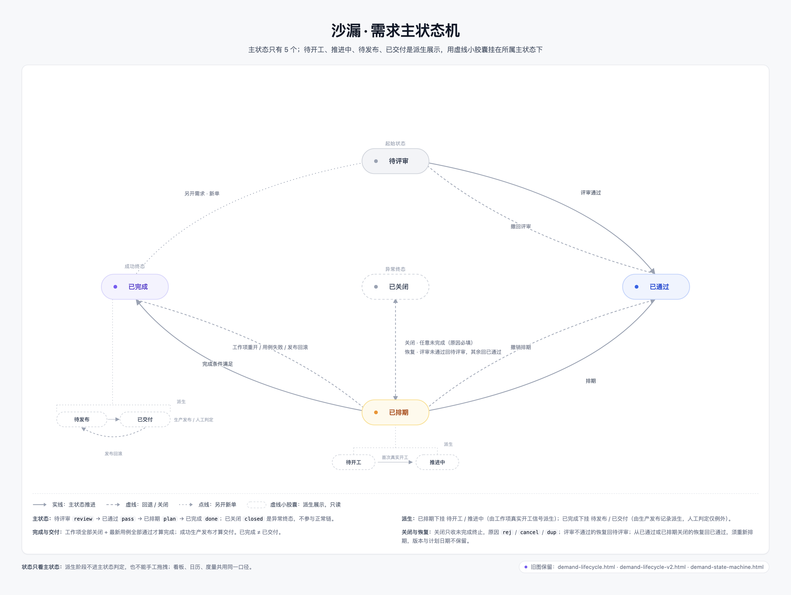

# 需求状态模型设计（2026-11-17）

> 状态：已实施（2026-11-17）。后端 5 主状态、完成判定、迁移 `sql/105_demand_done_status.sql`、看板 5 列与已完成工作页均已落地；本文保留为口径说明与验收依据。

## 结论

- 主状态 5 个：待评审 → 已通过 → 已排期 → 已完成；已关闭是异常终态，可从任意未完成状态进入。
- 「已完成」满足完成条件即为主状态，不再只是派生阶段；「已交付」仍不是主状态，是已完成上的派生展示。
- 待开工 / 推进中挂在已排期，待发布 / 已交付挂在已完成；四个阶段只读，由证据派生，不能拖拽，也不能直接改主状态。
- 完成不等于交付：工作项全部关闭且最新用例全部通过算完成；存在成功生产发布记录才算交付，人工判定只作例外。
- 关闭只收未完成的终止（评审不通过 / 中途取消 / 重复需求），并记录关闭前状态；恢复回到关闭前状态，从已排期关闭的回到已通过并须重新排期。

## 为什么主状态不到「开发中 / 已发布」

「开发中」是工作项在哪个执行列的事实，「已发布」是版本与发布记录的事实。一条需求可以拆成多个工作项、跨多个版本，把过程位置抬成需求主状态，会让需求的进度依赖某一个工作项，也会把「做完了」和「上线了」压成同一个状态。

TAPD 默认把规划中 → 实现中 → 已实现做成需求状态，适合以迭代为交付单位的流程。沙漏的工作项已经承担过程位置，需求再复制一套，会出现两套互相等待的状态；所以过程留在工作项，发布事实留在发布记录，需求只回答「评审、排期、完成、终止」四件事。

## 主状态机

实线是主状态推进，虚线是回退与关闭，点线是另开新单；虚线小胶囊是派生展示，不参与主状态判定。

## 流转与留痕

| 流转 | 触发 | 必填 / 限制 | 留痕 |
| --- | --- | --- | --- |
| 待评审 → 已通过 | 评审通过，项目写权限 | — | `demand_log` |
| 已通过 → 待评审 | 撤回评审 | — | `demand_log` |
| 已通过 → 已排期 | 排期；目标版本可空，选定须同项目且未发布 | 原因、当前 `revision` | `demand_log`，换版本通知提交人 |
| 已排期 → 已通过 | 撤销排期，同时清空目标版本与计划起止 | 原因、当前 `revision` | `demand_log` |
| 已排期 → 已完成 | 完成条件满足（自动） | 至少 1 个工作项且全部关闭；最新用例全部通过，0 个用例按通过 | 完成时间与证据快照 |
| 已完成 → 已排期 | 关联工作项重开、最新用例出现失败，或交付发布被回滚 | — | `demand_log` |
| 任意未完成 → 已关闭 | 关闭，管理者执行 | `closeReason=rej/cancel/dup`、原因、`revision` | `demand_log`，记 `closeStage` |
| 已关闭 → 待评审 / 已通过 | 恢复；评审不通过的回待评审，其余回已通过并清空目标版本与计划起止，须重新排期 | 原因、`revision` | `demand_log` |
| 已完成 → 待评审 | 不叫回退：另开需求、新单 | — | 新需求记录，旧单保持已完成 |

## 派生阶段

| 派生阶段 | 所属主状态 | 依据 | 不能替代的证据 |
| --- | --- | --- | --- |
| 待开工 | 已排期 | 尚无真实开工 | 计划开始日期不等于开工 |
| 推进中 | 已排期 | 首次移出 backlog、首次计时、直接创建在执行列，取最早日期 | 仅有关闭部分工作项不等于完成 |
| 待发布 | 已完成 | 完成条件满足且没有生效的生产发布 | 版本标记已发布、测试 / 预发记录不算交付 |
| 已交付 | 已完成 | 该需求存在 `result=success + environment=production + operation≠rollback + coverage=full + disposition=published` 且未被后续回滚撤销的发布条目；没有记录时才允许人工判定 | 失败、回滚、部分成功不算；回滚后回到待发布，重新发布成功再恢复 |

人工判定只允许选择「待发布 / 已交付」，绑定当时的目标版本，换版本后旧判定失效；真实发布证据始终优先。写入权限是空间主、管理员或项目负责人。

## 落地结果

- 表结构：`demand.status` 新增 `done`，迁移 `sql/105_demand_done_status.sql` 回填旧数据；不按目标日期或更新时间猜测完成。
- 回填：发布证据优先（成功正式生产发布或生效人工判定直接 `done`），其余按「至少 1 个未删除工作项全部完成 + 关联用例最新执行全部通过（0 条视为通过）」判定；已关闭保留 `closeStage`，恢复仍走关闭前状态。
- 完成判定：统一收敛在 `DemandCompletionService`，任何改变工作项 / 用例 / 发布证据的写路径在同一事务内调用，幂等；状态变化写 `complete` / `auto_reopen` 日志并通知提交人与关注人，备份导入静默只留日志，且因备份不携带发布记录与人工判定，导入只补 `plan → done`、不把 `done` 退回。
- 接口：`deliveryStage` 按所属主状态返回两个阶段；已完成条目返回 `donePending / delivered`，已排期返回 `waiting / active`，其他状态返回空。人工判定入口只在已完成上出现。
- 看板与工作页：5 主列；已排期 / 已完成列各带只读派生胶囊，工具条一个阶段筛选按 `<optgroup>` 分组、只作用于阶段所属列，列头计数不随筛选变化；已完成页复用工作项与用例口径并单列已交付。
- 权限与编辑：已完成需求可改标题、描述、验收标准、来源、模块、优先级与 WSJF（只修正文与归档信息），不能手工关闭、拖入、新增工作项或用例，也不能改目标版本、期望交付与计划日期；关闭入口提示先撤回证据（工作项重开、用例失败或发布回滚）让需求自动退回已排期。
- 统计：需求总数与版本进度含 `done`，交付率 / 已交付单列；`done` 不再并回 `plan` 计数。

## 与 TAPD 的对照

TAPD 默认系统状态是规划中 → 实现中 → 已实现，另有已拒绝；状态最多 31 个（16 个系统 + 15 个自定义），每个流转可单独勾选，并要求附加字段、限定用户组；发布计划是独立对象。沙漏保留它「状态机画法」和「发布独立」两点，不引入自定义状态和逐流转配置：主状态固定 5 个，过程位置留在工作项执行列。

## 原型与历史版本

- 本文配图：`diagrams/demand-main-state.png`，主状态机，2026-11-17。
- 旧稿保留未删：`demand-lifecycle.png`（方案 A，主状态与派生阶段分层）、`demand-lifecycle-v2.png`（方案 B，TAPD 式 9 状态显式流转）、`demand-state-machine.png`（9 状态环形原型，把开发中 / 已发布当状态，已弃用）。
