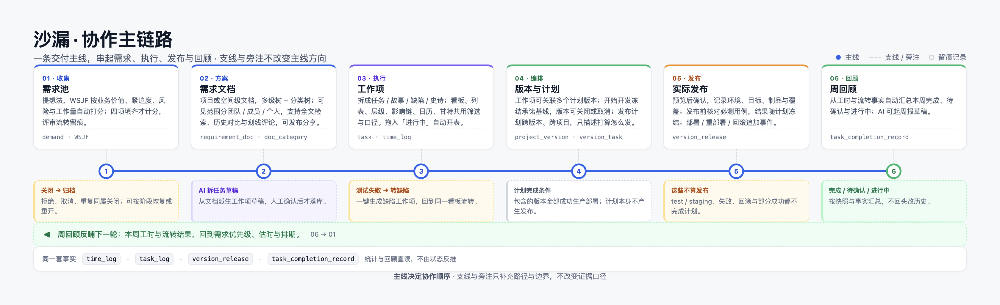
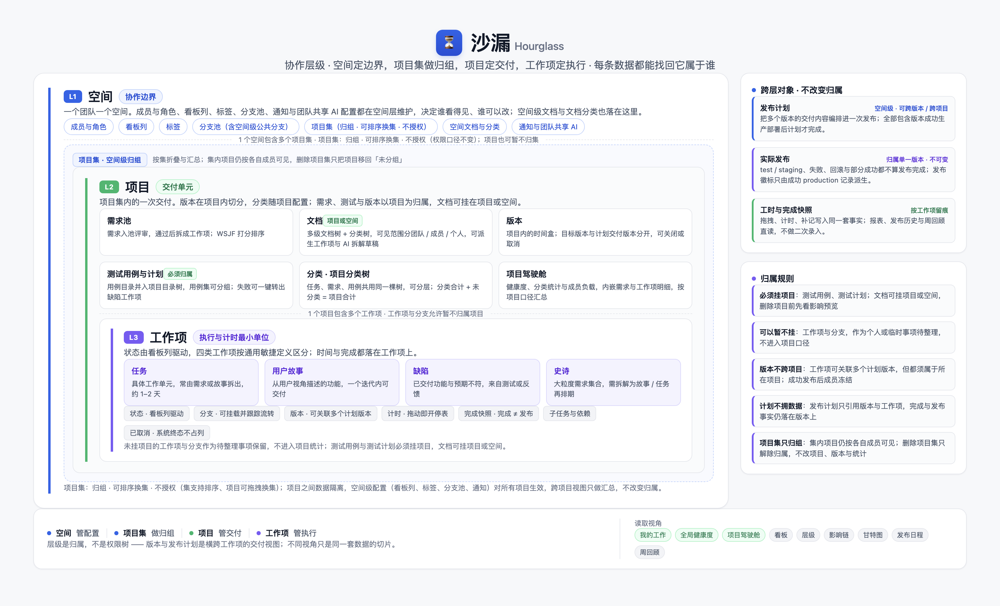
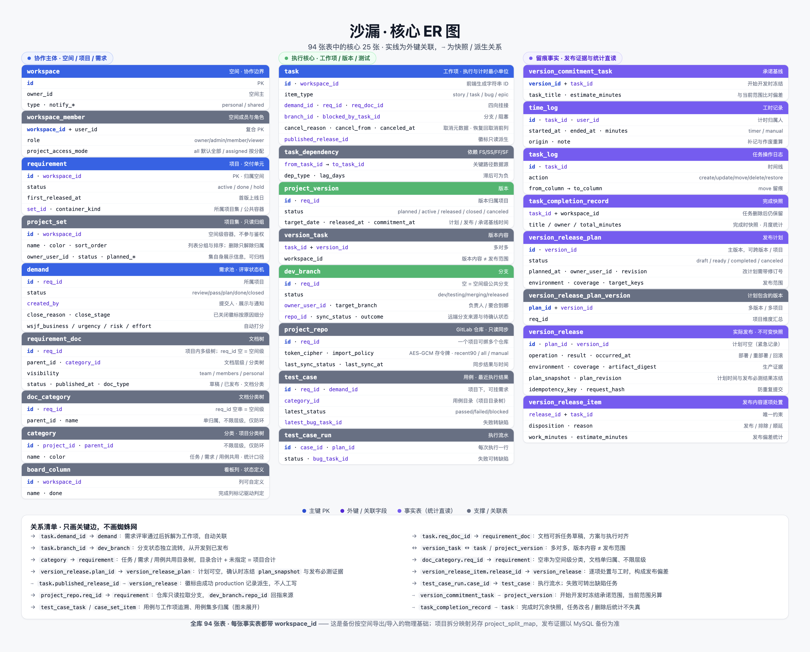

# 沙漏项目介绍

一个面向中小研发团队的**自托管轻量项目管理工具**：低成本上手，干活即记录，进度自动可见，从需求到发布全链路可追溯。它帮助团队少填报、少拼信息，不替代财务结算、部署执行或客户验收。

---

## 背景

沙漏最初是 chenghongchang（chc2）的个人看板工作台 wokstudio。kongxiangjin 想要一个更轻、更小、更精的项目管理产品，便在这套代码上继续开发。来龙去脉见[项目起源](项目起源.md)。

### 团队通常卡在哪

中小团队协作，最常见的状态是"事情都有人做，但没人说得清全局"：

1. **需求是断的** —— 想法记在聊天里，方案写在文档里，任务贴在看板上，交付靠口头传达，彼此不关联。月底问一句"这个版本到底承诺了哪些需求、各自做到哪一步了"，没人能一句话答上来。
2. **管理者看不见全局** —— 哪个项目要延期、谁的活儿已经排满、谁还有余量、哪个风险正在发酵，这些信息散落在每个人脑子里，不问就不知道，一问要问一圈。
3. **时间说不清** —— 记录里只有"做完了"三个字。"这件事到底花了多久"事后无法回答；月底算投入、对人头、写总结，全靠回忆补数据。
4. **回顾靠拼凑** —— 周报月报要翻聊天记录、邮件和会议纪要，写的人痛苦，看的人也未必信。

### 沙漏的做法

以**工作项**为执行主线，把协作各环节串在一条线上：

> 需求池里提想法 → 评审排期 → 文档里沉淀方案 → 拆成工作项在看板、日历、甘特图上推进 → 维护任务计划版本 → 完成后按实际日期预览 / 确认发布

日常操作留下执行与工时记录，管理视角（全局健康度、项目驾驶舱、成员负载、逾期与阻塞、报表）由这些记录生成，减少重复整理。源记录仍需及时维护；实际发布需有权限的人确认，不能从任务完成反推已上线。



### 定位

- **低成本上手**：固定默认值，不要求先设计工作流；建项目、提需求、拖看板即可开始记录，流程后续再补。
- **干活即记录**：计时与留痕绑在流转动作上，拖列即开表 / 停表，完成即归档；漏记可补记，记录仍需核对。
- **进度自动可见**：成员在「我的工作」看自己的活和投入，管理者在驾驶舱与项目集看真实进度；进度由事实记录派生，不填百分比。
- **全链路可追溯**：需求 → 工作项 → 用例 → 缺陷 → 版本 → 发布记录连成一条链；发布结论冻结进快照，可核对，但不替代客户验收。
- **自托管、数据自有**：核心数据保存在自己的服务器；使用外部 AI、邮件或机器人会向配置的服务发送相应内容，应按出站与脱敏策略启用。
- **适配中小团队**：不设人数上限，实际容量取决于数据量与并发而非人头；需要明确运维责任人；清晰顺手帮助采用，不以功能少作为购买理由。

---

## 信息是怎么组织的

### 层级

```
空间
 └─ 项目集（可选归组，只读汇总，不授权）
     └─ 项目
         └─ 工作项：用户故事 / 任务 / 缺陷 / 史诗（Epic）
```

- **空间**是团队协作的边界，成员、看板列、标签、分支等公共配置都在空间层维护；分类挂在项目下，随项目配置。
- **项目集**是空间级的可选归组，只做分组与项目级只读汇总：不改变项目权限，集内项目仍按各自成员可见；项目可以暂不归集，显示在「未分组」。新建、改名、排序与删除项目集仅空间主或管理员可操作，删除只解除归组，不删除项目、工作项与历史。
- **项目**是交付单元，工作项通常归属项目。工作项与分支允许暂不归属项目（作为待整理的个人或临时事项）；需求文档可挂项目或空间，测试用例与测试计划必须归属项目；项目删除前会先给出影响预览。
- **工作项**是执行与计时的最小单位，状态由看板列驱动；除看板列外还有终态「已取消」：不做了选原因（不做 / 重复 / 延期 / 设计如此）并写说明后归档，不删除数据，可恢复回取消前所在列，取消期间不计逾期、不进完成率分母。四类工作项按通用敏捷定义区分：

| 类型 | 是什么 |
| --- | --- |
| 任务 | 具体的工作单元，通常由需求或故事拆解而来，粒度小（约 1–2 天），面向执行 |
| 用户故事 | 从用户视角描述的一条功能需求（"作为谁，我希望什么，以便什么"），一个交付批次（版本）内可交付 |
| 缺陷 | 已交付功能与预期行为不符的问题，来自测试或使用反馈 |
| 史诗（Epic） | 大粒度的需求集合，一个交付批次做不完，需拆解为故事/任务后再排期；任务、故事、缺陷都可挂到某个史诗下，也可不挂 |

填写工作项时，「工作项类型」与「所属史诗」标签旁有「!」图标，点开即可查看上述说明。



### 横向关联

| 对象 | 与工作项的关系 | 用途 |
| --- | --- | --- |
| 需求池 | 原始需求先入池评审，通过后拆成工作项 | 排期可暂不指定目标版本；选定目标时须同项目且未发布，排期后可确认把名下工作项带入该版本，调期不批量迁移；关闭后按关闭前阶段恢复，回到已通过时清目标，不连带关闭任务；WSJF 四项填齐自动计分 |
| 文档 | 可挂项目或空间的方案文档，可派生出工作项 | 分类树可多层；支持把文档拆成任务草稿、检查完成度 |
| 版本 | M:N 计划交付关联与实际发布证据分开 | version_task 存当前任务版本集合；版本内容 / 跨版本计划 / 显式实际范围三者分开，一个计划可跨版本 / 跨项目；版本生产只成功部署一次（改动走 hotfix），支持多环境 / 目标及 redeploy / rollback；当前统计不替代事实；可关闭或取消未发布版本（原因必填），进入进行中时记录承诺基线 |
| 里程碑 | 项目级结果标记，不是工作项 | 一条里程碑只表达一条达成条件：版本 production 成功、关联工作项全部完成或人工确认；状态由证据推导，不占工作项计数、预估与燃尽，显示在项目驾驶舱、甘特独立轨道与版本卡 |
| 分支 | 工作项可挂分支 | 跟踪一条分支从开发到测试、合并、发布 |
| 标签 | 空间级字典，与工作项多对多 | 跨项目的筛选与统计维度 |
| 分类 | 项目级目录树，可分层 | 工作项、需求与用例共用一套节点；分类合计 + 未分类 = 项目合计 |

对象定义、层级归属与常见工具（Jira / 禅道 / TAPD 等）的对照，见《用户使用手册》1.3「对象模型」。



### 术语与数据模型对照

早期代码沿用了「需求」一词指代项目，界面文案与表名因此存在错位。阅读源码或接口时按下表对照，新增代码与接口优先使用「项目 / 工作项」语义：

| 界面概念 | 主要表 / 接口 | 说明 |
| --- | --- | --- |
| 项目集 | `project_set`；`/api/project-sets` | 空间级可选归组，只读汇总；`requirement.set_id` 记录归属，空值即未分组 |
| 项目 | `requirement`；`/api/projects`（旧 `/api/reqs` 等价） | 交付单元，不是需求池条目 |
| 需求池条目 | `demand`；`/api/demands` | 评审与排期对象，通过后可拆成工作项 |
| 文档 | `requirement_doc`、`doc_category`；`/api/req-docs` | 可挂项目或空间的方案文档；空间文档不挂项目，分类是一棵独立的自定义树 |
| 工作项 | `task`；`/api/tasks`（写）/ `/api/board`、`/api/tasks/list`（读） | 任务、故事、缺陷、史诗的统一载体 |
| 分类 | `category`；`/api/categories` | 项目级目录树（可分层），工作项、需求与测试用例共用一套节点 |
| 测试分类（原测试模块） | `test_module` | 已并入 `category`（sql/100），表仅保留作回滚，新代码不再写入 |
| 版本 | `project_version`、`version_task`；`/api/versions` | 项目版本及任务当前计划交付绑定，不代表实际发布 |
| 发布证据 | `version_release_plan`、`version_release_plan_version`、`version_release_plan_task`、`version_release`、`version_release_item`、`version_log` | 六表保存跨版本计划及成员版本、任务范围、不可变实际事件、条目快照与日志；全库 99 表（含版本终态、承诺基线、项目里程碑、交付报告、用例-工作项追溯、用例自定义分组、文档分类树、团队共享 AI 配置、Git 仓库同步、文档可见范围、工作项历史发布人工标记、需求池评论与需求提醒人、项目集与拆分映射、需求评审人、测试计划执行人、发布准备与计划关注、交付报告分享访问明细、周五补记与未处理项承接、轻量自动化与定时报告订阅、文档收藏、AI 用量日聚合、交付说明计划草稿、文档引用、发布计划分享） |

---

## 功能地图

左侧 10 个内容入口分四组，设置固定在导航末尾、个人设置点左下角头像，另加平台能力：我的（我的工作 / 周回顾）、规划（需求池 / 项目 / 版本）、交付（交付报告 / 工作项 / 文档 / 测试）、分析（洞察，含报表 / 投入 / 风险与负载）；消息中心收在顶栏铃铛的「查看全部」，分支在启用 Git 后从项目驾驶舱或版本详情进入。同一业务域的多个视图通过标题下方的二级导航切换（项目列表 / 项目集、版本列表 / 发布工作台、工作项四视图与分析（层级 / 影响链）、文档列表 / 历史版本、测试（工作台 / 用例 / 测试计划 / 报告 / 缺陷，覆盖矩阵收进测试计划）、运营概览 / 交付图表 / 投入结构）。

### 我的

| 功能 | 做什么 | 关键机制 |
| --- | --- | --- |
| 我的工作 | 角色工作台：待我处理 / 我发起的 / 我关注的 | 待我处理按角色分「我负责的开发、我带的测试、待我执行的测试计划、待我评审的需求」；我发起的（需求与工作项）与我关注的事项单独成页签；支持认领评审、分组、行内操作与分批加载；空间主 / 管理员另有「团队」页签查看本周交付 |
| 消息中心 | 站内通知的完整消息页 | 与顶部铃铛同一份数据，支持收藏、深链与一键全部已读；通知经 SSE 实时推送 |
| 周回顾 | 自动总结一周的完成、待确认、进行中；空间主 / 管理员可切「团队」 | 个人口径只统计我负责的工作项，三个分区互斥、工时只展示我的本周计时；团队视图按周给结论条、统计矩阵与完成 · 发布 / 质量 / 文档 / 成员 / 项目 · 风险，角色筛选只收窄成员明细，点矩阵数字打开统计明细抽屉；历史周期按操作记录近似还原；个人范围可选 AI 生成周报草稿 |

### 规划

| 功能 | 做什么 | 关键机制 |
| --- | --- | --- |
| 需求池 | 需求评审与排期 | 评审通过 / 拒绝 / 重开需项目写权限，未指派可由项目可写成员认领；排期由管理者操作；调期需原因 / revision，不自动改旧任务；计划起止独立于期望日期 |
| 项目 | 项目列表 / 项目集 | 项目列表可按项目集归组、折叠，未归集项目平铺在「未分组」；项目集只做归组与项目级只读汇总（全局健康度），由空间主 / 管理员维护。驾驶舱维护负责人、目标与计划日期并查看进度、工时、负载与交付资源；模板、归档与删除影响预览，存在发布证据时保护 |
| 版本 | 版本列表 / 发布工作台；按版本、首版 / 迭代分析，以及跨项目视图下的全部版本、发布计划与全部项目查看 | 统计折算不等于实际发布；正式发布说明显示 / 导出使用不可变记录与条目快照；版本页按产品 / 设计、开发、测试三段拆分实际工时并支持四维汇总与下钻，驾驶舱仍按测试窗口内 / 外展示；发布工作台提供发布准备、关注计划与准备提醒，只做提醒不改变工作项状态 |
| 交付报告 | 一页式对外交付报告 | 必须选定一条成功的生产发布记录，汇总承诺、实际发布、回归、遗留缺陷与投入；客户 / 管理 / 内部复盘三版；导出即冻结快照，可生成只读分享链接 |
| 分支 | 空间级分支跟踪 + GitLab 仓库只读同步 | 四态可任意方向切换（允许打回），开发 / 合并两套时间口径分开统计；可绑定仓库定时拉取分支与已合并 MR，远程变化进入待确认队列 |

### 交付

| 功能 | 做什么 | 关键机制 |
| --- | --- | --- |
| 工作项 | 看板、列表、层级、影响链、日历、甘特六种视图 | 看板、列表、层级、日历、甘特共享同一套筛选，影响链沿依赖双向展开；看板支持拖拽移列、列内排序、两级分组与行内新增；层级按项目 / 版本 / 分类缩进并聚合父级进度；工作项可另设测试负责人，未指派显示「待领取」，负责人与测试负责人合并为一个筛选入口、面板里分两组勾选；关注人名单可增删（本人可退出，项目可写者可代他人添加 / 移除）；列可配置流转矩阵与计时 / 逾期处理规则 |
| 文档 | 空间文档与项目文档的分类树管理 | 分类可自定义多层；每篇可设团队共享 / 指定成员 / 仅自己三档可见范围；正文自动过滤危险内容；支持 AI 拆任务与完成度体检 |
| 测试 | 用例、缺陷、测试计划、覆盖矩阵与测试报告 | 用例 / 测试计划 / 缺陷三个模式用二级导航切换，覆盖矩阵与测试报告收在测试计划页签；缺陷按项目汇总未关闭项并按严重度排序，失败用例可一键转缺陷工作项，测试计划完成后锁定为快照；测试计划可设执行人，被指派后进入「我的工作 → 待我执行的测试计划」；用例支持 Excel / CSV 导入导出与动态分组 |

### 洞察

| 功能 | 做什么 | 关键机制 |
| --- | --- | --- |
| 报表 | 趋势与分布、完成记录、流程体检、交付图表、投入结构五个视图 | 流程体检基于工作项操作记录，提供统计口径与相关记录用于核对，不替代预测或判断；交付图表面向管理者，支持导出；投入结构按年度 / 季度盘点人力、工时与资源分布 |
| 成员负载 | 跨项目查看每个成员的在办工作项与投入工时 | 同时看数量与工时，避免"工作项数多但耗时少"的误判 |
| 逾期与阻塞 | 集中处理逾期、被阻塞、停滞的工作项 | 逾期判定与看板、日历同一套口径；支持站内催办 |

### 平台能力

| 能力 | 说明 |
| --- | --- |
| 权限与可见性 | 空间角色：空间主（可多位，等权）/ 管理员 / 成员 / 查看者（查看者全局只读）；项目级按「成员 × 项目」设为可参与 / 可测试 / 只读 / 不可见。新成员默认不参与任何项目，邀请时可预分配、加入后可再调整；存量成员保留默认参与 |
| 通知 | 站内通知 + 即时推送 + 邮件；每日汇总、逾期与今日到期角标；按个人偏好投递 |
| 附件 | 支持图片、PDF、文本、Markdown、HTML、ZIP、Excel；图片、PDF、Markdown、HTML 与 Word 点开即在弹框内预览（HTML 在隔离沙箱内还原排版并可运行原型脚本）（图片可放大、旋转、拖拽查看细节），**.xlsx 在工作项详情内直接打开为可编辑表格**（改动覆盖保存）；支持复制粘贴、拖拽上传；评论（工作项 / 需求池）同样支持粘贴截图上传与图片内嵌预览 |
| AI 能力 | 优先使用平台配置的团队 AI，成员可显式改用个人模型与密钥；用于文档拆成工作项、完成度检查、测试用例生成、AI 周报与右下角 AI 助手，结果需人工确认后才会创建或执行 |
| 数据安全 | 文档正文自动过滤危险内容；AI 与邮件的密钥加密保存；附件类型白名单限制 |
| 流转约束 | 每个空间一份「来源列 × 目标列」矩阵，可取允许 / 需填原因 / 禁止，默认全部允许；只约束能否流转，不替代列级计时与逾期规则 |
| 搜索与审计 | 全局搜索跨需求池、工作项、文档与测试用例；操作审计支持筛选与 CSV 导出，管理员可查看系统信息 |
| 备份与恢复 | 按空间 JSON 任务备份 / 表格导出；正式发布凭证用数据库备份，覆盖导入有证据保护；回收站 30 天保留 |
| 设置 | 空间与成员、工作流（看板列 / 状态流转 / 分类）、通知与集成（空间推送、平台 SMTP）、数据与审计（备份 / 迁移导入 / 回收站 / 审计）、平台账号管理；版本在左侧导航独立维护，分支从项目驾驶舱 / 版本详情进入（需启用 Git），标签在工作项中维护 |

---

## 使用中的统一规则

这些是踩过坑之后定下来的口径，所有页面共用，不会各算一套：

| 规则 | 说明 |
| --- | --- |
| 自动计时与补记 | 自动计时仅计工作日的个人工作时段（默认 09:00–18:00），每日额度默认 8 小时、可配置，跨任务与空间共用；手工补记单条 1 分钟–24 小时、日期不晚于今天，不按周末 / 时段 / 日额度裁剪，当天补记会占用后续计时额度 |
| 计时归属 | 计时是"人"的属性：一人同一时刻只计一个任务，开始新的会自动停掉旧的并明确提示 |
| 完成后接力 | 计时中的任务被完成后，若原列还有任务则自动接上第一个；仅在本人当前没有运行中计时时生效 |
| 状态与归档 | 看板列驱动状态；进度 100% 但未归档的进入"待确认"；完成时落一条快照用于月度统计 |
| 口径统一 | 复用记录与计算规则；比较看板、日历、报表时需对齐指标、筛选与时间窗口，当前统计与历史快照可能不同 |
| 留痕 | 工作项流转、需求评审、工时记录全部留痕；回顾与流程体检都从这些记录还原历史 |
| 可见性 | 看不见的内容不会通过通知或推送泄露 |

---

### 交付闭环

- 仅 Task 与计划交付版本为 M:N，读取 / 保存响应使用 versionIds/versionNames 数组；保存省略 / null 保留，[] 解绑，显式变更需原因与管理者或任务负责人可写权限。Demand / TestPlan 仍是单目标 versionId；需求目标与任务集合独立，调期不改旧任务。
- 发布徽标优先由成功 production 实际记录推导，publishSource=record，展示 publishedAt/publishedReleaseId/everPublished/publicationState/publicationTargets（unpublished/effective/partial/rolled_back/unknown）；正式字段只读，历史迁移中无发布记录的工作项可由具备「人工标记工作项发布」权限的成员人工补录「已发布（人工）」（默认空间主、管理员或项目负责人，可加选项目可写成员），须填日期与原因，仅用于徽标、「发布态」列与筛选，不影响交付派生与统计。test/staging 或失败不代表生产发布。成功事实冻结内容关联，不锁任务完成 / 回退 / 计时；需要新增内容时另建版本。
- 发布计划可跨版本 / 跨项目；一个版本生产只成功部署一次，改动走新 hotfix 版本，同一制品可 redeploy / rollback，替换制品须新建版本；计划须全部包含版本都完成成功生产部署 / 重部署才完成，test/staging、rollback 与部分成功不算。版本内容、plannedTaskIds、actualTaskIds 三范围分开，实际范围只属当前版本。计划指定时间 / 负责人 / 环境 / targetKeys 数组 / coverage，更新选定计划带 id+revision，completed 只读且不可改，后续新计划或有 deviationReason 的紧急无计划事实。实际 context 明确带 UTC offset 的 occurredAt（与 recordedAt 分开）、环境 / 目标 / 覆盖、制品（必填）与 SHA256（选填）、操作、关联事件、执行人及唯一 ≤500 项实际任务数组。预览显示 not_selected、候选与警告，不静默排除实际事实，未完成事实需发布维护权限及未按计划发布的原因。
- 发布管理、预览与确认默认限空间 owner/admin 或项目 ownerUserId 且可写，空间可在「设置 → 工作流 → 发布权限」加选项目可写成员，提交时重新检查；任务负责人无整版本权，计划负责人元数据不赋权，releasedBy 为服务器登录者；需求评审通过 / 拒绝 / 重开需要项目写权限，未指派时可被项目可写成员认领。确认带 result/notes/failureReason/scopeToken/planRevision/idempotencyKey；未知结果 sessionStorage 保留同 body/key，先查 release-records?key=... 再同请求重试，明确结果后决定新键，不刷新清理。
- rollback 新增事件并按目标撤销关联记录引用，保留 ever 历史和后续不同成功；任务记录查全部可见事件。版本 / 计划 / 实际快照与当前工时分开，M:N 和多事件不放大全局工时；需求关闭不抹历史，零任务不能 100% 验收。不新增迭代模块、不做历史迁移。
- 删除版本不自动解绑；已发布或有实际尝试、仍有任务绑定（含回收站）或需求目标引用（含已关闭）受保护。无证据版本先按权限有因调整引用；不得通过撤标删历史证据。
- JSON 只搬运工作数据，包含任务版本数组、version.startDate、需求日期与 canceled，不转移正式发布证据；正式证据使用完整数据库备份恢复，项目 / 空间删除与覆盖导入保护证据。发布说明与快照 CSV 读不可变条目，历史日志只读，不提供发布历史 JSON 导出或补造旧证据。需求备份带可空计划起止字符串，保留 canceled；原始无目标的 plan 保留状态与计划日期；原始显式非空目标丢失 / 映射无效时置空，仅此类 plan 按原规则回 pass 并清计划日期，非法日期或倒置区间在覆盖删除前拒绝。详细操作见用户手册第 7、11、16 章。

## 边界与取舍

| 不做 / 有限支持 | 原因与现状 |
| --- | --- |
| 多人实时协同编辑表格 | 在线表格定位是"附件查看与快速修改"，不做协同冲突合并；同一附件以覆盖保存为最终稿 |
| Excel 样式与图表的完整还原 | 在线编辑是简化表格：.xlsx 保留单元格样式、合并、列宽行高与冻结；条件格式、图表、嵌入图片不保证保留，数值与公式优先 |
| 超大表格全量加载 | 预览按 20000 行 × 200 列截断并提示，避免页面卡死 |
| 预测型统计与 AI 评分 | 流程体检与度量只做可回溯的统计，不引入无法解释的模型输出 |
| 大规模部署 | 适合中小团队自托管，单实例部署；不追求海量用户与横向扩展 |
| 当前集成缺口 | 外部数据只支持 Excel / CSV 新建导入，缺增量更新、评论与附件迁移；缺 SSO / 企业微信免登、公开 API Token、Git 流水线联动；不是永久不做，按真实采用障碍决定优先级 |
| 结算与验收 | 工时与发布记录供复盘 / 对账参考，不提供计费率、审核锁账或客户签认；已有系统审计最小集不等于全部合规认证 |
