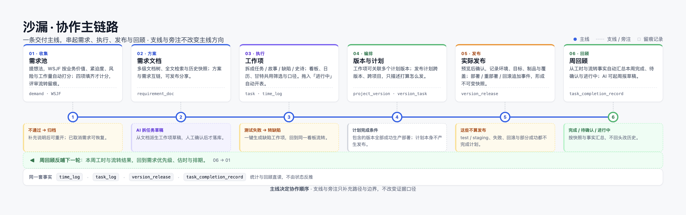
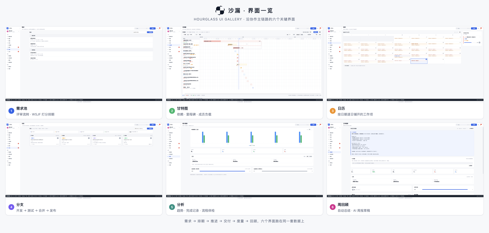
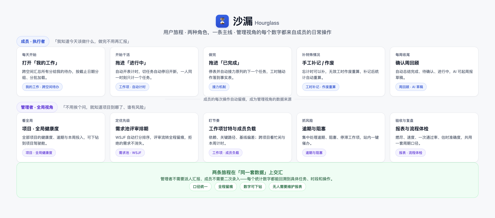
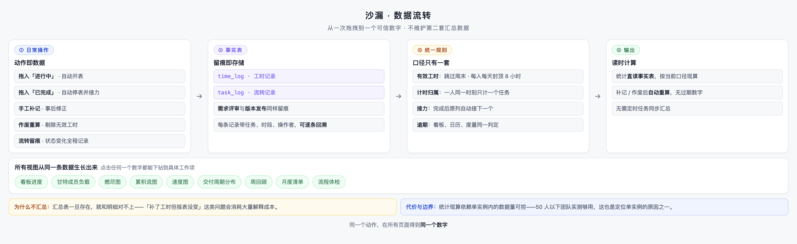
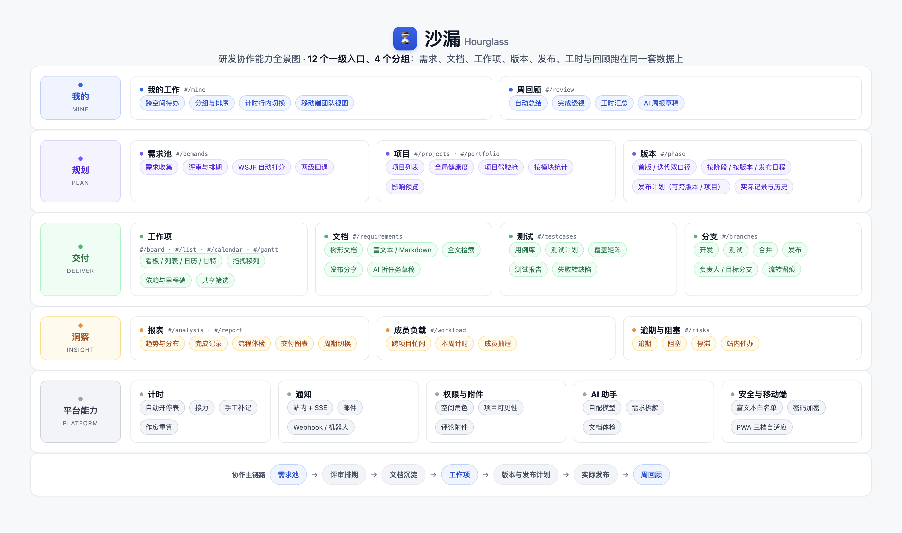
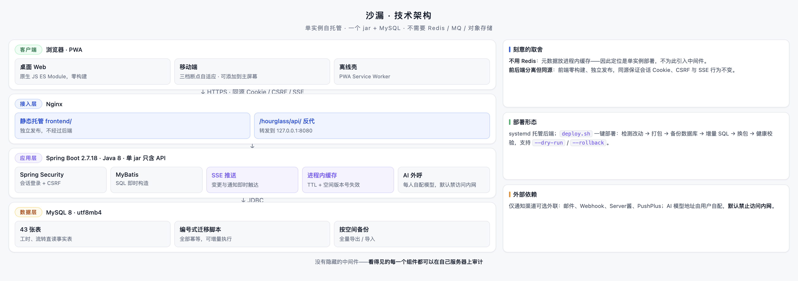

# 沙漏 · 产品说明

> 面向小团队的私有化研发协作工作台 —— 需求、评审、文档、任务、版本、回顾跑在同一套数据上。

---

## 沙漏是什么

沙漏把研发协作的整条链路收进一个可以自己部署的系统里：

> 需求池提想法 → 评审排期 → 文档沉淀方案 → 拆成工作项 → 看板 / 日历 / 甘特推进 → 维护计划版本 → 完成后预览 / 确认发布 → 周回顾与月度清单

进度、工时、成员负载、逾期风险和交付报表都从日常操作里自动产生，**不需要任何人二次录入**。

## 先看界面

以下是沿协作主链路的六个关键界面——项目、甘特图、日历、文档、报表、周回顾。所有视图读的是同一套数据，任何一个数字都能下钻到具体工作项。

> A–E 已实施，本地正确性门禁通过（Java、真实 API / MySQL、真实 headless Chrome 1440/390px 仿真及未知请求恢复）；七对 delivery PNG 已重拍、SHA256 配对一致并视觉查看，部署安全隔离验证通过。生产配置写入被策略拒绝且缺显式 DB_NAME，生产部署 / full seed 阻塞、未执行；提交推送结果以 Git 为准。独立统计见 [更新日志](../CHANGELOG.md)。上方 overview 图仍演示历史布局；仅用户手册中的七张 delivery PNG 为本轮真实浏览器仿真新图，不声称物理手机测试。

## 为谁而做

**推荐 50 人以下的研发团队使用**：有需求管理和迭代节奏，但没有专职 PMO。你们不需要再买一个重型平台，也不该继续用聊天记录当需求池。

| 你是 | 沙漏替你解决 |
| --- | --- |
| 团队负责人 | 不用挨个问就知道项目到哪了、谁有风险、时间花在哪 |
| 开发成员 | 打开「我的工作」就知道今天做什么，做完不用再写汇报 |
| 项目负责人 | 评审、排期、执行与版本交付相连，实际发布说明从不可变快照生成 |
| 运维 / IT | 一个 jar + MySQL 的自托管系统，数据不出内网 |

## 核心主张：任务管理不是目的，工时和回顾才是

多数工具止步于"任务移动了"；沙漏的差异化在移动之后发生：

- **移动任务驱动计时** —— 拖入「进行中」自动开表，拖入「已完成」自动停表并接力下一个；一人同一时刻只计一个任务，杜绝月底回忆式补录。
- **统计直读事实表** —— 工时、燃尽、负载直接读 `time_log` / `task_log`，不维护第二套汇总数据；补记、作废后自动重算，不存在报表和明细对不上。
- **每个数字可回溯** —— 点击任何统计都能下钻到具体任务、时段和操作；统计只做可解释的计算，不引入无法解释的模型输出。

### 计划、完成与发布分开记录

需求排期可暂不指定目标版本；选定目标时须同项目且未发布；计划起止独立于期望日期；调期（含清空目标） / 取消 / 恢复带原因与 revision，不自动改旧任务，取消不取消任务。仅 Task 与版本改为 M:N，使用 versionIds/versionNames 数组，保存省略 / null 保留、[] 解绑，显式改变关联需原因与权限；Demand / TestPlan 仍是单目标 versionId。成功事实后冻结内容关联，不锁任务完成 / 回退 / 计时；删除版本不自动解绑，也不得清除发布证据或现有引用。

完成不等于发布：徽标只读，由成功 production 实际记录推导，publishSource=record，展示 publishedAt/publishedReleaseId/everPublished/publicationState/publicationTargets（unpublished/effective/partial/rolled_back/unknown），无人工标记 / 撤标；test/staging 或失败不代表生产发布。一个版本支持多个独立计划、失败重试、多次成功、redeploy 与 rollback；三范围版本内容 / plannedTaskIds / actualTaskIds 分开。完成计划不可改，后续新计划或有偏离理由的紧急无计划事实；实际 context 明确带 UTC offset 的发生时间（与 recordedAt 分开）、环境 / 目标 / 覆盖、制品及 SHA256、操作 / 关联事件 / 执行人 / 唯一 ≤500 项任务数组。预览显示 not_selected、候选与警告，不静默排除实际事实，未完成事实需管理权限与偏离理由。rollback 追加事件并按目标撤销关联引用，保留 ever 历史与后续不同成功，不解锁内容。快照与当前工时分开，多关联 / 多事件不放大全局工时；需求取消不抹历史，零任务不能 100% 验收。

发布管理仅空间 owner/admin 或项目 ownerUserId 且可写，提交时重新检查；任务负责人无整版本权，计划负责人元数据不赋权，releasedBy 为服务器当前登录者，评审仍空间主。计划列表 / 新建与选定 id+revision 更新分开；确认使用同一 context 与 result/notes/failureReason/scopeToken/planRevision/idempotencyKey。未知结果 sessionStorage 保留同 body/key，先查 release-records?key=... 再同请求重试，明确结果后决定新键，不刷新清理。JSON 只搬运任务数组、version.startDate、需求日期与 canceled，不转移正式证据；正式证据用完整数据库备份恢复，项目 / 空间删除与覆盖导入保护证据。不新增迭代模块、不做历史迁移。需求备份保留可空计划起止字符串与 canceled，原始无目标的 plan 保留状态与计划日期；原始显式非空目标丢失 / 映射无效时置空，仅此类 plan 按原规则回 pass 并清计划日期，非法日期或倒置区间在覆盖删除前拒绝。详见用户手册与管理员指南。

## 能力全景

四组入口：我的（个人待办与周回顾）、规划（需求池 / 项目 / 版本）、交付（工作项 / 文档 / 测试 / 分支）、洞察（报表 / 成员负载 / 逾期与阻塞），平台能力贯穿其中。

## 部署形态：小而完整

单实例、自托管：**一个 jar + MySQL**，不需要 Redis / MQ / 对象存储。前端零构建，由 Nginx 直接托管；`deploy.sh` 支持备份、发布、健康校验及 `--dry-run` / `--rollback`。本轮只在独立新空库启用 52 表完整基线，不回放 61/62、不迁移旧历史，保留原库与原数据；完整基线会重建表，不是幂等无损升级脚本。数据不经过任何第三方云服务。

## 明确不做的

多租户 SaaS、大规模横向扩展、多人实时协同编辑表格、预测型统计与 AI 评分、外部平台迁移工具。**这不是能力不够，是刻意的范围克制**——小团队要的是每个功能都用得上、每个数字都可信。

## 进一步了解

| 文档 | 内容 |
| --- | --- |
| [项目介绍](项目介绍.md) | 背景、信息模型、模块地图、机制取舍 |
| [用户使用手册](user-guide.md) | 全功能操作手册与口径解释 |
| [快速上手指南](快速上手指南.md) | 新团队 30 分钟跑通主链路 |
| [管理员指南](管理员指南.md) | 部署、升级、备份、通知、AI 配置 |
| [常见问题](常见问题.md) | 口径、统计、部署的高频疑问 |

---

许可：[PolyForm Noncommercial License 1.0.0](../LICENSE)（源码可用，**禁止商用**；企业内网部署、对外交付、试点评估等商业场景需向版权持有人另行取得商业授权）。版权与历史沿革见 [NOTICE](../NOTICE)；内嵌第三方库与后端依赖沿用其原始开源许可证，清单见 [THIRD-PARTY-NOTICES.md](../THIRD-PARTY-NOTICES.md)。
