# 沙漏 用户使用手册

> 适用版本：沙漏 1.0.0 与已部署的 A–E 契约（生产 payload 见更新日志最新一条发布记录）；本地正确性门禁通过，含真实 headless Chrome 1440/390px 仿真、权限及未知请求恢复，七对 delivery PNG 重拍 / SHA256 配对一致并视觉查看，部署安全隔离通过。生产已实际部署并正常提交 / 推送，当前 payload 以更新日志中最近一次实际发布记录为准，完整生产模拟及只读验收完成；原 `hourglass` 经单独授权、受限备份与恢复验证后由 46 表重建为 52 表，认证 JDBC 与 `DB_NAME=hourglass`，原历史在备份中，`hourglass_20261110` 保留额外回退点。生产 Chrome 1440/390px、24 次入口导航、93 项有效断言通过，0 runtime/console/HTTP 错误，不以本地仿真替代（独立统计见 [更新日志](../CHANGELOG.md)）
> 阅读对象：最终用户（项目经理、开发、测试、管理者等）  
> 更新日期：2026-11-11
> 图注：仅第 7、11 节七张本地 delivery PNG（docs/frontend 七对）是仓库本轮新截图，生产四张私有验证截图未入库；仓库新图来自真实 headless Chrome 1440/390px 仿真，docs/frontend SHA256 配对一致并视觉查看；其余 overview 配图已于 2026-11-10 按当前实现重出，不声称物理手机测试。1 个自建浏览器 fixture 空间保留作本地正式证据，最终复跑未建新空间，不称全部本地数据已清理。操作以正文为准。

---

## 0. 产品定位与命名由来

### 0.1 面向小型项目制团队的研发交付工作台

沙漏是面向小型项目制研发团队的自托管研发交付工作台。它不追求成为功能无所不包的平台，而是把需求、文档、工作项、测试、工时、版本与发布记录连接起来：**让投入可解释，让交付可追溯。**

“交付账本”可以作为这条记录链的比喻，但不是财务账本或客户验收系统。自动计时减少重复录入，仍需修正；实际发布由授权人员确认，不代替部署执行、独立流水线验证或客户签收。先判断团队是否需要这条记录链与自托管，再判断功能是否适合，不仅按人数或行业选工具。

### 0.2 小而美，美而精

- **小**，是范围克制。围绕真实工作保留必要能力，不堆砌复杂层级、无关字段和繁重配置，也不因为其他产品具备某项功能就盲目加入。
- **美**，是清晰顺手。页面突出重点，常用操作直接可见，信息容易理解；团队不需要先学习一套复杂方法，才能开始管理日常协作。
- **精**，是细节可靠。同一指标在各页面保持同一口径，操作结果有明确反馈，异常状态有清楚说明，常用流程在反复使用后依然稳定、顺畅。

因此，“简单”不意味着功能简陋，而是把复杂留给系统，把清晰留给用户；“精致”也不只是视觉好看，而是每一次点击、每一条数据和每一个细节都经得起实际使用。

### 0.3 为什么叫「沙漏」

**沙漏是产品名，也是对时间与交付关系的提醒：计划只有持续流转，才会沉淀为成果。**

- **上半部**象征计划、待办与需求池——尚未落地的任务；
- **下半部**象征交付、完成与价值沉淀——已经产出的成果；
- **中间细腰**象征关键路径与瓶颈，提醒团队关注流转效率，而不只是增加并行工作；
- **沙粒流动**象征真实的时间投入，以及从计划到交付的持续转化。

这个名字与沙漏的计时、甘特排期、迭代节奏和周回顾能力相呼应，也表达了产品的态度：尊重每一份时间投入，让团队看见工作如何一步步变成结果。

---

## 1. 产品简介

沙漏是面向小型项目制研发团队的自托管研发交付工作台。它以「工作项」为执行主线，连接需求提出、评审排期、文档沉淀、任务执行与版本发布记录，让项目进展与投入有可查询的来源。工作完成、记录实际发布和客户验收是不同环节。

第一次使用时，建议先阅读本章与第 2 章完成基本设置，再按需要查阅工作项、执行视图、需求池、文档、测试、版本和报表等章节；遇到统计疑问时，可直接查看第 18 章「统一口径解释」。

### 1.1 核心能力

- **执行与记录相连**：移动任务可以驱动计时，计时沉淀为周回顾与月度清单，减少重复整理。
- **指标来源可解释**：关键指标复用工时与流转等记录；比较时需对齐筛选、日期及当前指标 / 历史快照，不是所有页面必须显示同一个数字。
- **全局进展可查询**：项目健康度、成员负载、逾期与阻塞、报表基于协作记录生成，仍需及时纠正漏记、误计和状态偏差。
- **核心数据自行托管**：后端 jar + MySQL，前端由 Nginx 托管，不依赖 Redis / MQ；启用外部 AI、邮件或机器人时可能发送业务内容，自托管不等于免维护、绝不出站或自动合规。

### 1.2 数据层级

```
空间（Workspace）
 └─ 项目（Project）
     └─ 工作项（Item）：任务 / 用户故事 / 缺陷 / 史诗
```

- **空间**：团队协作边界。成员、看板列、标签、分支等公共配置在空间层维护。
- **项目**：交付单元，工作项、需求目标版本与计划交付版本归属项目；版本不能跨项目绑定。
- **工作项**：执行与计时的最小单位，状态由看板列驱动。

| 工作项类型 | 说明 |
| --- | --- |
| 任务 | 具体工作单元，通常由需求或故事拆解而来，粒度约 1–2 天，面向执行。 |
| 用户故事 | 从用户视角描述的功能需求（"作为谁，我希望什么，以便什么"），一个迭代内可交付。 |
| 缺陷 | 已交付功能与预期行为不符的问题，来自测试或使用反馈。 |
| 史诗 | 大粒度需求集合，一个迭代做不完；任务、故事、缺陷都可挂到某个史诗下。 |

> 工作项类型与史诗字段旁有「!」图标，点击可查看类型说明。

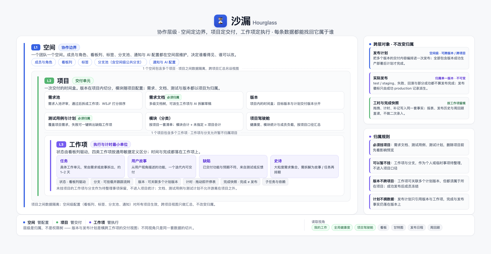

---

## 2. 快速入门

### 2.1 登录与首次使用

1. 打开浏览器，访问 沙漏 地址（如 `http://127.0.0.1:8080/hourglass/`）。
2. 使用管理员账号登录（首次启动时由运维人员通过环境变量 `AUTH_USER` / `AUTH_PASSWORD` 创建）。
3. 首次登录会自动生成你的个人空间。

> 首次登录且未带页面链接时，固定进入「我的工作」，不区分角色。之后刷新、收藏或分享链接会保留当前页面，不再改落点。

### 2.2 界面总览

登录后进入主界面，分为三个区域：

- **左侧边栏**：空间切换与导航菜单，分「我的（我的工作、周回顾）／规划（需求池、项目、版本）／交付（工作项、文档、测试、分支）／洞察（报表、成员负载、逾期与阻塞）」四组，设置与个人设置在页脚。
- **顶部栏**：全局搜索、新建入口、帮助菜单（快捷键帮助 / 帮助中心 / GitHub）、主题切换和通知中心；同一业务域的多个视图在标题下方用二级导航切换（工作项四视图、项目列表与全局健康度、测试四模式、报表四个页签）。
- **内容区**：当前选中视图的主体内容。

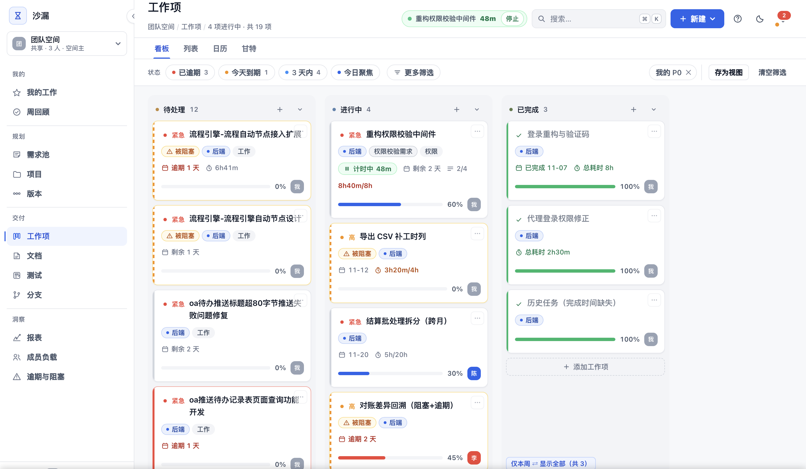

点击顶部栏的书本图标可在新标签页打开「帮助中心」：内置本手册与快速上手、常见问题、产品说明、管理员指南五份文档，左侧可随时切换；右上角「下载 Markdown」可下载当前文档，便于离线保存或团队内分享。

### 2.3 创建第一个项目

1. 在左侧导航点击「项目」。
2. 点击右上角「新建项目」。
3. 填写项目名称、描述，选择状态（进行中 / 已暂停 / 已完成）。
4. 点击保存，项目会出现在项目列表中。

### 2.4 创建第一个工作项

1. 从左侧「工作项」进入看板视图；项目与负责人可在筛选栏选择。
2. 点击看板列底部的「+ 添加工作项」，或顶部「新建」按钮。
3. 填写标题、类型、负责人、优先级、截止日期等。
4. 保存后，卡片会出现在看板首列。

### 2.5 拖拽流转与计时

- 在看板上，拖动卡片从一列移到另一列即可改变状态。
- 空间可配置「状态流转」矩阵：某些「来源 → 目标」可设为需填原因或禁止。需填原因时会弹窗，填写后写入活动记录；被禁止时看板、列表、批量与抽屉等入口都会给出同一提示，空间主 / 管理员确认后可强制移动。
- 拖入「进行中」列会自动开始计时。
- 拖入「已完成」列会自动停止计时，并触发「完成后接力」：如果原列还有其他任务，会自动接续计时第一个任务。
- 每张卡片右上角有计时按钮，也可手动开始 / 暂停。
- 忘开表、加班等情况可用「补记」手工补一条实际工时：可选择任意空间成员与日期（不晚于今天），补记不经过工作时段裁剪，直接计入任务与报表；补记记录可在工时记录列表中删除。
- 忘停表导致工时偏大时，点计时记录右侧的「作废」，再用「补记」按天录入实际工时；作废后所有统计与完成快照立即按实际工时重算（详见 18.7）。

---

## 3. 空间与成员

### 3.1 空间概念

空间是数据隔离单元。你可以属于多个空间（如个人空间、团队空间），不同空间的项目、工作项、成员完全隔离。

- **个人空间**：首次登录自动生成，适合个人待办。
- **共享空间**：由管理员创建，邀请团队成员加入。

切换空间：点击左侧边栏顶部的空间名称，在弹出菜单中选择目标空间。

### 3.2 成员管理

空间主或管理员可在「设置 > 成员与权限」中：

- 查看当前成员列表。
- 生成邀请链接，复制给新成员。生成时可勾选该成员加入后能访问的项目，并为每个项目选择「可参与 / 只读」；不勾选则加入后看不到任何项目，需要再加入后分配。
- 对成员角色使用「分配项目」，按项目批量调整「可参与 / 只读 / 不可见」。
- 修改成员角色或移除成员。

### 3.3 角色说明

空间级角色共有四档：

| 角色 | 权限 |
| --- | --- |
| 空间主（Owner） | 拥有空间全部权限，包括空间改名与推送配置、成员管理、完整备份导入导出、删除空间。 |
| 管理员（Admin） | 可管理项目与成员、新增 / 编辑 / 排序看板列、维护项目模块（新增 / 改名 / 排序 / 删除）、配置项目可见范围；不能删除看板列、不能修改空间名称或执行完整备份。 |
| 成员（Member） | 可创建和编辑自己参与的项目与工作项，可新增 / 编辑 / 排序看板列；作为项目负责人时可维护该项目模块；不能删除看板列、不能管理成员或完整备份。 |
| 查看者（Viewer） | 全局只读，不能创建、编辑、删除任何数据。 |

> 项目级对每个「成员 × 项目」单独设置三档权限：**可参与**（可查看、可编辑）、**只读**（只能查看）、**不可见**（完全隐藏）。新成员加入时默认不参与任何项目；可在生成邀请时预分配，也可在加入后由空间主 / 管理员通过「分配项目」调整。改造前已存在的成员保留原来的默认参与行为，直到被显式调整。

---

## 4. 项目

### 4.1 项目列表

进入「项目」视图，可看到当前空间下的所有项目卡片 / 列表：

- 每个项目显示名称、状态、进度条、工作项数、逾期数。
- 点击项目名称进入项目驾驶舱；驾驶舱里可看进度、工时、工作项分布、成员负载与交付资源，并可切「全部项目透视」。要推进该项目的工作项，从左侧「工作项」进入并把项目选进筛选条件。

### 4.2 创建 / 编辑 / 删除项目

- **创建**：右上角「新建项目」，填写名称、描述、状态。创建者自动获得该项目的可参与权限；其他「按项目分配」的成员默认看不到这个新项目，需要另行分配。
- **编辑**：项目卡片或项目详情中点击「编辑」。
- **删除**：先查看影响预览，再输入与项目名完全一致的确认文本；存在发布证据时保护阻止破坏性删除，不因输入确认文本而绕过。无发布证据时按接口级联规则处理，详见接口契约。

### 4.3 项目状态

| 状态 | 含义 |
| --- | --- |
| 进行中 | 团队正在投入的项目。 |
| 已暂停 | 暂时搁置，任务不再出现在活跃视图默认筛选中。 |
| 已完成 | 已关闭，可作为历史项目查阅。 |

### 4.4 首版标记

项目首次上线后，可在项目设置中标记「首版上线日」。该日期用于「版本」视图中自动区分「首版开发」与「迭代维护」两个阶段，且不会回写历史数据。

### 4.5 项目驾驶舱与全局健康度

- **全局健康度**：「项目」一级入口下的二级视图，一屏横向对比全部项目的健康度、逾期与本周投入，点项目名进入项目驾驶舱。
- **项目驾驶舱**：进入单个项目后的默认视图，包含周期、预估工时、实际工时、偏差、工作项分布、本周新增 / 完成、史诗汇总、项目内成员负载与「交付资源」聚合；交付资源按项目显示文档、测试用例 / 测试计划与版本数量，点卡片直接带着该项目进入对应视图。右上角可切换「单项目 / 全部项目透视」，左上角「← 项目列表」返回。停在驾驶舱时，二级导航会把「项目列表」标为所在分区，提示你从哪一层进来。
- **模块统计**：驾驶舱 KPI 卡下方按模块列出工作项数、进度、预估 / 实际 / 剩余工时、偏差与风险，口径与项目一致；没有模块归属的工作项单列为「未指定」，模块合计 + 未指定 = 项目合计。项目整体进度仍按全部工作项计算，不是各模块百分比的平均。点模块行可查看该模块的工作项。
- **驾驶舱内维护模块**：有权限时面板右上角可直接「+ 新增模块」，行尾垃圾桶就地删除；删除时选择迁移目标，其下工作项与需求一并迁过去，历史工时随工作项迁移。空间主、空间管理员或该项目负责人可维护，查看者与普通成员只读。
- **单项目 / 全部项目透视**：驾驶舱右上角切换；单项目模式看该项目的工作项表，点击行打开工作项详情，全部项目透视用于横向对比。

---

## 5. 工作项

工作项是 沙漏 的核心操作对象，包括任务、用户故事、缺陷、史诗四种类型。

### 5.1 创建与编辑

在看板、列表、日历、甘特等视图中均可新建工作项：

1. 点击「新建」或「+」按钮。
2. 在弹出的表单中填写：
   - 标题（必填）
   - 类型（任务 / 用户故事 / 缺陷 / 史诗）
   - 所属项目（必填）
   - 负责人
   - 优先级（P0 / P1 / P2 / P3）
   - 所属史诗
   - 当前计划交付版本（可多选，不是实际发布证据；保留 / 解绑与改关联规则见 11.2）
   - 开始日期 / 截止日期
   - 预估工时
   - 描述
3. 点击保存。

### 5.2 详情抽屉

点击任意工作项卡片或列表行，会从右侧滑出详情抽屉（桌面宽 1080px，双栏；窄屏为全屏单栏），包含：

- 顶部速览（编辑已有工作项时显示）：状态（点击可切换）、进度、实际 / 预估工时、截止（含逾期提示）与测试窗口
- 基本信息与编辑（标题、类型、优先级、所属项目 / 模块）
- 子任务（检查清单）
- 右栏：来源需求 → 关联（计划版本、关联需求常显；史诗 / 分支 / 文档在「更多关联」中展开）→ 生产发布事实（有正式发布记录时才显示）→ 评论。分支可在字段旁点「新建分支」就地创建，按当前项目和任务负责人预填，建好自动选中，保存工作项后关联生效。
- 附件
- 工时记录
- 活动历史

### 5.3 指派与负责人

- 一个工作项只能有一个负责人。
- 指派给他人时，对方会收到站内通知（如果对方可见该项目）。
- 指派给自己会出现在「我的工作」中。

### 5.4 优先级

| 优先级 | 含义 | 颜色 |
| --- | --- | --- |
| P0 | 最高，必须今天处理 | 红 |
| P1 | 高 | 橙 |
| P2 | 中 | 蓝 |
| P3 | 低 | 灰 |

优先级会在看板卡片左侧以色条显示，便于快速识别。

### 5.5 标签与模块

- **模块**：项目级分类，用于筛选与统计（如前端、后端、测试、设计）。可在项目驾驶舱的「模块」面板直接新增与删除，改名与排序仍可在「设置 → 工作流 → 模块」或编辑项目时维护；未挂项目的工作项模块为「未指定」。维护权限为空间主、空间管理员或该项目负责人。
- **标签**：自由文本标签，用于灵活标记（如「技术债」、「客户问题」）。
- 两者都可在筛选区快速过滤。

### 5.6 子任务（检查清单）

在详情抽屉的「子任务」区域：

- 添加子任务条目。
- 勾选即表示完成。
- 父任务会显示子任务完成进度。
- 删除父任务时，子任务会一并处理。

### 5.7 评论

- 在详情抽屉底部评论框输入，按回车或点击发送。
- 评论按时间正序排列，输入 `@` 可从候选成员中选择要提及的人（候选只包含能查看该项目的成员）。
- 评论会触发通知给负责人、被@的人以及关注该任务的人。
- 详情抽屉标题旁的「关注」按钮可开启/取消关注：关注后，该任务的新评论、列流转（在看板列之间移动）、移入回收站与恢复都会通知你（字段编辑不单独通知，避免高频打扰）。

### 5.8 附件

工作项与需求均支持附件：

- 支持图片、PDF、文本、Markdown、ZIP、Excel 等常见格式。
- 可通过拖拽、复制粘贴、点击上传三种方式添加。
- 单文件大小限制 10MB。
- 点缩略图或文件名即在弹框内预览，不再跳新标签页：
  - **图片**：放大缩小（工具栏、滚轮或 `+` `-`）、旋转 90°（`R` 顺时针、`Shift+R` 逆时针）、放大后按住拖动查看细节、双击在「适配窗口」与「实际像素」间切换、`0` 复位、`Esc` 关闭；头部会显示图片原始尺寸。
  - **PDF**：用浏览器内置查看器打开，缩放与旋转用查看器自带控件。
  - **Markdown / txt / Word（doc、docx）**：Markdown 按排版渲染，Word 由服务端转 HTML 后在只读沙箱内显示。
  - **Excel（.xlsx / .xls）**：点文件名直接打开为在线表格。
  - zip、ppt 等无法在线渲染的类型，仍按原样下载。
- 图片与 PDF 若要放大细看，直接在弹框里操作即可；需要原图时用弹框右上角「下载」。
- **Excel（.xlsx）可在工作项详情内直接打开为可编辑表格**，修改后覆盖保存；样式、条件格式、图表、嵌入图片不保证保留，以数值与公式优先。
- 超大表格按 20000 行 × 200 列截断并提示。

### 5.9 回收站

删除的工作项会进入回收站，保留 30 天：

- 在「设置 > 数据与审计 > 回收站」中查看。
- 可选择「恢复」或「彻底删除」。
- 彻底删除史诗时，其下子工作项的史诗关联会被清空，不会形成孤儿引用。

### 5.10 史诗（Epic）

- 史诗是一种大粒度工作项，用于聚合故事、任务、缺陷。
- 在创建或编辑工作项时，可选择「所属史诗」。
- 史诗不能挂到另一个史诗下，系统会阻止循环归属。
- 项目驾驶舱中提供史诗汇总，展示其下子项的完成度。
- 当某工作项从史诗类型改为其他类型时，其下子工作项会自动解除史诗关联。

---

## 6. 执行视图

工作项有看板、列表、日历、甘特四种执行视图，筛选条件在视图间共享。四种视图统一在标题下方的二级导航切换，不再在筛选栏另设开关。

### 6.1 看板

看板是最常用的视图：

- **列**：对应工作流状态（默认如：待处理 / 进行中 / 待测试 / 测试中 / 已完成）。
- **测试流程**：进行中 →「提测」进入待测试，开始测试后移入测试中；测试通过移入已完成，退回进行中或待处理需填写原因。进入测试中自动记录「开始测试」，转出时记录「结束测试」，详情抽屉的测试窗口可查看，需求池甘特图按这组时间绘制测试阶段。
- **拖拽**：拖动卡片到目标列即可流转状态。
- **列头**：显示该列工作项数，支持折叠列。
- **列内排序**：拖动卡片上下调整优先级顺序。
- **快速新增**：点击列底「+ 添加工作项」直接在该列创建。
- **筛选**：顶部筛选区支持负责人、优先级、模块、项目、标签、到期日、被阻塞等条件。

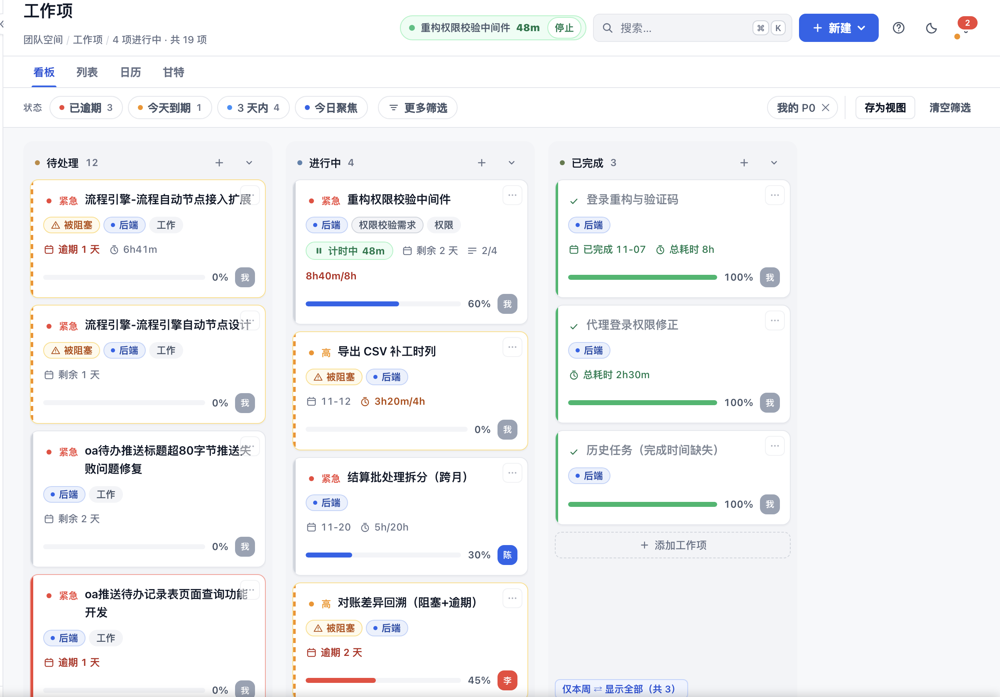

### 6.2 工作项列表

- 表格形式展示工作项。
- 支持列偏好记忆（选择显示哪些字段）。
- 支持行内快捷操作：编辑、删除、开始计时。
- 沿用看板筛选条件。

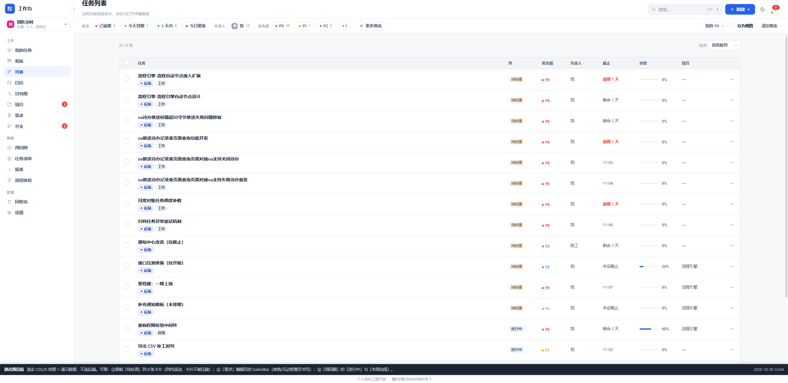

### 6.3 日历

- 工作项按 `[开始日期, 实际结束日]` 区间逐日铺开。
- **实际结束日 = min(完成日, 截止日)**：提前完成的任务不会在后续日期继续占格。
- 截止日高亮显示。
- 点击日期格可查看当天所有工作项。

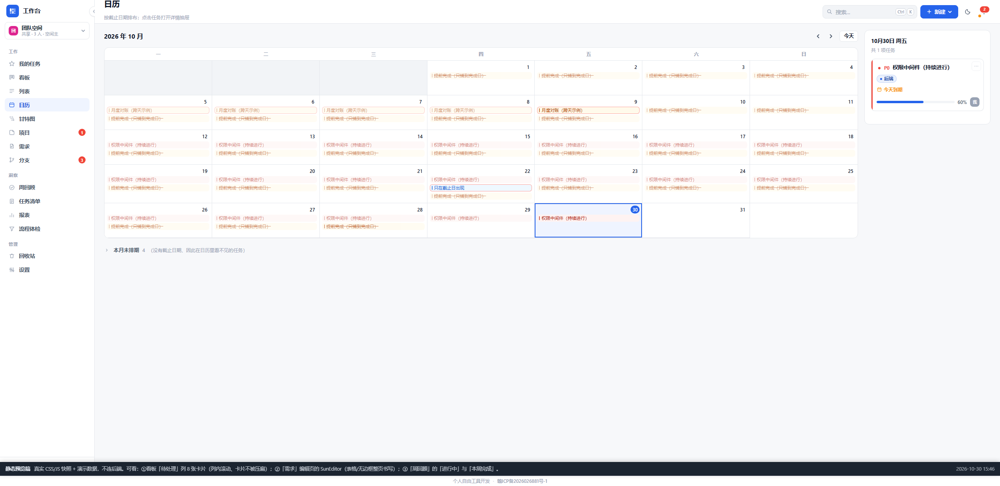

### 6.4 甘特图

甘特图是 沙漏 的强项，适用于排期与依赖管理：

- **时间刻度**：日 / 周 / 月，支持缩放。
- **依赖关系**：FS（完成-开始）、SS（开始-开始）、FF（完成-完成）、SF（开始-完成）+ 滞后量；通过拖拽任务条两端的圆点连线建立。
- **里程碑**：可标记零工期里程碑。
- **基线偏差**：显示计划与实际日期的偏差。
- **关键路径**：自动计算并高亮。
- **分组**：按项目、负责人、史诗等两级分组。
- **字段开关**：自定义显示哪些列。
- **成员负载面板**：按人按周查看成员负载。
- **改期撤销**：支持多步撤销。
- **导出与打印**：可导出 CSV，支持 A3 打印。
- **只读分享**：可生成只读分享链接，供外部人员查看。
- **深色模式**：已支持。

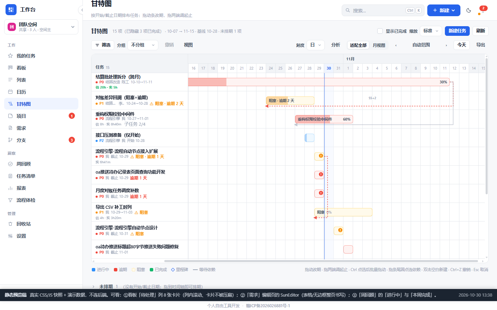

---

## 7. 需求池

需求池用于收集和评审原始需求，通过后再拆成工作项执行。

### 7.1 提交需求

1. 在左侧导航点击「需求池」。
2. 点击「提需求」。
3. 填写：
   - 标题（必填）
   - 来源
   - 类型
   - 优先级
   - 期望时间
   - 验收标准
   - 排期可暂不指定目标版本；选定目标时须同项目且未发布
   - 计划开始 / 结束日期（与期望日期独立，不自动改任务日期）
   - 描述
   - 附件
4. 保存后进入「待评审」列。

### 7.2 需求状态机

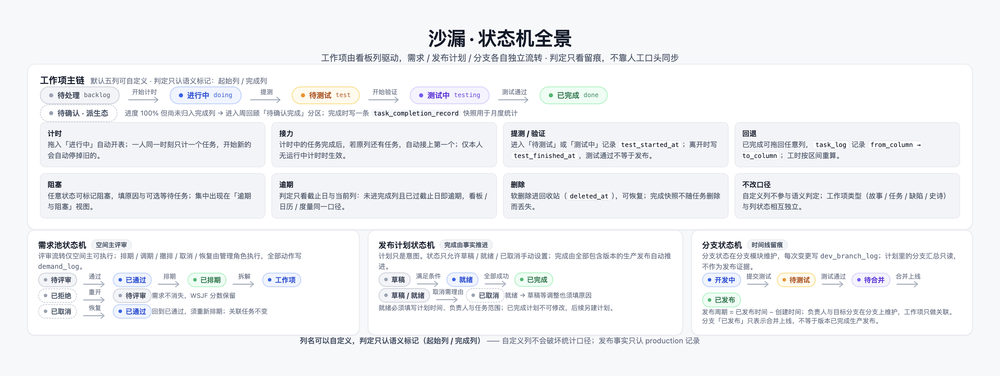

需求状态与工作项状态是两条独立链路：

- **待评审（review）** → **已通过（pass）** → **已排期（plan）**；排期可暂不指定目标版本；选定目标时须同项目且未发布。
- **已拒绝（rej）**可重开到待评审；通过 / 拒绝 / 撤回评审 / 重开仍仅空间主操作。
- **已取消（canceled）**保留需求、原目标版本、计划起止与历史，不连带取消或删除任务；原目标引用仍会阻止版本删除。恢复须填原因，回到已通过并清空目标版本与计划起止，需重新排期。撤排同样回到已通过并清目标与计划起止。
- 管理者可排期 / 调期 / 撤排 / 取消 / 恢复（管理者定义见 17.3）。计划写入口带当前 `revision`；清空目标仍属调期并保留已排期状态；调期、撤排、取消、恢复必须填原因，冲突时刷新后重试，全部留痕。
- 计划开始 / 结束日期与期望日期独立；调期、撤排、取消或恢复**绝不自动修改已有任务的版本、日期、状态**。需要顺延任务时，逐项明确改版并填原因。

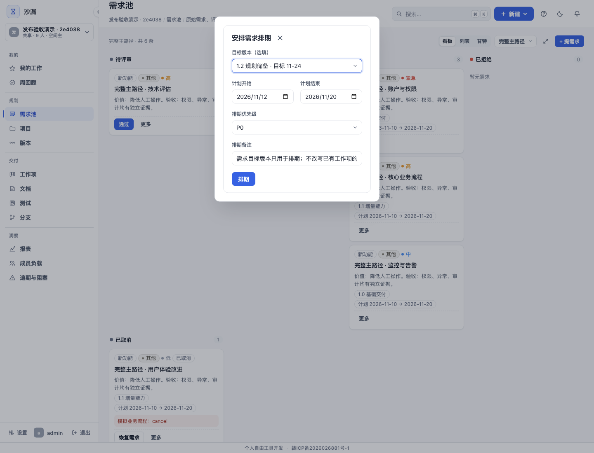

### 7.3 WSJF 评分

当需求填写「业务价值」、「紧迫度」、「风险缓解」、「工作量」四项后，系统会自动计算 WSJF（加权最短作业优先）得分并排序。得分公式不可手填，只由字段自动推导；任一项留空则不评分。

### 7.4 需求 → 工作项

- 已通过或已排期的需求可在详情中「拆分为任务」。
- 拆分后生成的工作项会自动关联该需求。
- 需求详情抽屉可透视关联的工作项列表及其进度。

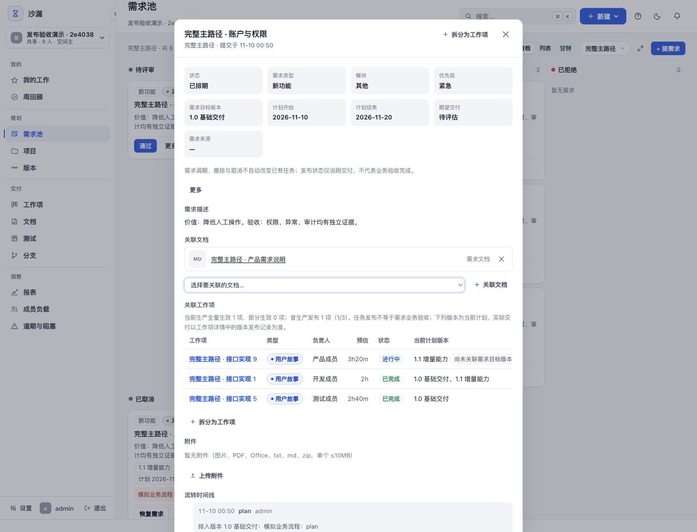

---

## 8. 需求文档

需求文档以树形结构组织项目下的方案文档，可派生工作项。

### 8.1 文档视图

1. 左侧导航进入「文档」。
2. 顶部二级导航切换「列表 / 看板 / 阅读 / 动态」：列表按项目分组，看板按状态分列，阅读用于连续浏览，动态记录最近变更。
3. 点击文档行进入编辑器；右侧「大纲」按正文标题自动生成，点击可跳转。
4. 支持新建、重命名、移动、删除文档节点；有编辑权限时，拖动节点左侧的手柄可调整同级顺序。
5. 文档跨项目移动时，旧项目的任务引用和需求池链接会被清理，子文档保留在原项目。
6. 阅读模式下点击文档头部的「历史版本」，无需进入编辑即可浏览历史快照：打开自动预览最新一版，可切换版本、与当前对比、查看文本差异；有编辑权限时可一键恢复（恢复前当前内容会自动留档）。
7. 阅读模式支持划线评论：选中正文任意文字，在弹出气泡中点击「划线评论」即可针对该片段发表意见；也可点击头部「评论」打开评论面板。带引用的评论会在正文中高亮，点击高亮可定位到对应评论。发表评论需要项目编辑权限。

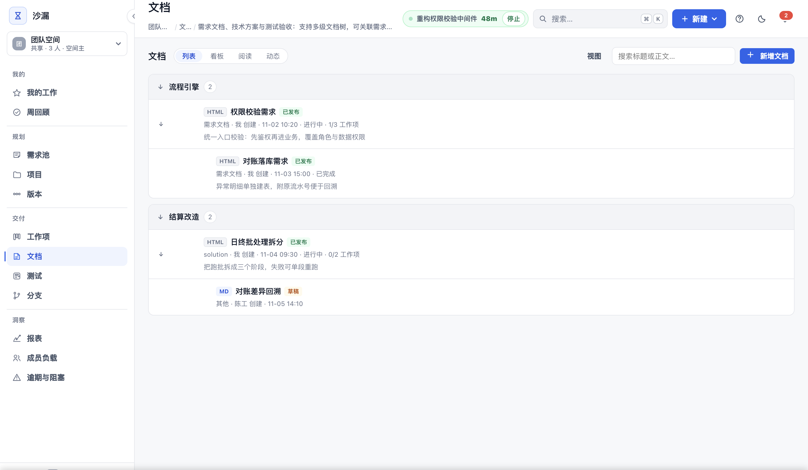

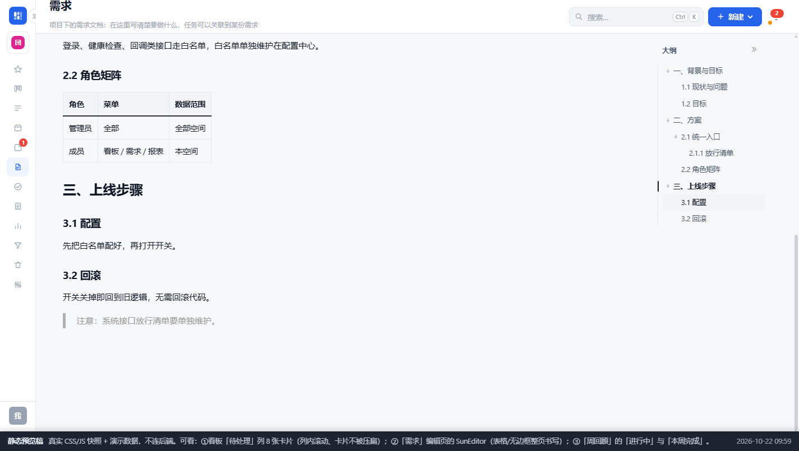

### 8.2 编辑与关联

- 文档正文支持 Markdown 与富文本编辑。
- 「新增文档」支持空白新建，也支持上传 Word（.docx / .doc）、Markdown、TXT、HTML 文件；导入后转换为可继续在线编辑的正文，编辑器内也可随时再次导入。
- 正文会自动过滤危险内容（XSS 防护）。
- 可将文档与需求池条目、工作项关联。
- 支持乐观锁并发编辑：若他人同时保存，会提示冲突。

### 8.3 AI 拆成工作项与完成度检查

在文档视图中可使用 AI 助手：

- **AI 拆成工作项**：按文档正文生成工作项草稿（标题、描述、优先级、依赖顺序），勾选确认后才会创建。
- **AI 检查完成度**：把正文拆成可验证的功能点，对照关联工作项标出未覆盖项；覆盖率与结论由程序按状态计算，模型不直接打分。
- 两项操作都会先保存正文再调用 AI；通常需要 20–60 秒，页面会显示等待计时，可随时取消，失败时可直接重试。
- 生成结果不会自动落库，标题可在结果弹窗里直接修改，没勾选的条目不会创建。

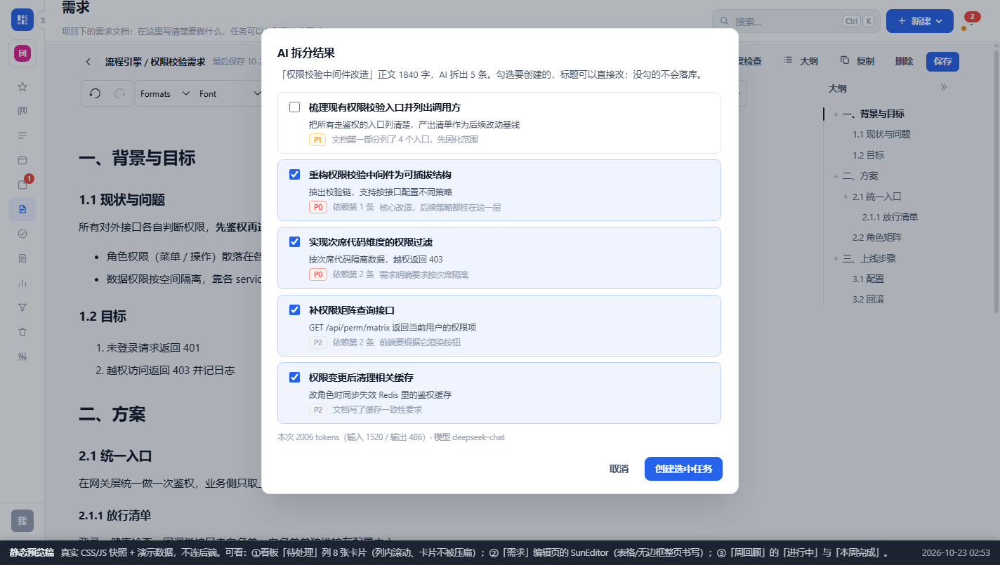

---

## 9. 测试

「测试」把用例、测试计划、覆盖矩阵与测试报告串成一条质量链路。四个模式统一在标题下方的二级导航切换，当前项目在页内选择。

> 测试里的「功能模块」是独立字典，只用于用例归类；工作项里的「模块」是项目级业务模块，两者互不影响。

### 9.1 用例

- 按项目维护用例库：标题、前置条件、步骤、预期结果、优先级、功能模块与负责人。
- 支持搜索、筛选、分页加载与 CSV 导入 / 导出。
- 「AI 生成用例」可从需求文档或需求池条目生成用例草稿：勾选并调整标题、优先级、模块后才会创建；生成过程可取消与重试，已有同名用例会跳过。
- 可直接标记通过、失败或阻塞；失败用例可一键转成缺陷工作项，步骤与备注会写入缺陷描述。
- 「视图」可保存当前项目、筛选与展示方式，供下次一键恢复。

### 9.2 测试计划

- 把一次版本回归或一轮测试圈成计划：从项目用例库挑选用例（单次最多 500 条），设置负责人、起止与版本。
- 在计划内批量记录执行结果，结果同时写回用例最近结果并追加执行流水。
- 计划完成后锁定为快照，便于回溯某一轮测试的范围与结论。

### 9.3 覆盖矩阵

- 按需求统计用例覆盖：哪些需求已有用例、覆盖多少、通过率如何。
- 按项目全量计算，不受用例列表分页与筛选影响。

### 9.4 测试报告

- 汇总当前项目的通过率、失败 / 阻塞清单与需求覆盖。
- 支持导出 CSV，作为本轮测试的质量证据。

> 命名口径：菜单与页面统一称「测试」，其下四个模式为「用例 / 测试计划 / 覆盖矩阵 / 测试报告」；不要再把「覆盖矩阵」「测试报告」当成独立一级菜单。

---

## 10. 分支

分支用来跟住一次开发从拉出到上线的流转，不替代版本：分支记录代码线，版本记录交付范围。分支状态是开发流转状态，不代表生产发布。

### 10.1 分支页

- 左侧导航「交付 → 分支」。默认按状态分「开发中 / 待测试 / 待合并 / 已发布」四列，可切换「按项目」分组或列表视图；顶部汇总可点击某一档直接筛选，并显示已发布分支的平均发布周期。
- 支持关键词搜索与项目筛选；不归属项目的分支显示为「空间级公共分支」。
- 卡片或列表行可拖拽到其他状态列，也可点状态徽标选择目标状态；状态允许任意方向切换，包括打回。拖拽、状态菜单与编辑入口仅对分支所属项目可写者显示。

### 10.2 新建与编辑

- 新建分支填写：分支名、目标分支（选填）、所属项目（留空为空间级公共分支）、负责人、初始状态、备注。分支名允许字母、数字、点、下划线、中划线与斜杠，最长 80 个字符；同一项目下不能重名。
- 创建、编辑、改状态与删除都按所属项目写权限判定；查看者只读，只读项目不会出现在新建分支的项目下拉中，任务抽屉也会隐藏就地新建入口。服务端仍会拦截无写权限的请求。
- 删除分支与修改同口径：空间主、管理员、项目负责人或对该项目可写的成员都能删除；只读项目与查看者不能删除，空间级公共分支由空间内非查看者维护。删除会解除关联工作项上的分支引用（工作项本身保留），并清除该分支的操作记录。

### 10.3 状态与时间

- 四个状态依次为开发中、待测试、待合并、已发布；每次进入状态会记录首次时间，抽屉中显示完整状态时间轴。
- 未发布分支显示当前状态已停留多久；已发布分支显示从创建到发布的周期。抽屉同时列出关联工作项、影响版本、归属项目与操作记录。
- 状态变更与删除都会写入操作记录；只看不改的成员不会产生记录。

### 10.4 与工作项、版本的关系

- 工作项详情「更多关联 → 所属分支」可选择已有分支；也可点「新建分支」就地创建，系统按当前项目和任务负责人预填，创建成功后自动选中，保存工作项后关联生效。
- 分支可关联版本，但版本内容、发布计划与生产发布事实仍以版本页为准；分支的「已发布」只表示开发流转到上线，不等于生产发布证据。

---

## 11. 版本与发布

### 11.1 版本管理（已部署）

本轮原 `hourglass` 46 表经用户单独明确授权、受限备份与恢复验证后重建为 52 表，其后 `65` 新增跨版本计划关联表、`66` 新增邀请项目预分配表，完整基线现为 54 张表；原历史仅在备份中保留，不回放 61/62、不迁移旧历史。完整基线会重建表，不是幂等无损升级脚本；正常脚本仍只支持新空库，原库重建不是默认部署许可，软件-only 回退不足，匹配 SQL 恢复须单独授权。线上 payload 以更新日志中最近一次实际发布记录为准，完整生产模拟及只读验收完成，生产 Chrome 1440/390px、24 次入口导航、93 项有效断言通过，0 runtime/console/HTTP 错误；详见 [管理员指南](管理员指南.md)。

从「规划 > 版本」按项目建版本。版本状态、发布计划、实际发布事件与任务工作状态分开记录。一个版本生产只成功部署一次，后续改动应新建 hotfix 版本；同一制品可重新部署（redeploy）或回滚（rollback），替换制品须新建版本。发布计划可跨版本、跨项目，只有计划包含的全部版本都完成成功的生产部署 / 重部署，计划才会完成；test/staging、回滚与部分成功不完成计划。

版本页有「按阶段 / 按版本 / 发布日程 / 全部项目」四个口径。其中「发布日程」跨项目汇总发布计划，默认按计划时间升序、只看未完成（草稿 + 就绪），可按项目、环境、状态与时间范围（未来 30 天 / 90 天 / 前后 3 个月 / 全部时间）筛选；点任意一行打开该计划的发布工作区，可查看计划覆盖的全部版本，并切到某个版本记录实际、查看历史与内容。日程只是计划汇总，不代表实际发布，归档项目不进入日程。

- 版本内容关联在成功事实形成后冻结，不得用撤徽标或回滚解锁、改写已交付内容；需要新增内容时另建版本。冻结的是内容关联，**不是任务完成、回退或计时**，这些工作动作仍按原有权限与流转规则执行。
- 需求仍只有一个可空目标 `versionId`，测试计划也仍是单目标 `versionId`；只有工作项与计划交付版本改为多对多。需求调期、取消、恢复不会自动修改旧任务。
- 删除版本不会自动解绑：已发布或有实际尝试记录（含失败）的版本不可删除；工作项绑定（含回收站）或需求目标引用（含已取消）也阻止删除。无证据版本的引用须按权限有因解除 / 调整，回收站任务先恢复，已取消需求有因恢复以清目标。不得删除历史证据或通过人工撤标绕过保护。

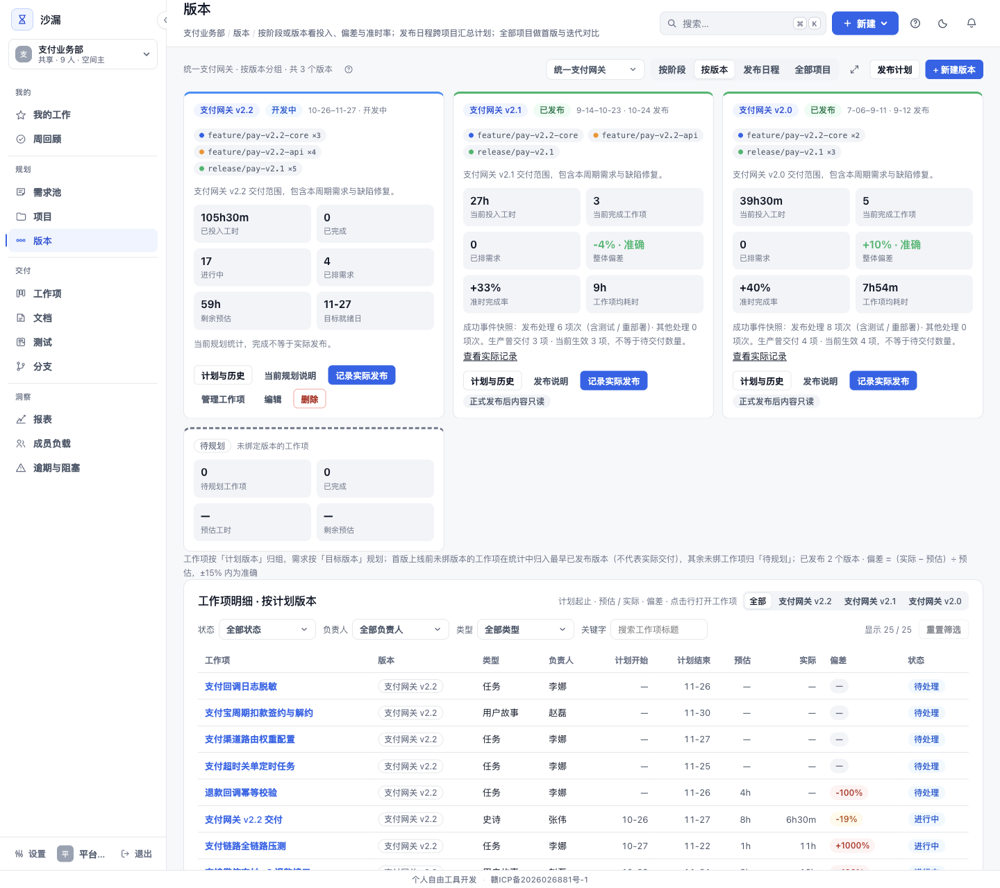

### 11.2 当前计划交付版本（原「影响版本」）

- 一个工作项可关联多个同项目计划交付版本，存于 `version_task`，读取与保存响应使用 `versionIds` / `versionNames` 数组；它们**不是实际发布证据**，也不要求等于需求目标。
- 保存 `versionIds` 省略 / null 保留现有集合（新建默认空集合），`[]` 显式解绑，非空数组显式设置集合；不再以空串解除，也不根据需求目标隐式改绑。
- 实际改变关联须 `versionChangeReason`，由管理者或该任务负责人且项目可写操作；成功事实冻结的内容关联不能借此修改。保存响应返回实际落库数组与 `tags`，以最终项目和负责人重新判断可写权限。
- 版本内容、计划 `plannedTaskIds` 与实际 `actualTaskIds` 是三个独立范围：关联版本不等于入选某计划，入选计划也不等于实际交付。

### 11.3 已完成与生产发布事实

「已发布」是完成列旁的**只读徽标，不新增看板列**；完成不等于发布，发布也不锁住任务工作状态。

- 徽标仅从成功的 `production` 实际记录推导，`publishSource=record`；展示 `publishedAt`、`publishedReleaseId`、`everPublished`、`publicationState` 与 `publicationTargets`，不得人工标记或撤标。
- `publicationState` 为 `unpublished / effective / partial / rolled_back / unknown`，分别表示未发布、当前有效、部分有效、引用范围已回滚或证据未知；按目标查看实际覆盖，不把未知范围当作全量发布。`test` / `staging` 成功不代表生产发布，失败也不产生发布徽标。
- rollback 是新的实际事件，关联原记录并按目标撤销其引用范围；保留 `everPublished` 与全部历史，不抹掉后续不同成功事件。同一任务可有多个版本、多次事件，不能只看一条最新记录判断全部目标。

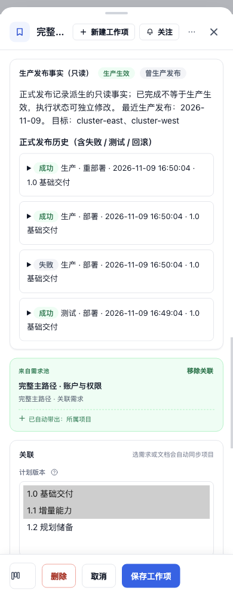

### 11.4 发布计划、预览与确认

1. 管理者列出或新建发布计划，更新选定计划必须带 `id + revision`。计划字段包括覆盖版本 `versionIds`（可跨版本、跨项目，当前版本固定包含）、计划时间 `plannedAt`、负责人账号 `ownerUserId`、状态、说明 / 风险 / 原因、`plannedTaskIds`、环境 `production / staging / test`、`targetKeys` 数组和覆盖 `full / partial / unknown`。状态可写 `draft / ready / canceled`，`completed` 只由成功事实产生；就绪须计划时间、负责人与至少 1 个工作项。工作项范围取所选版本内容并集，按项目分组选择版本；可用 `GET /api/release-plan-options` 读取可选版本与成员，用 `GET /api/release-plan-tasks?versionIds=...` 读取范围并集。完成计划不可改，后续使用新计划；紧急无计划事实须偏离理由。
2. 明确本次实际 context：可选 `planId`、实际发生时间 `occurredAt`（带 UTC offset 的 ISO 时间，与服务器 `recordedAt` 分开）、环境、目标数组、覆盖、制品引用 `artifactRef` 与 64 位十六进制 SHA256 `artifactDigest`、操作 `deploy / redeploy / rollback`、关联记录 `relatedReleaseId`、执行人 `executorUserId`、显式唯一且最多 500 项的 `actualTaskIds`、`deviationReason`。重新部署 / 回滚应说明所关联事件；执行人元数据不替代服务器登录者。
3. 按同一 context 预览，分别查看版本内容、计划范围与实际范围，显示计划未选 `not_selected`、候选及警告。未完成、完成时间晚于事件、需求已取消、跨范围等事实不得静默排除；记录未完成事实须管理权限与偏离理由。不把已发布任务排除，否则无法记录再次部署。
4. 确认另带 `result=success / failed`、`notes`、失败原因 `failureReason`、`idempotencyKey`、`planRevision`、`scopeToken`。失败只留不可变尝试；成功按显式实际范围保存记录、条目与快照。实际记录始终归属当前版本；计划只有在全部包含版本都完成成功生产 deploy / redeploy（且关联同一计划）后才完成，test/staging、rollback 与部分成功不计。只有成功生产 deploy / redeploy 参与有效发布推导；rollback 按关联记录及目标撤销引用，不删除原事件。
5. 计划、范围或权限变化时冲突后重新预览。网络中断或响应未知时，`sessionStorage` 保留**完整原 body 与同一 key**，页面刷新 / 重开后先以 `GET /api/versions/{id}/release-records?key=...` 查询；查询失败仍保留请求、禁止盲重试或新建事件。找到并核对原记录后不重复创建；查询成功且无记录时才可显式重试原完整请求 / 原键，明确拒绝也须先查询再显式重置、重新预览。不得刷新即清理、换键重发或用同键改内容。
6. 弹窗按「计划 / 实际 / 历史 / 内容」四个页签分区，入口决定初始页：版本卡「计划与历史」进计划页，「记录实际发布」直达实际页；工具栏「发布计划」在多版本时先选版本，不再静默挑一个版本。计划页的版本选择器按项目分组，当前版本固定勾选，可再加入其他版本 / 项目；任务池随所选版本并集刷新。页签可用左右方向键切换，Home / End 跳到首末页；计划页在状态旁显示就绪条件清单，工作项选择器支持搜索、状态筛选、全选可见、仅选已完成与清空，并显示已选 / 总数；实际页显示记录条件清单与填写顺序，实际任务只列当前版本内容。保存计划后保持原页签与滚动位置，并给出「去记录实际发布」的下一步入口。
7. 工作项选择器下方有「计划涉及分支」实时区块：按当前勾选（未改动时为已保存计划）的工作项，按分支去重汇总项数、目标分支、负责人与所属项目，并按状态排序、给出各状态分支数。该区块不落库、不做快照，随选择与分支状态变化重算；有权限时可直接点状态徽标修改分支本身（不在计划里另存一份状态）。未关联分支、分支不可见 / 已删除或工作项暂不可加载时分别提示且不丢数。分支状态以分支模块为准，不代表「已合并」，也不作为发布证据；计划完成仍以版本生产发布为准。
8. 「实际发布事实」拆成主表单与「高级与异常字段」：关联计划、发生时间、环境、结果、执行人、制品与 SHA256、目标键和明确实际范围常显；覆盖、操作、关联事件、偏差理由、说明与失败原因默认收起，选到重部署 / 回滚、非全量覆盖、失败，或预览提示偏差时自动展开，避免常规发布被异常字段淹没。

计划 `plannedAt` 是本地墙钟时间，不转 UTC 错移；计划与实际时间输入都按分钟记录、零秒显示精度归一，不因秒级差异误判未保存改动。实际时间 `occurredAt` 才转换为带 offset 的事件时刻；只有日期的完成信息不伪造时分秒。预览明确显示 selected / omitted 两组及理由；手机端发布弹窗为全屏、页签与按钮高度 ≥44px，关闭按钮 sticky 可达。静态资源缓存版本以 `frontend/sw.js` 的 `CACHE_NAME` 为准。

发布管理、预览与确认仅限空间 owner/admin 或项目负责人且项目可写，服务器提交时重新检查；任务负责人没有整版本发布权，计划负责人字段不赋权。`releasedBy` 固定为当前服务器登录者，不接受冒充（见 17.3）。

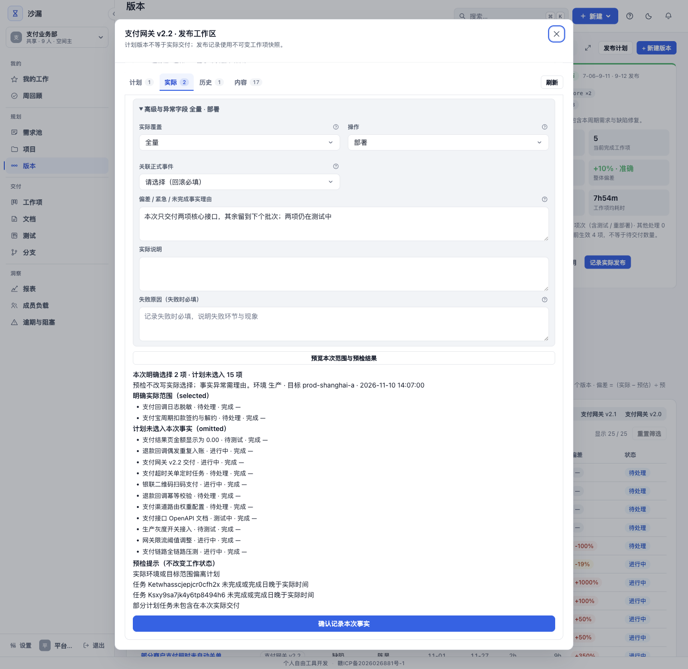

### 11.5 发布说明、历史与统计

- 版本、计划与实际快照分开保存；记录、发布说明及「导出快照 CSV」使用不可变快照，不随后续改名、改工时、调期、需求取消或回滚漂移。版本记录与任务 `release-records` 展示成功、失败、redeploy、rollback 全部可见事件，不只查最新成功；历史日志只读，不提供发布历史 JSON 导出。
- 当前工时 / 完成数与每次实际范围、计划偏差、覆盖及当前有效目标分开展示。单次未选 / 未交付不等于当前剩余；任务多版本关联与多个发布事件不得放大全局工时。当前生产曾交付去重数、当前生效数与事件处理项次分别显示，不推断待交付数量。
- 需求展示部分交付、目标偏差与任务当前版本数组；取消不抹实际快照历史。发布不等于业务验收，零关联任务不能显示 100% 验收。
- 既有首版阶段及折算只用于统计，不写任务绑定、徽标或正式记录；旧版本缺正式记录须显示证据未知 / 无正式记录，不补造历史。本次不新增迭代模块，不做历史迁移。
- JSON 只搬运工作数据：任务版本数组、`version.startDate`、需求日期及 `canceled`；不转移正式发布证据。存在证据的项目 / 空间删除与覆盖导入受保护；正式证据恢复使用完整数据库备份，包含 `version_release_plan`、`version_release_plan_version`、`version_release_plan_task`、`version_release`、`version_release_item`、`version_log` 六表及计划任务范围，附件另随运维备份恢复。

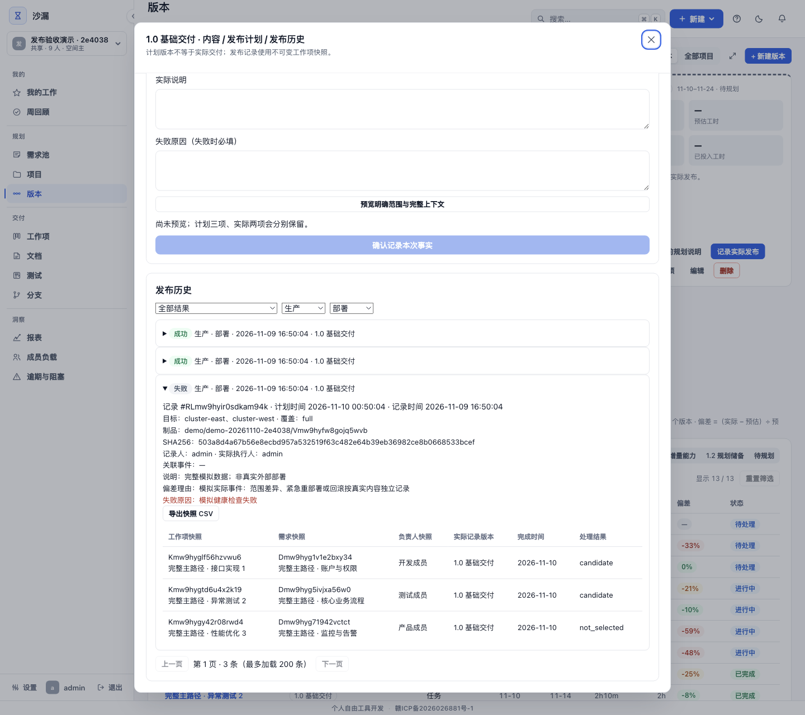

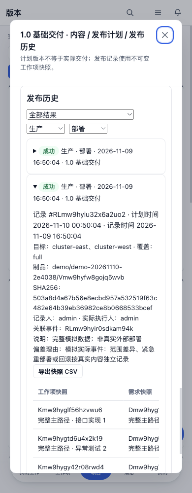

---

## 12. 洞察

### 12.1 成员负载

在「洞察 > 成员负载」中：

- 按人或按周查看每个成员的在办工作项与投入工时。
- 同时显示工作项数量与预估工时，避免"工作项数多但耗时少"的误判。
- 超载判定：当成员剩余预估 > 剩余工作日 × 团队容量常量（默认 8h/日，与 WorkTime 每日上限一致）时标记超载。
- 点击成员打开负载抽屉：先看项目分布，再点项目穿透到该项目下的工作项，工作项行可继续打开详情。
- 点击矩阵里成员 × 项目的工时，直接进入该成员在该项目下的工作项；抽屉内可按天查看本周 / 上周计时明细。
- 工具栏「导出本月工时」按当前自然月导出各成员的计划工时、实际工时与投入率（CSV），用于月度投入对账。

### 12.2 逾期与阻塞

「洞察 > 逾期与阻塞」集中展示跨项目的风险：

- **逾期任务**：超过截止日未完成的工作项。
- **被阻塞任务**：标记为 blocked 的工作项，显示阻塞原因与等待对象。
- **停滞任务**：连续多日无进展的任务。
- **超载提示**：成员负载超过容量。
- 支持站内催办。

---

## 13. 报表

「报表」一级入口下用二级导航切换四个视图：**趋势与分布**、**完成记录**、**流程体检**、**交付图表**。

### 13.1 趋势与分布

- 近 8 周（可调整周期）的新增与完成趋势。
- 工时统计：累计工时、本周工时、平均每项，可切「仅我 / 全空间」。
- 按模块与负责人看工作项分布。

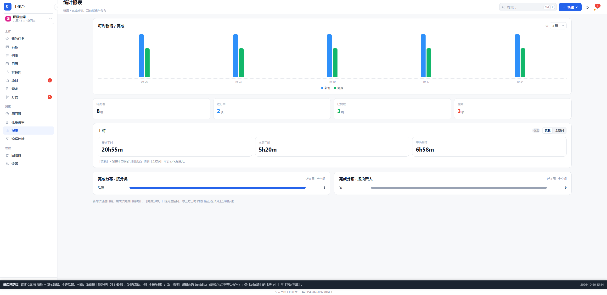

### 13.2 完成记录

- 按月列出已完成工作项，显示负责人、模块、起止时间与总耗时。
- 支持导出 CSV，用来核对某个月的交付清单。

### 13.3 流程体检

「流程体检」不做预测，只把已有的工作项操作记录做一次一致性检查——一次通过率、需求从通过到开工的延迟、估时与实际耗时的偏差。结合统计口径与相关工作项记录核对，用来排查「我们这个流程可能卡在哪一步」，而不是预测「下个迭代能做完多少」；并非所有汇总都已有直接点击下钻入口。

### 13.4 交付图表

交付图表面向管理者，提供四张敏捷读图：

#### 燃尽图

- 横轴：时间（日 / 周）。
- 纵轴：剩余预估工时。
- 剩余 = 总预估 − 已完成实际工时。
- 用于观察迭代或项目是否按计划收敛。

#### 速度图（Velocity）

- 展示近 4 周（或近 4 个迭代）的完成工时 / 完成工作项数。
- 用于预测团队未来可承受的迭代容量。

#### 累积流图（CFD）

- 展示近 8 周三个状态（待处理 / 进行中 / 已完成）的累计数量。
- 用于识别流程瓶颈。

#### 交付周期分布

- 统计工作项从创建到完成的周期。
- 展示 P50 / P85 分位数，帮助回答「大部分需求多久能交付」。

> 所有报表支持导出 CSV / PNG。

---

## 14. 我的工作

### 14.1 我的工作

「我的」→「我的工作」汇总当前空间中所有分派给自己的待办（手机端为底部「我的工作」tab），也是登录后的默认页面。

- 默认按逾期 / 今天 / 未来分组。
- 支持分组、行内操作、分页加载。
- 点击任务直接进入详情抽屉。

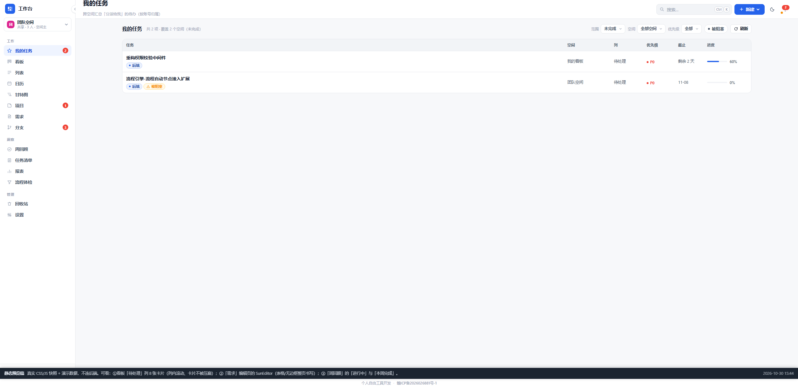

### 14.2 周回顾

「我的」→「周回顾」自动生成一周的总结：

- **已完成**：本周已完成并已归档的工作项。
- **待确认完成**：进度 100% 但尚未归档的工作项。
- **进行中**：本周仍在进行的工作项。
- 三个分区互斥，同一件事只出现一次。
- 历史周期按操作记录近似还原。
- 可一键生成 AI 周报草稿，人工确认后复制使用。

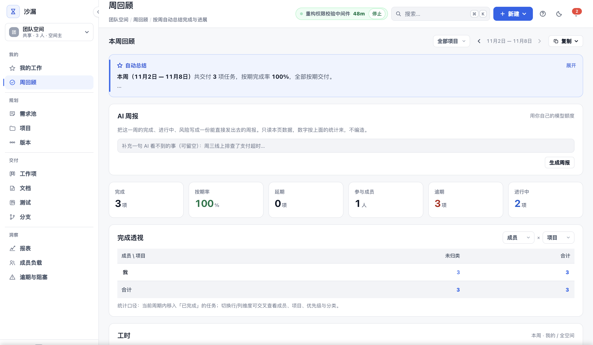

---

## 15. AI 助手

### 15.1 配置

在个人设置中可配置自己的 AI 模型与密钥：

- 选择模型与 OpenAI 兼容的接口地址。
- API 密钥加密保存，界面只显示掩码。
- 可单独关闭 AI，也可发一次极小请求验证地址、模型与密钥是否可用。
- 用量由所用模型服务商计费；当前版本不设每日 / 每月调用上限，也不会回落到他人的密钥。

### 15.2 使用场景

- **需求拆解**：把需求描述拆成工作项草稿。
- **文档体检**：检查需求文档的功能点是否都有工作项覆盖。
- **测试用例**：从文档或需求池条目生成用例与执行步骤草稿。
- **周报草稿**：根据周回顾数据生成周报文本。
- **长请求反馈**：拆分、体检、生成用例通常需要 20–60 秒，界面会显示计时与等待提示，可取消；失败时可直接重试。
- **AI 只出草稿，不会直接修改数据**：所有结果都需要人工确认后才会落库。

---

## 16. 通知与设置

### 16.1 通知中心与消息页

- 顶部铃铛图标显示未读通知数量。
- 点击打开通知面板，查看站内消息；需要长期跟进时，点面板底部「查看全部消息」（手机端底部「消息」tab，或快捷键 `g n`）进入完整消息页，它与通知面板是同一份数据。
- 消息页支持收藏与深链（`#/messages`），刷新或分享后仍能直达。
- 通知类型包括：任务指派、评论与 @提及、关注任务的评论与回收站操作、流转、需求/文档/分支/版本变动、每日汇总、逾期提醒、今日到期提醒。
- 同一任务的同类连续通知会折叠为一条（显示 ×N），点击后整组标为已读。
- 通知通过 SSE 实时推送。

### 16.2 通知偏好

在「个人设置 > 消息通知」中可配置（列表按「任务 / 需求与版本 / 每日汇总」分组）：

- 站内通知开关。
- 邮件通知开关（需配置 SMTP 与站点地址）。
- Webhook 通知开关。
- 各类事件是否投递。
- 「每日任务汇总」可单独关闭：只影响每天 09:00 的汇总，不影响任务级的到期提醒。

> 若接收人看不到目标项目（被设为不可见），则不会投递通知，避免信息泄露。

### 16.3 空间设置

设置页对所有空间角色可见，但各页签的维护权限不同：

- **空间**：查看空间类型、成员数与创建时间；仅空间主可修改空间名称和推送配置，删除空间也仅空间主可执行。
- **成员与权限**：空间主 / 管理员可生成或撤销邀请链接、调整成员角色、移出成员；管理员只能处理成员 / 查看者，不能授予管理员。生成邀请时可预设新成员的项目权限；加入后也可在成员行点「分配项目」批量调整，或在「项目可见范围」矩阵中逐格修改。新成员默认不参与任何项目。
- **工作流**：新增 / 编辑 / 排序看板列（成员也可）；删除看板列仅空间主。模块的增改删限空间主、管理员或项目负责人，普通成员只读。系统列固定为待处理、进行中、待测试、测试中、已完成，均不可删除；前四个可改名，「已完成」不可改名。处理规则（正常计时 / 暂停计时 / 结束计时）控制计时与逾期：待处理、进行中、已完成固定，待测试、测试中与自定义列可调整；规则变更只影响之后的手动开始和移列，不会自动停止已经运行的计时。状态流转矩阵由空间主 / 管理员维护，只收紧允许的列间移动。
- **通知与集成**：空间主配置该空间的推送地址与开关；SMTP 邮件配置仅平台管理员可见。
- **数据与审计**：导出任务备份、导入覆盖、清空任务数据仅空间主；工作项 CSV 所有角色可导出；回收站与空间活动记录在此查看；操作审计与系统信息仅平台管理员，可按操作人、动作、结果与日期筛选并导出 CSV。
- **平台**（仅平台管理员可见）：账号管理、系统信息与操作审计。

版本、分支在左侧导航独立维护；标签在工作项中直接输入；模块也可在项目驾驶舱的「模块」面板维护。导航使用记录只存在当前浏览器（localStorage），记录各视图的进入次数与停留时长，可导出 CSV，不会上传服务端。

### 16.4 个人偏好

- 主题：浅色 / 深色。
- 默认视图：看板 / 列表 / 日历 / 甘特。
- 列表列显示偏好。
- 每页数量。

---

## 17. 权限与可见性

### 17.1 空间级角色权限矩阵

| 功能 | Owner | Admin | Member | Viewer |
| --- | :---: | :---: | :---: | :---: |
| 查看项目与工作项 | ✓ | ✓ | ✓ | ✓ |
| 创建 / 编辑工作项 | ✓ | ✓ | 可见且可写 | ✗ |
| 创建 / 编辑项目 | ✓ | ✓ | 部分 | ✗ |
| 生成 / 撤销邀请、调整角色、移出成员 | ✓ | ✓ | ✗ | ✗ |
| 配置项目可见范围 | ✓ | ✓ | ✗ | ✗ |
| 新增 / 编辑 / 排序看板列 | ✓ | ✓ | ✓ | ✗ |
| 删除看板列 | ✓ | ✗ | ✗ | ✗ |
| 维护项目模块（新增 / 改名 / 排序 / 删除） | ✓ | ✓ | 仅项目负责人 | ✗ |
| 分支创建 / 编辑 / 改状态 / 删除 | ✓ | ✓ | 项目可写 | ✗ |
| 完整备份导出 / 导入覆盖 / 清空任务数据 | ✓ | ✗ | ✗ | ✗ |
| 导出工作项 CSV | ✓ | ✓ | ✓ | ✓ |
| 空间改名 / 推送配置 | ✓ | ✗ | ✗ | ✗ |
| 删除空间 | ✓ | ✗ | ✗ | ✗ |
| 需求评审流转 | ✓ | ✗ | ✗ | ✗ |

### 17.2 项目级可见性

空间主 / 管理员可为每个「成员 × 项目」设置三档权限：

- **可参与**：按成员角色正常参与该项目，可查看、可编辑。
- **只读**：只能查看该项目，不能修改。
- **不可见**：该项目对该成员完全隐藏，不会出现在任何列表、搜索、通知中。

新成员加入时默认**不参与任何项目**（所有项目不可见）。项目权限有三个配置入口：生成邀请链接时预分配、成员行「分配项目」批量调整、空间设置里的项目可见范围矩阵逐格修改。三者写入同一份授权数据，后续可随时调整；已存在的成员保留改动前的默认参与，直到被显式调整。

- 邀请列表与邀请页面会显示该邀请预分配了几个「可参与 / 只读」项目；已是成员的人打开邀请链接，会看到「进入空间」而不是重复加入。
- 成员升为管理员再改回成员时，沿用此前分配的项目权限，不会因角色往返而变成「全部可见」。
- 新成员登录后项目列表为空时，页面会提示「暂无可见项目」，请联系空间主或管理员分配。

> 项目负责人、任务负责人等身份不改变项目权限：不可见仍然看不到，只读仍然不能写。

---

### 17.3 排期与发布的权限边界

以下操作都要求项目可写；viewer、项目 read / none 均无权。身份使用账号 ID，不通过 `displayName` / 负责人文本认定。

| 操作 | 可操作人 |
| --- | --- |
| 需求评审（通过 / 拒绝 / 撤回评审 / 重开） | 仍仅 workspace owner |
| 排期 / 调期 / 撤排 / 取消 / 恢复、发布计划维护 | 管理者：workspace owner/admin，或项目 `ownerUserId` 对应账号且项目可写 |
| 发布管理 / 版本预览 / 确认（含 redeploy / rollback） | 仅管理者；任务负责人无整版本发布权，计划负责人元数据不赋权，提交时服务器重新检查 |
| 任务显式改计划版本 | 管理者，或该任务 `ownerUserId` 对应账号且项目可写；成功事实冻结的关联不可改 |
| 任务发布徽标 | 只读，由成功生产实际记录推导；无人工标记 / 撤标操作 |

`releasedBy` 为服务器当前登录者；`executorUserId` 仅记录实际执行人，不能冒充提交者。发布事实不锁任务完成、回退或计时。

## 18. 统一口径解释

沙漏复用工时、流转与快照记录，减少口径漂移。不同筛选、日期范围和当前 / 历史视图不应强行对齐为同一个数字。

### 18.1 自动计时的有效工时

- 按个人工作时段裁剪，默认 09:00–18:00；跳过周末。
- 每人每天自动计时额度默认 8 小时，可在个人设置调整；跨任务、跨空间共享，扣减当天已记工时。
- 手工补记不受工作时段、周末与每日额度裁剪，仍会占用当天后续自动计时的额度，详见 18.7。
- 这些规则解释系统怎样计算投入，不证明专注程度，也不自动等于可收费工时或劳动考核结果。

### 18.2 计时归属

- 计时是「人」的属性，不是「任务」的属性。
- 一个人同一时刻只计一个任务。
- 开始任务 B 会自动停掉任务 A，界面会明确提示"已停止对 A 的计时"。

### 18.3 完成后接力

- 计时中的任务被完成后，如果原列还有任务，会自动接上第一个。
- 仅在你当前没有运行中计时时才接力，不会抢掉别的空间正在计的任务。
- 请核对接力对象是否就是实际正在做的工作；否则停止或切换，必要时作废误计并补记。

### 18.4 实际结束日

```
实际结束日 = min(完成日, 截止日)
```

提前完成的任务不会在后续日历日期中继续出现。

### 18.5 逾期判定

- 超过截止日期且未完成即视为逾期。
- 逾期判定与看板、日历、报表使用同一套规则。

### 18.6 完成记录快照

工作项完成时会落一条快照，记录项目名、负责人、模块、起止时间、总耗时。历史月度统计基于快照，不受后续改名或删除影响。

### 18.7 手工补记与工时修正

- 实际工时默认全部来自计时器。忘开表、加班等场景可用工作项抽屉里的「补记」手工补一条记录。
- 补记不经过「工作时段、每日上限」的裁剪，填多少算多少（单条 1 分钟 ~ 24 小时，日期不晚于今天）；但仍占用当天该成员的计时日额度。
- 可为自己或任意空间成员补记；项目可写者均可操作。
- **记错了怎么办**：忘停表导致工时偏大时，在工时记录里点这条计时记录右侧的「作废」，再用「补记」按天录入实际工时（例如跨两天的 16 小时，作废后分别补 6 小时和 4 小时）。
- 作废是物理删除但会在工作项时间线留一条记录；作废和补记后，卡片、列表、报表、周回顾、甘特负载等统计立即按实际工时重算，已完成工作项的完成快照也会同步刷新。
- 正在计时的记录不能作废，先点「停止计时」。

---

## 19. 常见问题

### Q1：为什么我把工作项拖到「已完成」后，另一个工作项自动开始计时？

这是「完成后接力」机制。你当前没有其他运行中计时且原列有可接续任务时，系统接续下一个任务；不会抢占其他空间的运行中计时。请确认接续任务符合实际工作，减少空档不应以错误归属为代价。

### Q2：为什么我某天的工时没有满 8 小时，但系统显示只计了一部分？

自动计时只计算个人工作时段内的工作日时间，并扣减当天已记工时；每日额度默认 8 小时，可配置，跨任务与空间共享。每人同一时刻只运行一个计时器，不是多个任务同时计时后均摊。请先检查工作时段、当天其他记录及补记，再比较时长；补记本身不受上述裁剪。

### Q3：查看者能看到哪些内容？

查看者全局只读，不能创建、编辑、删除任何数据。只能看到对其可见的项目和工作项。「我的工作」只汇总分派给自己的待办，没有分派时为空，可从左侧「项目」进入只读浏览。

### Q4：项目删除时会删掉什么？

先看影响预览并填写项目名确认；存在发布证据时禁止破坏性删除。无证据时任务保留并解绑，文档、版本、需求池、用例与计划按级联规则清理；空间删除同样保护发布证据。

### Q5：Excel 在线编辑会丢失格式吗？

会。在线表格定位是「附件查看与快速修改」，侧重数值与公式。单元格样式、条件格式、图表、嵌入图片不保证保留。重要格式请下载后用桌面 Excel 处理。

### Q6：甘特图的只读分享链接有效期多久？

只读分享链接默认有效期为 30 天。空间主可在桌面甘特图的「分享只读链接」弹窗中停止分享，旧链接立即失效；重新生成链接后旧链接也会失效。有效链接的接收者无需登录即可查看经筛选的只读内容，分享前应核对暴露范围。

### Q7：为什么有的需求不能流转到「已通过」？

需求评审流转只有空间主有权限。此外，若需求缺少必填字段（如优先级、验收标准），也可能被阻止。

### Q8：AI 助手会不会自动修改我的任务？

不会。AI 只生成草稿，所有修改都需要你在界面中确认后才会落库。

### Q9：如何备份我的数据？

按空间导出 JSON 工作数据，保留任务 versionIds 数组、version.startDate、需求日期与 canceled；覆盖导入按接口权限执行。JSON 不转移正式发布证据，也不提供发布历史 JSON 导出。空间存在发布计划（包括空草稿）、任何发布尝试（包括失败）、版本日志、条目或已发布任务时，禁止覆盖导入、清空和删除，应导入新空间；已有成功发布及历史证据不会因备份兼容而放开覆盖。正式发布记录 / 条目 / 日志与附件须由运维备份 MySQL 和附件目录恢复，不从旧任务状态补造证据。

需求池备份的 `plannedStart` / `plannedEnd` 是可空的 `yyyy-MM-dd` 字符串，与期望日期独立；导出保留实际值，旧备份缺字段 / null / 空白为空，可只填一端，不从任务或版本日期推导。导入保留 canceled；原始无目标的 plan 保留 plan 状态与计划起止；原始显式非空目标 ID 重映射后须有效且属于需求项目，目标丢失 / 映射无效时置空，仅此类 plan 按原规则回到 pass 并清空计划起止，不把已取消需求自动恢复，也不重排任务。所有非空计划日期与起止顺序在任何覆盖删除前校验；非法日期或开始晚于结束返回 400，原数据不被删除，目标映射失败也不能跳过日期校验。

### Q10：回收站里的数据保留多久？

删除的工作项在回收站保留 30 天，之后自动清理。30 天内可随时恢复或彻底删除。

---

## 附录：快捷键

| 快捷键 | 作用 |
| --- | --- |
| `N` | 快速新建工作项 |
| `/` 或 `Ctrl + K` | 聚焦全局搜索 |
| `Esc` | 关闭抽屉 / 弹窗 |
| `← / →` | 在甘特图周 / 月视图间切换 |

> 更多快捷键可在界面「?」帮助入口查看。

---

## 附录：相关文档

除本手册外，帮助中心还提供以下文档（在帮助中心内点击可页内切换；在代码仓库中阅读时为相对链接）：

| 文档 | 内容 | 适用人群 |
| --- | --- | --- |
| [快速上手指南](快速上手指南.md) | 30 分钟跑通「提需求 → 拆工作项 → 拖拽计时 → 周回顾」全链路 | 新成员 |
| [常见问题](常见问题.md) | 数据口径、计时规则、权限等高频疑问的解答 | 所有用户 |
| [产品说明](产品说明.md) | 产品定位、信息模型、用户旅程与技术架构总览 | 想全面了解产品的人 |
| [管理员指南](管理员指南.md) | 部署、账号管理、备份与升级 | 空间主 / 运维 |
| [项目介绍](项目介绍.md) | 产品背景、信息模型与机制取舍 | 想了解设计边界的人 |
